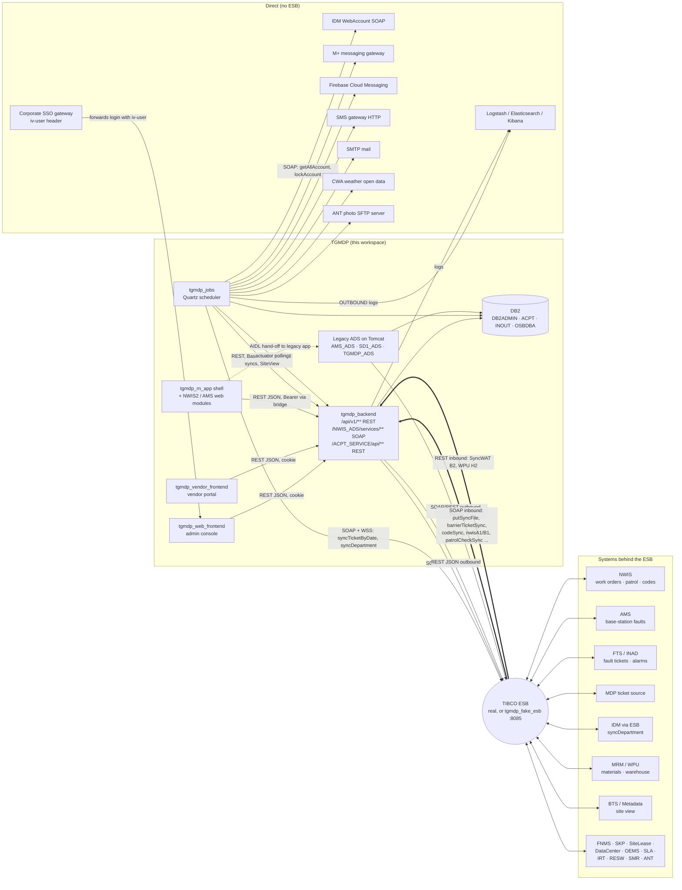

# Integration landscape

Up: [[System Overview]]

TGMDP is mostly an **integration system**. Most of its features show data owned elsewhere (NWIS work orders, AMS faults, FTS tickets, IDM people) or push data back. This note maps every external system the code talks to and the **direction** of each call. Use it before you open any ESB-related code.

How this map was built: from the call sites in `tgmdp_jobs`, the fake endpoints and inbound triggers in `tgmdp_fake_esb` (which mirror the real ESB contracts), `tgmdp_backend`'s CXF publish list (`config/CxfConfig.java`) and its env docs (`docs/Development_Setup.md`), plus the workspace docs `ESB_MAPPING.md`, `inbound_interfaces.md` and `HOWTORUN-local-side-by-side.md`. For backend-internal detail, see [[tgmdp_backend]].

## The diagram

Arrows point **from the caller to the callee**: the side that opens the connection. "Inbound" and "outbound" are from TGMDP's point of view.

Thick arrows (`==>`) mark **inbound** traffic: the ESB opens connections *into* TGMDP. These are the paths that need network ingress, firewall rules and server-side WS-Security validation.

## Call table

### Outbound through the ESB (TGMDP is the client)

| Target | Style | Example operations | Caller | Code / config |
|---|---|---|---|---|
| MDP | SOAP 1.2 + WSS | `syncTicketByDate` | jobs `SyncTicketAllData` | `tgmdp_jobs/.../service/mdp/MdpEsbSoapService.java:51-96` |
| IDM (ESB-fronted) | SOAP + WSS | `syncDepartment` | jobs `SyncOrgData` | `tgmdp_jobs/.../service/idm/IdmEsbSoapService.java`, `wsdl/IDM.wsdl` |
| NWIS (nwisMdp) | SOAP | `twmBaseStationQuery`, `patrolCheckReply`, `nwisAuthorityCheck` | backend (NWIS2) / legacy NWIS_ADS | `ESB_MAPPING.md` A1-A4 |
| AMS | SOAP | `amsAccountAuthorityCheck`, `barrierTicketDetailWeekCountListQuery`, `askAmsPatrolStatus` | backend / legacy SD1_ADS | `ESB_MAPPING.md` A3, B1-B2 |
| FTS / INAD | SOAP | `memberAccountCheck`, `askInadAlarmQuery` | backend / legacy SD1_ADS | `ESB_MAPPING.md` C1-C3 |
| BTS Metadata | SOAP | `syncMetadata` (SiteView) | backend, triggered by jobs `SiteViewSync` | `tgmdp_jobs/.../job/impl/bts/SiteViewSync.java:90-136` |
| AMS REST | REST JSON | `POST /ESB/AMSrestful/B1api` (open work ticket / material request) | backend `ams.apiB1.endpoint` | fake: `AmsToEsbController.java` |
| MRM / PMR | REST JSON | `/ESB/PMR/B4..E4api` | backend MRM module | fake: `MrmController.java` |
| WH / WPU | REST JSON | `/ESB/WPU/A1..G1api` | backend MRM/WH module | fake: `WpuController.java`, `WhController.java` |
| IRT, RESW, SMR, ANT, OEMS, SLA | REST JSON | `/ESB-towerload-B1api`, `/ESB/BSIRErestful/A1api`, `/SMRapi/*`, `/ANTapi/*`, `/OEMSapi/*`, `/esb_api/*` | backend / legacy SD1_ADS | `ESB_MAPPING.md` D1-D7; `tgmdp_backend/docs/Development_Setup.md` endpoint table |

### Inbound through the ESB (TGMDP is the server)

| Backend path | Style | Operations | Pushed by | Notes |
|---|---|---|---|---|
| `/NWIS_ADS/services/MDPService` | SOAP | `putSyncFile` (callback for `syncTicketByDate`), `syncTicketList` | ESB / MDP | Correlated by `mdpTransactionId`. See [[Trace - SyncTicketAllData ESB Round Trip]]. |
| `/NWIS_ADS/services/AMSService` | SOAP | `barrierTicketSyncByMinute`, `barrierTicketSyncByFile`, `codeSync` | AMS | fake triggers `/trigger/ams/*` |
| `/NWIS_ADS/services/FTSSoapHttpService` | SOAP | `codeSync`, `barrierTicketSync`, `fullFileSyncResult` | FTS | |
| `/NWIS_ADS/services/NwisMdpSoapHttpService` | SOAP | `patrolCheckSync`, `baseStationPatrolCheckSync`, `codeSync`, `formWorksSync` | NWIS | |
| `/NWIS_ADS/services/ACPTSoapService` | SOAP + base64 ZIP of CSV | `nwisA1` (vendors), `nwisB1` (work orders + PO) | NWIS, 3×/day for A1 | `inbound_interfaces.md` §2-3 |
| `/NWIS_ADS/services/{BtsSoapHttpService, MetadataSoapHttpService, DataCenterSoapHttpService, SkpSoapHttpService, SiteLeaseSoapHttpService, IDMService, RetuSoapHttpService}` | SOAP | `pushBtsResultInfo`, `putSyncFile`, `dataSyncReceive`, `pushIpmResultInfo`, `syncCode`, ... | various | publish list: `tgmdp_backend/.../config/CxfConfig.java:116-245` |
| `/ACPT_SERVICE/api/SyncWAT` | REST JSON | B2 work-order status | NWIS | Replies SUCCESS even for unknown tickets so the ESB queue isn't blocked (`inbound_interfaces.md` §4.5) |
| `/ACPT_SERVICE/api/WH/API_H2` | REST JSON | H2 MR audit-result callback | NWIS | project memory `h2-inbound-missing-mrul-audit` |

### Direct, no ESB

| Target | Direction | Caller | Code |
|---|---|---|---|
| IDM WebAccount (SOAP) | outbound | jobs `SyncAccountList` (get all, lock, leave-officer data) | `tgmdp_jobs/.../service/idm/IdmSoapService.java` (`esb.idm.url`) |
| Corporate SSO reverse proxy | inbound to the web tier: sets `iv-user` | browsers via SSO | faked by `tgmdp_fake_esb/.../controller/idm/IdmController.java:36-90` |
| M+ gateway | outbound | jobs `MplusSendMes`, `MplusVen*` (outbox drain) | `utils/utility/MplusUtility.java` |
| FCM | outbound | jobs `PushApp`, `MRMPush`, `AMS_PushAPP`, `FtsPushApp` | sharedModules `FcmService`; `logging/TargetSystem.java:12` |
| SMS gateway | outbound HTTP GET | jobs `SendSmsCheck`, monitors | `utils/utility/SMSUtility.java` (`SMS_PUSHURL` from `C_SET_DTL`) |
| SMTP | outbound | jobs mail services | `service/impl/MailServiceImpl.java`, `spring.mail.*` |
| CWA open data | outbound HTTPS | jobs `GetWeatherSite` | `job/impl/mdp/GetWeatherSite.java:30` |
| ANT SFTP server | outbound SFTP | jobs `DoAntPhotoUpload` | `job/impl/mdp/DoAntPhotoUpload.java:348` |
| Backend actuator / job OS metrics | outbound | jobs `MoniterWAS`, `MoniterOS` | `was-health.*` in `application.yml` |
| ELK | outbound (log shipping) | backend + jobs | `tgmdp_jobs/logstash/`, `log4j2-spring.xml` |

## Patterns to notice

1. **The ESB is the only door to most systems.** TGMDP never talks to NWIS or AMS directly. That is the [[Message Integration and ESB]] hub-and-spoke model, and it is why one fake ([[tgmdp_fake_esb]]) can stand in for a dozen systems.
2. **Two styles side by side.** Older services use SOAP with WSDL contracts and WS-Security. Newer ones use flat REST+JSON with status codes in the body. See [[SOAP vs REST]].
3. **Async request and callback.** Large syncs are "please start" outbound, then data arrives later inbound with a correlation id. See [[Asynchronous Request-Callback]].
4. **The scheduler is a clock, not a worker.** Several jobs only call the backend, which owns the ESB clients. See [[How Jobs Read and Write Data]].
5. **Outboxes instead of brokers.** M+, mail and SMS go through `STATUS` columns in DB2 tables, drained by jobs. See [[Outbox Pattern]].
6. **Inbound needs infrastructure.** An inbound path works only if the edge proxy forwards it. On staging, nginx forwarded only `/api/`, so `/NWIS_ADS` and `/ACPT_SERVICE` were 404'd at the edge (tell-tale sign: an nginx HTML 404, not Spring's JSON 404). See [[Environment Separation]].
7. **Know which ESB you are on.** The backend health check reports `esb=FakeESB` or `RealESB` from `METADATA_SOAP_ENDPOINT` (`tgmdp_backend/docs/Development_Setup.md:529-539`).

## Local wiring cheat-sheet

| Port | Process |
|---|---|
| 8080 | Tomcat with legacy ADS (JDK 8) |
| 8090 | `tgmdp_backend` (JDK 21) in the side-by-side setup |
| 8081 | `tgmdp_jobs` (its own default; Metro also uses 8081 in the RN setup, so don't run both) |
| 8085 | `tgmdp_fake_esb` |
| 5173 / 5174 / 5180 | ACPT / AMS / MRM vite dev servers |

Taken from `HOWTORUN-local-side-by-side.md` §1, plus each repo's `application.yml`. That doc also explains why emulators should reach the host via `adb reverse` + `127.0.0.1` and not `10.0.2.2`.

## Questions to check understanding

1. Pick any inbound row above. What must be true of the network, the proxy, and the backend's security config for it to work in a new environment?
2. Which external calls would still work if the ESB were down for an hour? Which jobs would raise alarms, and through which channel, given that some alarm channels are themselves external?
3. Why does the diagram have no arrow from NWIS straight to TGMDP?

## Related
- [[System Overview]] · [[tgmdp_backend]] · [[tgmdp_jobs]] · [[tgmdp_fake_esb]] · [[tgmdp_web_frontend]] · [[tgmdp_vendor_frontend]] · [[tgmdp_rn_app]]
- [[What an ESB Is]] · [[Why a Fake ESB Exists]] · [[Trace - SyncTicketAllData ESB Round Trip]] · [[How Jobs Read and Write Data]]
- [[Message Integration and ESB]] · [[SOAP vs REST]] · [[HTTP and REST]] · [[Client-Server Architecture]] · [[Scheduled Jobs and Batch Processing]] · [[Hybrid Mobile Apps]] · [[WebView and Native Bridge]]
- [[Gateway]] · [[Anti-Corruption Layer]] · [[Outbox Pattern]] · [[Asynchronous Request-Callback]] · [[WS-Security]] · [[Environment Separation]] · [[Authentication and Sessions]]
