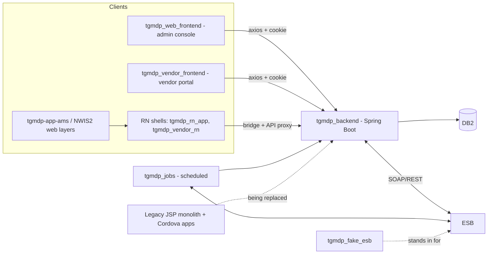

# System Overview

TGMDP/NWIS is a telecom field-operations platform: engineers, vendors and admins manage tickets, acceptance (工程驗收) and base-station faults. This workspace is a **rewrite in progress**. Legacy apps are being replaced piece by piece by a modern stack, and each piece is checked against the original for parity.

## The big ideas
1. **One backend, many clients.** `tgmdp_backend` exposes a URL prefix per audience, so it serves four client families ([[tgmdp_backend]], [[Layered Architecture]]).
2. **Two kinds of frontend.** Browser SPAs talk to the API directly. Mobile web layers talk through a native shell ([[Web Frontends Compared]], [[Mobile Architecture Overview]]).
3. **Integration by ESB.** Other corporate systems are reached over an Enterprise Service Bus ([[Integration Landscape]], [[Message Integration and ESB]]).
4. **Background work.** Scheduled jobs sync data on a timer ([[tgmdp_jobs]], [[Scheduled Jobs and Batch Processing]]).
5. **Testing against a fake.** A fake ESB lets you run everything locally ([[Why a Fake ESB Exists]], [[Mocking]]).
6. **Migration by parity.** The old systems stay the reference while features move over ([[Strangler Fig Migration and Legacy Parity]], [[Legacy Systems]]).

## Related
[[Home]] · [[Codebases MOC]] · [[Learning Path]] · [[Legacy to Modern MOC]]
