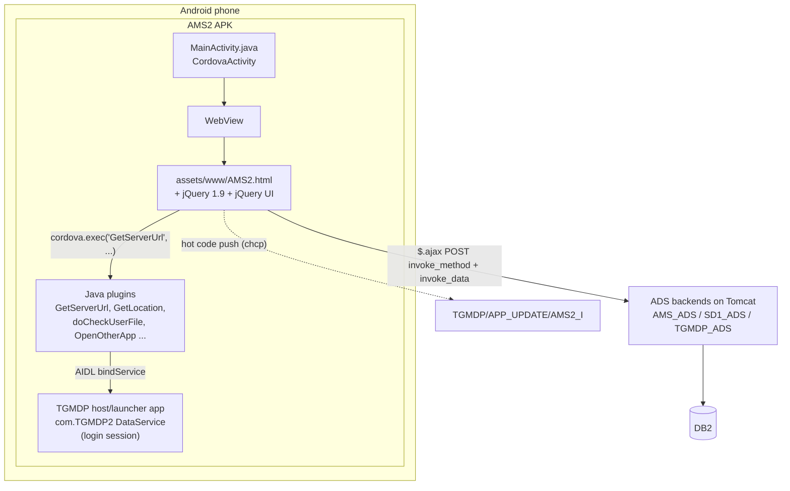

# Legacy Cordova App Anatomy

> How the legacy NWIS2 and AMS2 field apps are built: a Cordova WebView, one HTML shell, jQuery-loaded page fragments, global variables, and AJAX to the ADS backends. Up: [[Legacy Systems]] · [[System Overview]]

Both legacy field apps, [[niws2-app-legacy]] (base-station inspection) and [[ams2-app-legacy]]
(base-station fault tickets), are built the same way, almost file for file. Learn one and you can
read the other. This note uses AMS2 for its examples and points out where NWIS2 differs.

## What Cordova is

**Apache Cordova** wraps a folder of HTML, CSS and JavaScript in a native Android app. The app's
only screen is a full-screen **WebView** (an embedded browser). Native features (GPS, camera, phone
dialer, reading files, opening another app) are exposed as **plugins**: Java classes that
JavaScript calls through `cordova.exec(...)`. This is the classic [[Hybrid Mobile Apps]] approach,
and the plugin call is a [[WebView and Native Bridge]].



## Folder layout

All the app code is under the Android platform folder, not a top-level `www/`:

```
AMS2/platforms/android/app/src/main/
├── AndroidManifest.xml
├── res/values/strings.xml     # adapter_url, sd1_adapter_url, tgmdp_adapter_url
├── res/xml/config.xml         # <feature> list = registered Cordova plugins
├── java/com/AMS2/             # native plugins: GetServerUrl, GetLocation, DataServiceHelper ...
└── assets/www/                # the web app
    ├── AMS2.html              # the ONE html document (the shell)
    ├── menu.html              # home menu fragment
    ├── a001/ b001/ c001/ d001/ e001/ f001/      # one folder per home-menu item
    ├── ticketShare/ DataShare/ gnb/ HIWshare/ IronTower/   # shared sub-flows
    ├── js/
    │   ├── GlobeValue.js      # all global state objects
    │   ├── AMS2.js            # boot, navigation, back stack, logout
    │   ├── menu.js
    │   ├── utility/AdapterUtility.js   # the only HTTP client
    │   ├── utility/StringUtility.js, TimeUtility.js, HtmlTag.js, PushUtility.js ...
    │   └── a001/ c001/ ticketShare/ ...   # one JS file per HTML fragment
    ├── jqueryMobile/          # jquery-1.9.1, jquery-ui-1.9.2, swiper (vendored)
    ├── css/ images/
    └── chcp.json              # hot-code-push config
```

### Module folders and page naming

Each home-menu item is a folder named like a task code: `a001` (push inbox), `b001` (statistics),
`c001` (ticket search), `d001` (my tickets), `e001` (site data), `f001` (site location). Pages
inside follow the same suffixes as the web console: `Q1` query form, `M1` list/main, `I1` input,
`B1` browse. Every `xxx.html` has a matching `js/<folder>/xxx.js`. Shared flows (`ticketShare`,
`DataShare`) are reached from several menus. NWIS2 uses `a001 b001 b003 c001 d001` plus `share/`.

The code-by-folder naming mirrors the TGMDP console's `TGMDPa001` folders, which suggests the same
vendor and the same conventions built both.

## One HTML shell, many fragments

There is only one real HTML document, `AMS2.html`. It loads every script once and keeps an empty
`<div id="contentPage">`. Navigation means **replacing the inner HTML of that div** with another
file:

```html
<!-- ams2-app-legacy/AMS2/platforms/android/app/src/main/assets/www/AMS2.html:37-41, 53-63 -->
<form id="form1" name="form1" onsubmit="return false;">
    <div id="contentPage">
    </div>
...
<script src="js/GlobeValue.js"></script>
<script src="js/utility/HtmlTag.js"></script>
...
<script src="js/utility/AdapterUtility.js"></script>
<script src="js/AMS2.js"></script>
```

A fragment brings in its own script with a `<script>` tag at the top
(`c001/c001M1.html:1`: `<script src="js/c001/c001M1.js"></script>`). jQuery's `.load()` runs that
script when it inserts the fragment.

This is a hand-built **[[Single Page Applications]]** with no framework: no router, no components,
no virtual DOM. It looks like an SPA to the user because the document never reloads.

## A page object, and the global `currentPage`

Every page script follows one shape. It creates a namespace object for its own functions, and it
**overwrites** the global `currentPage.init` so the shell knows how to start the page after loading:

```js
// ams2-app-legacy/.../www/js/c001/c001M1.js:1-40 (trimmed)
var c001M1 = {};
c001M1.page = "./c001/c001M1.html";

currentPage.init = function() {
    _PAGE_OBJ.setPageName();
    _APP_DATA.resetWHERE_PARAM1();
    document.getElementById("top").scrollIntoView();
};

c001M1.goTicketList = function(){
    var site_id = document.getElementById("Q_SITE_ID").value;
    ...
    if(site_id!="" && site_id.length<5){ ShowMsg("基站編號至少輸入5碼。"); return; }
    _WHERE_PARAM1.READONLY = false;
    _WHERE_PARAM1.SITE_ID  = site_id;
    _WHERE_PARAM1.ZONE     = _USER_BEAN.ZONE;
    _WHERE_PARAM1.PAGE_NUMBER = 1;
    pagesHistory.push(c001M1.page);
    $("#contentPage").load("./ticketShare/TicketList.html", function(){
        currentPage.init();
    });
};
```

Read the last lines carefully, because this is the whole navigation model:

1. **Write the parameters for the next page into a global** (`_WHERE_PARAM1`). Pages never pass
   arguments to each other. They communicate through shared globals.
2. **Push the current page's path onto `pagesHistory`**, a global array used as a back stack
   (`js/AMS2.js:2`).
3. **Load the next fragment**, which overwrites `currentPage.init`, then call it.

Going back pops the stack and reloads that fragment (`js/AMS2.js:585-622`). Going home empties the
stack (`currentPage.menu`, lines 575-580). An empty stack on back asks "close the app?". Because a
page is re-created from its HTML each time, it must rebuild its state from the globals. That is
why the globals hold things like `PAGE_NUMBER` and `READONLY`.

```mermaid
sequenceDiagram
  participant U as User
  participant C as c001M1.js
  participant G as Globals (_WHERE_PARAM1, pagesHistory)
  participant S as #contentPage
  participant T as TicketList.js
  U->>C: tap 查詢
  C->>G: _WHERE_PARAM1.SITE_ID = ...; pagesHistory.push("./c001/c001M1.html")
  C->>S: $.load("./ticketShare/TicketList.html")
  S->>T: run TicketList.js (redefines currentPage.init)
  C->>T: currentPage.init()
  T->>G: read _WHERE_PARAM1
  T->>T: AdapterObject.invokeProcedure(...)
  U->>S: tap back
  S->>G: pagesHistory.pop() → "./c001/c001M1.html"
  S->>C: $.load(c001M1.html) → currentPage.init()
```

## Global state

`js/GlobeValue.js` declares the app's whole memory as plain global objects:

```js
// ams2-app-legacy/.../www/js/GlobeValue.js:2-24, 362-376, 393-405 (trimmed)
var _APP_DATA = {
    APP_NAME:"基站障礙", VER_NUM:"2.015",
    TIMEOUT_SEC:"1800",          // background timeout
    ADAPTER_URL:"", SD1_ADAPTER_URL:"", TGMDP_ADAPTER_URL:"",
    AUTH_TOKEN:"", TOKENEXP_TIME:"", DEVICE_UUID:"",
    ...
};
var _USER_BEAN = {
    USER_ID:"", USER_NAME:"", ROLE_NAME:"",
    ZONE:"",        // derived from ROLE_NAME
    ORG_ID:"", INAD_AUTH:""
};
var _WHERE_PARAM1 = {
    READONLY:true, TICKET_ID:"", ZONE:"", VTYPE:"", NOW_STATUS:"",
    SITE_ID:"", SITE_NAME:"", PAGE_NUMBER:1, QUERY_TYPE:""
};
```

Others include `_ZONE_DATA`, `_PARAM_DATA`, `_TICKET_DATA`, `_PHOTO_LIST`, `_WHERE_PARAM2..4`
and loose variables like `_SEL_FAULT_ID`. NWIS2 has the same idea (`_APP_DATA`, `_USER_BEAN`,
`_TEMPLATE_LIST`, `_TEMP_RF`).

This is [[Client State Management]] at its simplest. Any function can read or write anything, so
it is quick to write and very hard to reason about: you cannot tell which page last changed
`_WHERE_PARAM1.READONLY` without searching the whole codebase. The modern AMS app replaces these
with typed Zustand stores and URL search params (see
[[Cordova+jQuery vs RN Shell + React Web Layer]]). That is the [[Store Pattern]] with clear
owners.

## AJAX: one function for every backend call

`js/utility/AdapterUtility.js` is the only HTTP client. Each call adds the three credentials and
posts a form:

```js
// ams2-app-legacy/.../www/js/utility/AdapterUtility.js:25-33, 57-62
invokeProcedureGeneric: function(__url, __method, __data, __success, __error, __timeout) {
    __data.VERIFY_USER_ID = _USER_BEAN.USER_ID;
    __data.VERIFY_UUID    = _APP_DATA.DEVICE_UUID;
    __data.VERIFY_TOKEN   = _APP_DATA.AUTH_TOKEN;
    var requestData = { invoke_method: __method, invoke_data: JSON.stringify(__data) };
    var preTimeout = 60000;  // default timeout one minute
    ...
    $.ajax({
        type: "post", url: __url, data: requestData, dataType: "json",
        contentType: "application/x-www-form-urlencoded; charset=" + charset,
```

- `invokeProcedure` → `ADAPTER_URL` (AMS_ADS), `invokeProcedureToSD1` → `SD1_ADAPTER_URL`,
  `invokeProcedureGeneric(TGMDP_ADAPTER_URL, …)` → TGMDP_ADS (lines 14-24).
- On success it scans the **stringified body** for the text `token已過期` or `裝置資訊失效`
  (lines 70-76) and, if found, shows a dialog and either exits the app or returns to the TGMDP
  launcher. Session expiry is detected by string matching.
- Callbacks, not promises. Every caller passes a success and an error function. Long flows nest
  callbacks inside callbacks.

The backend side of this protocol is described in [[Legacy ADS Adapter Backends]].

## DOM manipulation: HTML built as strings

Results are rendered by concatenating HTML strings and assigning `innerHTML`:

```js
// ams2-app-legacy/.../www/js/ticketShare/TicketList.js:41-45, 190-201 (trimmed)
if(__data.RTN_DATA.DATA_LIST1.length > 0){
    document.getElementById("12_TITLE").innerHTML = "&nbsp;待接工(" + __data.RTN_DATA.DATA_COUNT1 + "件)";
    document.getElementById("12_FIELDSET").style.display = "";
    next_func1(__data.RTN_DATA.DATA_LIST1, "12_TABLE", "12");
}
...
option += "<tr><td class='word_ellipsis' colspan='2'>" + __data[i].TICKET_SRC + "&nbsp;" +
          "<span class='td_must'>(" + __data[i].ALARM_ID + ")</span> " + __data[i].MSG + "</td></tr>";
option += "<tr><td colspan='2'>處理人員：" + __data[i].OM_USER_NAME + "</td></tr>";
...
table.innerHTML += option;
```

Three things to see:

- **Server data goes into `innerHTML` unescaped.** If a ticket message ever contained ``, it would run. React's JSX escapes by default.
- **Event handlers are strings** (`onclick='TicketList.go_TicketDetail("...")'`), so they can only
  call global functions. That is another reason everything is global.
- **IDs are built from data** (`"12_TABLE"`, `name + i`). Logic and markup are tangled, and a
  test would need a full DOM.

jQuery UI supplies dialogs (`$('#DIALOG').dialog({...})`) and jQuery handles toggles and AJAX. The
toolkit is jQuery 1.9.1 and jQuery UI 1.9.2 from 2013, vendored in `jqueryMobile/`.

## Native plugins and the launcher

- `GetServerUrl` reads the three adapter URLs from `res/values/strings.xml` and hands them to JS
  (`niws2-app-legacy/NWIS2/platforms/android/app/src/main/java/com/NWIS2/GetServerUrl.java:20-36`).
  **Environments are switched by commenting lines in and out of `strings.xml`.** There are several
  commented-out URL blocks, one per environment ([[Environment Separation]]).
- `DataServiceHelper` binds over Android **AIDL** to the TGMDP launcher app's `DataService` and
  calls `getData("userData")` to get the logged-in user. AMS2 and NWIS2 have **no login of their
  own**. The launcher (`niws2-app-legacy/TGMDP2/`, another Cordova app) does login + OTP and the
  others borrow its session.
- `OpenOtherApp` jumps between the TGMDP family of apps.

## Updates without the Play Store: hot code push

`www/chcp.json` configures the `cordova-hot-code-push` plugin. Its `content_url` points at
`https://tgmdpweb.taiwanmobile.com:9443/TGMDP/APP_UPDATE/AMS2_I`, which is served by the legacy
TGMDP web app. That is also why `IPFilter` lets `/APP_UPDATE` through without an IP check (see
[[WebWork Request Flow]]). The app downloads new `www` files and swaps them in at runtime, so
JS-only fixes ship without a new APK. The modern RN shell does the same job with downloaded web
bundles.

## Why it was built this way

- **One web skill set for two platforms.** Cordova let a team of web/JSP developers ship Android
  (and in principle iOS) apps without writing native UI.
- **Fragments + globals is the simplest thing that works** with jQuery: no build step, no bundler,
  no transpiler. Edit a file and reload.
- **Hot code push** made field fixes quick at a time when app-store review was slow.

## What it costs

- No types, no modules, no tests, no linter. Every name is global and every contract is implicit.
- Logic, data access and markup live in one file per page (`TicketDetail.js` is 94 KB).
- WebView performance and an old jQuery version limit the UI. The look is "a web form on a phone."
- The app depends on a specific launcher app over AIDL, which is Android-only.

## Try it yourself

1. Open `js/ticketShare/TicketList.js` and list every global it reads or writes. Which other pages
   write the same globals?
2. Follow `currentPage.goback` in `js/AMS2.js:585`. What happens to `_WHERE_PARAM1` when you go back
   from the ticket list to `c001M1`?
3. Find where `_USER_BEAN.ZONE` is set (hint: `menu.js` parses it from `ROLE_NAME`). What breaks if
   `ROLE_NAME` has no zone in parentheses? (The README's local-dev bypass #1 answers this.)

## Related

- Up: [[Legacy Systems]] · [[System Overview]]
- Apps: [[niws2-app-legacy]] · [[ams2-app-legacy]]
- Backend: [[Legacy ADS Adapter Backends]]
- Modern comparison: [[Cordova+jQuery vs RN Shell + React Web Layer]] · [[Server-rendered JSP vs React SPA]]
- Concepts: [[Hybrid Mobile Apps]] · [[WebView and Native Bridge]] · [[Single Page Applications]] · [[Client State Management]] · [[Store Pattern]] · [[Routing]] · [[Component-Based UI]] · [[HTTP and REST]] · [[Environment Separation]] · [[Configuration and Environments]] · [[Authentication and Sessions]] · [[Over-the-Air Updates]]
