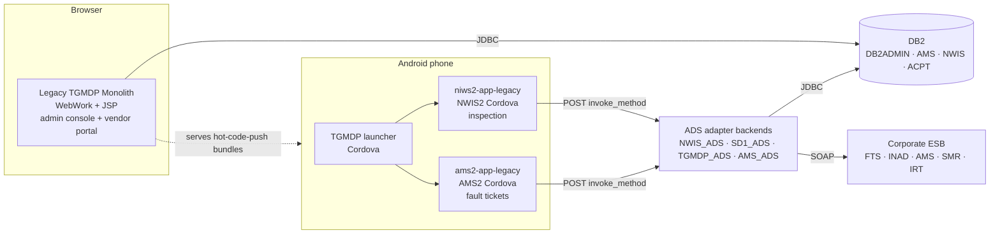

# Legacy Systems

> Map of content for the legacy code in the NWIS workspace: the systems the modern stack is replacing. Up: [[System Overview]]

The NWIS workspace holds two generations of the same product. The **modern** generation is
Spring Boot (`tgmdp_backend`), React web consoles (`tgmdp_web_frontend`, `tgmdp_vendor_frontend`),
a React Native shell (`tgmdp_rn_app`) and React web layers for the field apps (`tgmdp-app-nwis2`,
`tgmdp-app-ams`). The **legacy** generation, documented here, is what those replace. It is still
running in production next to the new code, on the **same DB2 database**, and it is the
**specification**: the rule for every rebuilt module is "behave exactly like legacy unless the
business signs off on a difference."

That makes the legacy code worth learning even though nobody adds features to it. You read it to
find out what the system is *supposed* to do.

## The three legacy systems

| System | What it is | Repo map |
|---|---|---|
| TGMDP monolith | Server-rendered web console (168 modules) + vendor portal + ACPT/MRM services, WebWork/XWork + JSP + JDBC | [[Legacy TGMDP Monolith]] |
| NWIS2 | Cordova-Android base-station **inspection** app + its ADS backends + the TGMDP launcher app | [[niws2-app-legacy]] |
| AMS2 | Cordova-Android base-station **fault ticket** app + its ADS backends | [[ams2-app-legacy]] |

## Cross-cutting notes

| Note | Read it to learn |
|---|---|
| [[WebWork Request Flow]] | Classic server-side MVC: filter → front controller → XWork mapping → interceptors → Action → JSP |
| [[FrontControllerFilter and ButtonBean Permissions]] | Hand-built role/button authorization stored in the HTTP session |
| [[Legacy Data Access with DBDAO]] | Raw JDBC wrapper, hand-built SQL, manual transactions, DB2 paging, stored procedures |
| [[Legacy ADS Adapter Backends]] | RPC-over-HTTP backends for the mobile apps; one servlet, one big dispatcher |
| [[Legacy Cordova App Anatomy]] | Cordova shell, `www/` module folders, jQuery fragments, globals, AJAX, native plugins |

## Suggested reading order

1. [[Legacy TGMDP Monolith]], then [[WebWork Request Flow]]. This is the clearest example of the
   old architecture.
2. [[Legacy Data Access with DBDAO]]. The same data layer is used by every legacy system.
3. [[FrontControllerFilter and ButtonBean Permissions]]. You need it to understand why the modern
   authorities look like `TASK_TGMDPa002:browse`.
4. [[Legacy ADS Adapter Backends]] and [[Legacy Cordova App Anatomy]]. The mobile side.
5. [[niws2-app-legacy]] and [[ams2-app-legacy]] for the concrete apps.
6. Then cross over to [[Legacy to Modern MOC]] for the comparisons.

## Common traits (and why they matter)

- **One home-grown framework, copied everywhere.** The `com.sys` package (DBDAO, PageBreak,
  ButtonBean, IniValue, LogUtility) appears in every Java project. There is no shared library and
  no dependency manager. Jars are checked into `WEB-INF/lib`.
- **Task codes as the backbone.** `TGMDPa002`, `a001`, `c001`: the same code names the URL, the
  folder, the class and the permission. The modern code keeps those codes in authorities, feature
  folders and comments, which is what makes old-to-new tracing possible.
- **No automated tests anywhere.** Verification was manual. The modern repos enforce coverage
  gates, so the rebuild also adds the safety net the legacy never had.
- **Shared DB2, shared tables.** Every legacy system and the new backend read and write the same
  database. Old and new can run side by side, and a module can be switched over one at a time. It
  also means a write from the new system must look exactly like a write from the old one.
- **Business rules in three places.** In Java SQL strings, in DB2 functions/procedures, and in page
  JavaScript (for example the N/M zone rule in AMS2). A rebuild that reads only one layer misses
  rules.

## Where the legacy code lives on disk

| Path in `NWIS_Legacy/` | Contents |
|---|---|
| `legacy/TGMDP/`, `legacy/TGMDP_legacy_new/` | Admin console (second copy has a Docker run setup) |
| `legacy/tgmdp_vendor_legacy/` | Vendor portal |
| `legacy/ACPT_ADS/`, `legacy/ACPT_SERVICE/`, `legacy/MRM_ADS/` | Acceptance and material-requisition backends |
| `legacy/AMS2/` | Local-run copy of the AMS2 app |
| `niws2-app-legacy/` | NWIS2 app + TGMDP2 launcher + NWIS/SD1/TGMDP/AMS ADS |
| `ams2-app-legacy/` | AMS2 app + AMS/SD1/TGMDP ADS |

## Related

- Up: [[System Overview]]
- Next: [[Legacy to Modern MOC]]
- Concepts: [[MVC]] · [[Front Controller]] · [[Server-Side Rendering]] · [[Hybrid Mobile Apps]] · [[DB2]] · [[Strangler Fig]] · [[Monorepo vs Polyrepo]] · [[Testing Pyramid]]
