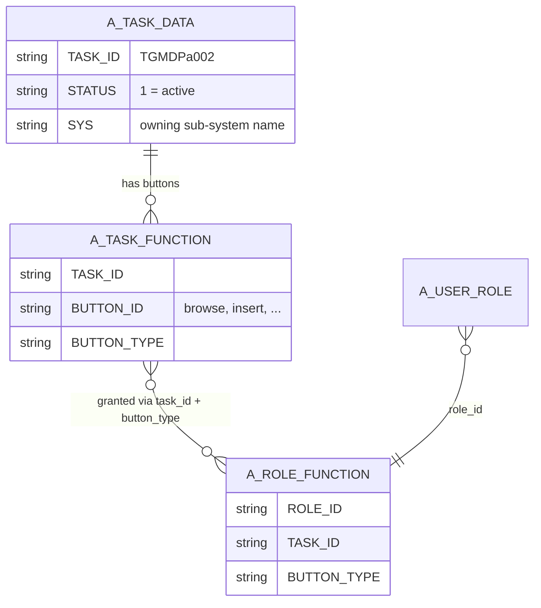
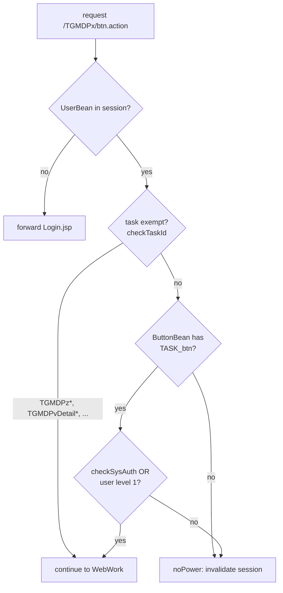

# FrontControllerFilter and ButtonBean Permissions

> How the legacy console decides *who* may press *which* button. Up: [[Legacy TGMDP Monolith]] · [[System Overview]]

Every TGMDP page is a set of **buttons** (begin, browse, select, insert, update, delete, export…).
The legacy security model is built around that idea: a permission is a string
`"<TASK_ID>_<BUTTON_ID>"`, for example `TGMDPa002_browse`. Roles grant buttons, users have roles,
and at login the full list of granted strings is computed once and stored in the HTTP session in a
`ButtonBean`. After that, a servlet filter checks the string on every `*.action` request.

This is [[Authorization and RBAC]] done by hand. It is worth learning in detail because the modern
backend copies the same algorithm (see [[Session ButtonBean vs JWT Authorities]]).

## Data model

Four tables in schema `DB2ADMIN` take part:



I inferred the relationships from the join in `ButtonBean.initButtonBean`. I did not read the DDL,
and `A_USER_ROLE` comes from the modern `JwtService`, not the legacy login code. Note the join goes
through **`button_type`**, not `button_id`. A role grants a *type* of button, and every button of
that type on the task comes with it.

## Step 1: build the permission list at login

`Login.begin` checks the password, builds the menu, then builds the ButtonBean and puts both beans
in the session:

```java
// legacy/TGMDP/src/com/prj/login/Login.java:59-64
ButtonBean buttonbean = new ButtonBean();
buttonbean.initButtonBean(userbean);

session = request.getSession();
session.setAttribute("UserBean", userbean);
session.setAttribute("ButtonBean", buttonbean);
```

`initButtonBean` runs one query and flattens the result into strings:

```java
// legacy/TGMDP/src/com/sys/presentation/ButtonBean.java:51-75 (trimmed)
String sql = "select distinct a.TASK_ID, b.BUTTON_ID " +
  "from A_TASK_DATA a inner join A_TASK_FUNCTION b on a.task_id = b.task_id " +
  "inner join (select * from A_ROLE_FUNCTION where ROLE_ID in ( "+ role +" )) c " +
  "on b.task_id = c.task_id and b.button_type = c.button_type " +
  "where a.status = '1' order by a.TASK_ID, b.BUTTON_ID";
...
if(taskId.equals("") || !taskId.equals(hm.get("TASK_ID").toString())) {
    map = hm.get("TASK_ID").toString() + "_" + "begin";   // implicit "begin"
    setButton(map);
}
map = hm.get("TASK_ID").toString() + "_" + hm.get("BUTTON_ID").toString();
setButton(map);
```

Two details:

- **`role` is a list of `?` placeholders** built in a loop, one per role. That is the safe way to
  do `IN (...)` with JDBC. The SQL is concatenated, but the values are still bound parameters.
- **`begin` is implicit.** If you have *any* button on a task, you also get `<TASK>_begin`, which
  is the permission to open the page at all.

## Step 2: check every request in the filter

`FrontControllerFilter` reads the URI `/TGMDP/TGMDPa002/browse.action` as `task_id=TGMDPa002` and
`action=browse`, then:

```java
// legacy/TGMDP/src/com/sys/filter/FrontControllerFilter.java:58-66, 106-114 (trimmed)
if (userID == null) {                 // not logged in or session timed out
    noUser(request, response);        // invalidate session, forward to /common/Login.jsp
    ...
}
button = (ButtonBean) session.getAttribute("ButtonBean");
button.setTask_Id(task_id);
button.setButton_Id(action);
...
if (checkTaskId(task_id)) {
    if (!button.checkButton(action) ||
        (!button.checkSysAuth(userID.getAuthList()) && !userID.getUserLVL().equals("1"))) {
        noPower(request, response);   // invalidate session, back to login
```

and `checkButton` is a list lookup:

```java
// legacy/TGMDP/src/com/sys/presentation/ButtonBean.java:161-165
public boolean checkButton(String button) {
    String map = this.task_id + "_" + button;
    this.nowButton = button;
    return buttonList.contains(map);
}
```



Extra rules hidden in the filter:

- **Exempt tasks.** `checkTaskId` skips the button check for task ids that start with `TGMDPz`,
  `TGMDPvDetail`, `TGMDPvAtt` and `TGMDPupic` (`FrontControllerFilter.java:212-218`). These are
  shared popups and utility pages.
- **Sub-system licence.** `checkSysAuth` (`ButtonBean.java:172-232`) reads `A_TASK_DATA.SYS` and
  checks that the user's app authorisations contain the right system, for example the 鐵塔載重
  (tower load) pages need 基站巡檢 or 基站障礙. It **opens its own DB connection on every request**,
  which is an easy performance cost to miss.
- **Level 1 users** (system administrators) skip the sub-system check.
- **Failure ends the session.** `noPower` calls `session.invalidate()`, so the user is logged out,
  not shown a 403 page.
- The filter also resets or copies the paging/sort hidden fields (`whereParam`, `numParam`,
  `orderParam`) into request attributes (lines 89-152). Security and paging state are mixed in one
  class.

## Step 3: the JSP hides buttons

The JSP reads the same bean to decide which buttons to draw
(`legacy/TGMDP/TGMDP/TGMDPa002/TGMDPa002Q1.jsp:10`:
`ButtonBean button = (ButtonBean)session.getAttribute("ButtonBean");`). Hiding the button is only
cosmetic. The filter is the real gate.

The parity reviews found that this is **not true everywhere**. For example, the ACPT accepted-
deviation sheet for `TGMDPs009` records that "legacy's action methods have no server-side
permission check at all — only the JSP buttons are gated"
(`acpt_parity_review/TGMDPs009_工程驗收查詢作業_accepted-deviations.md`, row 1). In that case the
rebuild is *stricter* than legacy, and the business signs off on the difference.

## Why it was built this way

- **Buttons are the unit the business understands.** Admins grant "this role may export from
  TGMDPa002." A string per button maps exactly to an admin screen.
- **Compute once, check cheaply.** The list is built at login, and a check is a `contains` on an
  in-memory list.
- **Server session = trust.** The bean lives in the session on the server, so the client cannot
  forge it. The cost is that the server is **stateful** ([[Stateless vs Stateful]]): it needs sticky
  sessions or session replication to scale, and a role change only applies after the next login.

## What to watch out for

- The permission check lives in a **filter that parses URLs by hand** (`uri[len-1]`). An action
  served from another path shape (servlets in `com.prj.ajax.*`, mapped in `web.xml`) is **not**
  covered, because the filter mapping is only `*.action`. Every AJAX servlet has to protect itself.
- Permission strings are built by concatenation in three places (login, filter, JSP). A typo in a
  `BUTTON_ID` in the DB silently hides a button.

## Questions to check understanding

1. A user has role R that grants `button_type = Q` on `TGMDPa002`. Which `BUTTON_ID`s do they get?
   Do they get `TGMDPa002_begin`?
2. Why does `/TGMDP/AJAXchk_Holiday` not pass through the ButtonBean check?
3. An admin removes a role from a logged-in user. When does the user lose access, and why?

## Related

- Up: [[Legacy TGMDP Monolith]] · [[System Overview]]
- Sideways: [[WebWork Request Flow]] · [[Legacy Data Access with DBDAO]]
- Modern comparison: [[Session ButtonBean vs JWT Authorities]] · [[WebWork Actions vs Spring Controllers]]
- Concepts: [[Authorization and RBAC]] · [[Authentication and Sessions]] · [[Stateless vs Stateful]] · [[Interceptor and Filter Chain]] · [[Front Controller]] · [[Cookies and CSRF]] · [[Defensive Programming]]
