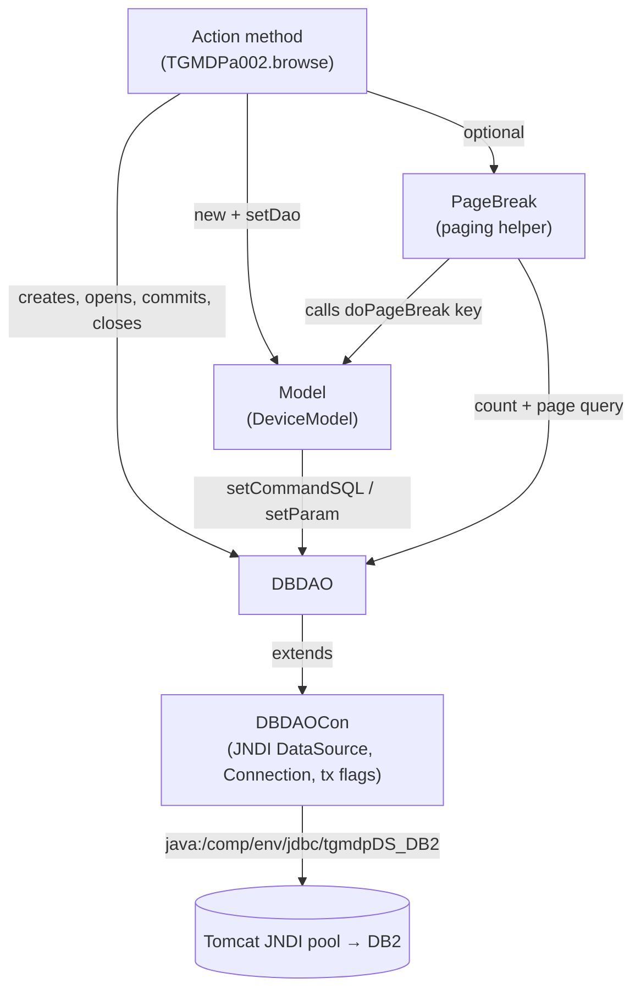

# Legacy Data Access with DBDAO

> How legacy TGMDP code talks to DB2: a home-made JDBC wrapper, hand-built SQL, a few stored procedures. Up: [[Legacy TGMDP Monolith]] · [[System Overview]]

There is **no ORM** in the legacy systems. No Hibernate, no JPA, no entity classes. Every query is
a SQL string written by hand in a "Model" class and run through one wrapper class, `DBDAO`. Rows
come back as `ArrayList<Map<String,String>>`, a list of untyped string maps. The same wrapper
(the `com.sys.integration` package) is copied into the monolith, the vendor portal and every ADS
backend, so once you understand it here you can read data access anywhere in the legacy code.

## The layers



| Class | Role | File |
|---|---|---|
| `DAOFactory` / `DBDAOFactory` | Creates a DAO by name using `Class.forName("com.sys.integration." + name + "DAOFactory")` | `legacy/TGMDP/src/com/sys/integration/DAOFactory.java:5-14` |
| `DBDAOCon` | Looks up the JNDI `DataSource`, opens one `Connection` with auto-commit **off**, tracks commit state | `legacy/TGMDP/src/com/sys/integration/DBDAOCon.java` |
| `DBDAO` | Holds one SQL string + a list of bind params; `search()`, `executeModify()`, `executeSP()`, paging per DB vendor | `legacy/TGMDP/src/com/sys/integration/DBDAO.java` |
| `Model` | Abstract base: holds `dao`, `resultData`, `pb` | `legacy/TGMDP/src/com/sys/presentation/Model.java:8-39` |
| `PageBreak` | Runs a count query and a page query for a model method chosen by a string key | `legacy/TGMDP/src/com/sys/presentation/PageBreak.java` |
| `com.prj.models.*` | 108 business classes full of SQL | e.g. `legacy/TGMDP/src/com/prj/models/DeviceModel.java` |

## One connection per action, transaction by hand

The connection opens with auto-commit off, and closing it **rolls back** anything not committed:

```java
// legacy/TGMDP/src/com/sys/integration/DBDAOCon.java:88-92, 111-116
con = ds.getConnection();
dbType = con.getMetaData().getDatabaseProductName();
con.setAutoCommit(false);
...
public void closeConnection() {
    if (isOpen()) {
        // 若未commit，則先執行rollback   (if not committed, roll back first)
        rollback();
```

So every Action method has the same pattern. The **Action is the transaction boundary**:

```java
// legacy/TGMDP/src/com/prj/actions/tgmdpa/TGMDPa002.java:64-68, 118-125 (shape)
DBDAO dao = (DBDAO) daoFactory.creatDAO("DBDAO");
try {
    dao.open();
    // ... many model calls sharing this dao ...
    dao.commit();                 // only in write methods, e.g. line 756
} catch (Exception e) {
    dao.rollback();
    ExceptionResolver.handle(this.getClass(), e, request, dao);
} finally {
    dao.close();
}
```

This is the job Spring's `@Transactional` does for you. Here it is written out in every method, and
forgetting `commit()` silently throws away your write ([[Database Transactions]]).

## Writing a query: dynamic WHERE + bind parameters

A Model method builds the WHERE clause piece by piece. For each filter the user filled in, it
appends a fragment with a `?` and pushes the value onto the param list **in the same order**:

```java
// legacy/TGMDP/src/com/prj/models/DeviceModel.java:268-281
if(__hm.get("NODE_ID1") != null && !__hm.get("NODE_ID1").toString().equals("")){
    where.append(" and org.NODE_ID1 = ? ");
    if (__dobreak)
        pb.setParam(__hm.get("NODE_ID1").toString());
    else
        dao.setParam(__hm.get("NODE_ID1").toString());
}
if(__hm.get("NODE_ID2") != null && !__hm.get("NODE_ID2").toString().equals("")){
    where.append(" and org.NODE_ID2= ?");
    if (__dobreak)
        pb.setParam(__hm.get("NODE_ID2").toString().split("_")[1]);
```

then joins it to the SELECT:

```java
// legacy/TGMDP/src/com/prj/models/DeviceModel.java:403-413
    + "FROM DB2ADMIN.B_DEVICE_MST MST "
    + "LEFT JOIN DB2ADMIN.C_DEVICE_LOG LOG ON MST.DEVICE_UUID = LOG.UUID "
    + "LEFT JOIN A_USER_DATA U ON MST.OWNER=U.USER_ID "
    + "LEFT JOIN VW_ORG_DATA ORG ON U.ORG_ID = ORG.ORG_ID "+
    " where " + where.toString() + " ";
if (__dobreak) {
    pb.setCommandSQL(sql);
    pb.setOrderSQL("OWNER,DEVICE_UUID,CONNECT_TITLE");
    this.resultData = pb.doSearch();
```

The good part: **user values are bound as `?` parameters**, so this is not SQL-injectable by
itself. The fragile part: the SQL text and the param list are two separate structures that must
stay in step. Add a `?` without a `setParam` and every following parameter shifts by one.

Some schemas are qualified (`DB2ADMIN.B_DEVICE_MST`) and some are not (`A_USER_DATA`). Unqualified
names resolve against the connection's `currentSchema`. The AMS ADS backend breaks with
`SQLCODE=-204` if that is set wrong (see [[ams2-app-legacy]]).

## Running it: `search()` and `makeTO()`

```java
// legacy/TGMDP/src/com/sys/integration/DBDAO.java:68-75, 612-640 (trimmed)
stmt1 = con.prepareStatement(cmdSQL, ResultSet.TYPE_SCROLL_INSENSITIVE, ResultSet.CONCUR_READ_ONLY);
setSQLParam();
sql_instruction = getRealSQL();      // a copy with values pasted in, for logging only
ResultSet rs = stmt1.executeQuery();
al = makeTO(rs);
...
while (rs.next()) {
    newData = new LinkedHashMap();
    for (int i = 1; i < meta.getColumnCount() + 1; i++) {
        if (rs.getString(meta.getColumnName(i)) != null) {
            // Timestamp → "2010/01/01 13:01:01", everything else → String
            newData.put(key.toUpperCase(), value);
        } else {
            newData.put(meta.getColumnName(i).toUpperCase(), "");   // NULL becomes ""
```

`makeTO` ("make transfer object") turns every row into a `Map` of **upper-case column name →
String**. NULL becomes the empty string, and timestamps are formatted as `yyyy/MM/dd HH:mm:ss`.
These conversions matter for parity work: when the new backend returns `null` or ISO dates, the
screen can differ from legacy even though the data is the same.

`getRealSQL()` (lines 673-703) pastes the parameter values into the SQL text with quotes. It is
used only for the log line on error (`ExceptionResolver` prints it), never executed, but it does
mean user data ends up in logs ([[Logging and Observability]]).

## Paging: one method per database vendor

`PageBreak` runs `select count(*) from (<sql>) pb` (`PageBreak.java:335`) and then
`dao.search(pageRecords, pageNumber)`, which picks an implementation by the **product name the
JDBC driver reports**:

```java
// legacy/TGMDP/src/com/sys/integration/DBDAO.java:149-158
String type = this.getDBType();
if (type.equals(IniValue.ORACLE)) { al = searchORACLE(pageRecords, pageNumber); }
if (type.equals(IniValue.MSSQL))  { al = searchMSSQL(pageRecords, pageNumber); }
if (type.equals(IniValue.DB2_1) || type.equals(IniValue.DB2_2)) {   // "DB2/NT", "DB2/NT64"
    al = searchDB2(pageRecords, pageNumber);
}
```

The DB2 version wraps your SQL in a window function:

```java
// legacy/TGMDP/src/com/sys/integration/DBDAO.java:272-274
String selectSQL = "select pb2.* from ( " +
    "select ROW_NUMBER() OVER ( order by " + odrSQL + " ) as ROW_NUM, pb.* " +
    "from ( " + cmdSQL + " ) pb ) pb2 where pb2.ROW_NUM > " + start + " and pb2.ROW_NUM <= " + end;
```

**A real-world trap:** only the Windows DB2 names `DB2/NT` and `DB2/NT64` are recognised
(`IniValue.java:34-35`). A Linux DB2 reports something else, so no branch matches, `search`
returns `null`, and **every paged list breaks**. The local-dev setup for the mobile backends works
around it with a DataSource shim that reports `DB2/NT64` (`ams2-app-legacy/README.md` §5, row 3).
Hard-coding an environment detail like this is the kind of hidden coupling that makes legacy code
hard to move ([[Configuration and Environments]]).

Note also that `odrSQL` (the ORDER BY) is **concatenated**, not bound. Bind parameters cannot hold
column names, so this is normal, but any code path that lets a request parameter reach
`setOrderSQL` needs an allow-list ([[Defensive Programming]]).

Another trap: `PageBreak` calls the model through a **string key**, and the key does not have to
match the method name. `pb.setModel(devicemodel, "browseMAC")` in `TGMDPa002.java:179` ends up in
`DeviceModel.doPageBreak`, which sends `"browseMAC"` to `browseDevice_A2(...)`, not to the method
called `browseMAC` (`DeviceModel.java:9-10`). Reading the code by method name sends you to the
wrong SQL.

## Stored procedures and DB2 functions

Most logic is in Java SQL strings, but some lives in the database:

```java
// legacy/TGMDP/src/com/prj/models/StatisticsModel.java:190-194
public void call_SP_C002(Map __hm) throws Exception {
    String sql = "call DB2ADMIN.SP_C002(?,?,?,?)";
    dao.setParam(__hm.get("START_DATE").toString());
    dao.setParam(__hm.get("END_DATE").toString());
    dao.setParam(Integer.parseInt(__hm.get("INTERVAL").toString()));
```

```java
// legacy/ACPT_ADS/src/com/prj/models/CtiModel.java:1325-1330
public void execCopyProcedure(String __ctim_id) throws Exception {
    String sql = "CALL ACPT.ACPT_COPY_CTI_DATA(?)";
    dao.setCommandSQL(sql);
    dao.setParam(__ctim_id);
    dao.executeModify();
}
```

There is no `CallableStatement` and no OUT parameter handling. Procedures are called through the
same `PreparedStatement` path (`executeSP()` at `DBDAO.java:506-536` is the same code as
`executeModify()`). Scalar **DB2 user-defined functions** also appear inside queries, for example
`select ACPT.ACPT_CTI_WNAME_ID(?) as cti_wname_id from SYSIBM.dual`
(`legacy/tgmdp_vendor_legacy/src/com/prj/models/CtiModel.java:341`) or
`ACPT.ACPT_IS_CONSENT_SIGNER_WEB(a.CONSENT_ID, b.SIGNER_LEVEL, ?) = 1` in a WHERE clause
(`legacy/TGMDP_legacy_new/src/com/prj/models/ConsentModel.java:267`).

Business rules inside DB functions are invisible to someone reading only Java. The rebuild has to
call the same functions, and the team has hit DB2-specific errors doing it: unqualified function
calls failing with `-440` (the function path is not the current schema), untyped `?` markers
typed too narrowly (`-302`), and sentinel values of the wrong type inside `IN (...)` (`-420`).
These are recorded in the project's memory graph. See [[DB2]].

## Why it was built this way

- **JDBC was the standard tool.** In the mid-2000s, a thin in-house wrapper over JDBC was a normal
  choice, and it kept every query visible and tunable by a DBA.
- **Reports and search screens are SQL-shaped.** Dynamic filters, multi-table joins and views
  (`VW_ORG_DATA`) are easier to write as SQL than as ORM mappings, so the rebuild still writes much
  of this SQL by hand (see [[DBDAO vs Spring Data Repositories]]).
- **One DB, many apps.** The same DB2 instance serves the console, the vendor portal, the ADS
  backends and now the new backend. Shared views and procedures were a way to reuse logic across
  apps written separately.

## What it costs

- **No types.** `hm.get("TICKET_ID").toString()` throws a NullPointerException if a column is
  renamed. The compiler cannot help ([[Type Systems]], [[Serialization and DTOs]]).
- **No tests.** You cannot run a model without a live DB2 ([[Unit Testing]], [[Mocking]]).
- **Duplication.** `browseMAC`, `browseDevice`, `browseDevice_A2` are near copies of one another.
- **Manual transactions** are easy to get wrong in long methods that also call LDAP and SMS
  (`TGMDPa002.insert`, lines ~700-770): if the SMS is sent and then `commit()` fails, the SMS cannot
  be taken back.

## Try it yourself

1. In `DeviceModel.browseDevice_A2`, count the `?` in the WHERE builder and the `pb.setParam` calls.
   Do they match on every branch?
2. Find another caller of `PageBreak.setModel` and work out which SQL method its key really runs.
3. Why does `makeTO` turning NULL into `""` matter for a React page that checks `value ?? '-'`?

## Related

- Up: [[Legacy TGMDP Monolith]] · [[System Overview]]
- Sideways: [[WebWork Request Flow]] · [[Legacy ADS Adapter Backends]]
- Modern comparison: [[DBDAO vs Spring Data Repositories]] · [[Strangler Fig Migration and Legacy Parity]]
- Concepts: [[SQL and Relational Databases]] · [[DB2]] · [[Database Transactions]] · [[ORM and JPA]] · [[Repository Pattern]] · [[Factory]] · [[Serialization and DTOs]] · [[DTO Pattern]] · [[Type Systems]] · [[Configuration and Environments]] · [[Logging and Observability]] · [[Defensive Programming]] · [[Error Handling]]
