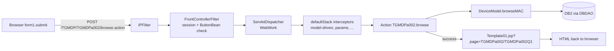

# Legacy TGMDP Monolith

> Repo map for `legacy/` in the `NWIS_Legacy` workspace. Up: [[Legacy Systems]] · [[System Overview]]

The **TGMDP legacy monolith** is the original web admin console of Taiwan Mobile's field-operations
platform. It is a single Java web application (one WAR) built on **WebWork 2.2.6 / XWork** (the
framework that later became Struts 2), rendering **JSP** pages on the server and talking to **IBM
DB2** through a hand-rolled JDBC wrapper. It is the "before" picture that `tgmdp_backend` +
`tgmdp_web_frontend` (and the vendor portal pair) are rebuilding.

It is not a toy. The main app alone has about **168 functional modules**, **552 Java files**,
**336 JSP files** and **81 jar files** checked into `WEB-INF/lib` (no Maven or Gradle). Studying it
teaches you what "classic server-side [[MVC]]" looks like at production scale, and why teams
eventually move away from it.

## What lives in `legacy/`

`legacy/` is not one project. It is a folder of several sibling legacy systems, each an Eclipse
project (`.project`, `.classpath`) that deploys to Tomcat.

| Folder | What it is | Style |
|---|---|---|
| `TGMDP/` | The admin console (the "monolith"). Modules `TGMDPa001` … `TGMDPz011`, `TGMDPaa…ae`. | WebWork + JSP |
| `TGMDP_legacy_new/` | A copy of `TGMDP/` plus a Docker/Ant setup to run it locally (Tomcat 9, JDWP on 5005). A spot check of `src/WW_XML/TGMDPa.xml` shows the two copies are identical apart from line endings; I did not diff every file. | WebWork + JSP |
| `tgmdp_vendor_legacy/` | The **vendor portal** used by outside contractors. Modules `TGMDPVENa/b/c/z…`, 69 JSPs. | WebWork + JSP |
| `ACPT_ADS/` | "ADS" adapter service for project acceptance (專案驗收). SOAP via Apache CXF, plus `…/adapter` servlets. | Servlet + CXF |
| `ACPT_SERVICE/` | Small JAX-RS (Jersey) REST service, e.g. the H2 warehouse inbound `restfulAPI/WH/API_H2.java`. | Jersey REST |
| `MRM_ADS/` | Material requisition adapter (`webservice/MRM.java` is ~100 KB). | Servlet + SOAP/REST |
| `AMS2/` | A run-it-locally copy of the AMS2 Cordova app with dev notes (`AMS2-dev-run-plan.md`). See [[ams2-app-legacy]]. | Cordova |
| `new_legacy_tgmdp/` | Empty placeholder. | — |

The ADS services are covered in [[Legacy ADS Adapter Backends]].

## Anatomy of `legacy/TGMDP/`

```
legacy/TGMDP/
├── MODULES.md                 # per-module file index (JSP + Java per TGMDPx code)
├── src/
│   ├── xwork.xml              # root WebWork config: includes WW_XML/*.xml
│   ├── WW_XML/TGMDPa.xml …    # one file per module letter: packages, actions, results
│   └── com/
│       ├── sys/               # in-house "framework" layer
│       │   ├── filter/        # IPFilter, FrontControllerFilter
│       │   ├── servlet/       # custom ServletDispatcher, DownloadDispatcher
│       │   ├── integration/   # DBDAO, DBDAOCon, DAOFactory, IniValue (config)
│       │   ├── presentation/  # Model, Form, PageBreak, ButtonBean, UserID, ExceptionResolver
│       │   └── utility/       # StringUtility, DateUtility, ExcelUtility, LDAP, SMS, logs
│       └── prj/               # the business application
│           ├── actions/tgmdpa … tgmdpz/   # Action classes (controllers), 31 packages
│           ├── actionforms/…              # Form beans bound from request params
│           ├── models/                    # 108 "Model" classes = SQL + business logic
│           ├── ajax/                      # servlets answering jQuery AJAX calls
│           ├── servlet/                   # file download / PDF servlets
│           ├── login/                     # Login, Logout, Home actions
│           └── webservice/                # XFire SOAP endpoint (IDMService)
└── TGMDP/                     # the web root (becomes the WAR)
    ├── WEB-INF/web.xml        # filters + servlets
    ├── WEB-INF/lib/           # 81 jars, incl. webwork-2.2.6.jar, xwork.jar, ognl.jar
    ├── common/Template01.jsp  # page layout ("master page") that includes each module JSP
    ├── js/submitForm.js       # how every page posts back to *.action
    └── TGMDPa001/ … TGMDPz011/  # one folder of JSPs per module
```

### The two layers inside `src/com`

The code is split into `com.sys` and `com.prj`. That split is a real architectural idea: `com.sys`
is a home-grown framework (database access, pagination, permission checks, error handling) and
`com.prj` is the business code that uses it. The same `com.sys` package is copied into every legacy
project (`ACPT_ADS`, `MRM_ADS`, `tgmdp_vendor_legacy`, the ADS backends of the mobile apps). It is
copied, not shared as a library, so every copy can drift on its own.

## Module naming: the TGMDP code

Everything is keyed by a **task code** such as `TGMDPa002`:

- `TGMDP` + a **letter group** (`a` = mobile device management, `s` = project acceptance, …) + a
  three-digit number.
- The same code is the WebWork **namespace** (`/TGMDPa002`), the JSP folder (`TGMDP/TGMDPa002/`),
  the Action class (`com.prj.actions.tgmdpa.TGMDPa002`), the permission key in the DB (`TASK_ID`),
  and the page suffix convention: `Q1` query, `I1` insert, `U1` update, `M1` maintenance.

This one naming key holds the whole system together. The modern stack keeps it on purpose:
`@PreAuthorize("hasAuthority('TASK_TGMDPa002:browse')")` in `tgmdp_backend` uses the same code (see
[[Session ButtonBean vs JWT Authorities]]).

## How a request is served (summary)



The full walk-through is in [[WebWork Request Flow]]. Data access is in
[[Legacy Data Access with DBDAO]]. The permission layer is in
[[FrontControllerFilter and ButtonBean Permissions]].

## Key files to open first

| File | Why |
|---|---|
| `legacy/TGMDP/src/xwork.xml:4-59` | Root config: includes 31 module XML files, plus Login/Logout/Home. |
| `legacy/TGMDP/src/WW_XML/TGMDPa.xml:19-57` | A full module mapping (TGMDPa002), with 10 actions. |
| `legacy/TGMDP/TGMDP/WEB-INF/web.xml:4-37` | Filter chain and the WebWork servlet. |
| `legacy/TGMDP/src/com/sys/filter/FrontControllerFilter.java` | Login and permission gate for every `*.action`. |
| `legacy/TGMDP/src/com/prj/actions/tgmdpa/TGMDPa002.java` | A typical 1,158-line Action. |
| `legacy/TGMDP/src/com/sys/integration/DBDAO.java` | The JDBC wrapper every model uses. |
| `legacy/TGMDP/TGMDP/TGMDPa002/TGMDPa002Q1.jsp` | A typical JSP view with Java scriptlets. |
| `legacy/TGMDP/MODULES.md` | Index of which files belong to which module code. |

## Build, config and run

- **Build:** Apache Ant (`TGMDP_legacy_new/docker/build.xml`) compiles `src/` against the jars in
  `WEB-INF/lib` and produces `TGMDP.war`. Dependencies are jar files in the repo, with no
  dependency manager. Compare that with Gradle in `tgmdp_backend` ([[Build Tools and Dependency Management]]).
- **Config:** `com.sys.integration.IniValue` loads `config.properties` and `dir.properties` from an
  external `iniValue/TGMDP/` folder. The DB2 datasource comes from Tomcat JNDI
  (`jdbc/tgmdpDS_DB2` in `META-INF/context.xml`). See [[Configuration and Environments]].
- **Run:** `docker compose up --build -d` in `legacy/TGMDP_legacy_new/` →
  `http://localhost:8090/TGMDP/`. There is **no test suite**. You check changes by clicking through
  the app in a browser.

## Texture you will meet (and why it matters)

- **Chinese comments and identifiers in mixed encodings.** Comments are in Traditional Chinese.
  Some files use old Mac line endings: `FrontControllerFilter.java` has a lone `\r` on line 58, so
  `grep`/`cat -n` show the `if (userID == null)` check *inside* a comment line, while `javac` and
  editors treat it as a separate line of real code. Line numbers can differ by one between tools
  in files like this.
- **Copy-paste as reuse.** `browse()` and `export()` in `TGMDPa002.java:130-230` build the same
  criteria map line by line. Every action method repeats the same open DAO / try / rollback /
  close block. This is the duplication the modern [[Service Layer]] removes.
- **Big classes.** A single Action can contain list, export, insert (with LDAP and SMS calls),
  update and delete. [[Separation of Concerns]] is mostly by naming convention.

## Questions to check understanding

1. Which three places must you edit to add a new page to module `TGMDPa002`?
   (Hint: an `<action>` in `WW_XML/TGMDPa.xml`, a method on the Action, a JSP in `TGMDP/TGMDPa002/`.)
2. Why does a module code like `TGMDPa002` show up in the permission table as well as in the URL?
3. `com.sys` is copied into five projects. What goes wrong when a bug is fixed in only one copy?

## Related

- Up: [[Legacy Systems]] · [[System Overview]]
- Deep dives: [[WebWork Request Flow]] · [[Legacy Data Access with DBDAO]] · [[FrontControllerFilter and ButtonBean Permissions]] · [[Legacy ADS Adapter Backends]]
- Modern comparison: [[WebWork Actions vs Spring Controllers]] · [[Server-rendered JSP vs React SPA]] · [[Strangler Fig Migration and Legacy Parity]]
- Concepts: [[MVC]] · [[Front Controller]] · [[Server-Side Rendering]] · [[Layered Architecture]] · [[DB2]] · [[Build Tools and Dependency Management]] · [[Configuration and Environments]] · [[Separation of Concerns]] · [[Monorepo vs Polyrepo]]
