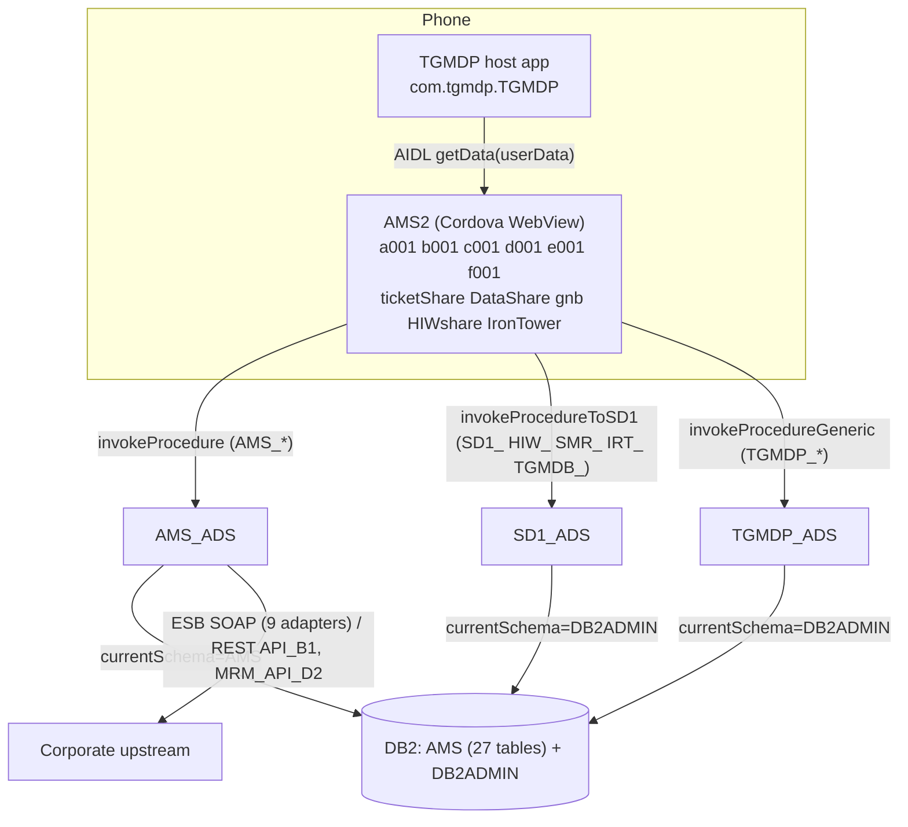

# ams2-app-legacy

> Repo map for the legacy **AMS2** base-station fault app (基站障礙) and its backends. Up: [[Legacy Systems]] · [[System Overview]]

**AMS2** is the **ticket side** of base-station maintenance. When a base station develops a fault,
a ticket (工單) is raised, either automatically from an alarm (告警派工) or by a dispatcher
(障礙派工). A technician has to accept it, work on it and reply. AMS2 is the phone app for that
job. This repository is its **legacy** version: a Cordova-Android app plus three Java ADS backends.
It is being rebuilt as `tgmdp-app-ams` (React + Vite + TypeScript, running inside the
`tgmdp_rn_app` shell) on top of `tgmdp_backend`. The legacy repo is the reference for that work.
In the README's words: "Nothing is greenfield — the new app must behave *exactly* like this one."
(`ams2-app-legacy/README.md` §0)

## What is in the folder

| Folder | What | Notes |
|---|---|---|
| `AMS2/` | The Cordova-Android app. UI in `platforms/android/app/src/main/assets/www/`. | See [[Legacy Cordova App Anatomy]] (examples there are from this app). |
| `AMS_ADS/` | **Primary backend**: tickets, push, params, site data, gNB (5G), statistics. 19 adapters. | `/AMS_ADS/ams/adapter` |
| `SD1_ADS/` | Site info, antenna, INAD logs, SMR, IronTower, HIW. Shared with NWIS2. | `/SD1_ADS/sd1/adapter` |
| `TGMDP_ADS/` | Token check, M+ messaging. | `/TGMDP_ADS/tgmdp/adapter` |
| `setup/` | `iniValue` templates, ESB WSDLs, `devshim/` (DataSource that reports `DB2/NT64`). | |
| `README.md`, `HOWTORUN.md` | Menu → page → adapter tables, DB notes, local-dev deviations, known legacy bugs. | Read §2 and §5. |

There is also a run-it-locally copy of the app at `legacy/AMS2/` with dev notes
(`AMS2-dev-run-plan.md`, `AMS2-dev-run-STATUS.md`).

## Architecture

**AMS2 has no login of its own.** At boot it binds over AIDL to the TGMDP host app
(service `com.TGMDP2.DataService`) and takes the session from it (`README.md` §0).

## The eight home menus

| # | Home label | Entry page | Function | Backend |
|---|---|---|---|---|
| 1 | 推播訊息查詢 | `a001/a001M1.html` | Push/alert inbox | AMS_ADS |
| 2 | 障礙統計總表 | `b001/b001M1.html` | Fault statistics by node / person / type | AMS_ADS |
| 3 | 障礙工單查詢 | `c001/c001M1.html` | **Ticket search** by site id / name / status | AMS_ADS |
| 4 | 個人障礙處理 | `d001/d001M1.html` | **My open tickets**, the technician's work queue | AMS_ADS |
| 5 | 基站資料維護 | `e001/e001Q1.html` | Site data search and maintenance | SD1_ADS |
| 6 | 高空作業檢核 | `HIWshare/HIWSiteList.html` | Working-at-height safety check | SD1_ADS |
| 7 | 鐵塔載重計算 | `IronTower/Query.html` | Tower load calculation | SD1_ADS → REST |
| 8 | 站台定位查詢 | `f001/f001Q1.html` | Site location lookup | AMS_ADS |

`ticketShare/` is the **ticket engine** shared by menus 2-4: list, detail, reply, photos, priority,
work tickets. `TicketDetail.js` alone is 94 KB. `DataShare/` holds INAD alarm logs, SMR power
system and resource swap. `gnb/` holds 5G gNB queries.

## A request, end to end: ticket search (menu 3)

1. `c001/c001M1.html` shows three inputs. `c001M1.goTicketList()` checks that a site id or name is
   entered (and site id ≥ 5 characters), writes them into the global `_WHERE_PARAM1`, pushes the
   page onto `pagesHistory` and loads `ticketShare/TicketList.html`
   (`AMS2/platforms/android/app/src/main/assets/www/js/c001/c001M1.js:15-40`).
2. `TicketList.getData()` calls
   `AdapterObject.invokeProcedure('AMS_GetTicketList_getTicketList', _WHERE_PARAM1, ...)`
   (`www/js/ticketShare/TicketList.js:69`).
3. `AdapterUtility.js` adds `VERIFY_USER_ID/UUID/TOKEN` and POSTs to `AMS_ADS/ams/adapter`.
4. `AdapterService` verifies the token against `DB2ADMIN.A_LOGIN_MST`, then dispatches to
   `AMS_GetTicketList.getTicketList` (`AMS_ADS/src/com/prj/servlet/ams/AdapterService.java:226-233`).
5. The adapter runs `AMSTicketModel.selectTicketList` with paging and splits rows into three lists:
   待接工 (waiting to accept), 處理中 (in progress), 待結案 (waiting to close).
6. Back in the WebView, `TicketList.getTableData` builds rows as HTML strings and assigns
   `innerHTML`. Checkboxes for batch actions only appear for tickets in the user's own zone, where
   zones N and M count as one area.

The modern version of this same flow is `tgmdp-app-ams/src/hooks/ticketShare/useTicketList.ts`
calling `GET /api/v1/ams/ticket/list` through the native bridge. It is compared in
[[Cordova+jQuery vs RN Shell + React Web Layer]].

## Database notes worth knowing

- Schema **`AMS`** (27 tables) holds tickets: `AMS_TICKET_DATA` / `VW_AMS_TICKET_DATA`,
  `AMS_TECHNOLOGY_DATA`, `AMS_CAUSE_DATA`, `AMS_PRIORITY_MST`, `AMS_TICKET_PHOTO` …
- **`AMS_ADS` must use `currentSchema=AMS`, not `DB2ADMIN`.** Its SQL names AMS tables without a
  schema and qualifies cross-schema reads (`join DB2ADMIN.A_SITEINFO_MST`). Pointed at `DB2ADMIN`
  it fails with `SQLCODE=-204` (object not found) (`README.md` §4).
- Zones are one letter: `N`, `M`, `S`, `C`. **N and M are treated as one area** (北一/北二), both in
  the list query and in the JS zone check.

## Legacy bugs recorded in the README (not fixed on purpose)

| Defect | Detail |
|---|---|
| Empty result → NPE | `AMS_GetTicketList.java:65` calls `al.size()` on null, so a truly empty paged list errors instead of returning `查無資料` (no data). |
| Shipped binaries did not compile | 67 of 103 delivered classes contained `"Unresolved compilation problem"`, Eclipse output saved despite compile errors. They were rebuilt from `src/`. |

Recording legacy bugs instead of silently copying or silently fixing them matters for parity: the
rebuild must decide, with the business, whether to reproduce each one. See
[[Strangler Fig Migration and Legacy Parity]].

## Local-dev deviations

The README lists three environment-only changes (§5): two self-disabling `// LOCAL DEV BYPASS`
blocks in `AMS_ADS/src/com/prj/adapters/ams/AMS_AuthorityCheck.java` that make up for the fake
ESB's answers, and the `DB2/NT64` DataSource shim explained in
[[Legacy Data Access with DBDAO]]. The app's own `www` JavaScript is **unmodified** so it stays
trustworthy as parity ground truth. Only `strings.xml` (adapter URLs) and `chcp.json` (hot code
push disabled) are touched.

## Questions to check understanding

1. Why do the README authors insist the `www` JavaScript is unmodified, even though they changed
   backend code?
2. A user in zone `M` searches tickets. Will they see zone `N` tickets with checkboxes? Where is
   that rule in the JS, and where must it also be in the backend?
3. What would you see on the phone if `AMS_ADS` were configured with `currentSchema=DB2ADMIN`?

## Related

- Up: [[Legacy Systems]] · [[System Overview]]
- Sibling app: [[niws2-app-legacy]]
- How it is built: [[Legacy Cordova App Anatomy]] · [[Legacy ADS Adapter Backends]] · [[Legacy Data Access with DBDAO]]
- Modern comparison: [[Cordova+jQuery vs RN Shell + React Web Layer]] · [[Strangler Fig Migration and Legacy Parity]]
- Concepts: [[Hybrid Mobile Apps]] · [[WebView and Native Bridge]] · [[Client State Management]] · [[Message Integration and ESB]] · [[DB2]] · [[SQL and Relational Databases]] · [[Environment Separation]]
