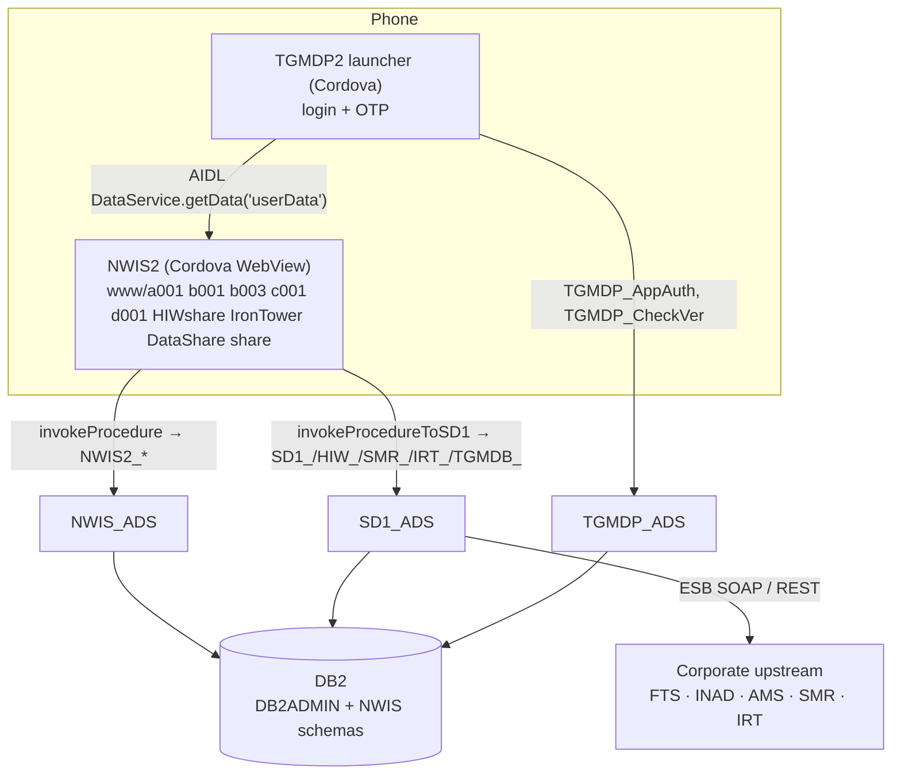

# niws2-app-legacy

> Repo map for the legacy **NWIS2** base-station inspection app (基站巡檢) and its backends. Up: [[Legacy Systems]] · [[System Overview]]

**NWIS2** is the phone app that Taiwan Mobile field technicians use to **inspect and maintain base
stations**: run their assigned inspection rounds (patrols), look up everything about one site,
check equipment alarms, record site surveys, do the safety check before climbing a tower, and
calculate tower load. This repository is the **legacy** version: a Cordova-Android app plus the
Java backends it calls. It is kept as the **source of truth for behaviour** while the app is
rebuilt as `tgmdp-app-nwis2` (a React web layer) inside the `tgmdp_rn_app` shell, on top of
`tgmdp_backend`.

The README puts it in one line: "legacy NWIS = the 'before'; the new React + Spring Boot app = the
'after'. This folder is the 'before' you copy from." (`niws2-app-legacy/README.md` §0)

> The folder name is `niws2-app-legacy` (with the letters swapped). The app inside is `NWIS2`.

## What is in the folder

| Folder | What | Notes |
|---|---|---|
| `NWIS2/` | The Cordova-Android app (~108 MB). UI is in `platforms/android/app/src/main/assets/www/`. | Package `com.tgmdp.NWIS`. See [[Legacy Cordova App Anatomy]]. |
| `TGMDP2/` | The **TGMDP launcher** Cordova app: `login.html`, `menu.html`, `verifyFault.html`. Owns login + OTP and exposes the session to the other apps through an AIDL `DataService`. | NWIS2 cannot run without it. |
| `NWIS_ADS/` | Java adapter backend for menus a001 / b001 / b003 / d001 (push, patrol, stats, survey) and NWIS login/logout. | `/NWIS_ADS/nwis/adapter` |
| `SD1_ADS/` | Shared backend for site data, HIW, IronTower, SMR, INAD, one-week dispatch log, resource swap. | Also used by AMS2. |
| `TGMDP_ADS/` | Shared login/OTP, version check, MAC verify, M+ messaging gateway. | Used by the launcher. |
| `AMS_ADS/` | A copy of the AMS backend. | NWIS2 calls `SD1_AuthorityCheck` for an AMS gate. |
| `setup/` | `iniValue` templates, ESB WSDLs, dev shims. | |
| `setup-local.sh` | Seeds `~/iniValue/...` and symlinks the ADS WARs into Tomcat. | |
| `README.md` / `README.id.md` | Very complete English and Indonesian guides: menus, adapters, how to run, local mocks. | Read §2 first. |

The backends are described in [[Legacy ADS Adapter Backends]].

## Architecture

## The seven home menus

| # | www folder | Menu | What the technician does | Backend |
|---|---|---|---|---|
| 1 | `a001` | 推播訊息 | Notification inbox: read, mark read, delete | NWIS_ADS |
| 2 | `b001` (+ `share/Patrol*`) | 個人巡檢處理 | **The core job**: open a patrol period, pick a site, run the checklist, photos, antenna and RF data, submit | NWIS_ADS |
| 3 | `b003` | 巡檢統計總表 | Supervisor progress dashboard by zone / section / person | NWIS_ADS |
| 4 | `c001` (+ `DataShare/`) | 基站資料維護 | "Everything about one site": basic data, one-week dispatch log, INAD alarm logs, antenna query, SMR power-system pages, resource swap | SD1_ADS |
| 5 | `d001` | 基站會勘清查 | Pre-construction site survey (AC power, DC/SMR, equipment, merge space) | NWIS_ADS |
| 6 | `HIWshare` | 高空作業檢核 | Safety checklist before working at height, GPS-gated to 100 m from the site | SD1_ADS |
| 7 | `IronTower` | 鐵塔載重計算 | Tower load calculation | SD1_ADS → IRT REST |

The full sub-page tables (about 60 pages) are in `niws2-app-legacy/README.md` §2. Some pages are
huge: `share/PatrolMain.html` (~94 KB) and `share/PatrolDetail.html` (~133 KB) hold the inspection
engine.

## How the code is organised

Same shape as AMS2 (see [[Legacy Cordova App Anatomy]] for the full explanation):

- `www/NWIS2.html` is the single shell. `js/NWIS2.js` boots the app, reads adapter URLs through
  the `GetServerUrl` plugin (`js/NWIS2.js:74`), checks the launcher (`CheckTGMDP`, line 313), loads
  `menu.html` into `#contentPage` (line 302) and handles back/home.
- `js/GlobeValue.js` holds the globals: `_APP_DATA`, `_USER_BEAN`, `_ZONE_DATA`, `_PARAM_DATA`,
  `_TEMPLATE_LIST`, `_TEMP_RF`, `_WHERE_PARAM4`.
- `js/utility/AdapterUtility.js` is the HTTP client (`invokeProcedure`, `invokeProcedureToSD1`,
  `invokeProcedureGeneric`).
- Each fragment `c001/c001Q1.html` has a script `js/c001/c001Q1.js`.
- Native plugins are in `platforms/android/app/src/main/java/com/NWIS2/`: `GetServerUrl`,
  `GetLocation`, `CheckTGMDP`, `DataServiceHelper` (AIDL), `OpenOtherApp`, `doCheckUserFile`, plus a
  document scanner library `com/scanlibrary/`.

## Running it locally (summary)

From `README.md` §4: JDK 8 for the ADS, JDK 17 for the Android build, Tomcat 9, Android Studio.
`./setup-local.sh` seeds config and symlinks the three ADS into Tomcat. Point `strings.xml` at
`http://10.0.2.2:8080/...` (the emulator's name for the host), build with `./gradlew assembleDebug`,
install with `adb`. Log in with the test user and the bypass OTP.

Two traps the README warns about:

- **Hot code push cache.** After editing `www/`, the app may keep serving the old cached bundle.
  Clear app data or bump `release` in `chcp.json`, and set `"update":"none"` so the splash screen
  does not wait for the corporate update server.
- **Corporate upstream is unreachable.** Menus that call ESB, INAD, SMR or IRT are mocked in local
  dev behind a guard (`IRT_IP/RESW_IP == "127.0.0.1"`). The README lists exactly which ones (§2
  table "Menus that are MOCKED"). This is a [[Feature Flags and Mock Toggles]] approach, done with a
  config value.

## Where it went in the modern stack

| Legacy | Modern |
|---|---|
| `NWIS2/` www pages | `tgmdp-app-nwis2` React web layer |
| `TGMDP2/` launcher (Cordova) + AIDL session | `tgmdp_rn_app` (Expo React Native shell): login, menu, session, WebView host |
| `NWIS_ADS`, `SD1_ADS` adapters | `tgmdp_backend` packages `nwisads/` and `sdoneads/` (`project-description.md` §9.2) |
| `AdapterObject.invokeProcedure` | bridge `postMessage` → shell → REST `/api/v1/...` |

The rebuild is driven by the "AI Software Factory" in `FACTORY.md`: station 1 (archaeology)
reverse-engineers a legacy module into a spec with a `file:line` for every rule; later stations
build, test and audit it against that spec. See
[[Strangler Fig Migration and Legacy Parity]].

## Questions to check understanding

1. Why can NWIS2 not be opened on its own, without the TGMDP launcher installed?
2. Which of the three backends would you look in for the INAD 4G alarm log page, and why might it
   show mock data on your laptop?
3. The README says `b001` is "the heaviest, most-used menu." Which files would you read first to
   understand how a patrol is saved?

## Related

- Up: [[Legacy Systems]] · [[System Overview]]
- Sibling app: [[ams2-app-legacy]]
- How it is built: [[Legacy Cordova App Anatomy]] · [[Legacy ADS Adapter Backends]] · [[Legacy Data Access with DBDAO]]
- Modern comparison: [[Cordova+jQuery vs RN Shell + React Web Layer]] · [[Strangler Fig Migration and Legacy Parity]]
- Concepts: [[Hybrid Mobile Apps]] · [[WebView and Native Bridge]] · [[Message Integration and ESB]] · [[Feature Flags and Mock Toggles]] · [[Environment Separation]] · [[Authentication and Sessions]] · [[DB2]]
