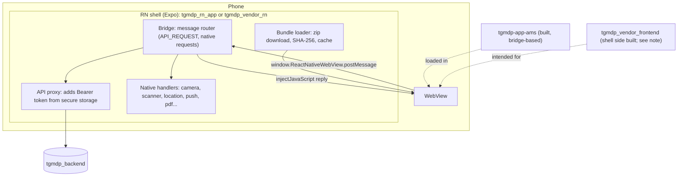

# Mobile Architecture Overview

All the mobile pieces in one picture. The core idea is a **thin native shell** plus **web apps in a WebView**: the [[Hybrid Mobile Apps]] model. Verified against `tgmdp_rn_app`, `tgmdp_vendor_rn` and `tgmdp-app-ams`.

## Which shell hosts what
| Shell | Hosts | Evidence |
|---|---|---|
| [[tgmdp_rn_app]] | Many modules, one WebView at a time out of a pool | `configs/app-config.*.json` has `MODULE_URLS` (AMS2, BTS, NWIS2, ACPT, SLM, ... 17 keys) and `WEBVIEW_POOL_POLICY` (`strict-3-lru`); `app/[module].tsx` redirects to `/webview/<module>`; `assets/modules/AMS/0.0.0.zip` is a seed bundle. See [[WebView Pool and Bundle Loading]] |
| [[tgmdp_vendor_rn]] | One vendor web app (`MODULE_ID: ACPTFirms`) | `app/index.tsx` re-exports `core/webview/infrastructure/WebViewScreen` |

Corrections to the earlier version:
- Only AMS (`AMS2` URL, seed zip) is concretely wired in the dev/staging configs; most `MODULE_URLS` entries are empty strings, so "NWIS2 hosted here" is a slot, not proof of a running module.
- In this checkout, `tgmdp_vendor_frontend/src` contains no use of `ReactNativeWebView` or `__nativeBridgeClient` (the global injected by `tgmdp_vendor_rn/core/bridge/infrastructure/buildBridgeClientScript.ts:57`), and no other repo consumes it. The vendor shell is built to host it, but the web-side bridge consumer is not present on branch `fix/TGMDPVENc001-c004-legacy-parity`. `tgmdp-app-ams` does use the bridge (`src/utils/bridge/core.ts`, `api.ts`).
- Both shells forward API calls with a bearer token: `tgmdp_vendor_rn/core/api-proxy/infrastructure/AxiosApiClient.ts:68-71` and `tgmdp_rn_app/services/bridge/transport/bridge-transport-helpers.ts`.

## Four ideas worth learning
1. **Trust boundary.** Web code can only ask the shell for things through a message protocol ([[Bridge Engine and Message Protocol]]). In `tgmdp_vendor_rn` the message type is checked (`API_REQUEST` or `NATIVE_MODULE_REQUEST`, else `UNKNOWN_MESSAGE_TYPE`) and only modules registered in `BridgeHandlerRegistry` (`hooks/useWebViewBridge.ts:73,121`) are reachable; others get `NATIVE_MODULE_NOT_IMPLEMENTED`.
2. **Network through the shell.** The AMS services call `bridgeClient` (`tgmdp-app-ams/src/services/api/bridge.ts`), which rejects when the bridge is absent; the shell holds the token ([[Bridge API Request Flow and Auth]]).
3. **Two different OTA mechanisms.** Module bundles are zips verified by SHA-256 (`tgmdp_rn_app/core/bundled-manager/verifier.ts`, loader header `X-SHA256`). Separately, Expo Updates is only enabled if HTTPS plus code signing are configured (`tgmdp_rn_app/configs/ota-update-config.js`). See [[Over-the-Air Updates]], [[RN Shell Build and Environments]].
4. **Coexistence with legacy.** `tgmdp_rn_app/core/communications/cordovaShim.template.ts` and `bootShim` inject Cordova-style shims, and native handlers reproduce old plugins ([[Native Modules and Legacy Coexistence]]).

## Trade-offs
Faster web iteration and shared UI code, at the cost of a bridge to maintain, WebView performance limits, and two runtimes to debug. See [[Hybrid Shell Architecture Trade-offs]].

## Read in this order
[[tgmdp_rn_app]] → [[Bridge Engine and Message Protocol]] → [[Bridge API Request Flow and Auth]] → [[tgmdp-app-ams]] → [[AMS Bridge Client]] → [[AMS State Hooks and Testing]] → [[tgmdp_vendor_rn]]

## Related
[[WebView and Native Bridge]] · [[System Overview]] · [[Cordova+jQuery vs RN Shell + React Web Layer]] · [[Codebases MOC]]
