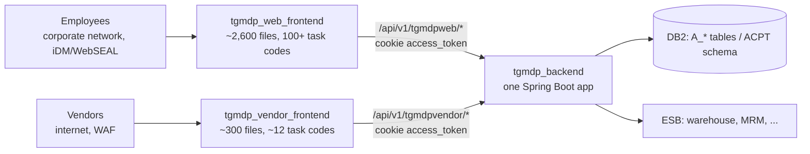

# Web Frontends Compared

Up: [[System Overview]] · Repos: [[tgmdp_web_frontend]] · [[tgmdp_vendor_frontend]]

TGMDP has two browser front ends built on the same stack and served by the same backend:

- [[tgmdp_web_frontend]], the **admin console** for employees (`/api/v1/tgmdpweb`).
- [[tgmdp_vendor_frontend]], the **vendor portal** for outside contractors (`/api/v1/tgmdpvendor`).

They started from a shared boilerplate and then diverged under different pressures. Comparing them is one of the best ways in this codebase to learn that architecture is a set of trade-offs, not a single right answer.

## What they share

| Area | Shared choice | Why it makes sense |
|---|---|---|
| Framework | React 19 SPA built with Vite 7 | fast dev server, static output served by nginx |
| Language | TypeScript 5.9 with the same strict flags (`strict`, `noUnused*`, `verbatimModuleSyntax`, `erasableSyntaxOnly`) | [[Type Systems]] catch contract mistakes early |
| State | Zustand 5, one store per feature + persisted auth/UI stores | minimal boilerplate [[Store Pattern]] |
| Forms | react-hook-form, with Zod via `zodResolver` for search forms | uncontrolled inputs, schema-based [[Validation]] |
| HTTP | one axios instance, `withCredentials: true`, response interceptor that unwraps `{success, data}` and throws `ApiError` | [[Interceptor and Filter Chain]], [[Singleton]] |
| Auth | HttpOnly `access_token` cookie set by the backend; JS never touches the JWT | XSS cannot steal the token ([[Authentication and Sessions]]) |
| Error text | identical `translateAxiosMessage` table → Traditional Chinese | [[Internationalization]] for one locale |
| Structure | feature folders with `api/ pages/ store/ types/` | [[Feature-Sliced Structure]] |
| Legacy parity | comments cite legacy JSP/Java line numbers; legacy button IDs reused as permission keys | [[Strangler Fig]] migration |
| Mocking | `VITE_*` flag swaps real API calls for in-memory data | [[Feature Flags and Mock Toggles]] |
| Testing | Vitest + Testing Library + jsdom, tests in `__tests__/` next to code | [[Unit Testing]] |
| Delivery | multi-stage Dockerfile → nginx with SPA fallback | [[Single Page Applications]] |

## Where they differ

### Users and security posture

| | Admin console | Vendor portal |
|---|---|---|
| Users | employees | external contractors, sub-contractors, suppliers |
| Login | username/password (or SSO pop-up) → `/auth/login` | captcha → SMS OTP → `/auth/otp/verify`, lockout after failures |
| Identity table | `A_USER_DATA` | `ACLT.ACPT_USER_DATA` |
| Network edge | corporate iDM/WebSEAL junction, shared host with legacy | internet WAF that blocks PUT/PATCH/DELETE |
| Client consequence | `installJunctionCookieGuard()` restores `IV_JCT` | API client type only exposes `get` and `post` |

**Why:** an internet-facing app for third parties needs a second factor and a stricter edge; an intranet app for employees inherits corporate SSO and proxy quirks. Each front end bends to its own infrastructure. See [[Authentication and Sessions]] and [[Cookies and CSRF]].

### Folder naming

| Console | Portal |
|---|---|
| English kebab-case, nested by menu group: `features/record-query/app-login-logout-record-query/` | Task code, flat: `features/TGMDPVENc003/` |
| task code lives in `withTaskGuard([...])` and `auth/data/menu.ts` | task code *is* the path |

**Why:** with 100+ modules, grouping by business area keeps the tree navigable. With a dozen, the code is the shortest unambiguous name. See [[Clean Code Naming]].

### API client

| Aspect | Console `src/shared/api/client.ts` | Portal `src/lib/client.ts` |
|---|---|---|
| Prefix | built by interceptor from `apiVersion` + `basePath` (`/api/v1/tgmdpweb`) | written in full in each feature (`/api/v1/tgmdpvendor/...`) |
| Request interceptor | strips empty params/body fields; session-wide `AbortController` | no-op |
| What `await get()` returns | the envelope `{success, data}`; callers read `res.data` | the AxiosResponse with `data` = payload; callers destructure `{ data }` |
| Timeout | 10 s default | 60 s (uploads, PDFs, ZIPs) |
| Error shapes | one (`error: {code, message}`) | two (`error` or `meta`) + `remainingAttempts` |
| Blob errors | parsed only with `useActualMessage: true` | always parsed |
| On 401 | abort all in-flight requests, `purgeLogin()`, stay in SPA | `logout()` + full-page redirect to `/login` (skipped for `/auth/` and pop-ups) |

**Why:** the console has many parallel requests per page (dropdown inits, tables) and keeps the SPA alive on logout, so it needs request cancellation and explicit store resets. The portal is simpler, so a hard reload is the cheapest way to guarantee a clean slate. Details: [[Web Console API Layer]], [[Vendor Portal API Layer]].

### Mock toggle

| Console | Portal |
|---|---|
| `VITE_USE_MOCK`; per feature `api/index.ts` chooses `xxxApi` or `xxxApi.mock` at import | `VITE_API_MOCK`; each method starts with `if (isMockMode)` |
| `hasPermission` and `TaskRouteGuard` return true in mock mode | no permission bypass |
| tests run with `VITE_USE_MOCK=true` globally (`vitest.setup.ts`) | tests `vi.mock` the api module explicitly |

**Why:** separate mock files scale better with 100+ features (the [[Strategy]] pattern), while inline branches keep a dozen small features readable. Note the **different variable names** for the same idea; a shared convention would reduce confusion. See [[Mocking]].

### Routing and permission checks

| Layer | Console | Portal |
|---|---|---|
| Session | `ProtectedRoute` layout route; `hydrate()` on each navigation, skips `/auth/me` while token is fresh | `ProtectedRoute` wrapper; `/auth/me` once per mount |
| Per-screen task check | `TaskRouteGuard` (port of legacy `FrontControllerFilter`: task buttons + system auth; refusal = logout) | none on the client |
| Menu | `/auth/menu` tree, filtered by `hasAccess`, env allow-list, hard-coded injections | `userData.menu` flat list, static fallback |
| Buttons | `hasPermission(taskId, action)`, `PermissionButton` | `useHasButton()("TASK_button")`, or a module `/permissions` endpoint |
| Code splitting | eager imports, one big bundle | `lazy()` per page with chunk-reload recovery |

**Why:** employee roles span many systems (基站巡檢, 工程驗收, …) and legacy enforced system access in a front-controller filter, so the console reproduces it. Vendors see a narrow, server-chosen menu and every vendor endpoint is scoped by the `vendorId` claim in the JWT, so the backend carries the weight. Both rely on backend `@PreAuthorize` as the real boundary. See [[Authorization and RBAC]], [[Front Controller]], [[Routing]].

### UI kit and styling

| Console | Portal |
|---|---|
| Tailwind v4 + SCSS theme files; custom components in `shared/components/ui/`; AntD used almost only for `Watermark` | Tailwind v4 only; custom components in `src/components/`; own `Watermark` |
| `lucide-react`, `chart.js`, `dexie` (IndexedDB photo cache) | `lucide-react` |

Both recreate the legacy look by hand rather than adopting a component library wholesale, because parity reviewers compare screenshots against the old JSP pages. See [[Component-Based UI]].

### State cleanup

| Console | Portal |
|---|---|
| central registry `registerResettableStore` + `resetAllStores()` on logout (only ~5 stores registered so far) | per-store `reset()` called on page unmount; hard reload on 401 |

**Why:** both solve "a module-level store outlives the page and the user". Central cleanup is hard to forget once wired; local cleanup also handles navigating away without logging out. Ideally you want both. See [[Client State Management]].

### Tooling

| | Console | Portal |
|---|---|---|
| Style | ESLint house rules (`semi`, `camelcase`, `eqeqeq`, `curly`, `max-len`…) | ESLint recommended only + Prettier with import and Tailwind-class sorting |
| Coverage | `@vitest/coverage-v8`, enabled on every run, no threshold | provider not installed; not measured |
| E2E | Playwright config (serial runs against a shared backend) | none |
| CI file | only an AutoQA analysis include | none |
| Extras | `openspec/` spec-driven proposals, `.autoqa/` | `scaffold:feature` generator |

**Why:** the console has more developers and more surface, so it invested in stricter rules, coverage and E2E. Neither repo enforces lint or tests in CI from its own pipeline file, which is a shared gap. See [[Linting and Formatting]], [[Test Coverage Gates]], [[Testing Pyramid]].

## Should they be one repo?

Arguments for merging (a [[Monorepo vs Polyrepo|monorepo]] with shared packages): one axios client, one `translateAxiosMessage`, one Vitest setup, one naming of the mock flag; fixes land once. Arguments for keeping them apart: different users, threat models, deploy targets and release cadence; a vendor-portal deploy should never be blocked by a console test failure; and the internet-facing bundle should not contain admin code. The current split is defensible. A middle path is a small shared package for the HTTP client and DTO types.

## The backend view

Both front ends hit one Spring Boot application. `AuthTokenFilter` branches on the URL (`/tgmdpweb/` vs `/tgmdpvendor/`) to decide where to load the user from and which authorities to grant (`tgmdp_backend/.../security/AuthTokenFilter.java:79-140`). `WebSecurityConfig` opens `/api/v1/tgmdpweb/auth/**`, `/api/v1/tgmdpvendor/auth/**` and `/api/v1/tgmdpvendor/register/**` and requires authentication for the rest. Per-client URL prefixes make it possible to apply different rules per audience inside one deployable, a form of the [[Gateway]] idea inside the backend. See [[tgmdp_backend]].

## Questions to check understanding

1. List three differences that come directly from "vendors are on the internet, employees are not".
2. If you had to merge the two API clients, which behaviours would you make configurable, and what would the defaults be?
3. Why might the console deliberately avoid a hard page reload on 401 when the portal uses one?
4. Pick one practice the portal does better than the console, and one the console does better. Justify each.

## Related

- [[System Overview]] · [[tgmdp_web_frontend]] · [[tgmdp_vendor_frontend]] · [[tgmdp_backend]]
- Console notes: [[Web Console Folder and Feature Structure]] · [[Web Console API Layer]] · [[Web Console State and Forms]] · [[Web Console Routing Auth and Permissions]] · [[Web Console Build Lint and Testing]] · [[Web Console Feature Trace - APP Login Logout Record Query]]
- Portal notes: [[Vendor Portal Folder and Feature Structure]] · [[Vendor Portal API Layer]] · [[Vendor Portal State and Forms]] · [[Vendor Portal Routing Auth and Permissions]] · [[Vendor Portal Build Lint and Testing]] · [[Vendor Portal Feature Trace - TGMDPVENc003 Serial Number Query]]
- Concepts: [[Single Page Applications]] · [[Client-Server Architecture]] · [[Authentication and Sessions]] · [[Authorization and RBAC]] · [[Cookies and CSRF]] · [[Client State Management]] · [[Routing]] · [[Monorepo vs Polyrepo]] · [[Mocking]] · [[Testing Pyramid]] · [[Type Systems]] · [[Component-Based UI]]
- Patterns: [[Feature-Sliced Structure]] · [[Store Pattern]] · [[Interceptor and Filter Chain]] · [[Strategy]] · [[Front Controller]] · [[Gateway]] · [[Strangler Fig]] · [[Anti-Corruption Layer]]
- Practices: [[Feature Flags and Mock Toggles]] · [[Linting and Formatting]] · [[Test Coverage Gates]] · [[Clean Code Naming]] · [[SOLID]] · [[Environment Separation]]
