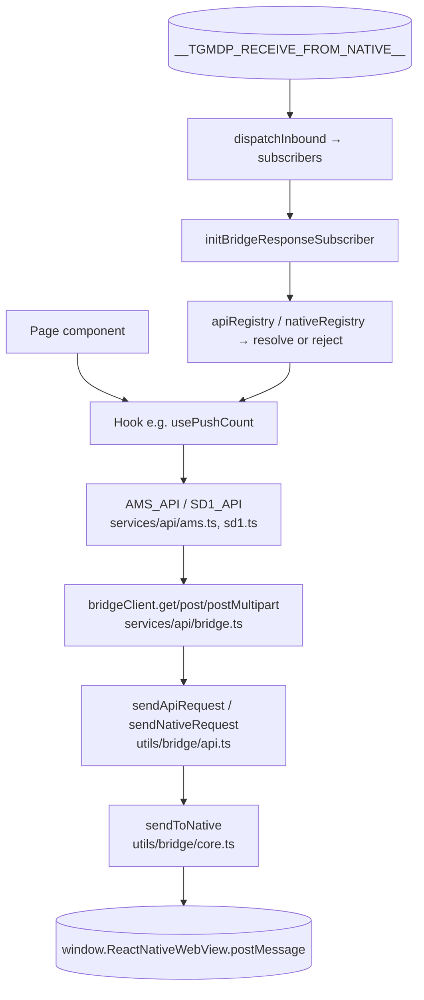

# AMS Bridge Client

> The guest half of the bridge: how AMS turns `postMessage` (a one-way pipe that carries strings) into promise-returning functions like `AMS_API.getPushCount()`. The ideas here — correlation IDs, a pending-request registry, timeouts on both sides, an internal event bus, and error normalisation — apply to any message-passing system, from WebSockets to worker threads.

Up: [[tgmdp-app-ams]] · [[System Overview]] · Host half: [[Bridge Engine and Message Protocol]] · End to end: [[Bridge API Request Flow and Auth]]

## The layers on the guest side



Each layer has one job:

| Layer | Job | File |
|---|---|---|
| `AMS_API`, `SD1_API` | One typed function per backend endpoint, with the right prefix and timeout | `src/services/api/ams.ts`, `sd1.ts` |
| `bridgeClient` | An axios-like surface (`get`, `post`, `put`, `delete`, `patch`, `postMultipart`) over the bridge | `src/services/api/bridge.ts:15-106` |
| `sendApiRequest`, `sendNativeRequest` | Correlation, timeout, error mapping | `src/utils/bridge/api.ts` |
| `sendToNative`, `registerNativeHandler`, bus | Raw transport and an internal publish/subscribe bus | `src/utils/bridge/core.ts` |

`bridgeClient` deliberately looks like axios. Hooks written against it read like normal web code, and the bridge is hidden: that is an [[Adapter]] (bridge transport presented through an HTTP-client interface) and a [[Facade]].

## Correlation: turning messages into promises

```ts
// tgmdp-app-ams/src/utils/bridge/api.ts:170-207 (shortened)
return new Promise((resolve, reject) => {
    const requestId = generateRequestId();             // req_<time>_<random>
    const timeoutId = setTimeout(() => {
        if (apiRegistry.has(requestId)) {
            apiRegistry.delete(requestId);
            reject(new Error(`API request timeout: ${endpoint}`));
        }
    }, timeout);
    apiRegistry.set(requestId, { resolve, reject, timeoutId, endpoint });
    const sent = sendToNative({
        type: 'API_REQUEST', requestId,
        request: { endpoint, method, params, payload, headers, toFormData, fieldConvertToFormData, timeout },
    });
    if (!sent) { clearTimeout(timeoutId); apiRegistry.delete(requestId); reject(new Error('Native bridge not available')); }
});
```

Three rules make this safe:

1. **Every request has a unique id** and the reply echoes it. Replies can arrive in any order.
2. **Every pending entry has a timeout**, and the timeout removes the entry. Without it, a lost reply leaks a promise forever and the spinner never stops.
3. **Clean up on every exit path**: success, failure, timeout and "could not send".

The shell runs its own timeout too, so both sides give up independently. The guest passes its timeout in the request, so the shell can match it (gNB calls 140 s, legacy adapter calls 60 s, default 30 s; `src/services/api/ams.ts:5-10`, `sd1.ts:114-122`).

Native operations (GPS, `APP_CHECKIN`, `REQUEST_SESSION`, camera, OTA) use the same pattern with a second registry, `nativeRegistry` (`api.ts:243-300`).

## The inbound bus

Replies and host commands arrive through one function the boot shim calls. AMS fans them out to subscribers:

```ts
// tgmdp-app-ams/src/utils/bridge/core.ts:48-60
type MessageSubscriber = (msg: NativeMessage) => void;
const subscribers = new Set<MessageSubscriber>();
export function subscribeToMessages(fn: MessageSubscriber): () => void {
    subscribers.add(fn);
    return () => subscribers.delete(fn);
}
export function dispatchInbound(msg: NativeMessage): void {
    subscribers.forEach(fn => { fn(msg); });
}
```

Separate subscribers handle responses (`initBridgeResponseSubscriber`, `api.ts:460-495`), boot (`useWebViewBoot`), navigation (`setupNavigationHandler`) and push (`onPushMessage`). Each returns an unsubscribe function, which React effects call on cleanup. This is [[Observer and Pub-Sub]].

One quirk to know: the shell echoes the request's `type` back as the reply's type (`tgmdp_rn_app/modules/bridge-engine/registry.ts:72-78`). So a reply to `NATIVE_REQUEST` arrives with `type: 'NATIVE_REQUEST'`, and the subscriber routes on `requestId` plus a list of known types. The AMS type file documents this (`src/utils/bridge/types.ts:24-28`).

## Error normalisation

A failed call reaches the guest as `{status: false, message, data: errorData}`. `errorData` holds the HTTP status as `code` and the backend body as `response`. AMS digs out the most useful message in priority order (`api.ts:75-85`) and offers `getServerErrorReply()` to tell "the server answered with an error" from "the server was never reached":

```ts
// tgmdp-app-ams/src/utils/bridge/api.ts:105-113
export function getServerErrorReply(err: unknown): ServerErrorReply | null {
    const errorData = (err as ApiRequestError | null)?.errorData;
    const status = errorData?.code;
    if (typeof status !== 'number' || status <= 0) return null;   // never reached the backend
    const detail = errorData?.response?.error;
    const text = detail?.message?.trim() ? detail.message : undefined;
    const message = status < 500 || (text !== undefined && CJK_TEXT.test(text)) ? text : undefined;
    return { status, code: detail?.code, message };
}
```

The rule in the last line is a nice piece of judgement: a 4xx message is business text meant for the user; a 5xx message is shown only if it is the backend's own Chinese text, otherwise it is probably a raw Java exception string that must not reach a field engineer. See [[Error Handling]].

## Session lost: one handler, registered by the app

If a reply shows the session is gone (HTTP 401, a host-refused request while online, or the host's `SESSION_AUTH_UNAVAILABLE` code, `api.ts:138-142`), `handleApiResponse` calls a **session-lost handler** instead of rejecting. The handler is registered by a React hook (`src/hooks/useSessionLost.ts:27-41`), which shows the legacy dialog 【TGMDP已登出，請重新登入!】 and then leaves AMS. Because the handler "takes over" the failure, the original caller's promise is left unanswered, exactly as legacy `AdapterUtility.js` did. The bridge layer does not import React or the stores; the app injects the behaviour with `setSessionLostHandler`. That is [[Inversion of Control]] at a small scale.

## Why the bridge code is not unit-tested here

`vite.config.ts:194-196` excludes `src/utils/bridge/**` and `src/utils/nativeBridge.ts` from coverage with the comment "requires mobile app runtime, untestable in jsdom". Most of this logic (registries, timeouts, error mapping) is in fact pure and testable with a stubbed `window.ReactNativeWebView`, which `src/test/mockBridge.ts` already provides. See [[AMS State Hooks and Testing|AMS Testing and the Coverage Gate]] for why this exclusion is worth questioning.

## Questions to check understanding

1. What happens to a pending `API_REQUEST` if the user leaves AMS and the WebView is destroyed by the pool before the reply arrives? Which side cleans up?
2. Why does `sendToNative` add `bootId` to every message (`core.ts:76-77`)?
3. Write a Vitest test for `getServerErrorReply` covering: no `errorData`, a 400 with English text, a 500 with Chinese text, a 500 with a Java exception message.

## Related

- [[tgmdp-app-ams]] · [[System Overview]] · [[Mobile Architecture Overview]]
- [[Bridge Engine and Message Protocol]] · [[Bridge API Request Flow and Auth]] · [[AMS Entry and Login Flow]] · [[AMS State Hooks and Testing|AMS State and Hooks]] · [[AMS State Hooks and Testing|AMS Testing and the Coverage Gate]]
- Concepts: [[WebView and Native Bridge]] · [[Error Handling]] · [[Serialization and DTOs]] · [[Concurrency and Threads]] · [[Inversion of Control]] · [[HTTP and REST]]
- Patterns: [[Adapter]] · [[Facade]] · [[Observer and Pub-Sub]] · [[Gateway]]
- Practices: [[Defensive Programming]] · [[Separation of Concerns]]
- New: Request-Response over Messaging
