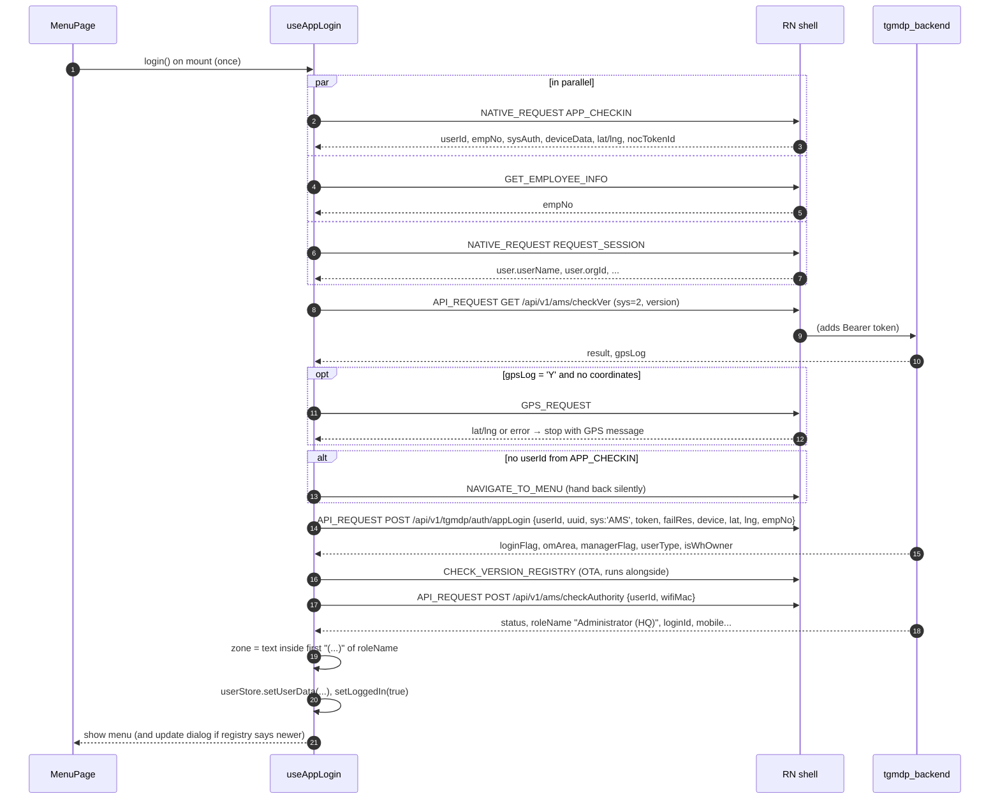

# AMS Entry and Login Flow

> The user is already signed in to the TGMDP shell. Why does AMS still "log in"? This note walks through `useAppLogin`, the hook that runs between "WebView booted" and "menu usable": it pulls identity from the shell, checks the app version, logs the device in to the AMS backend, checks the user's authority, and offers an OTA update. It is the clearest example in the repo of a guest borrowing the host's session.

Up: [[tgmdp-app-ams]] · [[System Overview]] · Related: [[Bridge API Request Flow and Auth]] · [[AMS Bridge Client]]

## Why a second login?

The shell's login proves *who the user is* to TGMDP. AMS, like each legacy system, also needs to:

- record that this device opened AMS (device info, location, push token) for audit and push routing,
- check that the user holds AMS permission (`sysAuth`) and an AMS authority role,
- learn AMS-specific facts: the user's operations area, manager flag, warehouse owner flag, zone.

So AMS performs an **application-level entry check** using the shell's identity, not a password. No credential ever passes through AMS. This mirrors legacy `AMS2.js` and `menu.js`, which the hook cites line by line.

## The sequence

Code anchors in `src/hooks/useAppLogin.ts`:

| Step | Lines |
|---|---|
| Parallel identity calls | `189-200` |
| Version check, GPS requirement | `208-233` |
| No signed-in user → hand back to TGMDP without a message | `235-241` |
| AMS permission from `sysAuth` decides `failRes` | `256-259` |
| `appLogin` call and refusal handling | `260-288` |
| OTA registry check started in parallel | `290-294` |
| Authority check | `296-307` |
| Zone parsed from `roleName` | `324-331` |
| User data saved, update dialog | `333-386` |

## Design points worth learning

**Parallelise what is independent.** The three bridge calls in step 1 do not depend on each other, so `Promise.all` runs them together (`useAppLogin.ts:189`). The registry check also runs in parallel with the authority check (`290-294`). On a phone with a slow radio, sequential calls add up quickly.

**Make failures typed.** The hook throws `EntryFailure(message, confirmLabel)` for every expected stop (version refused, GPS missing, no permission) and catches it in one place (`389-400`), which sets the dialog text. Anything else is formatted by a legacy-compatible exception formatter. One catch with typed errors beats a dozen nested `if (!res.success)` branches. See [[Error Handling]].

**Degrade where legacy degraded.** `GET_EMPLOYEE_INFO` failing is only logged and retried, then falls back to the `empNo` from `APP_CHECKIN` (`243-254`). `REQUEST_SESSION` failing yields `null` and an empty `orgId`. The version registry failing skips the update dialog. Each fallback is chosen to match what the legacy app did.

**Parity over tidiness.** The zone is the text inside the first parentheses of `roleName`. The long comment at `309-323` explains that an earlier "smarter" fallback was removed because it granted a zone legacy never granted. When the rule is "behave like the old system", a clever improvement is a bug. See [[Strangler Fig Migration and Legacy Parity|Legacy Parity]].

**Guard against re-entry.** The `isExiting` flag in `userStore` (`src/stores/userStore.ts:11-17`) blocks a new login attempt while AMS is leaving, because the shell will not answer an `APP_CHECKIN` sent during teardown.

## Where the result lives

`useUserStore` (`src/stores/userStore.ts`) holds `userData`, `isLoggedIn`, `isLoginAttempted`, `version` (the bundle version baked in by Vite's `define: { __APP_VERSION__ }`, `vite.config.ts:138-140`), `deviceOs` and `isExiting`. It is deliberately **not persisted**: the file even deletes an old `ams-user-storage` key from `localStorage` (`userStore.ts:51-53`). The shell is the source of truth for identity; AMS re-derives its user on each entry. That prevents a stale user surviving a logout in the shell. See [[Stateless vs Stateful]].

## Coverage note

`useAppLogin.ts` is on the coverage exclusion list (`vite.config.ts:236`) as a "complex hook requiring full integration environment". At about 460 lines with a dozen branches, it is the entry gate for every user and arguably the hook most worth testing. A refactor into small pure steps (`checkVersion`, `buildLoginParams`, `parseZone`) would make it testable with the existing bridge mocks. See [[AMS State Hooks and Testing|AMS Testing and the Coverage Gate]].

## Questions to check understanding

1. Which data comes from the shell, and which from the backend? Sort every field of `finalUserData` (`333-354`) into the two groups.
2. Why does the hook send `wifiMac: deviceUuid.toUpperCase()`? Where would you look to confirm?
3. If `checkVer` returns `gpsLog: 'Y'` and GPS permission is denied, what does the user see, and which legacy file defines that?

## Related

- [[tgmdp-app-ams]] · [[System Overview]] · [[Mobile Architecture Overview]]
- [[AMS Bridge Client]] · [[AMS State Hooks and Testing|AMS State and Hooks]] · [[Bridge API Request Flow and Auth]] · [[Bridge Engine and Message Protocol]] · [[tgmdp_backend]]
- Concepts: [[Authentication and Sessions]] · [[Authorization and RBAC]] · [[Error Handling]] · [[Stateless vs Stateful]] · [[Concurrency and Threads]]
- Patterns: [[Custom Hooks]] · [[Store Pattern]]
- Practices: [[Defensive Programming]] · [[Unit Testing]]
- New: [[Strangler Fig Migration and Legacy Parity|Legacy Parity]]
