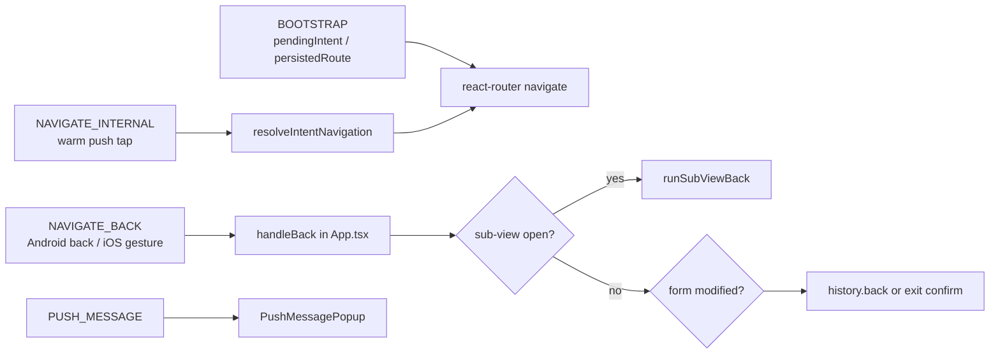

# AMS Features and Routing

> What the AMS app does for a field engineer, how its screens are organised in the repo, and how routing works when the "browser" is a WebView controlled by a native shell: hash routes, lazy chunks, deep links from push notifications, and a hardware back button that the page must answer.

Up: [[tgmdp-app-ams]] · [[System Overview]] · Host side: [[Bridge Engine and Message Protocol]]

## The business features

The menu (`src/components/menu/MenuList.tsx:32-87`) shows eight tiles, each mapped to a legacy menu code. The code names are kept from the legacy app so engineers can find the matching legacy folder (`ams2-app-legacy/www/js/<code>/`).

| Tile | Legacy code | Route | What it does |
|---|---|---|---|
| 推播訊息查詢 Push messages | `a001` | `/a001m1` | List, read and delete push notifications sent to the engineer |
| 個人障礙處理 My faults | `d001` | `/d001m1` → `/personal-ticket-list` | The engineer's own open fault tickets, grouped by priority |
| 障礙工單查詢 Ticket search | `c001` | `/c001m1` → `/ticket-list` | Search fault tickets by area and status |
| 障礙統計總表 Fault statistics | `b001` | `/b001m1`, `/b001m4`, `/b001m5` | Ticket counts by region: HQ users see every region, others their own (`pages/b001M2/b001m1.tsx:11-30`), drilling into ticket lists |
| 基站資料維護 Site data | `e001` | `/e001q1`, `/e001m1` | Site data queries |
| 高空作業檢核 High-altitude work (HIW) | `HIWshare` | `/hwi-share`, `/hwi-query*`, `/hwi-detail`, `/hwi-siteloc` | Check-in for work at height, weather, attachments |
| 鐵塔載重計算 Tower load | `IronTower` | `/iron-tower/*` | Tower load calculation, sent on to NWIS |
| 站台定位查詢 Site location | `f001` | `/f001q1`, `/f001q2`, `/f001m1` | Find a site, show it on Google Maps |

Shared sub-flows reached from tickets:

- **ticketShare**: ticket detail, reply (single and multi), photos, device list, PMR list, reminders (`src/pages/ticketShare/`).
- **DataShare**: site base info, antenna, one-week data, INAD alarm logs (3G/4G/5G/24h), SMR device state/health/assets, technology lists (`src/pages/DataShare/`).
- **gnb**: gNB tests, L2 checks and port status for 5G base stations (`src/pages/gnb/`). These calls wait up to 140 s, matching legacy (`src/services/api/ams.ts:5-8`).

## Folder convention: by legacy menu

`pages/<menu>/`, `hooks/<menu>/` and often `components/<area>/` line up. A page is mostly layout; data access sits in a hook in the matching hook folder, for example `pages/gnb/gNBtest.tsx` with `hooks/gnb/useGetPortStatus.ts`. That is [[Feature-Sliced Structure]] applied with the legacy menu as the slice, and the page/hook split is close to [[Container-Presentational]]. See [[AMS State Hooks and Testing|AMS State and Hooks]].

## Why HashRouter?

```tsx
// tgmdp-app-ams/src/main.tsx:25-33
createRoot(rootElement, { /* error callbacks */ }).render(
  <StrictMode>
    <AppErrorBoundary>
      <HashRouter>
        <App />
      </HashRouter>
    </AppErrorBoundary>
  </StrictMode>,
)
```

In production the app is loaded from `file:///.../AMS2/<version>/index.html`. A `BrowserRouter` would turn `/ticket-detail` into `file:///ticket-detail`, which does not exist, and a reload would show nothing. With a hash router the real file is always `index.html` and the route lives after `#`. The shell's boot shim reads the current route from `window.location.hash` (`tgmdp_rn_app/core/communications/bootShim.templates.ts:37-50`) and can persist and restore it. See [[Routing]] and [[Single Page Applications]].

## Lazy routes keep the first paint small

`src/App.tsx:26-77` loads only `MenuPage` eagerly. Every other page is a `lazy(() => import(...))` chunk inside one `<Suspense>`. The comment gives the reason: the WebView must parse and execute the initial bundle on open, so less code means a faster first menu. Vite also splits vendor code into `react-vendor` and `state-vendor` chunks (`vite.config.ts:108-121`).

## Navigation that comes from outside the page

A normal SPA only reacts to clicks. AMS also reacts to four kinds of host-driven navigation:



- **Cold start from a push**: the shell puts the target in `BOOTSTRAP.pendingIntent`; `resolveBootRoute` picks `pendingIntent.target ?? persistedRoute ?? initialRoute` (`src/utils/bridge/boot.ts:9-15`).
- **Warm push tap**: `NAVIGATE_INTERNAL` with params like `TICKET_NO` maps to `/ticket-detail` (`src/utils/bridge/navigation.ts:13-22`).
- **Before login passes**: a route that arrives early is parked in `useWebViewStore.postLoginRoute` and opened by `MenuPage` after the entry checks, because legacy always showed the menu first (`src/App.tsx:130-137`).
- **Hardware back**: the shell does not pop a native screen; it sends `NAVIGATE_BACK`. `App.tsx:100-123` first asks the open page whether it has an inner sub-view to close (`src/utils/subViewBack.ts`), then runs the unsaved-form guard, then either goes back in history or asks 是否關閉此應用程式 ("close this app?").

Leaving AMS is also explicit. The HOME key runs `useExitToTgmdp` (`src/hooks/useExitToTgmdp.ts`): set an "exiting" latch, log out of AMS on the backend, then send `NAVIGATE_TO_MENU` so the shell shows its menu. The latch exists because clearing the user would otherwise re-trigger the login effect and send an `APP_CHECKIN` the shell will never answer (comment at `useExitToTgmdp.ts:31-35`).

## Global UI mounted once

`App.tsx:156-179` renders the employee-number `Watermark`, a global `LoadingSpinner`, push popup, form-modified dialog, M+ message dialog, the exit confirm and the session-lost dialog above the routes. Mounting dialogs once and driving them from stores avoids every page re-implementing the same modal. See [[Component-Based UI]].

## Questions to check understanding

1. A push for ticket `T123` arrives while AMS is cached in the pool but the user has not passed the entry checks yet. Trace which store holds the route and which component finally navigates.
2. Why does `setupNavigationHandler` deliberately *not* register `window.__TGMDP_NAVIGATE_HANDLER__`? (Read `src/utils/bridge/navigation.ts:24-31`.)
3. What would a user see if `HashRouter` were swapped for `BrowserRouter` in a file-mode build?

## Related

- [[tgmdp-app-ams]] · [[System Overview]] · [[Mobile Architecture Overview]]
- [[AMS Bridge Client]] · [[AMS Entry and Login Flow]] · [[AMS State Hooks and Testing|AMS State and Hooks]] · [[Bridge Engine and Message Protocol]] · [[WebView Pool and Bundle Loading]]
- Concepts: [[Routing]] · [[Single Page Applications]] · [[Component-Based UI]] · [[Hybrid Mobile Apps]]
- Patterns: [[Feature-Sliced Structure]] · [[Container-Presentational]] · [[Observer and Pub-Sub]]
- Practices: [[Clean Code Naming]] · [[Separation of Concerns]]
- New: [[Strangler Fig Migration and Legacy Parity|Legacy Parity]] · Code Splitting
