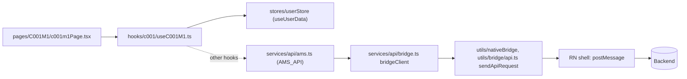

# AMS State, Hooks and Testing

How `tgmdp-app-ams` (React 19 + Vite + `react-router-dom` 7 + Zustand 5, running **inside** the RN shell) organises logic. Repo map: [[tgmdp-app-ams]]. Paths are under `tgmdp-app-ams/`.

## Layout of `src/`
Verified by listing the tree:
```
src/
  pages/        one folder per screen group (a001m1, b001M2, C001M1, d001, e001, f001, gnb, DataShare, HIWshare, IronTower, ticketShare) + MenuPage.tsx
  hooks/        shared hooks at the top (useAppLogin, useLogout, useSessionLost, useWebViewBoot...)
                plus per-module folders (b001, c001, d001, e001, f001, gnb, hiw, ironTower, mplus, photo, ticket, ticketShare, DataShare)
  services/     api/ (ams.ts, sd1.ts, cwa.ts, bridge.ts, client.ts) and monitoring/
  stores/       Zustand stores (userStore, taskIdStore, webViewStore, loadingStore, formModifyStore, ...)
  components/   shared UI;  utils/ (incl. utils/bridge/*)  types/  constants/
  __test__/     App tests;  tests also sit in __test__/ folders beside each unit
  test/setup.ts shared Vitest setup
```
Module folders are named after the **legacy modules** they replace, which makes parity reviews easy. See [[Strangler Fig Migration and Legacy Parity]]. Note the casing is inconsistent in practice (`C001M1` pages vs `hooks/c001`).

## The shape of one feature

- **Pages stay thin.** `c001m1Page.tsx:3,17` calls `useC001M1()` and renders; the hook holds the form state and validation (it cites legacy rules such as "site_id.length<5"). This is [[Custom Hooks]] plus [[Container-Presentational]]. `useC001M1` itself is pure UI logic and does not touch the network; other hooks (e.g. `hooks/useGetApiKey.ts`) call `AMS_API.*`.
- **Requests go through the bridge, not `fetch`.** `AMS_API` methods in `services/api/ams.ts` call `bridgeClient.get/post`, which rejects with "Native bridge not available" if the bridge is missing (`services/api/bridge.ts`). See [[AMS Bridge Client]]. `services/api/client.ts` does define an axios instance, but nothing in `src` imports it (only its own comment says auth lives in the bridge), so treat it as a leftover.
- **Stores are small and per-concern**, plain `create()` Zustand with selector hooks, e.g. `useUserStore` / `useUserData` in `stores/userStore.ts:58` and `usePageName` in `stores/taskIdStore.ts:28`. No `persist` middleware is used in `src/stores`; durable data lives in the shell.
- **Routing** is `react-router-dom` with lazy pages (`src/App.tsx`, `lazy(() => import(...))` at line 29 on). See [[AMS Features and Routing]].
- **Shared hooks** such as `useAppLogin`, `useSessionLost`, `useLogout` and `useWebViewBoot` cover cross-cutting behaviour. See [[AMS Entry and Login Flow]].

## Testing (what the config really says)
Source: `vite.config.ts`, `test:` block (lines ~153-250).
- **Vitest 4 + Testing Library**, `environment: 'jsdom'`, `globals: true`, setup in `src/test/setup.ts`. Tests are only picked up from `src/**/__test__/**/*.test.{ts,tsx}`.
- `setup.ts` stubs `localStorage`/`sessionStorage` and `window.ReactNativeWebView = { postMessage: vi.fn() }`, so the bridge is faked at the WebView boundary ([[Mocking]]). Hook tests use `renderHook`/`act` and `vi.mock('@services/api/ams', ...)` (see `hooks/__test__/useGetApiKey.test.ts`).
- **Coverage gate**: `thresholds` of 100 for lines, functions, branches and statements with the v8 provider. **But the gate only counts a curated subset.** The `exclude` list drops all of `src/pages/**`, `src/App.tsx`, `src/utils/bridge/**` and `utils/nativeBridge.ts`, the big API clients (`services/api/ams.ts`, `sd1.ts`, `client.ts`), and several large hooks (`useAppLogin`, `useWebViewBoot`, `useHIWDetail`, `usePersonalTicketList`, `useTicketList`, `useF001Q1`...), each with a reason comment. So "100% coverage" means 100% of what is not excluded. See [[Test Coverage Gates]] and [[Unit Testing]].
- Run with `npm run test` (`vitest run`) or `npm run test:coverage`. The `.gitlab-ci.yml` only has `build` (`npm run build-zip`) and `publish` stages, so tests are not run in that pipeline.
- A parity-driven workflow: legacy-gap fixes carry a test pinning the new behaviour; several comments cite legacy file:line.

## Why this works
Because the shell owns I/O, the web layer is mostly UI plus logic and unit-testable in jsdom. The price: the pieces that talk to the real bridge (`utils/bridge`, `useAppLogin`, `useWebViewBoot`) are exactly the ones excluded from the gate, so they need runtime verification. See [[Hybrid Shell Architecture Trade-offs]].

## Related
[[tgmdp-app-ams]] · [[AMS Features and Routing]] · [[Client State Management]] · [[Store Pattern]] · [[Testing Pyramid]] · [[Mobile Architecture Overview]]
