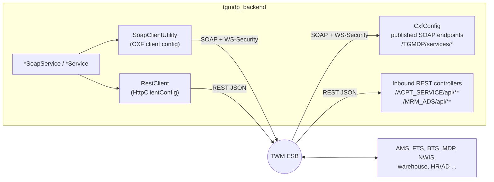
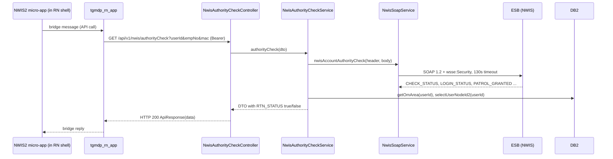

# tgmdp_backend ESB Integration

Up: [[tgmdp_backend]] · [[System Overview]]

Taiwan Mobile's internal systems (HR/AD authority, AMS fault tickets, FTS, BTS, MDP, warehouse, NWIS patrol and more) don't call each other directly. They talk through an **Enterprise Service Bus (ESB)**. The ESB is the switchboard: it routes, transforms and secures messages between systems. `tgmdp_backend` sits on the bus in **both directions**:



Read `tgmdp_backend/CLAUDE.md`, section "ESB integration map". It holds a failure playbook written after a real UAT incident, and the patterns below come from it.

## Outbound 1: SOAP with Apache CXF

### Generated clients
SOAP contracts are WSDL files in `src/main/resources/wsdl/` (`1_AMSSoapHttpService.wsdl`, `10_NWIS_ESBService.wsdl`, `12_ACPTSoapService.wsdl` ...). A custom Gradle task, `wsdl2java` in `build.gradle`, runs CXF's `WSDLToJava` on each one and writes Java classes to `build/generated-sources/wsdl`. `compileJava` depends on it, so you never edit generated code by hand.

One flag in that task has a story:

```groovy
"-wsdlLocation", "classpath:wsdl/${wsdl.name}",
```

Without it, `wsdl2java` baked the **build machine's absolute path** (`file:/var/jenkins_home/...`) into the generated class. On the deploy host the file didn't exist, `new XxxPortTypeService()` threw `FileNotFoundException`, and the SOAP call was never sent. Loading from the classpath makes the jar self-contained. (Failure pattern 1 in `CLAUDE.md`.) A typical "works on my machine" bug, fixed in the build file.

### `SoapClientUtility`: one place to configure every port

`utils/SoapClientUtility.java:42-96`

```java
public <T> T configurePort(T port, String endpointUrl, int connectionTimeoutMillis, int receiveTimeoutMillis, Map<String,Object> headers) {
    BindingProvider bindingProvider = (BindingProvider) port;
    bindingProvider.getRequestContext().put(BindingProvider.ENDPOINT_ADDRESS_PROPERTY, endpointUrl); // env-specific URL
    Client client = ClientProxy.getClient(port);
    client.getInInterceptors().add(new LoggingInInterceptor(esbLogEventSender));    // ESB traffic -> ELK
    client.getOutInterceptors().add(new LoggingOutInterceptor(esbLogEventSender));
    HTTPClientPolicy policy = new HTTPClientPolicy();
    policy.setConnectionTimeout(connectionTimeoutMillis);
    policy.setReceiveTimeout(receiveTimeoutMillis);
    ...
}
public <T> T configurePortWithWsSecurity(T port, ..., String username, String password) {
    handlerChain.add(new EsbWsSecurityHandler(username, password));
    return configurePort(port, ...);
}
```

Why centralise? Every SOAP client needs the same four things: the right endpoint per environment, timeouts, logging and security. Writing them once means a fix (e.g. adding logging) reaches every client. This is a [[Facade]] over CXF's verbose client API.

### WS-Security: UsernameToken with PasswordDigest

The ESB rejects SOAP calls without a WS-Security header. `service/esb/EsbWsSecurityHandler.java` adds one:

```java
// EsbWsSecurityHandler.java:102-115
MessageDigest sha1 = MessageDigest.getInstance("SHA-1");
sha1.update(nonce);                          // random bytes, new per message
sha1.update(created.getBytes(UTF_8));        // timestamp
sha1.update(passwordBytes);
return Base64.getEncoder().encodeToString(sha1.digest());
```

`PasswordDigest = Base64(SHA1(nonce + created + password))`. The password itself never travels. The nonce and timestamp let the receiver reject replays. (A weakness: anyone who captures one digest can brute-force a weak password offline. `CLAUDE.md` notes that the ESB log stores the full envelope, digest included.)

The most common UAT failure was a **missing or placeholder credential**. The deploy left `[nwis username]` from `.env.sample` in place, and every call failed with the generic fault "A security error was encountered". The lesson: when a security fault happens, first read the `<wsse:Username>` actually sent. See [[Secrets Management]] and [[Configuration and Environments]].

### Running example C: NWIS authority check

When a field engineer opens the NWIS2 micro-app, it checks with the NWIS system (through the ESB) whether this employee may patrol.



Code: `controller/nwisads/NwisAuthorityCheckController.java:24-29`, `service/nwisads/NwisAuthorityCheckService.java:51-110`, `service/nwisads/NwisSoapService.java:66-89`.

Things to notice:

- **Errors are data, not HTTP status.** If the ESB says "no permission", or even throws, the service returns `RTN_STATUS=false` with a message, **in HTTP 200** (`NwisAuthorityCheckService.java:47-49` javadoc, `:101-109` catch). The legacy app expects that contract, so the rebuilt backend keeps it. Compare the web console, which uses real 4xx/5xx codes. The contract is set by the client, not by REST ideals. See [[SOAP vs REST]].
- **SOAP 1.2 must be set by hand.** `factory.setBindingId(SOAPBinding.SOAP12HTTP_BINDING)` (`NwisSoapService.java:70-72`). The WSDL says SOAP 1.2, but the legacy service interface lacks `@BindingType`, so CXF would default to 1.1.
- **Long timeouts** (130 s): ESB calls can be slow. A Tomcat thread blocks the whole time, which is one reason some flows use `@Async` (`NwisDataCenterAsyncService`, `NwisPatrolCheckSyncAsyncService`).
- **Dev bypass flags** (`nwis.authority.skip-enabled`) can skip the ESB entirely. When one is on, "NWIS works" proves nothing about the ESB.

## Outbound 2: REST with `RestClient`

Some ESB services are JSON over HTTP, mostly in the vendor, MRM and ACPT flows. One shared `RestClient` bean is built in `config/HttpClientConfig.java:35-159`, with a **request interceptor** that logs every call as `log_type=esb`, `esb_protocol=REST`, plus endpoint, payload (truncated to 10 000 chars), HTTP status and latency. Callers just inject it:

```java
// service/tgmdpweb/projectAcceptance/AcptExternalCallbackServiceImpl.java:39-43
Map<String, Object> d2Response = restClient.post()
        .uri(d2Url)                 // from ${acpt.api.d2.endpoint}
        ...
        .retrieve()
```

Other users: `MPlusService`, `SmsService`, `SdOneAntApiService`, `NwisPatrolStartService`.

> **Security note — docs vs code.** `tgmdp_backend/CLAUDE.md` says the backend is "deliberately clean of trust-all" TLS. The current code is not. `HttpClientConfig.restClient()` uses `TrustAllStrategy` + `NoopHostnameVerifier`, and `SoapClientUtility` installs a `TRUST_ALL` `X509TrustManager` with `setDisableCNCheck(true)`. The comments justify it: ESB servers use private-CA, CN-only certificates. This turns off protection against man-in-the-middle attacks (CWE-295). The proper fix is a bundled truststore holding the ESB CA. Use it as a case study in how a "temporary" workaround spreads, and in why docs must be re-checked against code.

## Inbound 1: SOAP endpoints published by CXF

`config/CxfConfig.java` publishes JAX-WS endpoints under `cxf.path=/TGMDP/services` (`application.properties:9`):

```java
// CxfConfig.java:131-146
@Bean
public Endpoint nwisMdpEndpoint() {
    EndpointImpl endpoint = new EndpointImpl(bus, nwisMdpSoapEndpoint);
    endpoint.getInInterceptors().add(new SysIdInInterceptor(NWIS_SYS_ID));   // set SystemContext
    addEsbLogging(endpoint);
    endpoint.getInInterceptors().add(new WSS4JInInterceptor(wssProperties(nwisMdpPasswordCallback)));
    endpoint.getInInterceptors().add(new SoapActionRoutingInterceptor());
    endpoint.publish("/NwisMdpSoapHttpService");
    return endpoint;
}
```

- **`WSS4JInInterceptor`** checks the caller's UsernameToken digest (`wssProperties`, `:301-310`: `UsernameToken Timestamp`, `PasswordDigest`, `Nonce Created`). A *password callback* class supplies the expected password. This is the mirror image of `EsbWsSecurityHandler`.
- **`SysIdInInterceptor`**: CXF requests don't pass through `SystemRouteFilter`'s logic for `/api`, so this CXF interceptor sets the system ID instead. Same need, different pipeline. The interceptor chain is CXF's version of a servlet filter chain.
- Other endpoints: `/AMSService`, `/MetadataSoapHttpService` (BTS), FTS, MDP, SLA, RETU, SKP, IDM.
- Spring Security treats `/TGMDP/services/**` as `permitAll` (`WebSecurityConfig.java:91-93`) because security is enforced at the SOAP layer. There is also a dedicated chain for `/NWIS_ADS/services/**` (`:51-63`).

## Inbound 2: REST endpoints with legacy paths

The ESB was configured years ago to call URLs like `http://host/ACPT_SERVICE/api/WH/API_H2`. Changing the ESB's routing table is far harder than keeping the URL. So the controllers keep the legacy prefix:

```java
// controller/acptads/ApiH2AcptController.java:21-37
@RestController
@RequestMapping("/ACPT_SERVICE/api")
public class ApiH2AcptController {
    @PostMapping("/WH/API_H2")
    public ResponseEntity<AcptEsbInboundResponseDto> apiH2(@RequestBody AcptApiH2RequestDto requestDto) {
        return ResponseEntity.ok(acptApiH2Service.apiH2(requestDto));
    }
}
```

H2 = "NWIS sends the EM review result (approve/reject) of a vendor material requisition". Highlights from `service/acptads/AcptApiH2Service.java`:

- **ESB envelope, not `ApiResponse`.** The reply uses the ESB's codes: `10001 SUCCESS`, `20002 資料不完整` (incomplete data), `20003 系統發生異常` (system error) (`:76-82`). Always HTTP 200. The ESB reads the `Status` field.
- **Per-record transactions** with `REQUIRES_NEW` (`:100-127`), so one bad record doesn't undo the batch.
- **Per-record error aggregation**: errors are joined as `申請單號-<no>：<reason>;...` (`:139-153`).
- **Don't leak internals.** Legacy put the exception object into the response. The port returns a fixed message and logs the detail (`:159-163`). See [[Error Handling]].
- **Side effects**: reject email to the OM, an M+ notification, an audit row in `ACPT_TGMRULOP_LOG`.

Other inbound REST controllers: `controller/mrmads/MrmAdsInboundESBController.java` (`/MRM_ADS/api/NWIS/SyncCode`, `/SyncMaterial`, `/SyncWarehouse`), `MrmAdsWarehouseInboundESBController`, `controller/acptads/SyncWatAcptController.java`. See `inbound_interfaces.md` in the workspace root for the full list.

> **Ops gotcha (from the team's notes):** the staging edge nginx forwarded only `/api/` to Spring. Every ESB inbound prefix (`/ACPT_SERVICE`, `/MRM_ADS`, `/TGMDP/services`) got a 404 before reaching the app. You can tell them apart: nginx returns an **HTML** 404, Spring returns a **JSON** 404. Remember this before debugging code that never ran.

## Observability for ESB traffic

| Stream | Produced by | Fields |
|---|---|---|
| SOAP in/out | `logging/EsbLogEventSender.java` (CXF logging interceptors) | `log_type=esb`, `esb_stage` REQUEST/RESPONSE/FAULT, `esb_operation`, `esb_payload`, `esb_latency_ms` |
| REST out | `HttpClientConfig` interceptor | same fields + `esb_protocol=REST`, `esb_http_status` |

The diagnostic rule in `CLAUDE.md` is worth memorising. **No `REQUEST` log means the call was never sent.** Look at client construction (WSDL, config). A `REQUEST` without `<wsse:Security>` is a code bug. A `FAULT` after a correct header is credentials, certificates or connectivity.

## Local testing

`tgmdp_fake_esb/` (sibling repo) is a Spring-WS mock on `:8085`. Point `*_SOAP_ENDPOINT` at `http://localhost:8085/ws` to test request shape end to end. It does **not** validate WS-Security, so it cannot reproduce credential failures. Use it as a [[Mocking]] tool, not proof of integration.

## Questions to check understanding

1. Why does the inbound H2 endpoint always answer HTTP 200, even on failure?
2. What's the difference between `configurePort` and `configurePortWithWsSecurity`, and what symptom do you see if a service uses the wrong one?
3. Why does `NwisSoapService` attach its own security handler and then call `configurePort` (not `configurePortWithWsSecurity`)? (Hint: read the javadoc on `configurePortWithWsSecurity`.)
4. Draw the trust boundary: which inbound paths rely on WS-Security, and which rely only on the network?

## Related

- [[tgmdp_backend]] · [[System Overview]] · [[tgmdp_backend Security and Auth]] · [[tgmdp_backend Logging and Configuration]] · [[tgmdp_backend Persistence and DB2]]
- [[Message Integration and ESB]] · [[SOAP vs REST]] · [[HTTP and REST]] · [[Client-Server Architecture]]
- [[Gateway]] · [[Adapter]] · [[Facade]] · [[Anti-Corruption Layer]] · [[Interceptor and Filter Chain]] · [[Strangler Fig]]
- [[Concurrency and Threads]] · [[Logging and Observability]] · [[Secrets Management]] · [[Mocking]] · [[Error Handling]]
- [[Hybrid Mobile Apps]] · [[WebView and Native Bridge]]
