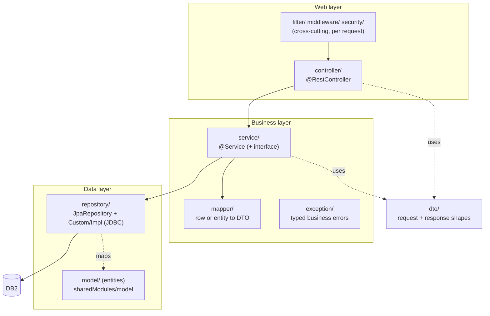

# tgmdp_backend Layering and Packages

Up: [[tgmdp_backend]] · [[System Overview]]

The backend follows the classic Spring **layered architecture**:



Each arrow points one way. A controller never talks to a repository directly (in the well-behaved modules). A repository never knows about HTTP. The sections below explain **why** each layer exists, using running example A (PO category, `TGMDPs011`) and example B (vendor login).

## Controller: translate HTTP into method calls

`controller/tgmdpweb/projectAcceptance/PoCategoryController.java:39-132`

A controller's job is narrow:
- declare the URL and HTTP verb (`@GetMapping`, `@PostMapping`),
- declare **who may call it** (`@PreAuthorize`),
- bind and validate input (`@Valid @RequestBody`, `@PathVariable @NotBlank @Size(max = 30)`),
- call one service method,
- turn the result into an HTTP response (status code, headers, body).

```java
@PostMapping("/{contractNo}")
@PreAuthorize("hasAuthority('TASK_TGMDPs011:update') and hasAuthority('SYS_工程驗收')")
public ResponseEntity<ApiResponse<PoCategoryUpdateResponseDto>> update(
        @PathVariable @NotBlank @Size(max = 30) String contractNo,
        @Valid @RequestBody PoCategoryUpdateRequestDto request,
        @AuthenticationPrincipal CustomUserDetails currentUser) {
    ApiResponse<PoCategoryUpdateResponseDto> response = poCategoryService.update(request, contractNo, currentUser);
    return ResponseEntity.status(response.getCode()).body(response);
}
```

**Why keep it thin?** HTTP concerns change for different reasons than business rules. If the export endpoint needs a new `Content-Disposition` header, you edit only the controller. If the rule for "is this project type inspectable" changes, you edit only the service. That is the Single Responsibility part of [[SOLID]].

The export endpoint (`PoCategoryController.java:111-131`) shows the one HTTP-ish job that rightly stays in the controller: it builds the RFC 5987 `filename*=UTF-8''...` header so a Chinese file name survives the download.

**Counter-example.** `controller/tgmdpvendor/ProjectAcceptanceController.java` is about 126 KB, and `TempProjectController.java` is about 45 KB. Large controllers are usually a sign that business rules leaked upward. When you read one, check how much logic would move to a service if you refactored it.

Vendor auth (example B) is thinner still. `TgmdpvendorAuthController.java:305-342` only builds the `Set-Cookie` header, which is an HTTP concern, and leaves the OTP rules to the service.

## Service: the business rules and the transaction boundary

`service/tgmdpweb/projectAcceptance/PoCategoryService.java` (interface) and `PoCategoryServiceImpl.java` (implementation).

```java
public interface PoCategoryService {
    ApiResponse<PoCategorySearchResponseDto> search(PoCategorySearchCriteria criteria, CustomUserDetails currentUser);
    ApiResponse<PoCategoryUpdateResponseDto> update(PoCategoryUpdateRequestDto request, String contractNo, CustomUserDetails currentUser);
    ...
}
```

The service layer exists for three reasons:

1. **Business rules live in one place.** `PoCategoryServiceImpl.update` (`:196-268`) decides that changing a PO's project type must also update `ACPT_CTI_MST`, compute an "is inspectable" flag, write a `SYS_LOG` audit row and write an interface log. Any caller (web, app, job) gets the same behaviour.
2. **Transaction boundary.** `@Transactional` sits on service methods (`PoCategoryServiceImpl.java:197`). Two repository writes, PO and CTI, then commit or roll back together. See [[Database Transactions]] and [[tgmdp_backend Persistence and DB2]].
3. **Orchestration.** One service call may use five repositories and an ESB client. `PoCategoryServiceImpl` injects eight collaborators (`:59-66`).

**Why an interface + `Impl`?** It lets tests and other beans depend on the abstraction, and it lets Spring create proxies cleanly. In this repo the pattern is used inconsistently. `PoCategoryService` has an interface; `TgmdpvendorAuthService` and `AcptApiH2Service` are concrete classes. Both work. Mockito can mock concrete classes, so the interface mostly documents the API. See [[Dependency Injection]].

**A layering smell to notice:** `PoCategoryServiceImpl` returns `ApiResponse<...>` with an `HttpStatus` inside. That couples the service to HTTP. A purer design would return the DTO and throw `ResourceNotFoundException`, letting the controller or `GlobalExceptionHandler` choose the status. Many newer modules do that. Comparing the two styles teaches you why "services shouldn't know about HTTP".

## Repository: the only layer that speaks SQL

There are two flavours side by side, often for the same table.

**Spring Data interface** (example: `repository/acptads/AcptWorkTypeMstRepository.java`):

```java
@Repository
public interface AcptWorkTypeMstRepository extends JpaRepository<AcptWorktypeMst, String> {
    @Query(value = "SELECT PROJECT_TYPE, NAME, STATUS, INSPECT_TYPE, ... " +
            "FROM ACPT.ACPT_WORKTYPE_MST WHERE STATUS = '1'", nativeQuery = true)
    List<AcptWorktypeMst> getAcptProjectType();
}
```

You write no implementation; Spring generates it at startup.

**Custom fragment: `XxxRepositoryCustom` interface + `XxxRepositoryImpl` class** (example: `repository/tgmdpweb/projectAcceptance/PoCategoryBrowseRepositoryCustom.java` + `PoCategoryBrowseRepositoryImpl.java`). This is used when the SQL is dynamic, with optional filters and pagination. The `Impl` uses `NamedParameterJdbcTemplate` and returns `Page<Map<String,Object>>`.

**Why have a repository layer at all?** It hides *how* data is fetched. The service asks `browse(criteria, pageable)` and gets a page back. Whether that came from JPQL, native SQL or JDBC is the repository's business. You can swap the implementation (for example, to work around a DB2 bug) without touching the service. See [[Repository Pattern]].

## Entity (model): a Java view of a table

`sharedModules/src/main/java/com/taiwanmobile/sharedmodules/model/acptads/AcptPoMst.java`

```java
@Entity
@Table(name = "acpt_po_mst")
public class AcptPoMst extends BaseEntityAcpt {
    @Id @Column(name = "contract_no", length = 50, nullable = false)
    private String contractNo;
    @Column(name = "project_type", length = 20)
    private String projectType;
    ...
}
```

`BaseEntityAcpt` is a `@MappedSuperclass` with `create_date / update_date / create_id / update_id` and `@PrePersist` / `@PreUpdate` hooks. Every ACPT table shares those audit columns. The class comment records a real bug: without `@MappedSuperclass`, Hibernate failed at startup with `UnknownPathException`.

Entities exist so JPA can track changes and write SQL for you ([[ORM and JPA]]). In this repo many reads bypass entities, as `Map<String,Object>` rows from native SQL. The legacy schema is wide, denormalised and full of DB2 functions, so mapping every query result to an entity would be a lot of ceremony for little gain.

**Why are entities in a submodule?** The batch app `tgmdp_jobs` reads the same tables. `sharedModules` is a git submodule (`.gitmodules`), so both apps share one definition. `config/SharedModulesJpaPackagesConfig.java:39-63` registers it with `@AutoConfigurationPackage`, not `@EntityScan`. The javadoc explains why: `@EntityScan` would force JPA on in sliced tests like `@WebMvcTest`. That is a nice example of a decision you only understand once you have broken a test. See [[Monorepo vs Polyrepo]].

## DTO: the contract with the client

`dto/` holds about 2400 classes, by far the biggest package. Examples:

- **Request DTO with validation**: `dto/tgmdpweb/projectAcceptance/PoCategoryUpdateRequestDto.java`, with `@NotBlank` on `taskId`, `taskName` and `projectType`.
- **Search criteria DTO** bound from query params: `PoCategorySearchCriteria`.
- **Response DTO** built with Lombok `@Builder`: `PoCategorySearchResponseDto`, with a nested `PaginationDto`.
- **Generic envelope**: `dto/ApiResponse.java`.

**Why not return entities directly?**
1. Entities mirror the DB, while DTOs mirror the screen. They change for different reasons.
2. Returning an entity can leak columns such as password hashes, or trigger lazy-loading surprises during JSON serialization.
3. DTOs carry validation annotations for *input*. You don't want those on the entity.

See [[DTO Pattern]] and [[Serialization and DTOs]].

## Mapper: converting between shapes

Two styles exist:
- **Hand-written** `@Component` mappers, e.g. `mapper/tgmdpweb/TgmdpwebSystemServiceMonitoringLogQueryMapper.java`, which turns `Object[]` rows into DTOs.
- **MapStruct** generated mappers, e.g. `mapper/tgmdpweb/resourceExchange/ResourceExchangeHistoryMapper.java` with `@Mapper(componentModel = "spring")` and `@Mapping(target = "userId", source = "USER_ID")`. About 11 files use it.
- And very often a private `mapToDto(Map<String,Object>)` method inside the service (`PoCategoryServiceImpl`).

## Cross-cutting packages

| Package | Purpose |
|---|---|
| `security/` | JWT filter, CSRF origin check, method security, `CustomUserDetails`, `SysAuthRules` |
| `filter/`, `middleware/` | `SystemRouteFilter`, `LegacyQueryParamFilter`, `LogFilter` |
| `config/` | `@Configuration` beans: datasource, CXF, REST clients, Jackson, Jasypt, global exception handler |
| `context/` | `SystemContext` ThreadLocal + `ContextCopyingTaskDecorator` for `@Async` threads |
| `interceptor/` | CXF interceptors for inbound SOAP (`SysIdInInterceptor`, `SoapActionRoutingInterceptor`) |
| `logging/` | `EsbLogEventSender` (SOAP traffic → ELK) |
| `utils/` | `JwtUtility`, `SoapClientUtility`, `LogUtility`, `CaptchaUtility`, `OTPUtility` ... |
| `registry/` | a self-contained mini-module (its own controller/service/repo/dto) for OTA app-bundle releases |
| `esb` (`com.taiwanmobile.esb`) | JAXB/XSD classes; WSDL clients are generated into the build dir |

## Questions to check understanding

1. `PoCategoryServiceImpl.update` returns `ApiResponse(NOT_FOUND)` when the contract doesn't exist. Rewrite it in your head to throw `ResourceNotFoundException`. What would change in the controller? In the tests?
2. Why does `PoCategoryBrowseRepositoryImpl` return `Map<String,Object>` rows instead of `AcptPoMst` entities?
3. If the batch app `tgmdp_jobs` changes `AcptPoMst`, what has to happen in `tgmdp_backend` for the change to take effect?

## Related

- [[tgmdp_backend]] · [[System Overview]] · [[tgmdp_backend Request Lifecycle]] · [[tgmdp_backend Persistence and DB2]] · [[tgmdp_backend Design Patterns Spotted]]
- [[Layered Architecture]] · [[Separation of Concerns]] · [[SOLID]] · [[Dependency Injection]] · [[Inversion of Control]]
- [[MVC]] · [[Service Layer]] · [[Repository Pattern]] · [[DTO Pattern]] · [[Builder]] · [[Feature-Sliced Structure]]
- [[ORM and JPA]] · [[Serialization and DTOs]] · [[Monorepo vs Polyrepo]] · [[Clean Code Naming]]
