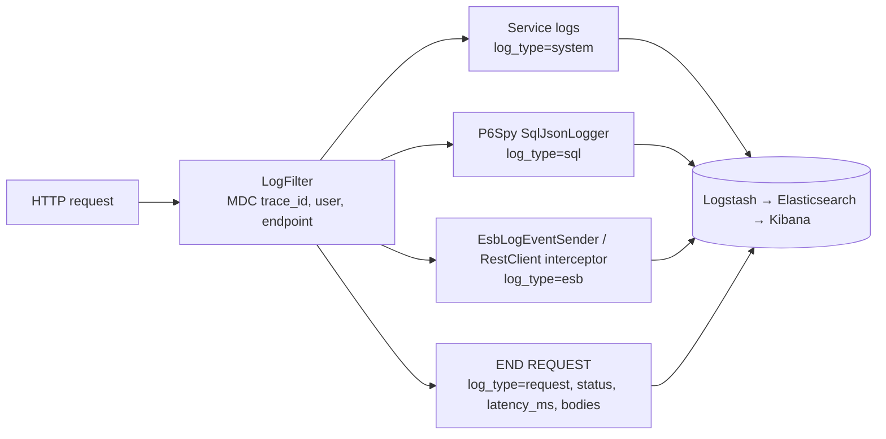
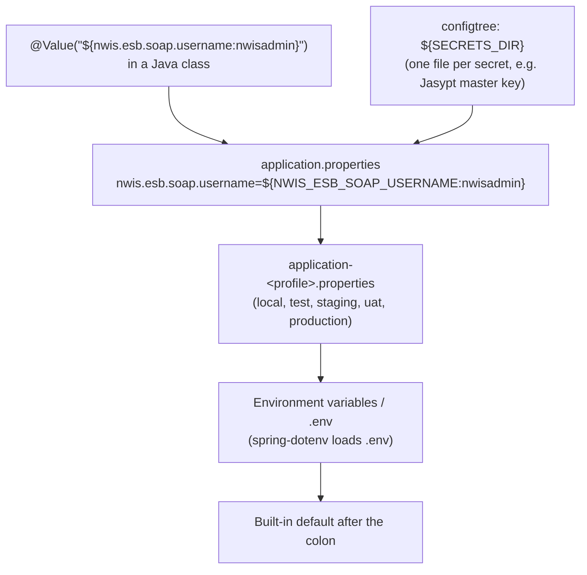

# tgmdp_backend Logging and Configuration

Up: [[tgmdp_backend]] · [[System Overview]]

Two operational concerns share this note because they meet in one place: **the environment**. Configuration decides *what* the app connects to; logging tells you *what actually happened* when it did. Most production incidents in this repo (see `tgmdp_backend/CLAUDE.md`) were solved by reading one and fixing the other.

## Part 1: Logging and observability

### Structured logs, not text

Logs are JSON, built by `net.logstash.logback.encoder.LogstashEncoder` (`src/main/resources/logback-spring.xml`). They are shipped by TCP to Logstash (`LogstashTcpSocketAppender`, `${LOGSTASH_HOST}:${LOGSTASH_TCP_PORT}`, `:218-296`) and searched in Kibana. Plain-text logs are for humans; JSON logs are for **queries**. `trace_id: "abc" and log_type: "esb"` is impossible over a text file.

### One request, many streams, one `trace_id`



| `log_type` | Logger / producer | Extra MDC fields |
|---|---|---|
| `request` | `middleware/LogFilter.java` | `trace_id`, `endpoint`, `http_method`, `client_ip`, `request_source` (WEB/VENDOR/APP), `user`, `request_body`, `response_body`, `status_code`, `latency_ms` |
| `sql` | `config/SqlJsonLogger.java:26-30` via P6Spy (`spy.properties`) | `sql_query`, `sql_params`, `sql_exec_ms`, `sql_category` |
| `esb` | `logging/EsbLogEventSender.java` (SOAP), `config/HttpClientConfig.java` (REST) | `esb_stage`, `esb_operation`, `esb_endpoint`, `esb_payload`, `esb_latency_ms`, `esb_http_status` |
| `system` | everything else (`utils/LogUtility.java`, Lombok `@Slf4j`) | |

`logback-spring.xml:300-326` routes each named logger (`sql`, `esb`, `LogFilter`, `registry`) to its own rolling file **and** to Logstash, with `additivity="false"` so lines aren't duplicated. `<springProfile>` blocks change the routing per environment.

### MDC, and where it breaks

MDC is a `ThreadLocal` map. `LogFilter` fills it on the request thread and calls `MDC.clear()` in `finally` (`LogFilter.java:109`). That works as long as the request stays on one thread.

`@Async` work runs on `applicationTaskExecutor` (`config/AsyncConfig.java:13-26`), which installs `context/ContextCopyingTaskDecorator`:

```java
// context/ContextCopyingTaskDecorator.java
public Runnable decorate(Runnable runnable) {
    String sysId = SystemContext.getSysId();          // captured on the request thread
    return () -> {
        try { SystemContext.setSysId(sysId); runnable.run(); }
        finally { SystemContext.clear(); }
    };
}
```

It copies the **system ID**, but **not the MDC**. So logs written by async ESB syncs (`NwisDataCenterAsyncService`, `FtsTicketSyncService` ...) lose the request's `trace_id` and can't be joined to it in Kibana. The fix is one line: capture `MDC.getCopyOfContextMap()` and `MDC.setContextMap(...)` inside the same decorator. This is a classic [[Concurrency and Threads]] trap. ThreadLocals don't follow your work onto other threads unless you carry them.

### What not to log

`LogFilter` masks JSON fields named `password`, `token`, `authorization`, `secret`, `refreshToken` (`:37-38`) and replaces binary or multipart bodies with a placeholder. `config/TruncatingMdcEntryWriter.java` caps oversized MDC values. On the other side, `CLAUDE.md` admits that `EsbLogEventSender` logs SOAP envelopes **verbatim**, including the WS-Security password digest. Masking it is a tracked hardening item. Logging is a data-leak surface like any other. See [[Logging and Observability]] and [[Secrets Management]].

### Health and metrics

`management.endpoints.web.exposure.include=health,metrics` and a readiness group that includes a custom `config/Db2HealthIndicator.java` (`application.properties:97-99`). An orchestrator can ask "are you ready?", and the answer includes "can I reach DB2?". `metrics/` holds a login-session counter used in `TgmdpvendorAuthService.verifyOtp` (`loginSessionMetrics.increment()`).

## Part 2: Configuration and profiles

### Layers of configuration



- **Profile selection:** `spring.profiles.active=${SERVER_STAGE:local}` (`application.properties:6`). The deploy sets `SERVER_STAGE=uat` and so on; a dev machine defaults to `local`.
- **Profile files:** `application-local.properties`, `-test`, `-staging`, `-uat`, `-production`. For example, the UAT datasource reads `${UAT_DB_URL}` (`application-uat.properties:4`).
- **`.env` loading:** `me.paulschwarz:spring-dotenv` reads `.env` at startup. `bootRun` and `integrationTest` also load it in `build.gradle` (`loadEnvFile()`). `.env.sample` is the committed template with placeholders, and the real `.env` is git-ignored.
- **Profile-gated beans:** `@Profile("local")` / `@Profile("test")` datasource beans (`config/DataSourceConfig.java`). Stage checks in code, e.g. `FIXED_OTP_ALLOWED_STAGES = Set.of("local", "test")` in `TgmdpvendorAuthService.java:64`, and stack traces only in local/test in `GlobalExceptionHandler.java:375`.

**The lesson from production:** defaults after the colon (`${X:default}`) make the app *start* when a variable is missing. That can be worse than failing. `CLAUDE.md` records a UAT incident where unfilled `.env.sample` placeholders (`[nwis username]`) were sent to the ESB as real credentials, and every SOAP call failed with a generic security fault. A missing secret should fail fast at startup, not at the first customer request. See [[Configuration and Environments]] and [[Environment Separation]].

### Encrypted secrets: Jasypt

Secret values in host env files can be written as `ENC(...)`. At startup, `jasypt-spring-boot` decrypts them with a master key. The key itself is **not** in any env file: it comes from a file in a mounted secrets directory, imported with

```properties
spring.config.import=optional:configtree:${SECRETS_DIR:/run/secrets/}   # application.properties:8
```

`config/JasyptConfig.java` wires the encryptor, and `config/SanitizingPropertyResolver.java` wraps property resolution. A Gradle task encrypts values without putting plaintext on the command line:

```bash
echo -n '<value>' | ./gradlew -q jasyptEncrypt -PkeyFile=<path to master key>
```

Tests use a throwaway key under `src/test/resources/jasypt/secrets/` (`build.gradle` `test { environment 'SECRETS_DIR', ... }`). This is the standard "envelope" idea: encrypt many secrets with one key, and protect that one key with the platform (Docker/Kubernetes secrets). See [[Secrets Management]].

### Per-system config emulating many legacy WARs

The `iniValue/` folder contains one directory per legacy system (`AMS_ADS`, `BTS_ADS`, `FTS_ADS`, `MRM_ADS`, `TGMDP_WEB` ...) plus `dir.properties`. `IniValueService` reads values such as upload URL, photo flag and log root for the **current** system ID from `SystemContext` (set by `SystemRouteFilter` or CXF's `SysIdInInterceptor`). One process thereby behaves like many old apps, each with its own config. It is also why `SystemRouteFilter` refuses unknown `X-SYS-ID` values: the ID becomes part of a file path.

### Other runtime settings worth knowing

- `server.shutdown=graceful` + `spring.lifecycle.timeout-per-shutdown-phase=30s`: in-flight requests finish before shutdown.
- `server.forward-headers-strategy=native`: trust `X-Forwarded-*` from the reverse proxy, so `request.getRemoteAddr()` and generated URLs are correct.
- `spring.servlet.multipart.max-file-size=50MB`.
- `app.ota.*`: zip-bomb limits for OTA bundle uploads (`max-entries`, `max-compression-ratio` ...), see the `registry/` package. See [[File Upload and Storage]].

## Try it yourself

1. Run locally with `APP_LOG_CONSOLE_LEVEL=DEBUG`. Call any endpoint that hits the DB and find the matching `log_type=sql` line for your `trace_id`.
2. Add `MDC.getCopyOfContextMap()` handling to `ContextCopyingTaskDecorator` in a scratch branch, then explain which Kibana query starts working.
3. Remove `NWIS_ESB_SOAP_USERNAME` from your `.env`. What value does `NwisSoapService.nwisEsbUsername` get, and where does that default come from?

## Questions to check understanding

- Why is it safer to read the Jasypt master key from a configtree file than from an env variable?
- When would `${X:default}` be the right choice, and when should startup fail instead?
- Why does `LogFilter` need `ContentCachingResponseWrapper` to log the response body?

## Related

- [[tgmdp_backend]] · [[System Overview]] · [[tgmdp_backend Request Lifecycle]] · [[tgmdp_backend ESB Integration]] · [[tgmdp_backend Testing and Build]]
- [[Logging and Observability]] · [[Configuration and Environments]] · [[Environment Separation]] · [[Secrets Management]]
- [[Concurrency and Threads]] · [[Scheduled Jobs and Batch Processing]] · [[Feature Flags and Mock Toggles]] · [[Interceptor and Filter Chain]] · [[Decorator]] · [[File Upload and Storage]]
