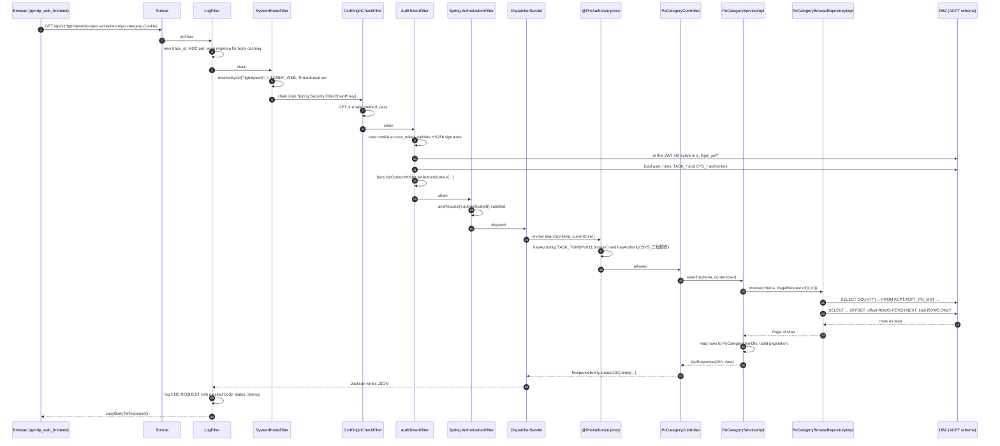

# tgmdp_backend Request Lifecycle

Up: [[tgmdp_backend]] · [[System Overview]]

This note follows **one real request** from the browser to DB2 and back:

```
GET /api/v1/tgmdpweb/project-acceptance/po-category?page=1&size=10&contractNo=PO-2026
Cookie: access_token=<JWT>
```

This is the search on the 工程驗收 → PO工程類別設定 screen (task code `TGMDPs011`) of the web admin console. It is running example A from the repo map.

Why trace one request? Because "Spring magic" stops being magic once you can name every object that touches the request. Every layer below exists to solve one specific problem.

## The big picture



Now step by step.

## 1. Servlet filters (before Spring Security)

### `LogFilter`: the outermost wrapper

`tgmdp_backend/src/main/java/com/taiwanmobile/boilerplate/middleware/LogFilter.java:31-111`

```java
@Component
@Order(Ordered.HIGHEST_PRECEDENCE)
public class LogFilter extends OncePerRequestFilter {
    ...
    ContentCachingRequestWrapper wrappedRequest = new ContentCachingRequestWrapper(request, maxCachedBodyBytes);
    ContentCachingResponseWrapper wrappedResponse = new ContentCachingResponseWrapper(response);
    String traceId = UUID.randomUUID().toString();
    MDC.put("trace_id", traceId);
    MDC.put("request_source", resolveAppSource(request.getRequestURI()));
    ...
    try { filterChain.doFilter(wrappedRequest, wrappedResponse); }
    finally {
        ... MDC.put("response_body", responseBody); logger.info("END REQUEST ...");
        wrappedResponse.copyBodyToResponse();
        MDC.clear();
    }
```

Why it is first (`HIGHEST_PRECEDENCE`): it must see **everything**, including requests that security rejects. The `try/finally` guarantees an END log even when something throws.

Why it wraps the request and response: a servlet input stream can only be read once. `ContentCachingRequestWrapper` keeps a copy so the filter can log the body after the controller has consumed it. `ContentCachingResponseWrapper` buffers the output. That is why `copyBodyToResponse()` must be called at the end; forget it and the client receives an empty body. Request and response bodies are masked for `password`, `token`, `authorization`, `secret`, `refreshToken` (`LogFilter.java:37-38`).

The `trace_id` lives in SLF4J's **MDC** (Mapped Diagnostic Context). MDC is a `ThreadLocal` map that every log line on this thread will carry. In Kibana, `trace_id: "<id>"` shows the whole request, including SQL and ESB calls. See [[tgmdp_backend Logging and Configuration]].

### `SystemRouteFilter`: which legacy system is this?

`filter/SystemRouteFilter.java:17-68` + `config/SysRouteMapping.java:19-55`

The URI `/api/v1/tgmdpweb/...` contains `/tgmdpweb`, so `SysRouteMapping.resolveSysId` returns `TGMDP_WEB`. The filter stores it with `SystemContext.setSysId(...)`, a `ThreadLocal<String>`, and **always** clears it in `finally`. Services such as `IniValueService` later use the system ID to pick per-system config (upload roots, log roots). The old WARs each had their own config, and this is how one app emulates many.

> Watch the order in `ROUTE_KEYWORD_MAP`: it is a `LinkedHashMap` and "FIRST MATCH WIN". `/registry` must come before `/tgmdpweb`, so `/api/v1/tgmdpweb/registry/...` maps to `TGMDP_ADS`, not `TGMDP_WEB`. Ordering bugs like this are why the code comments warn about it.

A client may also send `X-SYS-ID`. The filter only accepts values from the `SysId` enum (`SystemRouteFilter.java:36-49`). Otherwise a caller could steer per-system file paths into a directory of their choosing. This is a path-traversal guard. See [[Defensive Programming]].

`filter/LegacyQueryParamFilter.java` also runs, but only on listed NWIS/SD1 paths. It rewrites legacy `SITE_ID` style parameters to `siteId`. It does nothing for our request.

## 2. Spring Security filter chain

`security/WebSecurityConfig.java:65-170` defines **two** chains:

- `@Order(1)` `soapSecurityFilterChain` matches only `/NWIS_ADS/services/**` and permits all (`:51-63`). CXF endpoints are not MVC handlers, so they need their own matcher.
- `@Order(2)` `securityFilterChain` handles everything else, including our request.

Inside chain 2, the custom filters run in this order (`:164-168`):

1. **`CsrfOriginCheckFilter`**: our request is a `GET`, so it is skipped (`CsrfOriginCheckFilter.java:61-65`). For a `POST` it would compare the `Origin` header with the CORS allow list.
2. **`AuthTokenFilter`**: the heart of authentication (`AuthTokenFilter.java:47-217`):
   - `basicAuthService.tryServerToServerAuthenticate(request)` returns false here: there is no `Basic` header.
   - `parseJwt` finds the `access_token` cookie (`:219-236`).
   - `jwtUtils.validateJwtToken(jwt)` checks the signature and expiry.
   - `jwtService.validateTokenWithDatabaseJWT(jwt)` checks the token is still active in `a_login_jwt`. This turns a stateless JWT into a **revocable** session. See [[Stateless vs Stateful]].
   - It loads `CustomUserDetails`, `TASK_<taskId>:<buttonId>` authorities, and, because the URL contains `/tgmdpweb/`, the `SYS_<system>` authorities (`:72-84`).
   - Finally it calls `SecurityContextHolder.getContext().setAuthentication(...)` (`:210`).
3. Spring's own `AuthorizationFilter` enforces `.anyRequest().authenticated()` (`:155`). An empty security context at this point means `AuthEntryPointJwt` produces a 401 JSON body.

Note `AuthTokenFilter.java:213-215`: **any** exception inside the filter is logged and swallowed. The request continues unauthenticated, and the authorization step then rejects it. This "fail closed" design means a crash inside auth can never let a request through.

## 3. DispatcherServlet and method security

Spring MVC's `DispatcherServlet` is the [[Front Controller]]. It finds the handler for `GET /api/v1/tgmdpweb/project-acceptance/po-category`, which is `PoCategoryController.search`.

The controller bean is wrapped in a proxy because `@EnableMethodSecurity(prePostEnabled = true)` is on (`WebSecurityConfig.java:18`). Before the method body runs, the proxy evaluates:

```java
// controller/tgmdpweb/projectAcceptance/PoCategoryController.java:67-76
@GetMapping(value = {"", "/"})
@PreAuthorize("hasAuthority('TASK_TGMDPs011:browse') and hasAuthority('SYS_工程驗收')")
public ResponseEntity<ApiResponse<PoCategorySearchResponseDto>> search(
        @ParameterObject PoCategorySearchCriteria criteria,
        @AuthenticationPrincipal CustomUserDetails currentUser) {
    ApiResponse<PoCategorySearchResponseDto> response = poCategoryService.search(criteria, currentUser);
    return ResponseEntity.status(response.getCode()).body(response);
}
```

If the check fails, Spring throws `AuthorizationDeniedException`. `GlobalExceptionHandler.java:259` turns it into a 403.

Argument binding: query params `page`, `size`, `contractNo`, `projectType` bind onto the `PoCategorySearchCriteria` DTO. `@AuthenticationPrincipal` injects the `CustomUserDetails` that `AuthTokenFilter` put in the security context.

## 4. Service

`service/tgmdpweb/projectAcceptance/PoCategoryServiceImpl.java:124-154`

```java
int pageNum = criteria.getPage() != null ? Math.max(criteria.getPage() - 1, 0) : 0;   // UI is 1-based
int pageSize = criteria.getSize() != null ? criteria.getSize() : 10;
Pageable pageable = PageRequest.of(pageNum, pageSize);
try {
    Page<Map<String, Object>> resultPage = poCategoryBrowseRepository.browse(criteria, pageable);
    List<PoCategoryItemDto> items = resultPage.getContent().stream().map(this::mapToDto).toList();
    ...
    return new ApiResponse<>(HttpStatus.OK, HttpStatus.OK.getReasonPhrase(), responseDto);
} catch (Exception e) {
    log.error("Error searching PoCategory", e);
    return new ApiResponse<>(HttpStatus.INTERNAL_SERVER_ERROR, "INTERNAL_ERROR", null);
}
```

The service converts UI conventions (1-based pages) to Spring conventions (0-based `Pageable`). It maps raw DB rows into a typed DTO and wraps the result in the standard envelope. Note the style: this service **returns** errors as an `ApiResponse` with code 500 instead of throwing. The controller then copies that code into the HTTP status. Other modules throw exceptions instead. See [[tgmdp_backend Error Handling and Validation]].

## 5. Repository → DB2

`repository/tgmdpweb/projectAcceptance/PoCategoryBrowseRepositoryImpl.java:25-74` uses `NamedParameterJdbcTemplate`. It builds the `WHERE` clause dynamically, but **every value is a bind parameter** (`:contractNo`, `:projectType_0` ...). It never concatenates user input into SQL, which is how it avoids SQL injection.

```sql
SELECT a.contract_no, a.contract_name, a.project_type, a.set_user_id, a.set_user_name,
       to_char(a.set_date, 'yyyy/mm/dd') AS set_date, b.name
FROM ACPT.ACPT_PO_MST a
LEFT JOIN ACPT.ACPT_WORKTYPE_MST b ON b.PROJECT_TYPE = a.project_type
WHERE 1=1 AND a.CONTRACT_NO LIKE :contractNo
ORDER BY a.CONTRACT_NO ASC OFFSET :offset ROWS FETCH NEXT :limit ROWS ONLY
```

Two round trips: `COUNT(*)` for the total, then one page with `OFFSET ... FETCH NEXT`. Tables are **schema-qualified** (`ACPT.`) because one connection talks to several DB2 schemas. The connection comes from a HikariCP pool (`config/DataSourceConfig.java:54-79`). In `local`/`test`, P6Spy wraps it and logs each SQL with `log_type=sql` (`config/SqlJsonLogger.java:26-30`). See [[tgmdp_backend Persistence and DB2]].

## 6. Response wrapper and serialization

Every JSON response in this app uses one shape, `dto/ApiResponse.java`:

```json
{ "code": 200, "success": true, "message": "OK",
  "timestamp": "2026-11-16T10:00:00", "data": { "pagination": {...}, "data": [...] } }
```

`@JsonInclude(NON_NULL)` drops `error` and `meta` when they are empty. `success` is derived from the status (`status.is2xxSuccessful()`). The frontend's axios layer can then treat every endpoint the same way. Jackson **2** does the serialization (`config/JacksonConfig.java`; Jackson 3 is excluded in `build.gradle`).

On the way out, `LogFilter`'s `finally` block logs `END REQUEST GET /api/v1/... 200 37ms` with the masked response body, then copies the buffered body to the real response.

## What changes for other clients?

| Client | Difference in the lifecycle |
|---|---|
| Vendor portal `/api/v1/tgmdpvendor/**` | `AuthTokenFilter` does **not** find the user in `A_USER_DATA`. It falls into the vendor branch and builds authorities from the JWT's `authorities` claim (`AuthTokenFilter.java:191-206`). |
| NWIS app `/api/v1/nwis/**` | Token in an `Authorization: Bearer` header. `LegacyQueryParamFilter` may rename params. Responses often carry legacy `RTN_STATUS=false` **inside an HTTP 200**, because the app expects that. |
| ESB REST `/ACPT_SERVICE/api/**` | `permitAll` in security (`WebSecurityConfig.java:97-99`), no JWT. The response is a legacy ESB envelope (`Status: 10001`), not `ApiResponse`. |
| ESB SOAP `/TGMDP/services/*` | Handled by the CXF servlet, not `DispatcherServlet`. Auth comes from CXF's `WSS4JInInterceptor` (`config/CxfConfig.java`). |

## Try it yourself

1. Run the backend locally and call `GET /api/v1/healthCheck`. Find the `START REQUEST` / `END REQUEST` pair in the console and confirm they share a `trace_id`.
2. Call the PO category endpoint without a cookie. Which class writes the 401 body? (Follow `AuthEntryPointJwt` → `HandlerExceptionResolver` → `GlobalExceptionHandler.handleUnauthorized`.)
3. Set a breakpoint in `AuthTokenFilter.doFilterInternal` and in `PoCategoryController.search`. Inspect `SecurityContextHolder.getContext().getAuthentication().getAuthorities()` and find `TASK_TGMDPs011:browse`.

## Questions to check understanding

- Why must `SystemContext.clear()` sit in a `finally` block? What happens on a Tomcat thread pool if it doesn't? (Hint: thread reuse.)
- Why is `AuthTokenFilter` placed *before* `UsernamePasswordAuthenticationFilter`?
- The service catches all exceptions and returns `ApiResponse(500)`. What does the user see? What does the log show? What is lost compared with letting `GlobalExceptionHandler` handle it?

## Related

- [[tgmdp_backend]] · [[System Overview]]
- [[tgmdp_backend Security and Auth]] · [[tgmdp_backend Persistence and DB2]] · [[tgmdp_backend Layering and Packages]] · [[tgmdp_backend Error Handling and Validation]]
- [[HTTP and REST]] · [[Interceptor and Filter Chain]] · [[Front Controller]] · [[MVC]]
- [[Authentication and Sessions]] · [[Authorization and RBAC]] · [[Stateless vs Stateful]] · [[Concurrency and Threads]]
- [[Serialization and DTOs]] · [[Logging and Observability]] · [[SQL and Relational Databases]] · [[Defensive Programming]]
