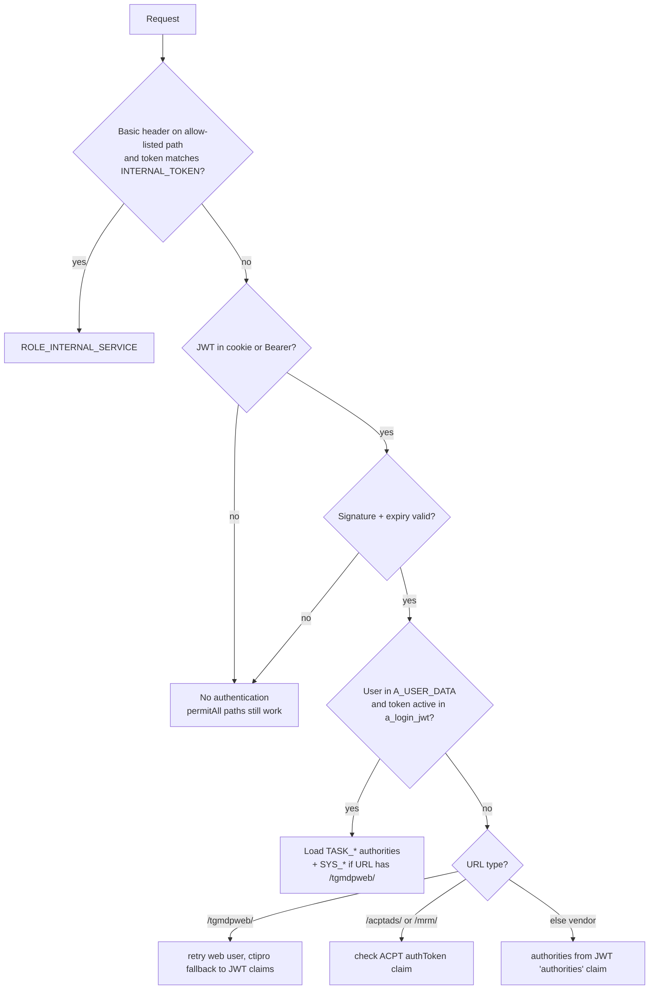
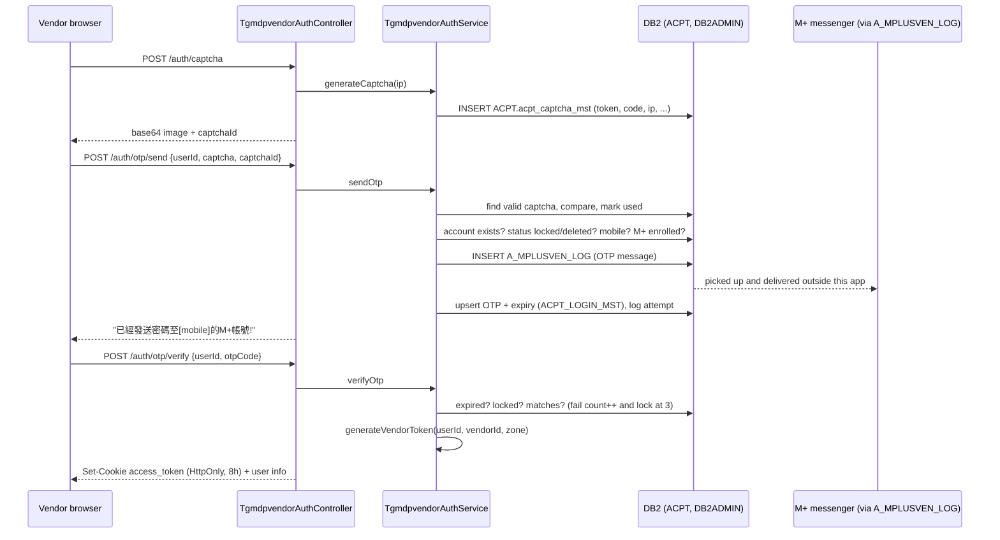

# tgmdp_backend Security and Auth

Up: [[tgmdp_backend]] · [[System Overview]]

One backend serves internal staff (web console), external contractors (vendor portal), field engineers (mobile apps) and machines (ESB). Each group logs in differently and is stored in a different table. This note explains how one security setup handles all four, and why it ended up shaped this way.

## The four identities

| Who | Login endpoint | How they prove identity | User table | Token carrier |
|---|---|---|---|---|
| Staff on the web console | `POST /api/v1/tgmdpweb/auth/login` | username + password (MD5-compared legacy hash), or an SSO header `iv-user` from a reverse proxy | `DB2ADMIN.A_USER_DATA` | `HttpOnly` cookie `access_token`, 1 h |
| Vendor / contractor | `POST /api/v1/tgmdpvendor/auth/captcha` → `otp/send` → `otp/verify` | captcha + 6-digit OTP sent over M+ (enterprise messenger) | `ACPT.ACPT_ACCOUNT_MST` | `HttpOnly` cookie `access_token`, 8 h |
| Field engineer in RN app | `POST /api/v1/tgmdp/auth/appLogin` (+ OTP, fingerprint variants) | AD/ESB authority checks, device registration | `DB2ADMIN.A_USER_DATA` + `a_login_jwt` | `Authorization: Bearer` |
| ESB / internal service | n/a | shared Basic token on allow-listed paths, WS-Security on SOAP, or nothing (`permitAll`) | n/a | header |

## Sessions: stateless JWT, made revocable

`WebSecurityConfig.java:84-86` sets `SessionCreationPolicy.STATELESS`. Spring never creates an `HttpSession`. Instead every request carries a JWT signed with HS256 (`utils/JwtUtility.java:43`, `Keys.hmacShaKeyFor(jwtSecret...)`; `.signWith(key, SignatureAlgorithm.HS256)` at `:104`).

**Why stateless?** Several backend instances can serve any request without sharing session memory. See [[Stateless vs Stateful]].

**The catch:** a pure JWT can't be revoked before it expires. So for web and app users the backend *also* stores issued tokens in `a_login_jwt` and checks them on every request:

```java
// security/AuthTokenFilter.java:62-70
if (jwtUtils.validateJwtToken(jwt)) {                       // signature + expiry
    String usernameOrUserId = jwtUtils.getUsernameOrUserIdFromToken(jwt);
    ...
    if (!jwtService.validateTokenWithDatabaseJWT(jwt)) {    // still active in a_login_jwt?
        throw AuthException.invalidDbToken();
    }
```

`repository/ALoginJwtRepository.java:51` selects `... from a_login_jwt where jwt = :jwt AND STATUS = '0'`. Logout flips the status. This hybrid gets most of the scaling benefit of JWT plus real logout, at the cost of **one DB query per request**.

Vendor tokens are **not** stored in `a_login_jwt` (comment at `AuthTokenFilter.java:109-112`), so vendor logout cannot revoke a token before its 8 hours are up. Notice the asymmetry.

## Cookies and CSRF

Browser clients receive the token as a cookie:

```java
// controller/tgmdpvendor/TgmdpvendorAuthController.java:318-323
ResponseCookie.from("access_token", response.getAccessToken())
        .httpOnly(true)                              // JS cannot read it (XSS)
        .secure(cookieSecure)                        // HTTPS only (COOKIE_SECURE env)
        .path("/")
        .maxAge(Duration.ofHours(8))
        .sameSite(cookieSecure ? "None" : "Lax");    // None requires Secure
```

**Why `SameSite=None`?** The SPAs are served from a different origin than the API. They use CORS with credentials (`config/CorsConfig.java:17`, `setAllowCredentials(true)` + an allow-list from `CORS_ORIGIN`). `Lax` or `Strict` would stop the browser from sending the cookie on those cross-site calls.

**The consequence:** `SameSite=None` brings CSRF back. Any website could make the victim's browser `POST` to the API with the cookie attached. Spring's CSRF token filter is disabled (`WebSecurityConfig.java:79`), because a token scheme would need frontend changes. Instead the team added `security/CsrfOriginCheckFilter.java`:

```java
// CsrfOriginCheckFilter.java:61-95 (shortened)
if (SAFE_METHODS.contains(request.getMethod())) { chain.doFilter(...); return; }   // GET/HEAD/OPTIONS
String origin = request.getHeader("Origin");
if (origin == null || origin.isBlank()) {
    String referer = request.getHeader("Referer");
    if (referer == null || referer.isBlank()) { chain.doFilter(...); return; }   // native mobile: no header
    origin = refererOrigin(referer);
}
if (origin == null || allowedOrigins().contains(origin)) { chain.doFilter(...); return; }
response.setStatus(403); ... "Request origin not allowed"
```

Browsers set `Origin` themselves, and page JavaScript cannot forge it, so a cross-site attack always carries the attacker's origin. Native mobile clients send no `Origin`, and CSRF is a browser-cookie attack anyway, so they pass. This is a textbook "defence that needs zero client change". See [[Cookies and CSRF]].

## The authentication filter: one filter, many branches

`security/AuthTokenFilter.java:47-217` is the most complex security class. Read it as a decision tree:



Why is it branchy? Different user stores grew up in different legacy systems. Vendors don't exist in `A_USER_DATA`, and vendor tokens are not in `a_login_jwt`, so the "normal" path throws `USER_NOT_FOUND` or `INVALID_DB_TOKEN` for them. The `catch (AuthException e)` branch (`:87-207`) decides, by URL, whether that failure is fatal or whether to trust the JWT's embedded claims instead.

**Trade-off to think about:** branching on `requestUrl.contains("/tgmdpvendor/")` couples security to URL spelling. A new module whose URL accidentally contains `/registry/` gets the relaxed rules. A cleaner design would issue tokens with an explicit `aud` (audience) claim and pick the branch from that. See [[Authentication and Sessions]].

Any exception in the filter is caught and logged (`:213-215`), and the request continues **unauthenticated**. Authorization then rejects it with a 401 written by `security/AuthEntryPointJwt.java`. That class delegates to the `HandlerExceptionResolver`, so the 401 body goes through `GlobalExceptionHandler` and has the standard JSON shape.

## Server-to-server: Basic token

`service/BasicAuthService.java` runs first in `AuthTokenFilter`. It accepts `Authorization: Basic <token>` only when:
1. `internal_token` (`INTERNAL_TOKEN` env) is set, **and**
2. the URI matches an Ant pattern in `basic_auth.allowed_paths` (`SERVER_AUTH_ALLOWED_PATHS`, e.g. `/api/v1/ams/ticket/...`).

It then grants `ROLE_INTERNAL_SERVICE`. The path allow-list limits the blast radius if the shared token leaks. Note the comparison is `token.equals(internalToken)`, not a constant-time compare. That is a minor timing-attack nit worth knowing about.

## Vendor login: captcha + OTP (running example B)



Key points, with code:

- **Captcha is stored server-side in a table**, not in a session (`ACPT.acpt_captcha_mst`, `sharedModules/.../TgmdpvendorCaptchaRepository.java:36`). It is single-use: `markCaptchaAsUsed` (`TgmdpvendorAuthService.java:281`). The same idea as the JWT: no server memory, state lives in the DB.
- **The OTP goes out through a DB table.** The service inserts a row into `DB2ADMIN.A_MPLUSVEN_LOG` (`:365-387`); some other process delivers it. This is an **outbox**-style integration: the app doesn't need the messenger's API.
- **OTP lifetime and lockout:** `OTP_EXPIRY_MINUTES = 5`, `MAX_RETRY_ATTEMPTS = 3` (`:44-45`). The controller's javadoc still says "3 minutes / max 5 attempts" (`TgmdpvendorAuthController.java:294-295`), and the M+ message text says "verify before now+3 min" (`:371`). Code beats comments; this drift is worth raising in review.
- **Bug-for-bug parity:** a deleted account (`status='2'`) on *send* returns 帳號鎖定 (locked), not 帳號不存在 (not found), because the legacy code had a dead branch (`:299-309`). The comment records the ruling. Security-wise, identical messages for "locked" and "deleted" also leak less about account state.
- **Dev bypass guarded by stage:** `VENDOR_OTP_FIXED_ACCOUNTS` skips captcha and M+ for listed test accounts, but only when the stage is `local` or `test` (`FIXED_OTP_ALLOWED_STAGES`, `:64`). A `@PostConstruct` logs a WARN at startup if it is configured anywhere (`:114-128`). This is how you keep a test backdoor from becoming a production backdoor. See [[Feature Flags and Mock Toggles]].
- **Rollback rules:** see `noRollbackFor` in [[tgmdp_backend Persistence and DB2]]. The failure counter must persist even though the method throws.

## Authorization: TASK_ and SYS_ authorities

After authentication, a user's `GrantedAuthority` list contains strings like:
- `TASK_TGMDPs011:browse`, `TASK_TGMDPs011:update`: **task + button** permissions from role tables (`JwtService.getTaskIdAuthorities`, `service/JwtService.java:144-186`). These map one-to-one to the legacy "ButtonBean" model, where each screen button had a permission.
- `SYS_工程驗收`, `SYS_基站障礙`: **system** permissions (`JwtService.getEffectiveSysAuthorities`, `:196-208`), computed with `security/SysAuthRules.java`. That class ports legacy `ButtonBean.checkSysAuth()`, including its quirk that some systems accept a superset system, and its substring match.
- `ROLE_VENDOR`, `SYS_廠商`: vendor authorities (`TgmdpvendorJwtService.getVendorAuthorities`).

Endpoints check them declaratively:

```java
@PreAuthorize("hasAuthority('TASK_TGMDPs011:update') and hasAuthority('SYS_工程驗收')")   // PoCategoryController.java:89
@PreAuthorize("hasAnyAuthority('SYS_工程驗收', 'SYS_廠商')")                                // shared web+vendor endpoints
@PreAuthorize("@otaSecurity.hasAdminPermission()")                                          // custom bean check (registry)
```

This is **RBAC** (role-based access control): roles → permissions → checks. It runs with fine-grained, per-button permissions, which reproduces the legacy UI's button-level security. See [[Authorization and RBAC]].

**Coarse URL rules** sit in `WebSecurityConfig.java:100-155`: login, version check and health endpoints are `permitAll`, everything else is `authenticated()`. Inbound ESB paths `/TGMDP/services/**`, `/MRM_ADS/api/**`, `/ACPT_SERVICE/api/**` are `permitAll` (`:91-99`). I found no application-level authentication for the REST inbound paths. Their protection appears to rely on network placement (only the ESB can reach them). *This is my reading of the code, not a confirmed design document.*

## Other security details worth noticing

- **HSTS** for one year (`WebSecurityConfig.java:157-162`).
- **MD5 password encoder** (`security/Md5PasswordEncoder.java`) exists only to verify legacy password hashes. MD5 is not acceptable for new password storage; it is a compatibility shim.
- **SSO header `iv-user`** (`controller/tgmdpweb/TgmdpWebAuthController.java:52`): a fronting reverse proxy authenticates the user and passes the identity in a header. This name is typical of IBM's WebSEAL/ISAM. *Inferred from the header name only.* Trusting such a header is only safe if nothing else can reach the backend directly.
- **Dev-only ESB bypass flags** (`nwis.authority.skip-enabled` and friends, documented in `tgmdp_backend/CLAUDE.md`) hard-code "granted". They must stay `false` outside local.

## Questions to check understanding

1. Why does the vendor portal need `CsrfOriginCheckFilter` while the RN app doesn't?
2. A vendor's token was stolen. Can the vendor revoke it by logging out? What would you change?
3. What exactly does `hasAuthority('TASK_TGMDPs011:update') and hasAuthority('SYS_工程驗收')` protect against that `.authenticated()` doesn't?
4. Why is the captcha single-use, and what attack does that stop?

## Related

- [[tgmdp_backend]] · [[System Overview]] · [[tgmdp_backend Request Lifecycle]] · [[tgmdp_backend ESB Integration]] · [[tgmdp_backend Persistence and DB2]]
- [[Authentication and Sessions]] · [[Authorization and RBAC]] · [[Cookies and CSRF]] · [[Stateless vs Stateful]]
- [[Interceptor and Filter Chain]] · [[Strategy]] · [[Defensive Programming]] · [[Secrets Management]] · [[Feature Flags and Mock Toggles]] · [[Environment Separation]]
- [[Outbox Pattern]] · [[tgmdp_vendor_frontend]] · [[tgmdp_web_frontend]]
