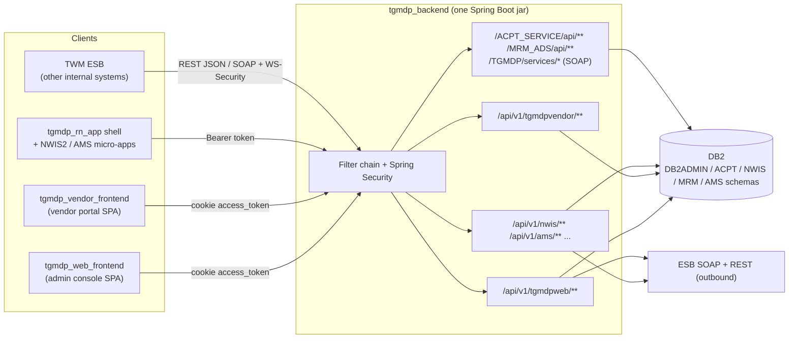

# tgmdp_backend

> Repo map. Start here, then follow the links at the bottom.
> Source: `/Users/rizkisiraj/Documents/NWIS_Legacy/tgmdp_backend/` (read only).

## What this repo is

`tgmdp_backend` is **one Spring Boot application that replaces a whole fleet of legacy Java web apps**. Taiwan Mobile used to run one WAR per system: `NWIS_ADS`, `AMS_ADS`, `ACPT_SERVICE`, `MRM_ADS`, `SD1_ADS`, the TGMDP admin console, the vendor portal, and others. Each had its own login, its own DB code and its own SOAP plumbing. This backend folds all of them into one deployable jar, while keeping each old system's URLs, table names and quirks alive. The new frontends and mobile apps can then be swapped in one module at a time.

That last point explains most of the odd things you will see in this code. The goal is **legacy parity**: the new endpoint must behave exactly like the old one, sometimes bug for bug. Comments like `Legacy LoginModel.java:93-118` appear all over the code. A developer wrote them to prove that a rule was copied from the old system, not invented. This is the [[Strangler Fig]] pattern applied to a backend.

The Gradle `rootProject.name` is still `boilerplate`, and the root package is `com.taiwanmobile.boilerplate`. The project began as a company Spring Boot template and grew into the main backend. Do not read "boilerplate" as "unimportant".

## Tech stack (from `build.gradle`)

| Area | Choice | Where |
|---|---|---|
| Language | Java 17 (toolchain) | `tgmdp_backend/build.gradle` `java { toolchain }` |
| Framework | **Spring Boot 4.1.1**, Spring Security, Spring Data JPA, Validation, Actuator | `build.gradle:3` |
| JSON | Jackson **2** (Boot 4 defaults to Jackson 3; it is excluded on purpose) | `build.gradle` `configurations.all { exclude ... spring-boot-starter-jackson }` |
| Database | IBM **DB2** (`com.ibm.db2:jcc`), HikariCP pool, P6Spy SQL logging | `config/DataSourceConfig.java` |
| Schema migration | Liquibase (present but `spring.liquibase.enabled=false`) | `src/main/resources/application.properties:11` |
| SOAP | Apache **CXF 4.2.4** (JAX-WS), clients generated by a custom `wsdl2java` Gradle task | `build.gradle` `tasks.register("wsdl2java")` |
| REST clients | Spring `RestClient` (Apache HttpClient 5), `WebClient` | `config/HttpClientConfig.java` |
| Auth | JJWT 0.11.5 (HS256), MD5 password encoder for legacy hashes | `utils/JwtUtility.java`, `security/Md5PasswordEncoder.java` |
| Secrets | Jasypt (`ENC(...)` values in env files) | `config/JasyptConfig.java` |
| Mapping | MapStruct 1.5.5 (a few mappers), Lombok everywhere | `mapper/` |
| Docs | springdoc-openapi (Swagger UI) | `config/OpenApiConfig.java` |
| Files | Apache POI (Excel), openhtmltopdf (PDF), zip4j | `build.gradle` dependencies |
| Push | Firebase Admin | `build.gradle` |
| Logging | Logback + logstash encoder → ELK | `src/main/resources/logback-spring.xml` |
| Quality | Checkstyle, PMD, SpotBugs, JaCoCo, SonarQube | `build.gradle` plugins |
| Tests | JUnit 5, Mockito, AssertJ, Spring MockMvc, Testcontainers, REST Assured, H2 | `build.gradle` test deps |

> **Doc drift warning.** The repo's own `tgmdp_backend/CLAUDE.md` still says "Spring Boot 3.5.x". `build.gradle` says `4.1.1`, and the long comments in the `ext {}` block describe the 3.5 → 4 migration. Trust the build file. This is a good lesson: **docs rot, build files don't lie.**

Look at the huge comment blocks around `ext {}` and `configurations.all { resolutionStrategy }` in `build.gradle`. Nearly every pinned version names a CVE. That is what dependency management looks like in a bank-grade or telco-grade shop. See [[Build Tools and Dependency Management]].

## Size

Rough counts under `src/main/java/com/taiwanmobile/boilerplate/`:

| Package | Java files | Role |
|---|---|---|
| `controller/` | ~342 | HTTP entry points |
| `service/` | ~514 | business logic, ESB calls |
| `repository/` | ~397 | DB access (JPA interfaces + JDBC impls) |
| `dto/` | ~2418 | request/response shapes |
| `model/` | ~255 | JPA entities |
| `exception/` | ~44 | typed business errors |
| `config/`, `security/`, `filter/`, `middleware/` | ~28 | cross-cutting plumbing |

There is also a **git submodule** `sharedModules/` (`com.taiwanmobile.sharedmodules`). It holds entities, repositories and services shared with the batch-job app `tgmdp_jobs`. `config/SharedModulesJpaPackagesConfig.java` wires it in. See [[tgmdp_backend Layering and Packages]].

## Package layout per system

Inside `controller/`, `service/`, `repository/` and `dto/`, code is split again **by legacy system**. The folder name usually matches the old WAR it replaces:

| Sub-package | Legacy system it replaces | URL prefix |
|---|---|---|
| `tgmdpweb` | TGMDP web admin console (WebWork/JSP) | `/api/v1/tgmdpweb/**` |
| `tgmdpvendor` | TGMDP vendor portal | `/api/v1/tgmdpvendor/**` |
| `tgmdpads` | TGMDP app shell auth / version | `/api/v1/tgmdp/**` |
| `nwisads` | NWIS_ADS (patrol app backend) | `/api/v1/nwis/**` |
| `amsads` | AMS_ADS (base-station fault app) | `/api/v1/ams/**` |
| `acptads` | ACPT_SERVICE (project acceptance) | `/api/v1/acptads/**`, `/ACPT_SERVICE/api/**` |
| `mrmads` | MRM_ADS (material management) | `/api/v1/mrm/**`, `/MRM_ADS/api/**` |
| `sdoneads` | SD1_ADS | `/api/v1/sd1/**` |
| `btsads`, `ftsads`, `fntiads`, `inoutads`, `oemsads`, `rfopt`, `slaads`, `trpads`, `ceringads`, `nampads` | smaller legacy adapters | `/api/v1/<sys>/**` |

This is a mix of **package-by-layer** at the top (`controller/`, `service/`) and **package-by-feature** underneath (`controller/tgmdpweb/projectAcceptance/...`). See [[Feature-Sliced Structure]].

## One app, many clients



How the backend tells clients apart:

1. **URL prefix.** `config/SysRouteMapping.java` maps a URI keyword to a system ID (`/tgmdpweb` → `TGMDP_WEB`, `/nwis` → `NWIS_ADS`, and so on). `filter/SystemRouteFilter.java` stores that ID in a `ThreadLocal` (`context/SystemContext.java`) for the rest of the request. `middleware/LogFilter.java:159-170` tags every log line with `request_source` = WEB / VENDOR / APP.
2. **Credential carrier.** The browser SPAs get an `HttpOnly` cookie named `access_token`. The mobile apps send `Authorization: Bearer ...`. ESB callers use either a shared Basic token or no app-level auth on the `permitAll` inbound paths. All of these are read in `security/AuthTokenFilter.java:219-236`.
3. **Who the user is.** Web users live in `DB2ADMIN.A_USER_DATA`. Vendor users live in `ACPT.ACPT_ACCOUNT_MST`. `AuthTokenFilter` branches on the URL (`/tgmdpweb/`, `/tgmdpvendor/`, `/acptads/` ...) to decide which table and which authority source to trust. See [[tgmdp_backend Security and Auth]].

Who calls what (cross-repo):

- `tgmdp_web_frontend` (Vite/React admin console) → `/api/v1/tgmdpweb/**` with axios and the cookie.
- `tgmdp_vendor_frontend` (vendor portal) → `/api/v1/tgmdpvendor/**`. Login is captcha + OTP and the token goes in the cookie.
- `tgmdp_rn_app` (React Native shell) → `/api/v1/tgmdp/auth/**` for login. The NWIS2 and AMS micro-apps run inside the shell's WebView. They have **no HTTP of their own**: they post bridge messages, and the shell makes the HTTP call to `/api/v1/nwis/**` or `/api/v1/ams/**` (see `TGMDP_RN_AND_NWIS2.md` §4 in the workspace root).
- The **TWM ESB** pushes data in (inbound) through `/ACPT_SERVICE/api/**`, `/MRM_ADS/api/**` and the CXF SOAP endpoints. The backend calls the ESB out (outbound) for authority checks, ticket sync and more. See [[tgmdp_backend ESB Integration]].
- `tgmdp_jobs` (scheduler) shares entities and repositories through the `sharedModules` submodule.
- `tgmdp_fake_esb` is a local Spring-WS mock of the ESB on `:8085`.

## Running examples used across these notes

To keep things concrete, the notes follow three real flows:

| # | Flow | Client | Files |
|---|---|---|---|
| A | **PO category search and update** (TGMDPs011, 工程驗收 → PO工程類別設定) | web admin console | `controller/tgmdpweb/projectAcceptance/PoCategoryController.java`, `service/tgmdpweb/projectAcceptance/PoCategoryServiceImpl.java`, `repository/tgmdpweb/projectAcceptance/PoCategoryBrowseRepositoryImpl.java` |
| B | **Vendor login: captcha → OTP send → OTP verify** | vendor portal | `controller/tgmdpvendor/TgmdpvendorAuthController.java`, `service/tgmdpvendor/TgmdpvendorAuthService.java` |
| C | **NWIS authority check (outbound SOAP)** and **H2 inbound (ESB → us)** | NWIS mobile app, ESB | `controller/nwisads/NwisAuthorityCheckController.java`, `service/nwisads/NwisSoapService.java`, `controller/acptads/ApiH2AcptController.java`, `service/acptads/AcptApiH2Service.java` |

## How to run it

```bash
cd tgmdp_backend
./gradlew bootRun              # reads .env, SERVER_STAGE defaults to "local"
./gradlew -Pfast test          # unit tests without static analysis
./gradlew wsdl2java            # regenerate SOAP client classes
```

Swagger UI is permitted without auth at `/swagger-ui/**` (`security/WebSecurityConfig.java:87-90`).

## Questions to check understanding

1. Why does one backend keep URL prefixes like `/ACPT_SERVICE/api` and `/MRM_ADS/api` instead of moving everything under `/api/v1`? (Hint: who calls those URLs, and can you change that caller?)
2. A request arrives at `/api/v1/tgmdpvendor/consent`. Which system ID will `SysRouteMapping.resolveSysId` return, and why does the order of entries in `ROUTE_KEYWORD_MAP` matter?
3. Why does the build exclude Jackson 3 even though Spring Boot 4 ships it by default?

## Notes in this folder

- [[tgmdp_backend Request Lifecycle]]: one HTTP request traced from filter to DB2 and back
- [[tgmdp_backend Layering and Packages]]: controller / service / repository / entity / DTO and why
- [[tgmdp_backend Persistence and DB2]]: JPA vs native SQL vs JdbcTemplate, transactions, DB2 traps
- [[tgmdp_backend Security and Auth]]: JWT cookies, captcha + OTP, role checks, CSRF
- [[tgmdp_backend ESB Integration]]: outbound SOAP/REST and inbound endpoints
- [[tgmdp_backend Error Handling and Validation]]: exception handlers, response envelope, validation
- [[tgmdp_backend Logging and Configuration]]: MDC/ELK logging, profiles, env vars, Jasypt
- [[tgmdp_backend Testing and Build]]: JUnit/Mockito/MockMvc, Gradle, CI, hooks
- [[tgmdp_backend Design Patterns Spotted]]: pattern catalogue with file references

## Related

- [[System Overview]]
- [[Client-Server Architecture]] · [[Layered Architecture]] · [[HTTP and REST]] · [[Message Integration and ESB]]
- [[Strangler Fig]] · [[Feature-Sliced Structure]] · [[Monorepo vs Polyrepo]] · [[Build Tools and Dependency Management]]
- [[DB2]] · [[Authentication and Sessions]] · [[Single Page Applications]] · [[Hybrid Mobile Apps]] · [[WebView and Native Bridge]]
- [[tgmdp_web_frontend]] · [[tgmdp_vendor_frontend]]
