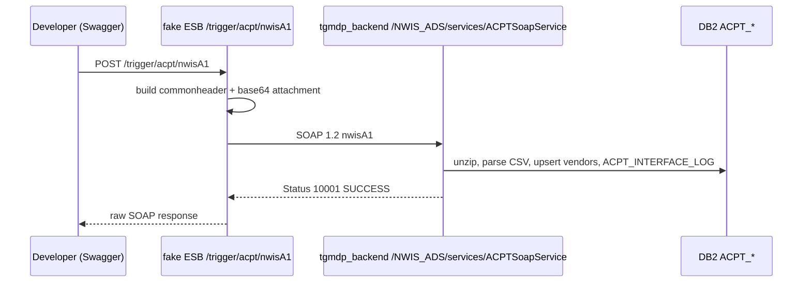

# Fake ESB internals: SOAP dispatch, REST fakes, failure simulation and triggers

Up: [[tgmdp_fake_esb]] · [[System Overview]]

How does one small Spring Boot app impersonate about 15 SOAP services and about 10 REST APIs, in both directions? There are four mechanisms.

## 1. One servlet, many WSDLs

```java
// tgmdp_fake_esb/src/main/java/com/taiwanmobile/fakeesb/config/SoapWebServiceConfig.java:102-116
@Bean
public ServletRegistrationBean<MessageDispatcherServlet> messageDispatcherServlet(ApplicationContext ctx) {
    MessageDispatcherServlet servlet = new MessageDispatcherServlet();
    servlet.setApplicationContext(ctx);
    servlet.setTransformWsdlLocations(true);
    servlet.setMessageFactoryBeanName("messageFactory");
    return new ServletRegistrationBean<>(servlet, "/ws/*");
}

@Bean(name = "MDP")
public Wsdl11Definition mdpWsdl11Definition() {
    SimpleWsdl11Definition d = new SimpleWsdl11Definition();
    d.setWsdl(new ClassPathResource("wsdl/MDPSoapHttpService.wsdl"));
    return d;
}
```

Spring-WS's `MessageDispatcherServlet` is a [[Front Controller]] for SOAP. **Every** SOAP request lands on `/ws/*`, whatever path the client used. The servlet parses the envelope and hands the body to whichever `@Endpoint` method claims its root element:

```java
// endpoint/MdpEndpoint.java:73-79
@PayloadRoot(namespace = NAMESPACE_URI, localPart = "syncTicketByDateRequest")
@ResponsePayload
public void syncTicketByDate(@RequestPayload Element request, MessageContext messageContext) { ... }
```

So **routing is by (namespace, element name), not by URL**. That is why the backend docs can say "point `*_SOAP_ENDPOINT` at `http://localhost:8085/ws`" for every service at once. Each `Wsdl11Definition` bean only *publishes* a WSDL at `/ws/<beanName>.wsdl` (with `transformWsdlLocations` rewriting `<soap:address>` to the fake's own host). It plays no part in dispatch. There are 16 such beans (`:111-221`).

```mermaid
flowchart LR
    C[Client POST /ws/anything] --> D[MessageDispatcherServlet]
    D --> F{SoapVersionChoosing<br/>MessageFactory}
    F -->|text/xml or /bts| S11[SOAP 1.1 SAAJ]
    F -->|application/soap+xml| S12[SOAP 1.2 SAAJ]
    S11 & S12 --> R{@PayloadRoot match}
    R -->|ns MDP + syncTicketByDateRequest| E1[MdpEndpoint]
    R -->|ns WebAccount + addAccount| E2[IdmSoapEndpoint]
    R -->|no match| X[SOAP Fault: no endpoint]
```

### Speaking both SOAP 1.1 and 1.2

TWM's services are a mix: BTS uses 1.1, most others use 1.2. Spring-WS normally uses *one* message factory with *one* version. The fake swaps in a factory that decides per request:

```java
// SoapWebServiceConfig.java:59-76
public SoapVersion getSoapVersion() {
    ... HttpServletRequest request = connection.getHttpServletRequest();
    if (isBtsRequest(request)) return SoapVersion.SOAP_11;               // URI contains /bts
    String ct = request.getContentType();
    if (ct != null && ct.contains("application/soap+xml")) return SoapVersion.SOAP_12;
    if (ct != null && ct.contains("text/xml"))             return SoapVersion.SOAP_11;
    return SoapVersion.SOAP_12;
}
```

The HTTP `Content-Type` is the real signal: SOAP 1.1 is `text/xml` with a `SOAPAction` header, and SOAP 1.2 is `application/soap+xml; action="..."`. The `/bts` URI rule is a pragmatic override for a client that sends the wrong content type. This is a [[Strategy]] chosen at runtime from request data.

### Building responses by hand

Endpoints build replies as raw DOM (`MdpEndpoint`) or as text blocks (`IdmSoapEndpoint.response(...)`, `:17-27`), not as JAXB objects. That is quick to write and needs no code generation, but nothing checks the reply against the XSD. It is one reason the fake can drift (see [[Why a Fake ESB Exists]]).

`MdpEndpoint` hardens its `DocumentBuilderFactory` against XXE: no DOCTYPE, no external entities (`:33-46`). That is good practice even in a test tool, since it parses untrusted XML. See [[Defensive Programming]].

## 2. REST fakes on the ESB's real paths

REST controllers are mapped to the **same path prefixes as the real ESB**: `/ESB/AMSrestful`, `/ESB/PMR/`, `/ESB/WPU`, `/OEMSapi`, `/esb_api`, `/ANTapi`, `/SMRapi`, `/ESB/BSIRErestful`, `/ESB-towerload-B1api|B2api`. Switching a client from real to fake then only means changing **host and port**, never the path. Path parity is what makes this a drop-in [[Adapter]] for the real thing.

Each controller is thin and delegates to a `*MockService` that generates data ([[Service Layer]]). Request DTOs carry Bean Validation, and `@RestControllerAdvice` classes map Spring's exceptions to the ESB's vocabulary:

```java
// validation/B1ValidationHandler.java:20-29
@ExceptionHandler(HttpMessageNotReadableException.class)
public ResponseEntity<B1EsbResponse> handleJsonError(HttpMessageNotReadableException ex) {
    B1EsbResponse r = new B1EsbResponse();
    r.setStatus("20002");
    r.setMessage("Invalid JSON structure");
    return ResponseEntity.badRequest().body(r);
}
```

Look at the scoping. `SlmValidationHandler` and `WpuValidationHandler` are limited with `basePackages = ...controller.slm` / `.wpu`. **`B1ValidationHandler` and `MrmValidationHandler` are unscoped** (`validation/B1ValidationHandler.java:13`, `MrmValidationHandler.java:12`), so both apply to *every* controller, and neither has an `@Order`. Which one formats an OEMS or AMS validation error therefore depends on bean ordering. Scope every advice explicitly ([[Error Handling]]).

One more overlap: `WhController` is mapped to `/ESB/WPU/` and `WpuController` to `/ESB/WPU`, and both declare `/B4api` through `/F2api`. Spring tells them apart only because `WhController` adds `consumes = application/json`, so JSON requests prefer it as the more specific match. It works, but it is fragile. A reader cannot tell which fake answers without knowing Spring's matching rules.

## 3. Failure simulation by header

```java
// controller/ams_esb/AmsToEsbController.java:36-42
public ResponseEntity<B1EsbResponse> b1(
    @RequestHeader(value = "X-FAKEESB-STATUS", required = false) String simulatedStatus,
    @Valid @RequestBody B1EsbRequest request) {
    if (simulatedStatus != null && !simulatedStatus.equals("10001")) {
        return ResponseEntity.ok(simulatedFailure(simulatedStatus));
    }
```

A request header picks the outcome: `20001` connect fail, `20002` NWIS fail, `20003` system error, `20004` no data, `F` timeout. The same convention is used across the WPU endpoints (`WpuController.java:21-31,336-349`), so a QA engineer can test every client error branch without editing the fake. It is a per-request [[Feature Flags and Mock Toggles]].

Two subtleties:

- `@Valid @RequestBody` is resolved **before** the method body runs. A request that fails validation never reaches the header check, so you can't simulate `20004` with an invalid body.
- The header changes the **body** only. HTTP is always 200 and the reply is instant, so it tests the client's *business-status* handling, not its *transport* handling.

## 4. Inbound triggers: the fake as client

`/trigger/*` turns the fake around. It becomes the HTTP *client* and pushes SOAP into TGMDP at `TGMDP_SOAP_BASE_URL + /NWIS_ADS/services/<Service>`:

```java
// service/trigger/SoapTriggerService.java:124-146 (abridged)
String url = tgmdpBaseUrl + servicePath;
String envelope = buildEnvelope12(headerXml, bodyXml);
headers.setContentType(MediaType.valueOf(
        "application/soap+xml;charset=UTF-8;action=\"" + soapAction + "\""));
ResponseEntity<String> response = restTemplate.exchange(url, HttpMethod.POST, entity, String.class);
```

- **Header variants.** The TWM ESB has versioned common headers (`Common/v1-0` … `v1-3`) and ACPT uses a different `header` namespace. There is one builder per variant (`:188-217`, `buildAcptHeader`), and each trigger picks the version its target WSDL expects.
- **WS-Security on the way in.** `sendSoap11WithWss...` adds a real UsernameToken with `PasswordDigest = Base64(SHA1(nonce + created + password))` and a 5-minute Timestamp (`:219-260`). This lets you test the **backend's** WSS4J *validation*, which is the inbound side of [[WS-Security]]. Account settings come from `tgmdp.soap.wss-username/password`. Note that those properties have hard-coded fallback defaults in `@Value` (`:30-34`). Fine for a fake, but it is the pattern [[Secrets Management]] warns against in real code.
- **Swagger as the UI.** Each trigger is tagged (`@Tag(name = "Trigger - AMS")`), so `/swagger-ui.html` becomes a button panel. There is also a Thymeleaf page at `/trigger-ui` (`IdmController.java:98-102`).



(The ACPT flow and its CSV formats are documented in the workspace `inbound_interfaces.md`. The fake's A1 trigger sends the literal text `"a1 sync data"` as its "zip", so expect the backend's unzip step to fail unless you replace it with a real zip. Read from the code, not run.)

## Questions to check understanding

1. A client posts a valid MDP request to `/ws/IDM` instead of `/ws/MDP`. Does it still reach `MdpEndpoint`? Why?
2. Why do the REST fakes reuse the real ESB paths, while the SOAP fakes all sit under `/ws`?
3. Write the trigger you would need to test the backend's *rejection* of a bad WS-Security password.
4. Which Spring mechanism decides between `WhController.handleB4Wh` and `WpuController.dropdownQuery` for `POST /ESB/WPU/B4api` with `Content-Type: application/json`?

## Related
- [[tgmdp_fake_esb]] · [[System Overview]] · [[What an ESB Is]] · [[Why a Fake ESB Exists]] · [[Trace - SyncTicketAllData ESB Round Trip]]
- [[Front Controller]] · [[Strategy]] · [[Adapter]] · [[Service Layer]] · [[DTO Pattern]] · [[Interceptor and Filter Chain]]
- [[SOAP vs REST]] · [[Validation]] · [[Error Handling]] · [[Feature Flags and Mock Toggles]] · [[WS-Security]] · [[Secrets Management]] · [[Defensive Programming]] · [[Mocking]]
