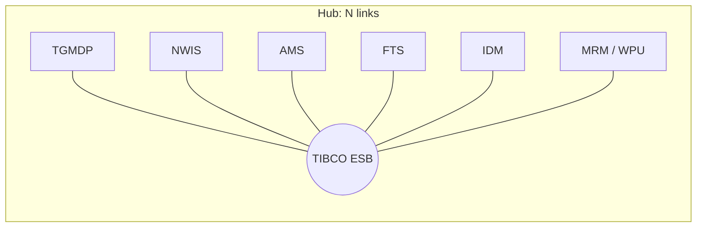
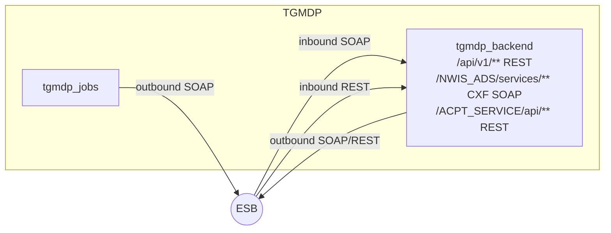

# What an ESB is: outbound and inbound calls in TGMDP

Up: [[tgmdp_fake_esb]] · [[System Overview]] · general concept: [[Message Integration and ESB]]

## The problem an ESB solves

Taiwan Mobile has dozens of back-office systems: NWIS (network work orders), AMS (base-station faults), FTS (customer fault tickets), IDM (identity), MRM/WPU (materials and warehouse), OEMS, BTS metadata, and more. Imagine each one calling every other one directly:

```mermaid
flowchart LR
    subgraph Point-to-point: N×(N-1) links
        A1[TGMDP] --- B1[NWIS] & C1[AMS] & D1[FTS] & E1[IDM]
        B1 --- C1 & D1 & E1
        C1 --- D1 & E1
        D1 --- E1
    end
```

Every system would need to know every other system's address, protocol, credentials and data format. A change in one ripples out to all of them. An **Enterprise Service Bus** puts one integration hub in the middle:



What the ESB does for TGMDP, as seen from the code:

| ESB job | How you can see it in this codebase |
|---|---|
| **Routing.** One address per service, and the ESB knows where the real system is. | TGMDP only knows URLs such as `.../MDPSoapHttpService` or `/ESB/AMSrestful/B1api`, never NWIS's own host. |
| **Common envelope.** Every message carries `commonHeader { messageFrom, messageTo, transactionId, messageTimeStamp, status, message }`. | `SoapTriggerService.buildCommonHeader` (`tgmdp_fake_esb/.../service/trigger/SoapTriggerService.java:208-217`) and `CommonHeader` in jobs. |
| **Security at the edge.** WS-Security UsernameToken accounts are issued per calling system. | `MdpEsbSoapService.java:74-83` in jobs. The backend docs note the ESB rejects the wrong account with `wss4j SecurityError`. |
| **Protocol mediation.** Old systems speak SOAP, newer ones REST+JSON. | Both exist side by side. The AMS "B1" REST API is described as "AMS → ESB → NWIS" (`AmsToEsbController.java:23`). |
| **Audit.** Every hop is logged with the `transactionId`. | TGMDP keeps its own audit too (`ACPT_INTERFACE_LOG`, `B_TICKET_SYNC`). |

So the ESB is a [[Gateway]] and a [[Facade]] for the whole company. From TGMDP's side, the code that wraps it (CXF ports, `*SoapService` classes) acts as an [[Anti-Corruption Layer]]: legacy XML shapes are turned into the app's own DTOs at the edge. See [[Adapter]].

## Outbound and inbound

The words describe direction **from TGMDP's point of view**:

- **Outbound**: TGMDP is the *client*. TGMDP → ESB → some system. Examples: "give me the org tree" (IDM `syncDepartment`), "create a material request" (AMS B1).
- **Inbound**: TGMDP is the *server*. Some system → ESB → TGMDP. Examples: "here are new work orders" (ACPT `nwisB1`), "here is the ticket file you asked for" (MDP `putSyncFile`), "work-order status changed" (ACPT `SyncWAT`).



Why does direction matter so much? Because the two directions fail differently and are secured differently:

| | Outbound | Inbound |
|---|---|---|
| Who opens the connection | TGMDP | The ESB |
| Network needed | TGMDP → ESB egress (proxy settings in jobs: `application.yml` `proxy.*`) | ESB → TGMDP **ingress**. A path must be routable. Staging nginx was found to forward only `/api/`, so every inbound prefix such as `/NWIS_ADS` or `/ACPT_SERVICE` 404'd before reaching Spring (project memory `staging-nginx-only-routes-api`). |
| Auth | TGMDP *sends* credentials | TGMDP must *check* credentials (the backend's CXF WSS4J in-interceptor) |
| On failure | TGMDP decides: retry, log, alarm | The ESB decides. TGMDP's reply code tells it whether to retry. ACPT `SyncWAT` deliberately answers `10001 SUCCESS` even for an unknown ticket "so the ESB queue is not blocked" (`inbound_interfaces.md` §4.5). |
| How to test locally | Point the endpoint at the fake ESB | Use the fake ESB's `/trigger/*` to push into the backend |

## SOAP payloads vs REST payloads

TGMDP uses both. They look like this.

**SOAP** (most ESB services: MDP, IDM, AMS, FTS, BTS, NWIS, ACPT A1/B1). XML in an envelope, a header block for routing and security, a body whose root element names the operation, and a WSDL contract:

```xml
<!-- built by SoapTriggerService for /trigger/acpt/nwisA1 (abridged) -->
<soap:Envelope xmlns:soap="http://www.w3.org/2003/05/soap-envelope">
  <soap:Header>
    <hdr:commonheader xmlns:hdr="http://www.taiwanmobile.com/ESB/xsd/header">
      <hdr:messageFrom>FakeESB</hdr:messageFrom><hdr:messageTo>TGMDP</hdr:messageTo>
      <hdr:transactionId>FAKEESB-1A2B3C4D</hdr:transactionId>
    </hdr:commonheader>
  </soap:Header>
  <soap:Body>
    <a1:nwistSyncFileResult xmlns:a1="http://www.taiwanmobile.com/A1RequestSchema">
      <a1:attachment><a1:fileName>a1_sync.csv</a1:fileName><a1:file>YTEg…</a1:file></a1:attachment>
    </a1:nwistSyncFileResult>
  </soap:Body>
</soap:Envelope>
```

Files travel **inside** the XML as base64 (the `<file>` element). That is why ACPT A1 and B1 carry zipped CSVs (see `inbound_interfaces.md` §2-3). SOAP 1.1 puts the operation in a `SOAPAction` HTTP header. SOAP 1.2 puts it in the `Content-Type`'s `action=` parameter (`SoapTriggerService.java:135` vs `:159`).

**REST + JSON** (newer ESB APIs: AMS B1, MRM/PMR, WPU, OEMS, SLA, IRT, SMR, ANT). A plain POST and a flat JSON body, with status carried *in the body*, not in the HTTP code:

```http
POST /ESB/AMSrestful/B1api
Content-Type: application/json

{ "Source": "AMS_SYS", "Category": "2", "TicketNo": "…", "IdNo": "…",
  "IssAcct": "…", "AckAcct": "…", "FcTime": "2026/11/16 09:30" }

→ 200 { "Status": "10001", "Message": "SUCCESS", "Jcn": "JCN20261116042", "MR_DOCNO": "MR20261116311", "RES_REPAIR": [] }
```

TWM's status vocabulary (`10001` success, `20001` connect fail, `20002` bad data, `20003` system error, `20004` no data, `F` timeout) appears in both styles. The HTTP status is usually 200 even for business failures, so **clients must read the body**. That is a classic legacy-integration trap. See [[SOAP vs REST]], [[HTTP and REST]] and [[Error Handling]].

## An example traced through the code (REST, outbound)

The SOAP outbound + inbound example is long enough for its own note: [[Trace - SyncTicketAllData ESB Round Trip]]. Here is the short REST one, AMS B1, as the fake implements it:

```java
// tgmdp_fake_esb/src/main/java/com/taiwanmobile/fakeesb/controller/ams_esb/AmsToEsbController.java:36-58
public ResponseEntity<B1EsbResponse> b1(
    @RequestHeader(value = "X-FAKEESB-STATUS", required = false) String simulatedStatus,
    @Valid @RequestBody B1EsbRequest request) {
    if (simulatedStatus != null && !simulatedStatus.equals("10001")) {
        return ResponseEntity.ok(simulatedFailure(simulatedStatus));   // test hook
    }
    // Backwards compatibility with legacy API_B1: trim IssAcct/AckAcct to last 5 chars
    if (request.getIssAcct() != null && request.getIssAcct().length() > 5) { ... }
    B1EsbResponse response = new B1EsbResponse();
    response.setStatus("10001");
    response.setMessage("SUCCESS");
    response.setJcn(generateJcn());
    response.setMrDocNo(generateMrDocNo());
```

1. **Contract enforcement.** `@Valid` checks `B1EsbRequest`'s rules before the method runs: `Category` must match `"2"`, `FcTime` must match `yyyy/MM/dd HH:mm`, and `TicketNo` can be at most 15 characters (`dto/ams_esb/B1EsbRequest.java`). A wrong field name or format gets a `20002` from the error advice.
2. **Legacy quirks kept on purpose.** Lines 44-50 cut account ids to their last 5 characters, and lines 76-80 always return an (empty) `RES_REPAIR` array for category 2, "so `rtnJS.has("RES_REPAIR")` is true". The fake copies the *real* ESB's odd behaviour, because the client code depends on it.
3. **Generated identifiers.** `JCN…` and `MR…` numbers come back the way the real system would assign them.

Who calls it? In legacy, `AMS_ADS` read the URL from `AMS_API_B1` (`ams2-app-legacy/setup/iniValue/AMS_ADS/config.properties:52`). In the rebuild, the backend reads `ams.apiB1.endpoint`. Its integration test `OpenWorkTicketApiB1NegativeTest` (`tgmdp_backend/src/test/java/.../integration/ams/`) points that property at a **dead port** (`localhost:19999`) to test connection failure, which the fake cannot simulate (see [[Why a Fake ESB Exists]]). Point the property at `http://localhost:8085/ESB/AMSrestful/B1api` and the call ends up in the code above.

Note the JSON field names in the response: `Status`, `Jcn`, `MR_DOCNO`, `RES_REPAIR`. PascalCase, camel and SCREAMING_SNAKE all in one payload, pinned by `@JsonProperty` (`dto/ams_esb/B1EsbResponse.java:10-22`). The names come from the legacy contract. Renaming them "properly" would break the client.

## Questions to check understanding

1. In an inbound call, who is the HTTP client? Who must validate WS-Security?
2. Why might the ESB team prefer `200 + {"Status":"20003"}` over `500`? What does it cost the client?
3. ACPT `SyncWAT` answers SUCCESS for an unknown ticket. Argue for and against that from the ESB's queueing point of view.
4. Find one place where TGMDP is **both** an ESB client and an ESB server in the same business flow.

## Related
- [[tgmdp_fake_esb]] · [[tgmdp_jobs]] · [[tgmdp_backend]] · [[System Overview]] · [[Integration Landscape]]
- [[Message Integration and ESB]] · [[SOAP vs REST]] · [[HTTP and REST]] · [[Serialization and DTOs]] · [[Validation]] · [[Error Handling]]
- [[Gateway]] · [[Facade]] · [[Adapter]] · [[Anti-Corruption Layer]] · [[Client-Server Architecture]] · [[WS-Security]] · [[Asynchronous Request-Callback]]
- [[Why a Fake ESB Exists]] · [[Fake ESB Internals]] · [[Trace - SyncTicketAllData ESB Round Trip]]
