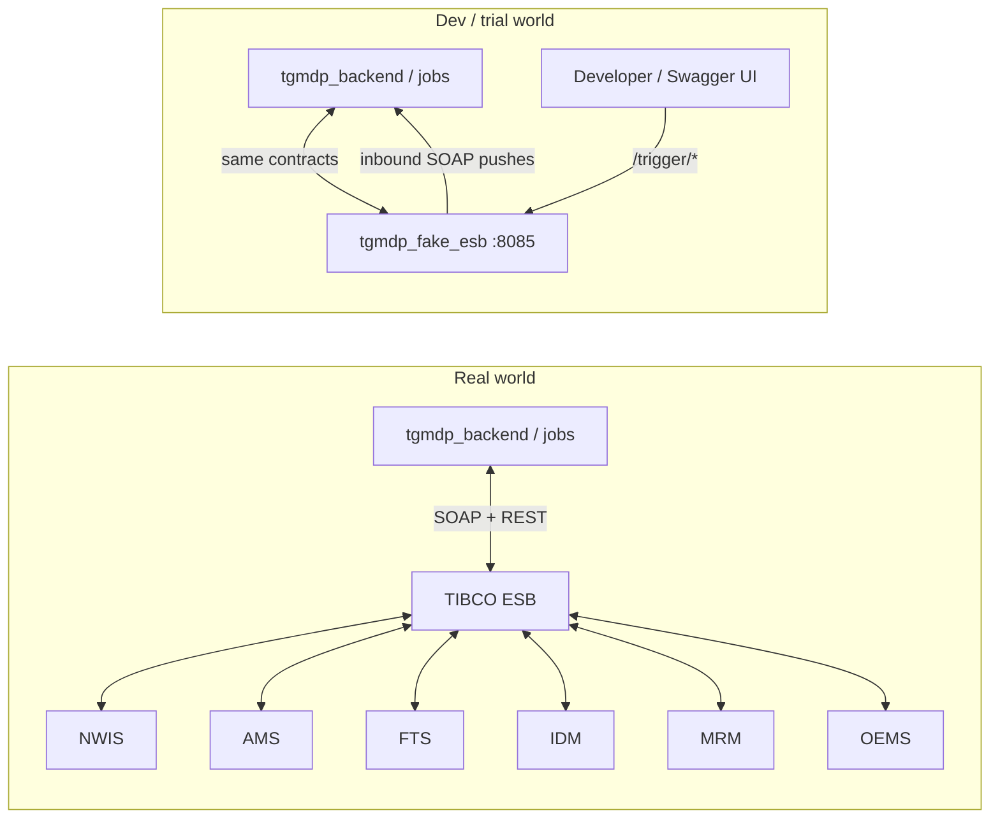

# tgmdp_fake_esb — repo map

`tgmdp_fake_esb` is a **stand-in for Taiwan Mobile's TIBCO ESB**. It is a Spring Boot 2.7 app on port **8085** that speaks the same SOAP and REST contracts as the real ESB, so that [[tgmdp_backend]] and [[tgmdp_jobs]] can be built and demoed without access to the corporate network. It is never deployed as part of production. It is a test double the size of a whole system.

> If you have not met the word "ESB" before, read [[What an ESB Is]] first. Then read [[Why a Fake ESB Exists]] for the reasoning behind this repo.

## What it pretends to be



It does two jobs:

1. **Answers outbound calls.** TGMDP calls the ESB, and the fake returns canned or generated responses. SOAP lives under `/ws/*`. REST lives under the real ESB's path prefixes (`/ESB/AMSrestful`, `/ESB/PMR`, `/ESB/WPU`, `/OEMSapi`, `/esb_api`, `/ANTapi`, `/SMRapi`, `/ESB-towerload-B1api`, and others).
2. **Starts inbound calls.** The real ESB pushes data *into* TGMDP (ticket syncs, code syncs, ACPT work orders). The fake has `/trigger/*` buttons that build those SOAP envelopes and POST them to `TGMDP_SOAP_BASE_URL` (`src/main/resources/application.yml:10`).

It also fakes the corporate **SSO login gateway**. `/login` plus `POST /gotoweb` sets the `iv-user` header that the WebSEAL-style reverse proxy would normally add (`controller/idm/IdmController.java:36-90`), so the web console's SSO entry can be tried locally.

## Folder layout

| Path | Contents | Why |
|---|---|---|
| `src/main/java/com/taiwanmobile/fakeesb/FakeEsbServer.java` | Boot main | |
| `config/SoapWebServiceConfig.java` | Spring-WS `MessageDispatcherServlet` on `/ws/*`, a SOAP 1.1/1.2 auto-detecting message factory, and 16 `Wsdl11Definition` beans | One servlet serves every SOAP contract. See [[Fake ESB Internals]]. |
| `endpoint/*Endpoint.java` | Spring-WS `@Endpoint` classes: `MdpEndpoint`, `AmsEndpoint`, `FtsEndpoint`, `BtsEndpoint`, `FnmsEndpoint`, `IdmSoapEndpoint`, `NwisEndpoint`, `AcptEndpoint`, `SiteLeaseEndpoint`, `MetadataEndpoint`, `DataCenterEndpoint`, `SkpEndpoint`, `Mdp2FnmsEndpoint`, `AmsEsbServiceEndpoint` | Outbound SOAP answers, dispatched by `@PayloadRoot`. |
| `controller/<system>/` | REST controllers: `ams_esb`, `mrm`, `wh`, `wpu`, `oems`, `slm`, `irt`, `resw`, `smr`, `ant`, `idm` | Outbound REST answers. |
| `controller/trigger/InboundTriggerController.java` + `service/trigger/SoapTriggerService.java` | Builds inbound SOAP envelopes (commonHeader v1-0 to v1-3, optional WS-Security) and POSTs them to TGMDP | Lets you rehearse ESB → TGMDP pushes on demand. |
| `service/<system>/*MockService.java` | Generates the fake data (ids, lists, dates) | Keeps controllers thin. |
| `dto/<system>/` | Request/response DTOs with Bean Validation (`@NotBlank`, `@Size`, `@Pattern`) | Turns the interface spec into code. See [[Validation]]. |
| `validation/*ValidationHandler.java` | `@RestControllerAdvice` error mappers | Reply with the ESB's error codes (`20002`, `20003`), not Spring's default error JSON. |
| `src/main/resources/wsdl/` | 21 WSDL and XSD files (17 WSDL, 4 XSD) | The real contracts, copied in. |
| `src/main/resources/templates/` | `login.html`, `home.html`, `trigger.html` | SSO page and the trigger UI. |
| `docs/` | `ams_esb/rest/B1Api.md`, `mrm/rest/MrmApiD2.md` | Hand-written specs for the REST fakes. |
| `bin/` | Eclipse build output, **committed** | Should be in `.gitignore`. Ignore it when reading. |
| `Dockerfile`, `docker-compose.yml`, `.gitlab-ci.yml` | Container on 8085; GitLab Auto-DevOps with SAST and secret detection | Deployed to a shared trial host (see below). |

## Where it runs

- **Locally**: `./gradlew bootRun` gives `http://localhost:8085`. Swagger UI is at `/swagger-ui.html` (springdoc).
- **Shared trial environment**: `tgmdp_backend`'s ESB defaults point at `https://esb.trial.my.id/...`, and the backend's health check reports `esb=FakeESB` whenever `METADATA_SOAP_ENDPOINT` contains `esb.trial.my.id` (`tgmdp_backend/docs/Development_Setup.md:529-539`). This gives a deployment a quick "am I talking to the real thing?" check. See [[Environment Separation]].

## Stack notes

- Spring Boot **2.7.14**, so `javax.*` (`build.gradle:2`). The apps it fakes are on Boot 4 with `jakarta.*`. That is fine because the wire format is all that matters, but don't copy code between the repos.
- Spring-WS (`spring-boot-starter-web-services`) for SOAP. The real backend uses Apache **CXF**. Two different SOAP stacks agreeing on one WSDL is a small contract test in itself.
- Spring Security with a single shared password for the UI (`config/SinglePasswordAuthProvider.java`), and **every ESB path `permitAll`** (`config/SecurityConfig.java:33-55`). So WS-Security headers are accepted but never checked.

## Reading order

1. [[What an ESB Is]]: the concept, outbound vs inbound, and SOAP vs REST payloads.
2. [[Why a Fake ESB Exists]]: test doubles and contract testing at system level.
3. [[Fake ESB Internals]]: how one servlet serves 16 WSDLs, failure simulation, and triggers.
4. [[Trace - SyncTicketAllData ESB Round Trip]]: the fake in action with jobs and backend.

## Try it yourself

```bash
cd tgmdp_fake_esb && ./gradlew bootRun
curl -s http://localhost:8085/ws/MDP.wsdl | head            # WSDL served by bean name "MDP"
curl -s -X POST http://localhost:8085/ESB/AMSrestful/B1api \
  -H 'Content-Type: application/json' -H 'X-FAKEESB-STATUS: 20004' -d '{}'
```

Why does the last call come back as a 400 validation error and not the simulated `20004`? (Hint: `@Valid` runs before the method body. Read [[Fake ESB Internals]].)

## Related
- [[System Overview]] · [[Integration Landscape]] · [[tgmdp_backend]] · [[tgmdp_jobs]]
- [[Message Integration and ESB]] · [[SOAP vs REST]] · [[Mocking]] · [[Testing Pyramid]] · [[Contract Testing]]
- [[Gateway]] · [[Adapter]] · [[Feature Flags and Mock Toggles]] · [[Environment Separation]] · [[Validation]] · [[Build Tools and Dependency Management]]
