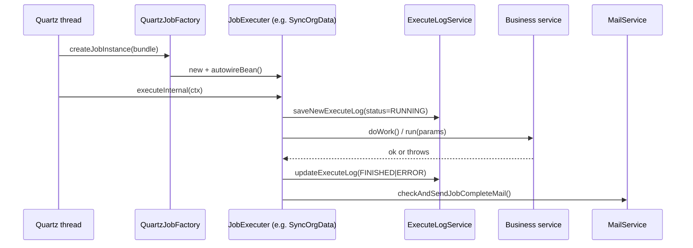
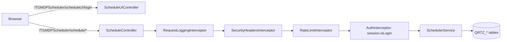

# How jobs are scheduled and triggered

Up: [[tgmdp_jobs]] · [[System Overview]]

## The one-sentence version

Quartz keeps every job and trigger as **rows in DB2** (`QRTZ_*` tables). When a trigger's fire time comes, Quartz builds the job object (Spring injects its dependencies) and calls `JobExecuter.executeInternal()`. That method picks one of three paths: *scheduled*, *once*, or *event-driven*.

## Why Quartz with a JDBC store, and not `@Scheduled`?

Spring's `@Scheduled` writes the schedule into the source code (`@Scheduled(cron="0 */5 * * * *")`). Changing it means a code change, a build and a deploy. TGMDP operators need to pause a job during maintenance, move a nightly sync from 02:00 to 03:00, or run "SiteViewSync for 4G only, right now", all without a release. Quartz with `job-store-type: jdbc` (`tgmdp_jobs/src/main/resources/application.yml:69-90`) stores the schedule as **data**:

- A trigger change made in the UI survives a restart, because the rows are in the database.
- The scheduler can tell what it *missed* while it was down, because the last fire time is stored. This is the "misfire" idea below.
- Several nodes *can* share one schedule if clustering is on (see the locking section of [[Job Reliability - Idempotency, Retries, Locking and Failure]]).

This is [[Inversion of Control]] at the process level. The job class only says *what* to do. *When* is decided by data an operator controls.

## Wiring Quartz into Spring

```java
// tgmdp_jobs/src/main/java/com/taiwanmobile/tgmdpscheduler/config/QuartzConfig.java:26-36
@Bean
public SchedulerFactoryBean schedulerFactoryBean(@Qualifier("quartzDataSource") DataSource quartzDataSource) {
    SchedulerFactoryBean factory = new SchedulerFactoryBean();
    factory.setSchedulerName(SCHED_NAME);          // "TGMDPScheduler"
    factory.setOverwriteExistingJobs(true);
    factory.setStartupDelay(STARTUP_DELAY_TIME);   // 5 s
    factory.setJobFactory(quartzJobFactory);
    factory.setDataSource(quartzDataSource);
    return factory;
}
```

Quartz instantiates job classes with reflection, so Spring never sees them. `QuartzJobFactory` (`config/QuartzJobFactory.java:22-30`) fixes this by calling `capableBeanFactory.autowireBean(jobInstance)` after Quartz creates the object. That one line is why `@Autowired private SyncOrgDataService syncOrgDataService;` works inside a job. See [[Dependency Injection]].

The five-second startup delay lets the Spring context, the datasources and the Hibernate session factory finish starting before the first trigger fires.

## The template every job follows

`JobExecuter` is an abstract [[Template Method]]. Subclasses fill in two hooks:

```java
// tgmdp_jobs/.../job/JobExecuter.java:37-39
protected abstract void doWork() throws Exception;                    // scheduled and one-off runs
protected abstract void run(Map<String, Object> para) throws Exception; // event-driven run with parameters
```

The fixed skeleton around them, simplified:

```java
// JobExecuter.java:50-98 (abridged)
MDC.put("trace_id", UUID.randomUUID().toString());     // every log line from this run shares an id
IniValue.initWithSysId(resolveSysId());                 // "mdp" package → MDP_JOBS legacy settings
setService.refresh();                                   // reload C_SET_DTL switches
if (triggerDesc.startsWith("一次性執行的Trigger")) {      // "one-shot trigger"
    executeLog = saveNewExecuteLog(jobName, "ONCE", ...);   doWork();
} else if (trigger.getNextFireTime() == null) {         // fired by triggerJob() with a JobDataMap
    executeLog = saveNewExecuteLog(jobName, "EVENT", ...);  run(dataMap);
} else {
    executeLog = saveNewExecuteLog(jobName, "NORMAL", ...); doWork();
}
// catch → status = "ERROR"; then updateExecuteLog(...) and checkAndSendJobCompleteMail(...)
```

Why use a template instead of letting each job log for itself? Because then **every** job gets an execution-log row in `QRTZ_JOB_EXECUTE_LOG`, a trace id in its logs, and an alert mail on failure, and a new job cannot forget any of them. That is [[Separation of Concerns]]. The cross-cutting work lives in one place, and the business code stays small (`SyncOrgData.doWork()` is seven lines).



## The three ways a job fires

| Execution type | How it is created | Code |
|---|---|---|
| **NORMAL**, recurring | A cron or interval trigger saved from the UI | `SchedulerServiceImpl.java:280-288` (cron), `:319-347` (interval) |
| **ONCE**, one-shot | `POST /TGMDPScheduler/schedule/triggerJob?jobName=X[&date=yyyyMMddHHmmss]` | `SchedulerServiceImpl.java:349-363`, which sets the description to `一次性執行的Trigger` |
| **EVENT**, with parameters | `POST /TGMDPScheduler/schedule/run?jobName=X&parameters={json}` | `SchedulerServiceImpl.java:406-412` calls `scheduler.triggerJob(key, new JobDataMap(params))` |

`JobExecuter` tells them apart in a fragile way. ONCE is recognised by a **Chinese string prefix on the trigger description**, and EVENT is recognised by "no next fire time". It works, but a trigger renamed by hand in the DB would quietly change paths. A typed field in the `JobDataMap` would be sturdier ([[Defensive Programming]]).

The EVENT path is how `SiteViewSync` syncs just one network type. Its `run()` reads `base_type` from the map and falls back to all of 3G/4G/5G when it is missing (`job/impl/bts/SiteViewSync.java:73-84`).

### Trigger builders

```java
// SchedulerServiceImpl.java:280-288
return TriggerBuilder.newTrigger()
        .withSchedule(CronScheduleBuilder.cronSchedule(cronExpression)
            .withMisfireHandlingInstructionIgnoreMisfires())
        .forJob(jobName).withDescription(description).endAt(triggerEndTime).build();
```

`buildHourlyTrigger`, `buildDailyTrigger`, `buildWeeklyTrigger` and `buildMonthlyTrigger` are small helpers that build a cron string from UI fields. The interval trigger can also take an **active range** such as `08-18`. That becomes a Quartz `DailyCalendar` with `setInvertTimeRange(true)` (`:339-344`), which means "only fire inside this window". Monitoring jobs use this to stay quiet at night.

**Misfire policy.** `IgnoreMisfires` tells Quartz to fire missed runs as soon as it can after downtime and then carry on with the normal schedule. According to the Quartz docs, a trigger that missed several fire times can then run several times in a row on restart. For an idempotent full refresh this is harmless. For something that sends SMS, it could mean duplicate alerts. Compare this with [[Job Reliability - Idempotency, Retries, Locking and Failure]].

## The operator surface



- `WebConfig.java:38-50` registers the [[Interceptor and Filter Chain]] in a deliberate order. HSTS runs first so rejected responses still carry the header. Rate limiting runs before auth so an unauthenticated flood is cut off cheaply.
- `AuthInterceptor.java:33-53` only checks `session.isLogin`. Its own comment says the app has **one shared account**, so the audit log records the source IP, not a person. See [[Authentication and Sessions]] and [[Authorization and RBAC]]. With no roles at all, anyone who logs in can delete any job.
- `ScheduleController.java:46-54` adds a 5-second **replay guard** keyed on `jobName+parameters`. A double-clicked "Run" button does not start two runs. The guard is an in-memory map, so it is per-node and resets on restart.

## Questions to check understanding

1. Remove `QuartzJobFactory` from the context. What error appears, and in which job?
2. An operator sets an interval trigger with active range `22-06`. Look at how `activeRange.split("-")` is used. Does a range that crosses midnight work?
3. Why is the ONCE/EVENT split decided at *runtime* inside the job, and not by having two different job classes?
4. What would you change so that EVENT runs can be told apart without relying on `getNextFireTime() == null`?

## Related
- [[tgmdp_jobs]] · [[System Overview]] · [[How Jobs Read and Write Data]] · [[Job Reliability - Idempotency, Retries, Locking and Failure]]
- [[Scheduled Jobs and Batch Processing]] · [[Template Method]] · [[Dependency Injection]] · [[Inversion of Control]]
- [[Interceptor and Filter Chain]] · [[Authentication and Sessions]] · [[Authorization and RBAC]] · [[Configuration and Environments]] · [[Defensive Programming]] · [[Separation of Concerns]]
