# How jobs read and write data

Up: [[tgmdp_jobs]] · [[System Overview]]

A job is mostly plumbing. It reads something, either a DB table or a remote system. It transforms it. Then it writes it somewhere: a DB table, a remote system, or a mailbox. Almost every TGMDP job matches one of five shapes. Once you can name the shape, any job in `job/impl/` is quick to read.

## Two datasources, on purpose

```yaml
# tgmdp_jobs/src/main/resources/application.yml:48-68 (local profile, credentials omitted)
spring.datasource.quartz.jdbc-url: ${LOCAL_QUARTZ_DB_URL:jdbc:db2://db2:50000/tgmdp:currentSchema=OSBDBA;}
spring.datasource.app.jdbc-url:    ${LOCAL_APP_DB_URL:jdbc:db2://db2:50000/tgmdp:currentSchema=DB2ADMIN;...}
```

- **`quartz`** (`OSBDBA` schema) holds the `QRTZ_*` scheduler tables and `QRTZ_JOB_EXECUTE_LOG`. `ExecuteLogServiceImpl` and `SchedulerServiceImpl` are annotated `@Transactional(transactionManager = "quartzTransactionManager")`.
- **`app`** (`DB2ADMIN` and other business schemas such as `INOUT`, `ACPT`) holds everything the business cares about.

Why split them? Scheduler bookkeeping should not share a transaction with business work. If a sync rolls back, you still want the row that says "this job ran and failed". Each has its own transaction manager, so the two commit independently. See [[Database Transactions]].

The UAT profile is a leftover of the legacy deployment. It points at **Oracle** with `OracleDelegate` (`application.yml:206-247`), while local, staging and production use DB2 with `DB2v8Delegate`. The repository code uses native SQL in places, so watch for dialect differences. See [[DB2]] and [[SQL and Relational Databases]].

## Shared repositories

The entities and Spring Data repositories are not in this repo. They come from the `sharedModules` git submodule, which `tgmdp_backend` also uses. Most are native-SQL `@Query` methods that mirror legacy SQL, for example `InoutWbmplusMstRepository` (`tgmdp_backend/sharedModules/src/main/java/com/taiwanmobile/sharedmodules/repository/inout/InoutWbmplusMstRepository.java:17-31`). This is the [[Repository Pattern]] used as a thin SQL wrapper rather than a domain model ([[ORM and JPA]]).

The trade-off: one schema change updates both apps at once, which is good. But the two apps are now coupled at the *database* level and not through an API. A column rename in the backend can break a job at 3 a.m.

## The five data shapes

```mermaid
flowchart TB
    subgraph A[1. Pull and replace]
        A1[ESB/IDM SOAP] --> A2[delete-all + insert] --> A3[(A_ORG_DATA)]
    end
    subgraph B[2. Outbox drain]
        B1[(INOUT_WBMPLUS_MST STATUS=0)] --> B2[M+ / FCM / SMS API] --> B3[(STATUS=1 or PUSH_TIME+1)]
    end
    subgraph C[3. Kick the backend]
        C1[Job] -->|REST + Basic token| C2[tgmdp_backend /api/v1/...] --> C3[ESB / ADS]
    end
    subgraph D[4. Async request, callback later]
        D1[(B_TICKET_SYNC STATUS=0)] --> D2[ESB syncTicketByDate] -.->|later| D3[backend putSyncFile]
    end
    subgraph E[5. Watch and alarm]
        E1[(C_MBATCH_MST, B_SYNC_TIME, actuator)] --> E2[threshold rule] --> E3[(mail/SMS queue)]
    end
```



### 1. Pull and replace (full refresh)

`SyncOrgDataService.execute()` calls the IDM `syncDepartment` SOAP operation through the ESB and rebuilds the whole org tree:

```java
// tgmdp_jobs/.../service/mdp/SyncOrgDataService.java:118-128
private void syncOrgData(List<Node1Type> list) {
    if (list != null && !list.isEmpty()) {
        aOrgDataRepository.deleteAllOrgData();      // wipe
        for (Node1Type node : list) {
            syncNode(node, "", "", "", "");        // recursive insert, 4 levels deep
        }
    }
}
```

Why delete and re-insert instead of diffing? The source sends the *whole* tree every time. Diffing a four-level hierarchy is hard to get right, while "replace everything" is obviously correct. It is also naturally **idempotent**: run it twice and you get the same table. `execute()` is `@Transactional(rollbackFor = Exception.class)` (`:53`), so a failure halfway through rolls back the delete too. Readers never see an empty org table. The `isEmpty()` guard stops an empty response from wiping the table. See [[Idempotency]].

### 2. Outbox drain (queue in a table)

Other parts of the system (the backend, legacy apps) don't call M+ directly. They **insert a row** with `STATUS='0'`, and `MplusSendMes` drains the table:

```sql
-- InoutWbmplusMstRepository.java:17-21 (tgmdp_backend/sharedModules)
SELECT BMP_ID, ACC_MPLUS_KEY, SEND_MES, PUSH_TIME FROM INOUT.INOUT_WBMPLUS_MST
WHERE STATUS = '0' AND MPLUS_TIME >= (CURRENT TIMESTAMP - 30 MINUTES)
  AND (PUSH_TIME IS NULL OR PUSH_TIME <= 3)
```

On success the job writes `STATUS='1'` and the `campaignId`. On failure it keeps `STATUS='0'` and increments `PUSH_TIME` (`job/impl/mdp/MplusSendMes.java:139,150`). This is the [[Outbox Pattern]]. The table *is* the queue, and the WHERE clause *is* the retry policy (at most about 4 attempts, only for 30 minutes). Why a table and not a message broker? Legacy TGMDP had none, and a DB table survives restarts, can be queried with SQL, and is shared by every app that can reach DB2.

### 3. Kick the backend

Jobs such as `AmsRequestAllTicketData`, `FtsRequestAllTicketData` and `SiteViewSync` do no business logic at all. They `POST` to a `tgmdp_backend` endpoint with a `Basic` token from `BACKEND_TOKEN`:

```java
// tgmdp_jobs/.../job/impl/ams/AmsRequestAllTicketData.java:55-65
String url = host + endpoint;
Map<String, String> headers = Map.of("Authorization", "Basic " + token);
ResponseEntity<ApiResponse<AmsTicketSyncResponseDto>> response = httpRequestUtility.post(url, Map.of(),
    new ParameterizedTypeReference<ApiResponse<AmsTicketSyncResponseDto>>() {}, headers);
```

Why? The backend already owns the ESB clients, the WS-Security accounts and the parsing logic for AMS, FTS and BTS. Duplicating them in the jobs repo would mean two copies to keep in parity. So the job is only the *clock*, and the backend is the *worker*. The backend checks for this: `FtsTicketController.java:92` notes "full ESB sync is for the tgmdp_jobs scheduler (Basic token), not app users". Endpoints come from `backend.*` in `application.yml:376-400`. See [[Client-Server Architecture]] and [[HTTP and REST]].

### 4. Async request, callback later

`SyncTicketAllData` writes a tracking row, asks the ESB to *start* a sync, and finishes. The data comes back later on a **different connection**, inbound to the backend. This is the most instructive flow in the repo. It has its own note: [[Trace - SyncTicketAllData ESB Round Trip]].

### 5. Watch and alarm

The `mdp/moniter` jobs read health data and write alarm rows:

- `MoniterBatch` reads `C_MBATCH_MST.LAST_EXECUTE_TIME` and alarms when a batch is late by **more than 2× its cycle** (`job/impl/mdp/moniter/MoniterBatch.java:113-145`). This is why so many jobs end with a "batch stamp" (`cMbatchMstRepository.updateMst(...)` plus `insertDtl(...)`). It is a **heartbeat**: each job proves it is alive, and a watchdog job notices when one goes quiet.
- `MoniterSyncThreeMin` alarms when `B_SYNC_TIME` for GIS/AMS/SMS/FTS is more than 30 minutes old.
- `MoniterWAS` polls the backend's actuator, and `MoniterOS` polls `/jobs/moniterOs` on the job nodes themselves.

Alarms are themselves rows (`mailRepository.insertEmail(...)` in `MplusSendMes.java:84-93`), so a mail-sending job delivers them later. It is outboxes all the way down. See [[Logging and Observability]].

## Writing files and other side channels

- `SyncOrgDataService.saveResponseFile` writes the raw SOAP response as `<transactionId>.xml` for diagnosis. It is best-effort: a failure is logged and the sync goes on (`SyncOrgDataService.java:93-116`).
- `DoAntPhotoUpload` uploads photos over SFTP with Apache MINA SSHD. It uses `AcceptAllServerKeyVerifier` (`job/impl/mdp/DoAntPhotoUpload.java:348`), which turns off host-key checking and leaves the upload open to man-in-the-middle attacks. Worth fixing.
- `GetWeatherSite` reads the Central Weather Administration open-data API. The API key is **embedded in a constant URL** (`job/impl/mdp/GetWeatherSite.java:30-31`) and not read from the environment. This is a [[Secrets Management]] smell. The value is not reproduced here.

## Try it yourself

1. Choose three jobs in `job/impl/mdp/` and label each with one of the five shapes above.
2. In `SiteViewSync.java:116-132`, the batch stamp is written even when the backend replies `success=false`, but **not** on HTTP 4xx/5xx. Read the comment there. Why did the authors keep this legacy quirk?
3. `AmsRequestAllTicketData` stamps `MON_SYNCAMSTICKET` even when `body.getSuccess()` is false (`:68-76`). What does that do to `MoniterBatch`'s ability to notice a broken sync?

## Related
- [[tgmdp_jobs]] · [[System Overview]] · [[How Jobs Are Scheduled and Triggered]] · [[Job Reliability - Idempotency, Retries, Locking and Failure]] · [[Trace - SyncTicketAllData ESB Round Trip]] · [[Integration Landscape]]
- [[Database Transactions]] · [[DB2]] · [[SQL and Relational Databases]] · [[ORM and JPA]] · [[Repository Pattern]] · [[Service Layer]]
- [[Outbox Pattern]] · [[Idempotency]] · [[Message Integration and ESB]] · [[HTTP and REST]] · [[Client-Server Architecture]] · [[Secrets Management]] · [[Logging and Observability]]
