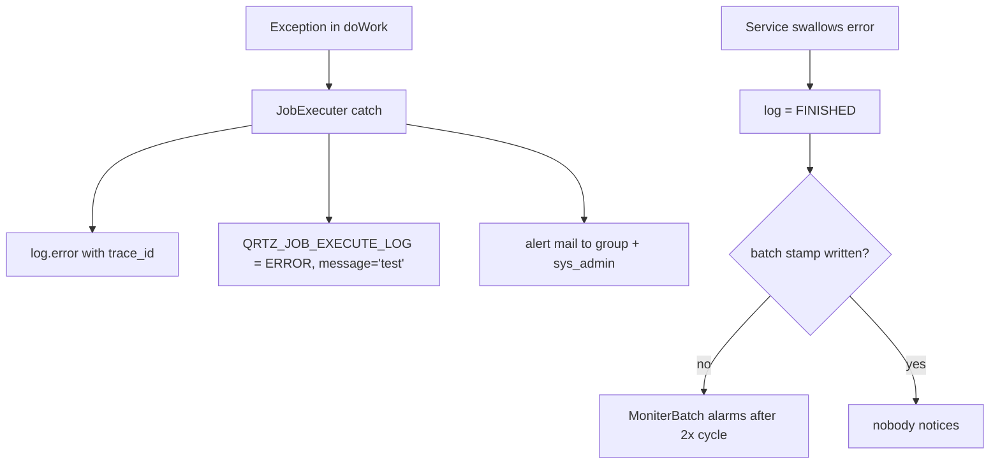

# Job reliability: idempotency, retries, locking and failure

Up: [[tgmdp_jobs]] · [[System Overview]]

Batch jobs fail in ways that request handlers don't. Nobody is watching. They run while the network is down. They can run twice, or not at all. This note asks four questions of the TGMDP jobs and answers each from the code. Where the answer is "there isn't one", it says so and explains why.

| Question | Short answer in tgmdp_jobs |
|---|---|
| Is it safe to run twice? (**idempotency**) | Depends on the job: full-refresh jobs yes, outbox jobs mostly, notification jobs no. There is no framework-level guarantee. |
| Does it try again? (**retries**) | Not at the Quartz or HTTP level. Retries exist only as **status columns in outbox tables**, plus "the next scheduled run". |
| Can two copies run at once? (**locking**) | `@DisallowConcurrentExecution` on every job, plus one worker thread per node. Not safe across nodes in the current config. |
| What happens on failure? | An execution-log row, an alert mail, and possibly a watchdog alarm. The exception is **swallowed**, and the stack trace is not saved. |

## 1. Idempotency

An operation is idempotent when doing it N times leaves the same state as doing it once. Jobs need this because they *will* run more than once: misfire catch-up after downtime (see [[How Jobs Are Scheduled and Triggered]]), an operator pressing "Run" during a scheduled run, or a retry after a partial failure.

How TGMDP gets it, job by job:

- **Full replace.** `SyncOrgDataService` deletes `A_ORG_DATA` and re-inserts the tree in one transaction (`service/mdp/SyncOrgDataService.java:53-81,118-128`). Running it twice gives the same result, so it is idempotent by construction.
- **State machine on a row.** Outbox rows go from `STATUS 0 → 1`. The query only picks `STATUS='0'`, so a sent message is not sent again (`InoutWbmplusMstRepository.java:17-21` in `tgmdp_backend/sharedModules`). There is a gap: if M+ accepts the message and the `UPDATE ... STATUS='1'` then fails, the next run sends it again. That gives **at-least-once** delivery, not exactly-once.
- **Idempotency key.** `SyncTicketAllData` creates a fresh `transactionId` per run and stores it with `STATUS='0'`. When the ESB calls back, the backend processes that id **only if** its status is still `0`, and otherwise answers `"transactionId ... executed"` (`tgmdp_backend/.../service/mdpads/MdpSoapEndpoint.java:73-121`). A duplicate callback is harmless. See [[Trace - SyncTicketAllData ESB Round Trip]].
- **Not idempotent.** `SendSmsCheck`, `PushApp` and the alarm mails just send. Running them twice sends twice.

Lesson: idempotency is a *design* property of each job's data, not something a framework adds. See [[Idempotency]].

## 2. Retries

Nothing in the stack retries for you:

- `JobExecuter.executeInternal` catches every exception (`job/JobExecuter.java:80-87`) and never throws `JobExecutionException` with `setRefireImmediately(true)`, so **Quartz never refires** a failed run.
- `HttpRequestUtility` (sharedModules) and `SoapClientUtility` only set timeouts. The ESB SOAP client uses a 600 s connect and 300 s receive timeout (`service/mdp/MdpEsbSoapService.java:86`). There is no retry or backoff.

Retries are instead built into the data:

```text
outbox row:  STATUS='0', PUSH_TIME=n   →  job tries  →  ok:   STATUS='1'
                                                    →  fail: PUSH_TIME=n+1, still '0'
selected again only while PUSH_TIME <= 3 and the row is < 30 minutes old
```

Why do it this way? A retry in a table is **visible** (you can query what is stuck), **durable** (it survives restarts), and **bounded** (the WHERE clause is the retry budget). A retry inside a loop is invisible and is lost when the JVM dies. The cost is that the gap between attempts equals the job's interval.

For pull-type jobs such as `SyncOrgData`, the "retry" is simply the next scheduled run. That is fine for a full refresh, because the next run fixes everything.

## 3. Locking: preventing concurrent runs

Two tools are in play:

1. **`@DisallowConcurrentExecution`** is on all 56 job classes (the example template has it too: `job/impl/JobForImplementExample.java:11`). Quartz then won't start a second instance of the *same JobDetail* while one is running. A slow 10-minute sync with a 5-minute trigger does not stack up.
2. **`threadCount: 1`** in the local, staging and production profiles (`application.yml:81`). The whole scheduler has one worker thread, so jobs on one node run one after another. This is maximal safety, but one slow job (say a 20-minute `SyncAccountList`) delays every other job and can cause misfires. UAT uses `threadCount: 20` (`application.yml:238`). See [[Concurrency and Threads]].

**Across nodes.** `.env.example` mentions two job hosts (`WAS_JOB1_HOST` and `WAS_JOB2_HOST`, "prod_ap3/prod_ap4"). Quartz coordinates nodes only when `isClustered: true`. It then takes a row lock in `QRTZ_LOCKS` so that only one node fires each trigger. Local, staging and production set `isClustered: false` (`application.yml:89,139,189`). Only UAT sets `true` (`:246`). Per the Quartz docs, two non-clustered schedulers on the *same* `QRTZ_` tables can each fire the same trigger, and `@DisallowConcurrentExecution` does not protect across them. **Unverified:** whether production really runs two job nodes against one schema with this profile. If it does, every non-idempotent job (SMS, push) is at risk of double-sending. This is the first thing to check before scaling out.

There is no application-level lock either, such as a `SELECT ... FOR UPDATE` on outbox rows or a "claimed by" column. The outbox pattern relies on there being only one consumer.

## 4. Failure handling

```java
// tgmdp_jobs/.../job/JobExecuter.java:80-90
}catch(Exception e){
    logger.error("executeInternal error", e);
    status = "ERROR";
    message = ExceptionUtils.getStackTrace(e);
    if(message.length() > 2000){ message = message.substring(0,2000); }
}
if (executeLog != null){
    qrtzExecuteLogService.updateExecuteLog(executeLog, status, "test");   // ← message is not passed
    mailService.checkAndSendJobCompleteMail(executeLog);
}
```

What happens on failure, in order:

1. The error is logged with the MDC `trace_id`, so in Kibana you can filter one run's lines.
2. `QRTZ_JOB_EXECUTE_LOG` gets `STATUS='ERROR'`, but the message column gets the literal string **`"test"`**. The truncated stack trace built two lines earlier is thrown away. The O&M SOP (`docs/Operation_and_Maintenance_OM_SOP.md`, Test 1) says the stack trace is stored. **The code disagrees with the doc.** Trust the code.
3. `checkAndSendJobCompleteMail` (`service/impl/MailServiceImpl.java:198-236`) mails the job's mail group plus `sys_admin`. Read lines 201-217 carefully. When the status is `ERROR` and no `JOB_MAIL_<job>_ERROR` group exists, `sendMail` is `null`, and `sendMail.getEmailList()` on line 217 looks like a `NullPointerException`. The exception would happen *inside* failure handling, outside the try that guards only the `send` call. (Found by reading; not reproduced.)
4. The exception does not reach Quartz, so the trigger stays healthy and simply fires again next time.

**Silent failures.** Many services catch and log instead of throwing. `SyncOrgDataService.execute()` logs `ESB回傳失敗` ("ESB returned failure") and returns normally when the ESB header status is not `"S"` (`:69-80`). The job is then recorded as **FINISHED**, and no ERROR mail goes out. The safety net is the heartbeat: `MoniterBatch` notices a missing batch stamp (`job/impl/mdp/moniter/MoniterBatch.java:113-145`). But some jobs stamp *even on a failed response* (`ams/AmsRequestAllTicketData.java:68-76`), so for those the net has a hole. See [[Error Handling]].

**`@Transactional` that does nothing.** `SyncTicketAllData.doSync()` is annotated `@Transactional` but is `private` and called from inside the same class (`job/impl/mdp/SyncTicketAllData.java:57-58`). Spring transactions work through a proxy, and a proxy can't intercept private methods or self-calls, so the annotation is ignored. Each repository call commits on its own. A common Spring trap ([[Database Transactions]]).

**Interrupted runs.** If the JVM dies mid-job, the log row stays `RUNNING` forever. `ExecuteLogService.listRunningExecuteLog()` and `hasBeenInterrupted()` exist for this, but nothing calls them (`grep` finds only the interface and impl).



## Questions to check understanding

1. Rank `SyncOrgData`, `MplusSendMes` and `SendSmsCheck` from "safe to double-run" to "unsafe". Explain the order.
2. Name a one-line fix for the lost stack trace, and the test you would add (`JobExecuter` has none today).
3. What has to be true of the DB *and* the config before you can safely start a second job node?
4. Why might a team *choose* swallow-and-log over rethrow in a batch system? What do they then need to add to stay safe?

## Related
- [[tgmdp_jobs]] · [[System Overview]] · [[How Jobs Are Scheduled and Triggered]] · [[How Jobs Read and Write Data]] · [[Trace - SyncTicketAllData ESB Round Trip]]
- [[Idempotency]] · [[Outbox Pattern]] · [[Concurrency and Threads]] · [[Database Transactions]] · [[Error Handling]] · [[Logging and Observability]]
- [[Scheduled Jobs and Batch Processing]] · [[Defensive Programming]] · [[Unit Testing]]
