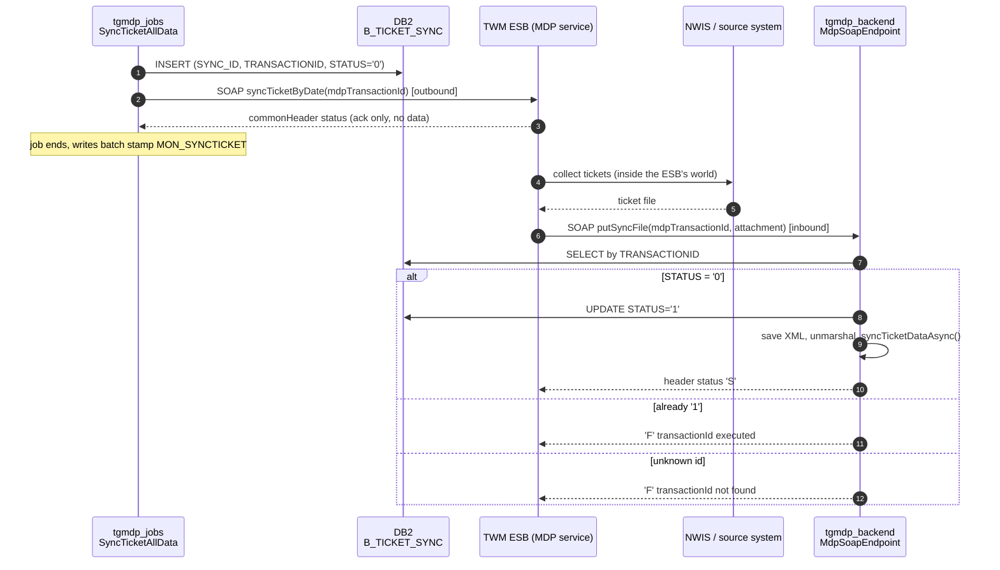

# Trace: SyncTicketAllData's round trip through the ESB

Up: [[tgmdp_jobs]] · [[System Overview]] · also see [[What an ESB Is]]

This job is worth tracing slowly. It shows an **outbound** SOAP call and an **inbound** SOAP call joined by a correlation id, with an idempotency check at the end. Three repos are involved: `tgmdp_jobs` sends, the ESB relays (or [[tgmdp_fake_esb]] stands in for it), and `tgmdp_backend` receives.

## The big picture



Why split one sync into two calls? Collecting every ticket can take minutes, much longer than anyone should hold an HTTP connection open. So the ESB uses **asynchronous request / callback**. The first call only says "please start". The result comes back later, pushed by the ESB, and carries the same `mdpTransactionId` so the receiver can match it to the request. See [[Asynchronous Request-Callback]] and [[Message Integration and ESB]].

## Step 1: the job writes its intent

```java
// tgmdp_jobs/src/main/java/com/taiwanmobile/tgmdpscheduler/job/impl/mdp/SyncTicketAllData.java:57-66
@Transactional
private void doSync() {
    try {
        String syncId = bTicketSyncRepository.getNextSyncId();                  // DB2 sequence
        String transactionId = String.format("%010d", Long.parseLong(syncId));  // zero-padded
        bTicketSyncRepository.insertSync(syncId, transactionId);
```

`insertSync` writes `STATUS='0'` (`tgmdp_backend/sharedModules/.../repository/BTicketSyncRepository.java:30-40`). The row is **written before the call**, so whatever happens next, there is a record of what was requested. (The `@Transactional` is ineffective here; see [[Job Reliability - Idempotency, Retries, Locking and Failure]].)

## Step 2: the outbound SOAP call

```java
// SyncTicketAllData.java:69-80
CommonHeader headerVal = new CommonHeader();
headerVal.setMessageFrom("MDP");
headerVal.setMessageTo("ESB");
Holder<CommonHeader> header = new Holder<>(headerVal);

SyncTicketByDateRequest body = new SyncTicketByDateRequest();
body.setMdpTransactionId(transactionId);

ESBPortType port = mdpEsbSoapService.getPort();
port.syncTicketByDate(header, body);
```

Things to notice:

- **`Holder<CommonHeader>`**: the header is *in-out*. The ESB writes `status`, `message` and `transactionId` back into the same object. That is how JAX-WS models a SOAP header the server modifies. See [[Serialization and DTOs]].
- **`messageFrom` / `messageTo`**: every TWM ESB message has this envelope header. The ESB routes on it and logs it.
- `ESBPortType`, `CommonHeader` and `SyncTicketByDateRequest` are **generated** from the WSDL. This is the WSDL-first, contract-first SOAP style. See [[SOAP vs REST]]. For MDP the stubs are not generated in this repo. They come pre-built in the vendored `lib/MDPWebService.jar`, and the `wsdl2java` task only handles the IDM WSDLs.
- `getPort()` loads `wsdl/ESBService.wsdl` from the classpath when `esb.mdp.wsdl.path` is empty (`MdpEsbSoapService.java:55-59`). That file is **not** in `src/main/resources/wsdl/`, and `application.yml` defines no `esb.mdp.*` keys, so in practice you must provide `ESB_MDP_WSDL_PATH` and `ESB_MDP_ENDPOINT` (Spring relaxed binding). Read from the code, not run.

`MdpEsbSoapService.getPort()` builds the client:

```java
// tgmdp_jobs/.../service/mdp/MdpEsbSoapService.java:74-89 (abridged)
outProps.put(WSHandlerConstants.ACTION, USERNAME_TOKEN + " " + TIMESTAMP);
outProps.put(WSHandlerConstants.USER, clientAccount);
outProps.put(WSHandlerConstants.PASSWORD_TYPE, WSConstants.PW_DIGEST);
outProps.put(WSHandlerConstants.PW_CALLBACK_REF, new ClientPasswordCallback(clientAccount, clientToken));
cxfEndpoint.getOutInterceptors().add(new WSS4JOutInterceptor(outProps));
ESBPortType configured = soap.configurePort(port, endpointUrl, 600000, 300000, null);
SoapLoggingSupport.install(ClientProxy.getClient(configured), TargetSystem.ESB_MDP);
```

- **WS-Security UsernameToken + Timestamp, password digest.** The password itself is never sent. The client sends `Base64(SHA1(nonce + created + password))`, and the timestamp limits replay. See [[WS-Security]] and [[Authentication and Sessions]].
- An **interceptor chain** on the client: WSS4J adds the security header, and `SoapLoggingSupport` swaps CXF's plain logging for structured `OUTBOUND` records with the password masked (`logging/LogRedactor.java`). See [[Interceptor and Filter Chain]] and [[Logging and Observability]].
- The endpoint comes from `esb.mdp.endpoint`, so it is config, not code. Pointing it at the fake ESB is a one-line change. See [[Configuration and Environments]].

### The outbound payload on the wire (SOAP 1.2, shape only)

```xml
<soap:Envelope xmlns:soap="http://www.w3.org/2003/05/soap-envelope">
  <soap:Header>
    <wsse:Security>…UsernameToken (digest) + Timestamp…</wsse:Security>
    <v1:commonHeader xmlns:v1="http://www.taiwanmobile.com/ESB/xsd/Common/v1-0">
      <v1:messageFrom>MDP</v1:messageFrom><v1:messageTo>ESB</v1:messageTo>
    </v1:commonHeader>
  </soap:Header>
  <soap:Body>
    <mdp:syncTicketByDateRequest xmlns:mdp="http://www.taiwanmobile.com/ESB/xsd/MDP/v1-0">
      <mdp:mdpTransactionId>0000012345</mdp:mdpTransactionId>
    </mdp:syncTicketByDateRequest>
  </soap:Body>
</soap:Envelope>
```

## Step 3: what the fake ESB does with it

Locally, [[tgmdp_fake_esb]] answers the outbound call. It routes on the body's root element:

```java
// tgmdp_fake_esb/src/main/java/com/taiwanmobile/fakeesb/endpoint/MdpEndpoint.java:73-79
@PayloadRoot(namespace = NAMESPACE_URI, localPart = "syncTicketByDateRequest")
@ResponsePayload
public void syncTicketByDate(@RequestPayload Element request, MessageContext messageContext) throws Exception {
    logRequest("syncTicketByDate", request);
    addCommonHeaderToResponse(messageContext, "MDP syncTicketByDate processed successfully");
}
```

It only logs and acks. It **does not** start the callback by itself. You trigger the inbound half by hand with `POST /trigger/mdp/putSyncFile` (see Step 4). The fake's header puts `status=10001` (`MdpEndpoint.java:205-208`), while the backend's own inbound endpoint replies `S`/`F`, and `SyncOrgDataService` checks for `"S"`. `SyncTicketAllData` only logs the status, so it doesn't care. But this is exactly the kind of drift that [[Why a Fake ESB Exists]] warns about.

## Step 4: the inbound callback

On the real ESB this arrives some minutes later. With the fake you fire it yourself:

```java
// tgmdp_fake_esb/.../controller/trigger/InboundTriggerController.java:219-235 (abridged)
String body = "<mdp:putSyncFileRequest xmlns:mdp=\"" + ns + "\">" +
              "<mdp:mdpTransactionId>FAKEESB-MDP-SYNC-001</mdp:mdpTransactionId>" +
              "<mdp:attachment>…base64 file…</mdp:attachment></mdp:putSyncFileRequest>";
soapTriggerService.sendWithCommonHeaderV10(
    "/NWIS_ADS/services/MDPService",
    "http://www.taiwanmobile.com/ESB/wsdl/MDP/v1-0/putSyncFile", ns, body);
```

The backend publishes that path with CXF (`tgmdp_backend/.../config/CxfConfig.java:165-167`, `endpoint.publish("/MDPService")`) and handles it here:

```java
// tgmdp_backend/.../service/mdpads/MdpSoapEndpoint.java:66-78 (abridged)
swapHeader(ch);                                         // reply goes back from TGMDP to ESB
String transactionId = body.getMdpTransactionId();
BTicketSync syncRecord = mdpTicketSyncRepository.getByTransactionId(transactionId);
if (syncRecord != null) {
    if ("0".equals(syncRecord.getStatus())) {
        mdpTicketSyncRepository.updateSyncStatus(syncRecord.getSyncId(), "1");
        // save attachment as <transactionId>.xml, unmarshal (DTD/XXE disabled), process async
```

- The **correlation id** (`mdpTransactionId`) ties this inbound message to the row the job wrote in Step 1.
- The **status check is the idempotency guard**: a replayed callback gets `F / transactionId executed` and changes nothing.
- An **unknown id** is rejected. The fake's hard-coded `FAKEESB-MDP-SYNC-001` will therefore *always* get `transactionId ... not found`, unless you first insert a matching `B_TICKET_SYNC` row or edit the trigger. A good exercise.
- The heavy work (`syncTicketDataAsync`) runs **asynchronously**, so the ESB gets its reply quickly. Note that the status flips to `1` *before* processing. If the async step crashes, the data is lost, and a replay is refused. That is at-most-once processing for this half.

## Try it yourself

1. Start the fake ESB (`./gradlew bootRun` in `tgmdp_fake_esb`, port 8085) and the backend. Set `ESB_MDP_ENDPOINT=http://localhost:8085/ws` and point `ESB_MDP_WSDL_PATH` at a copy of the MDP WSDL (the fake ships one: `tgmdp_fake_esb/src/main/resources/wsdl/MDPSoapHttpService.wsdl`; check that its service QName matches `MDPSoapHttpService`) and run `SyncTicketAllData` with `POST /TGMDPScheduler/schedule/run?jobName=SyncTicketAllData`. Find the `=== Received MDP syncTicketByDate Request ===` line in the fake's log.
2. Read the new `TRANSACTIONID` from `B_TICKET_SYNC`. Put it into the trigger body and fire `/trigger/mdp/putSyncFile`. Then fire it a second time. Which response does each call get?
3. Draw where you would add a "callback never arrived" alarm. (Hint: what does `MoniterBatch` measure, and what does it miss?)

## Related
- [[tgmdp_jobs]] · [[tgmdp_backend]] · [[tgmdp_fake_esb]] · [[System Overview]] · [[Integration Landscape]]
- [[What an ESB Is]] · [[Why a Fake ESB Exists]] · [[How Jobs Read and Write Data]] · [[Job Reliability - Idempotency, Retries, Locking and Failure]]
- [[Message Integration and ESB]] · [[SOAP vs REST]] · [[Serialization and DTOs]] · [[Interceptor and Filter Chain]] · [[Configuration and Environments]]
- [[Idempotency]] · [[Asynchronous Request-Callback]] · [[WS-Security]] · [[Gateway]]
