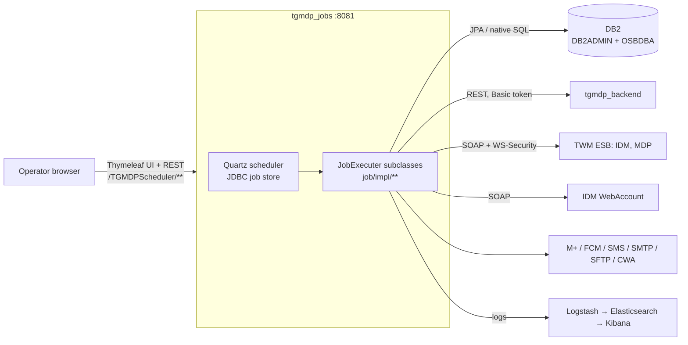

# tgmdp_jobs — repo map

`tgmdp_jobs` is the **batch half** of the rebuilt TGMDP platform. The backend ([[tgmdp_backend]]) answers requests from people. This repo does the work nobody asks for in real time: syncing org charts from IDM, asking the ESB for ticket files, pushing M+ and FCM notifications, watching servers, and mailing reports.

It is a Spring Boot 4.1.1 app on Java 17 that embeds the **Quartz** scheduler. It also has a small Thymeleaf admin UI where an operator can add jobs, set cron triggers, run a job once, and see the history. Gradle calls the project `TGMDPScheduler` (`tgmdp_jobs/settings.gradle`), and that name shows up in the URL paths.

> Why a separate process? Batch work has a different shape from request work. It is long-running and bursty, it touches many rows, and it needs to run even when no user is logged in. Keeping it out of the request-serving JVM means a slow 20-minute sync cannot starve the API's thread pool. Read [[Scheduled Jobs and Batch Processing]] for the general idea.

## Where it sits

The full picture of every external system is in [[Integration Landscape]].

## Folder layout

| Path | What lives there | Why it exists |
|---|---|---|
| `src/main/java/com/taiwanmobile/tgmdpscheduler/TGMDPSchedulerApplication.java` | Boot entry point. Scans both `tgmdpscheduler` and `sharedmodules`. | The jobs reuse the backend's entities and repositories (see `sharedModules` below). |
| `.../config/QuartzConfig.java`, `QuartzJobFactory.java` | Builds the Quartz `SchedulerFactoryBean` and lets Spring inject beans into job instances. | Quartz creates job objects itself, so without this factory `@Autowired` fields would be null. See [[Dependency Injection]]. |
| `.../config/QuartzDataSourceConfig.java`, `AppDataSourceConfig.java` | Two datasources: one for the `QRTZ_*` tables, one for business tables. | Scheduler state and business data live in different schemas (`OSBDBA` vs `DB2ADMIN` in `application.yml:50,60`). |
| `.../job/JobExecuter.java` | Abstract base class for every job. | The [[Template Method]] that adds logging, the execution-log row and the alert mail around each job body. |
| `.../job/impl/{mdp,bts,ams,fts,acpt,fnti,inout,mrm}/` | About 56 concrete jobs, grouped by legacy subsystem. | The package name becomes the `SYS_ID` (`mdp` → `MDP_JOBS`, `JobExecuter.java:41-47`), which picks the legacy ini settings. |
| `.../job/controller/` | `ScheduleController` (REST), `ScheduleUIController` (login + pages), `AjaxController` (mail groups), `MoniterOsController` (OS metrics). | The operator console. |
| `.../service/` and `service/impl/` | Scheduler, execute-log, mail and alarm services, plus per-module services (`service/mdp/SyncOrgDataService.java` and others). | Keeps job classes thin. The job decides *when*, the service decides *what* ([[Service Layer]]). |
| `.../service/idm/`, `service/mdp/MdpEsbSoapService.java` | Apache CXF SOAP clients for the ESB. | See [[What an ESB Is]]. |
| `.../logging/` | `OutboundLoggingInterceptor`, `SoapLoggingSupport`, `LogRedactor`, `TargetSystem`. | Every outbound call becomes a structured `OUTBOUND` log record with credentials masked ([[Logging and Observability]]). |
| `.../utils/utility/` | Legacy helpers ported over: `MplusUtility`, `SMSUtility`, `javaMail`, `JMXUtility`. | Kept close to the legacy code so behaviour stays the same. |
| `src/main/resources/wsdl/IDM.wsdl`, `IDMService.wsdl` | WSDL contracts. `build.gradle` runs `wsdl2java` before `compileJava`. | The Java client stubs are *generated* from the contract, not hand-written. |
| `src/main/resources/tables_db2.sql`, `tables_entities.sql` | Quartz DDL and custom tables. | `initialize-schema: never` (`application.yml:72`), so a DBA must run these. |
| `src/main/resources/templates/` | Thymeleaf pages and modals (`setTriggerModal.html`, `runJobModal.html`). | The admin UI. |
| `sharedModules/` | A **git submodule** (`.gitmodules`) shared with `tgmdp_backend`. Entities, repositories, `HttpRequestUtility`, `SoapClientUtility`, `FcmService`. | One copy of the data-access code for two apps. In this checkout the submodule folder is empty, so read it under `tgmdp_backend/sharedModules/`, which points at the same remote. |
| `lib/` | Vendored jars: `MDPWebService.jar`, `secure-core-1.0.jar`, `ojdbc8.jar`. | Legacy TWM libraries that are not on Maven Central. |
| `docs/` | O&M SOP, dev setup, per-job test scenarios, code-review reports, Checkmarx findings. | Handy, but check claims against the code. See the `"test"` message bug in [[Job Reliability - Idempotency, Retries, Locking and Failure]]. |
| `docker-compose.yml`, `Dockerfile`, `logstash/` | DB2 11.5, the app on 8081, and an ELK stack. | Local stack. The Dockerfile `HEALTHCHECK` calls `/actuator/health`. |

## The job catalogue, by module

| Package | Jobs (examples) | What they do |
|---|---|---|
| `mdp` | `SyncOrgData`, `SyncAccountList`, `SyncWhiteList`, `SyncTicketAllData`, `MplusSendMes`, `PushApp`, `SendSmsCheck`, `LogClear`, `CheckExpTicket`, `DoAntPhotoUpload`, `GetWeatherSite` | IDM org and account sync, ESB ticket sync, M+/FCM/SMS delivery, housekeeping. |
| `mdp/moniter` | `MoniterWAS`, `MoniterDB`, `MoniterOS`, `MoniterAppService`, `MoniterBatch`, `MoniterSyncThreeMin` | The platform's own monitoring: health, thresholds, and "did the other jobs run?" |
| `bts` | `SiteViewSync`, `RunMetadata`, `MakeCSV`, `BaseLogRefresh`, `FetchLogNoc` | Base-station metadata. |
| `ams`, `fts` | `AmsRequestAllTicketData`, `FtsRequestAllTicketData`, `AMS_PushAPP`, `FtsPushApp` | Ask the backend to start a full ticket sync, and push new-ticket notifications. |
| `acpt` | `SendNewPo`, `NoSignNoc` | Project-acceptance mails. |
| `fnti`, `inout`, `mrm` | `FntiDailyEmail`, `FntiPdfToTiff`, `InoutDailyEmail`, `MRMPush` | Daily reports, file conversion, MRM push. |

`job/impl/JobForImplementExample.java` is the smallest possible job and the best place to start reading.

## Reading order

1. [[How Jobs Are Scheduled and Triggered]]: Quartz, triggers, and the `JobExecuter` template.
2. [[How Jobs Read and Write Data]]: the two datasources, batch stamps, outbox tables, and calls to the backend and the ESB.
3. [[Job Reliability - Idempotency, Retries, Locking and Failure]]: what happens when things go wrong.
4. [[Trace - SyncTicketAllData ESB Round Trip]]: one job followed end to end, out through the ESB and back.

## Try it yourself

- Run `docker compose up -d`, then `curl http://localhost:8081/actuator/health`.
- Open `job/impl/JobForImplementExample.java` and `job/impl/mdp/SyncOrgData.java` side by side. What does the real job add to the example?
- `grep -L DisallowConcurrentExecution -r src/main/java/.../job/impl` prints nothing. Every job opts out of overlapping runs. Why might that be the safe default?

## Related
- [[System Overview]] · [[Integration Landscape]] · [[tgmdp_backend]] · [[tgmdp_fake_esb]]
- [[Scheduled Jobs and Batch Processing]] · [[Message Integration and ESB]] · [[SOAP vs REST]]
- [[Template Method]] · [[Service Layer]] · [[Repository Pattern]] · [[Dependency Injection]] · [[Inversion of Control]]
- [[Configuration and Environments]] · [[Logging and Observability]] · [[Build Tools and Dependency Management]] · [[Monorepo vs Polyrepo]]
