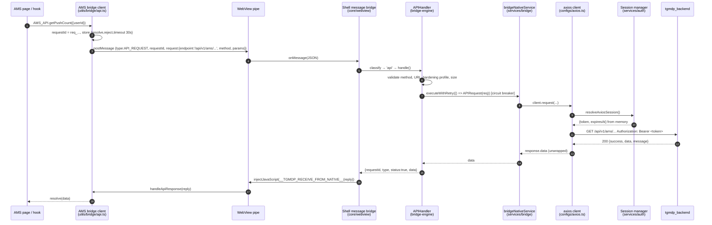

# Bridge API Request Flow and Auth

> A web module inside the TGMDP shell never opens a socket to the backend. It asks the shell to make the call. This note follows one HTTP request from a button tap in AMS to the Spring Boot backend and back, and explains where the auth token lives, how it is refreshed, and what happens when the backend says 401.

Up: [[tgmdp_rn_app]] · [[System Overview]] · Before this: [[Bridge Engine and Message Protocol]] · Guest side: [[AMS Bridge Client]]

## Why proxy HTTP through native at all?

A browser-style `fetch` from the WebView would work technically. The shell refuses that design for four reasons:

1. **One owner for the session.** The token, its expiry, refresh, logout and the "you were signed out" dialog all live in one place. Eight web modules do not each reimplement [[Authentication and Sessions]].
2. **The token stays in native secure storage** (Keychain / Keystore via `expo-secure-store`), out of reach of `localStorage` and of any third-party script on the page.
3. **No CORS problem.** A page loaded from `file://` (an OTA bundle) has no useful origin; the native HTTP stack does not care.
4. **Shared resilience.** Retries, a circuit breaker, timeouts and logging are written once.

This is a [[Gateway]] (one exit point to the backend) combined with a [[Facade]] (`bridgeNativeService` hides axios, fetch, session and telemetry behind `APIRequest()`).

## The full round trip



Each numbered step maps to code:

| Step | File |
|---|---|
| 2-3 | `tgmdp-app-ams/src/utils/bridge/api.ts:160-208` (`sendApiRequest`) |
| 5 | `tgmdp_rn_app/core/webview/useWebViewBoot.message-bridge.ts:160-187` |
| 6 | `modules/bridge-engine/handler/api-handler.ts:152-178` (`validateAPIRequest`) and `services/bridge/hardening/bridge-hardening-profiles.ts:122-142` |
| 7 | `api-handler.ts:187-253` (circuit breaker, then `executeWithRetry`) |
| 8 | `services/bridge/index.ts:110-159` → `services/bridge/transport/bridge-transport.ts:21-80` |
| 9-10 | `configs/axios.request.ts:175-221` and `configs/axios.session-port.ts` |
| 14 | `configs/axios.ts:48-54` (the response interceptor returns `response.data`) |
| 15-17 | `modules/bridge-engine/registry.ts:48-79` |

Multipart uploads (photos) take a different branch: when `toFormData` is set the transport uses `fetch` with a `FormData` body instead of axios (`bridge-transport.ts:54-61`), because the guest cannot hand a native file object across a string pipe; it sends field names and the shell builds the form.

## Where the token comes from

```ts
// tgmdp_rn_app/configs/axios.session-port.ts:19-30
export function registerAxiosSessionResolver(next: AxiosSessionResolver): void {
    resolver = next;
}
export function resolveAxiosSession(): Promise<AxiosSessionSnapshot | null> {
    return resolver === null ? Promise.resolve(null) : resolver();
}
```

This little file is a textbook [[Dependency Injection]] "port". The axios config layer must not import the session manager (that would create an import cycle, which `madge --circular` fails the build on). Instead the auth subsystem registers a resolver at startup (`services/auth/index.ts:454`) and axios only knows the function type. That is [[Inversion of Control]] and the D in [[SOLID]].

The request interceptor then decides per request (`configs/axios.request.ts:198-221`):

- **Public endpoints** (`configs/axios.ts:33-41`: `checkVer`, `checkServices`, `regDevice`, `sendOtp`, `login`, `loginByFingerprint`, `requestNewToken`) go out with no token.
- **Logout** may carry an explicit token even while the store already says "logging out".
- **Everything else** gets `Authorization: Bearer <token>` (`configs/axios.helpers.ts:132-141`).

`services/auth/session/session-request.policy.ts` makes the decision exhaustive: a request can be sent anonymously, use the current session, **wait for an in-flight refresh** (single-flight), or be rejected with `SESSION_AUTH_UNAVAILABLE` while a sign-out is pending. The AMS client recognises that last code and shows its own "TGMDP signed out" dialog (`tgmdp-app-ams/src/utils/bridge/api.ts:118-142`).

## Session lifecycle in the shell

`services/auth/session/AbsoluteSessionManager.ts:1-11` lists its invariants in a header comment; they are worth reading slowly:

- The backend login or refresh supplies the token tuple (token + absolute expiry).
- Secure storage and the native **USERFILE** (the SSO file legacy apps read) are written as one logical mutation.
- Refresh runs only in the foreground and is serialised by a "session generation" counter, so a slow refresh that finishes after logout cannot bring the session back to life.
- Logout clears credentials but keeps the device registration.

Refresh calls `POST /api/v1/tgmdp/auth/requestNewToken` (`data/sso/api.ts:142-143`, used from `absolute-session.refresh.ts:154`). The in-memory projection that the UI reacts to is `stores/auth/useAuthStore.ts`, a Zustand [[Store Pattern]] store; its comment states it "must not be treated as the durable source of truth".

## When the backend says no

- **HTTP 401 on a private endpoint**: the response interceptor does not log out by itself. It queues a presentation request in the auth store (`configs/axios.response.ts:85-108`), and the UI shows one confirm-logout dialog. The guard `!isLoggingOut` stops a second dialog stacking on the first. This keeps policy (what to do) separate from transport (what happened): [[Separation of Concerns]].
- **Retries**: the `api` retry policy retries up to 3 attempts on `408, 429, 500, 502, 503, 504`, network and timeout errors, with exponential backoff and jitter (`services/bridge/resilience/bridge-retry-policy.ts:45-56`).
- **Error body forwarding**: on failure the bridge reply carries `status: false` plus an `errorData` object holding the HTTP status, a message and the raw response body (`modules/bridge-engine/handler/inbound-error-utils.ts:137-150`, attached in `inbound-legacy-helpers.ts:237-254`). AMS reads the backend's own message from it (`tgmdp-app-ams/src/utils/bridge/api.ts:105-113`). An older team note said backend error messages never reached the WebView; the code on the current `develop` forwards them through `errorData`, so check which path your build takes before trusting either claim.

## What the guest *can* see

Two native operations deliberately hand identity to the guest:

- `APP_CHECKIN` returns user id, name, employee number, system authorisations, device data, location and the push token (`services/bridge/session/bridge-session-builders.ts:130-152`). AMS uses it to build its login call to `/api/v1/tgmdp/auth/appLogin`.
- `REQUEST_SESSION` returns the same plus `authToken` and `tokenExpire` (`bridge-session-builders.ts:154-188`).

So "the module never sees the token" is true for *HTTP calls* (the shell attaches it) but not absolute: a module can ask for it. The vendor shell made the opposite choice; compare in [[tgmdp_vendor_rn|Vendor Shell Bridge and API Proxy]].

## Try it yourself

1. In `configs/axios.ts`, find the `PUBLIC_ENDPOINTS` list. Which endpoint would break login if you removed it, and why does `requestNewToken` need to be public?
2. Read `api-handler.ts:41-44`. Why do gNB endpoints get a 140-second timeout while everything else gets 30 seconds? (Answer is in `tgmdp-app-ams/src/services/api/ams.ts:5-8`.)
3. Draw the sequence for a 401 reply. Which component shows the dialog in the shell, and which one in AMS?

## Related

- [[tgmdp_rn_app]] · [[System Overview]] · [[Mobile Architecture Overview]]
- [[Bridge Engine and Message Protocol]] · [[AMS Bridge Client]] · [[AMS Entry and Login Flow]] · [[tgmdp_vendor_rn|Vendor Shell Bridge and API Proxy]] · [[Hybrid Shell Architecture Trade-offs]] · [[tgmdp_backend]]
- Concepts: [[Authentication and Sessions]] · [[HTTP and REST]] · [[Client-Server Architecture]] · [[Dependency Injection]] · [[Inversion of Control]] · [[Error Handling]] · [[Stateless vs Stateful]] · [[Concurrency and Threads]]
- Patterns: [[Gateway]] · [[Facade]] · [[Interceptor and Filter Chain]] · [[Store Pattern]] · [[Adapter]]
- Practices: [[SOLID]] · [[Separation of Concerns]] · [[Secrets Management]] · [[Defensive Programming]]
