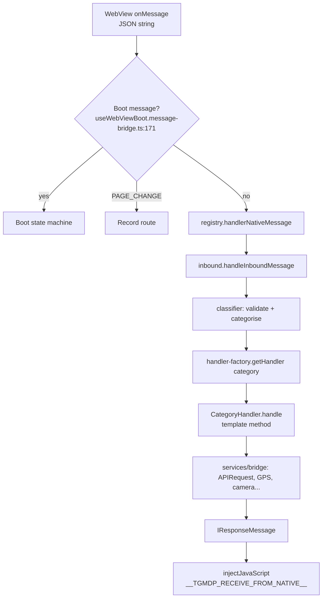
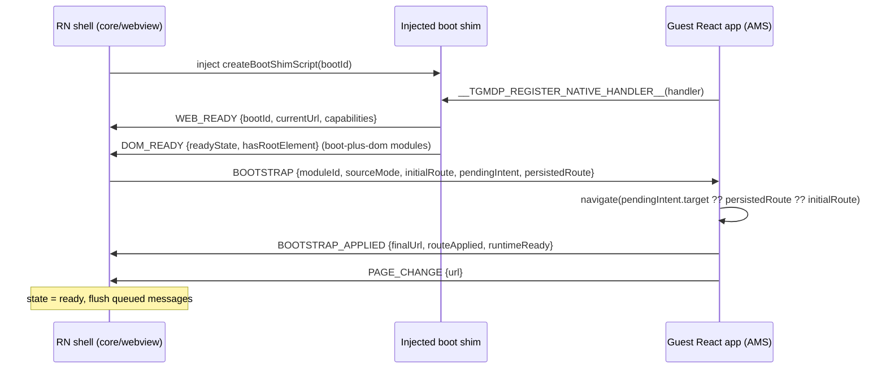

# Bridge Engine and Message Protocol

> A web page inside a WebView cannot call native code directly. The only channel is a string: the page posts JSON to the host, and the host injects JavaScript back into the page. This note shows how `tgmdp_rn_app` turns that thin channel into a typed, validated protocol with a boot handshake, request IDs and per-category handlers.

Up: [[tgmdp_rn_app]] · [[System Overview]] · Next: [[Bridge API Request Flow and Auth]]

## The two physical pipes

| Direction | Mechanism | Code |
|---|---|---|
| Web → Native | `window.ReactNativeWebView.postMessage(JSON.stringify(msg))`, provided by react-native-webview. The shell receives it in the WebView `onMessage` prop. | guest: `tgmdp-app-ams/src/utils/bridge/core.ts:73-109` |
| Native → Web | `webViewRef.current.injectJavaScript(script)`. The script calls `window.__TGMDP_RECEIVE_FROM_NATIVE__(message)`, which the guest registered. | `tgmdp_rn_app/core/communications/nativeDispatch.ts:5-54` |

Everything else in this note is protocol built on top of those two pipes. This is the core of the [[WebView and Native Bridge]] concept.

The native → web script also protects against **stale delivery**. Each loaded page gets a `documentId`. If a reply was meant for an older page (the user navigated or the WebView reloaded), the script drops it:

```js
// tgmdp_rn_app/core/communications/nativeDispatch.ts:11-25 (inside the injected string)
var globalState = window.__TGMDP_BOOT__;
var currentDocumentId = globalState && globalState.documentId ? globalState.documentId : null;
if (message && message.targetDocumentId && currentDocumentId
    && message.targetDocumentId !== currentDocumentId) {
    // report STALE_DOCUMENT_DELIVERY instead of delivering
    return;
}
```

## The message envelope

Every web → native message has the same shape (`types/bridge/messageType.ts:17-26`):

```ts
export interface IDataMessage {
    type: MessageType;          // 'API_REQUEST', 'GPS_REQUEST', 'WEB_READY', ...
    data?: unknown;
    requestId?: string;         // correlates a reply with its request
    bootId?: string;            // which boot attempt of the page sent it
    operation?: NativeOperationType;  // for NATIVE_REQUEST
    request?: IBridgeAPIRequest;      // for API_REQUEST
    payload?: unknown;
    metadata?: Record<string, unknown>;
}
```

The reply the shell sends back is `{ requestId, type, status, message, data }` (`modules/bridge-engine/registry.ts:72-78`). The guest matches `requestId` against a map of pending promises. That turns a fire-and-forget pipe into async request/response, the same idea as JSON-RPC.

## Message vocabulary and categories

`types/bridge/messageCategory.ts:21-59` maps every message type to one of five categories. Each category gets its own handler, timeout, retry policy and hardening profile.

| Category | Message types | What it does |
|---|---|---|
| `api` | `API_REQUEST` | HTTP call to the backend, made by the shell with the user's token |
| `native` | `NATIVE_REQUEST` (+ `operation`), `GPS_REQUEST`, `APP_CHECKIN`, `REQUEST_SESSION`, `CAPTURE_REQUEST`, `SCAN_REQUEST`, `MULTI_*`, `REQUEST_APP_PERMISSIONS`, `MODULE_UPDATE`, `CHECK_VERSION_REGISTRY`, `REQUEST_PERMISSIONS` | Device work: GPS, camera, scanner, session data, OTA update |
| `boot` | `WEB_READY`, `DOM_READY`, `BOOTSTRAP`, `BOOTSTRAP_APPLIED`, `BOOT_NOT_READY` | The startup handshake (below) |
| `navigation` | `PAGE_CHANGE`, `NAVIGATE_TO_MENU`, `GET_EMPLOYEE_INFO`, `OPEN_BTS`, `OPEN_MRM`, `OPEN_EXTERNAL_URL`, `OPEN_EXTERNAL_APP` | Leave the module, open another module, open a URL the WebView may not open itself |
| `diagnostic` | `BOOT_SHIM_DIAGNOSTIC` | Telemetry from the injected boot script |

`NATIVE_REQUEST` is the newer, explicit form: one type with an `operation` field (`NATIVE_REQUEST` + `operation: 'GPS_REQUEST'`). The bare types (`GPS_REQUEST`) are the older form, still accepted for backward compatibility. `classifier.ts:96-102` handles both:

```ts
// tgmdp_rn_app/modules/bridge-engine/classifier.ts:96-102
function resolveMessageCategory(msg: IDataMessage): MessageCategory {
    if (isExplicitRequestMessage(msg)) {
        return classifyExplicitMessage(msg);   // NATIVE_REQUEST → native, API_REQUEST → api
    }
    return MESSAGE_CATEGORY_MAP[msg.type];     // legacy lookup table
}
```

Before classifying, the message is checked for shape and size (`classifier.ts:80-94`). The comment there explains why the size check was added: a compromised module could otherwise post an arbitrarily large message.

## The pipeline inside the shell



Every category handler extends one abstract class, `CategoryHandler` in `modules/bridge-engine/handler/base-handler.ts`. Its `handle()` method fixes the order of steps and lets each subclass fill in only `execute()`. That is the [[Template Method]] pattern:

```ts
// tgmdp_rn_app/modules/bridge-engine/handler/base-handler.ts:101-115
private async runWithContext(context: HandlerContext): Promise<unknown> {
    await this.beforeHandle(context);
    this.applyInputHardening(context);
    this.validateMessage(context);
    const data = await executeWithCategoryTimeout(
        this.category,
        () => this.execute(context),
        { requestId: context.requestId, timeoutMs: this.resolveTimeoutMs(context) },
    );
    await this.afterHandle(context, data);
    return data;
}
```

`handler-factory.ts` picks the subclass by category with a `switch` (a simple [[Factory]]). `APIHandler`, `NativeHandler`, `BootHandler`, `NavigationHandler` and `DiagnosticHandler` each live in `modules/bridge-engine/handler/`.

### Feature-flagged rollout and a legacy fallback

The category router was introduced next to an older monolithic handler. `BridgeFeatureFlags.newClassificationEnabled` (`configs/feature-flags.ts:78`) switches between them. If the routed path throws, `inbound.ts:46-53` logs a warning and **runs the same message again through the legacy path**. This made the rollout safe, but read [[Hybrid Shell Architecture Trade-offs]] for the side effect on failed API calls.

## The boot handshake

A WebView that has finished loading HTML is not yet a running React app, and the shell must tell the guest *which module it is* and *which page to open* (for example a push notification deep link). The shell therefore runs a small state machine per WebView: `idle → waiting_for_web_ready → waiting_for_dom_ready → waiting_for_bootstrap_applied → ready` (or `fallback_ready` on timeout) — `core/webview/WebViewBootState.ts`.



- The payload contract is in `core/communications/contracts.ts:16-42`.
- The guest side is `tgmdp-app-ams/src/hooks/useWebViewBoot.ts:42-72` and `src/utils/bridge/boot.ts:9-42`.
- Messages the shell wants to send before `ready` are queued (`useWebViewBoot.message-bridge.ts:197-211`) and flushed after. `DeferredMessageQueue` also de-duplicates navigation commands, so two quick taps on a push notification produce one navigation.
- `readinessPolicy: 'boot-plus-dom'` (set for BTS and NWIS2 in `constants/modules.ts:35,67`) makes the shell also wait for `DOM_READY`. That costs a little latency but avoids showing a blank page for apps that render slowly.

## Hardening: the bridge is a trust boundary

The guest is "our" code, but it is still web content: it loads over HTTPS or from a downloaded zip, it may include third-party scripts, and a link could navigate it elsewhere. The shell therefore treats bridge input as untrusted:

- **Per-category profiles** (`services/bridge/hardening/bridge-hardening-profiles.ts:16-103`): maximum payload size, allowed HTTP methods, allowed URL patterns for `api`, and required OS permissions for camera/GPS operations.
- **Navigation gate**: the WebView may only navigate inside the module's own origin (`features/webview/useWebViewScreen.security.ts`, `isModuleNavigationAllowed`).
- **Rate limiter and circuit breaker** on native and API calls (`services/bridge/resilience/`).

See [[Defensive Programming]] and [[Validation]].

## Questions to check understanding

1. Why does the shell need `bootId` *and* `documentId`? (Hint: a WebView can reload while an old API call is still in flight.)
2. What would break if the shell hard-coded the module id inside the AMS bundle instead of sending it in `BOOTSTRAP`?
3. `GET_EMPLOYEE_INFO` is categorised as `navigation`, not `native`. Find the reason in `navigation-handler.ts` and decide whether you agree.

## Related

- [[tgmdp_rn_app]] · [[System Overview]] · [[Mobile Architecture Overview]]
- [[Bridge API Request Flow and Auth]] · [[AMS Bridge Client]] · [[WebView Pool and Bundle Loading]] · [[Hybrid Shell Architecture Trade-offs]]
- Concepts: [[WebView and Native Bridge]] · [[Hybrid Mobile Apps]] · [[Serialization and DTOs]] · [[Validation]] · [[Error Handling]] · [[Logging and Observability]] · [[Type Systems]]
- Patterns: [[Template Method]] · [[Factory]] · [[Strategy]] · [[Observer and Pub-Sub]] · [[Interceptor and Filter Chain]] · [[Front Controller]]
- Practices: [[Defensive Programming]] · [[Feature Flags and Mock Toggles]]
