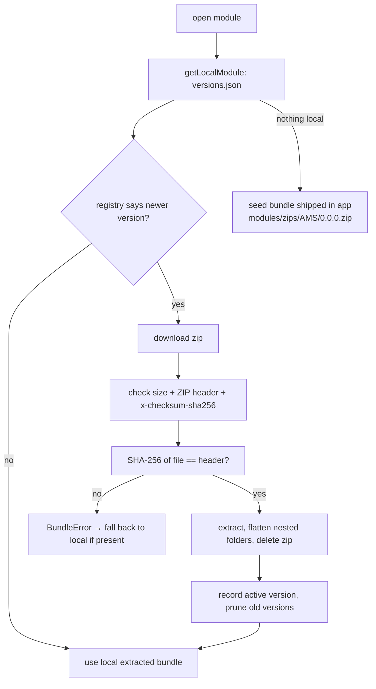

# WebView Pool and Bundle Loading

> Two runtime problems every serious hybrid app meets: **where does the web code come from** (a dev server, or a zip downloaded over the air and verified), and **how many WebViews can you keep alive** before the phone runs out of memory. `tgmdp_rn_app` answers the first with `core/bundled-manager` and the second with a strict 3-slot LRU pool.

Up: [[tgmdp_rn_app]] · [[System Overview]] · Related runtime: [[Bridge Engine and Message Protocol]]

## Part 1: where a module's web code comes from

`modules/runtime/useModuleSource.runtime.ts:203-215` picks one of two sources:

```ts
export function resolveModuleSource(params: ResolveModuleSourceParams): Promise<ModuleSource> {
    const { moduleId, devUrl, onProgress } = params;
    if (ENV.USE_URL_MODE) {
        return Promise.resolve(resolveUrlModeSource(moduleId, devUrl));
    }
    return resolveFileModeSource(moduleId, onProgress);
}
```

| Mode | Source | Used for |
|---|---|---|
| **URL mode** (`USE_URL_MODE: true` in `app-config.<env>.json`) | `https://...` from `MODULE_URLS`, for example a Vite dev server on a laptop | Developing a module with hot reload inside the real shell |
| **File mode** | `file://.../<module>/<version>/index.html` on the device | Every real install |

Both work only because the web modules are built with Vite `base: './'` (`tgmdp-app-ams/vite.config.ts:141`). Relative asset URLs resolve the same from `https://host/` and from `file:///.../`. A module with absolute `/assets/...` URLs would load a white page from a zip.

### The bundle loader (file mode)

`core/bundled-manager/` is a small package manager for web bundles:



Key files: `downloader.ts`, `verifier.ts`, `extractor.ts`, `storage.ts`, `install-transaction.ts`, `version-audit.ts`. The checksum check is the important part: the shell is about to run downloaded JavaScript with access to a bridge that can read the user's identity, so the bytes must be the bytes the registry published. See [[File Upload and Storage]] and [[Defensive Programming]].

Who publishes the zip? Each web repo's CI. AMS's `.gitlab-ci.yml` runs `npm run build-zip` on `develop` and uploads `.bundle/<version>.zip` to the module registry with `moduleName=AMS2`; HTTP 409 means "version already published" and is treated as success. The guest can also ask the shell to update itself: `MODULE_UPDATE` and `CHECK_VERSION_REGISTRY` are bridge operations (`tgmdp-app-ams/src/utils/bridge/api.ts:328-405`).

This is the main reason the architecture exists: **a fix to AMS ships in minutes, without an App Store review.** The cost is discussed in [[Hybrid Shell Architecture Trade-offs]].

## Part 2: the strict 3-LRU WebView pool

Creating a WebView and booting a React app inside it takes hundreds of milliseconds and tens of megabytes. Keeping every module alive would make switching instant but would get the app killed by the OS. Destroying each WebView on exit is safe but slow. The pool is the compromise.

**Policy** (`modules/runtime/webview-pool/`, README `Runtime Guardrails`):

- At most **1 active** slot (visible) and **up to 2 cached** slots (alive, hidden).
- Leaving a module moves its slot to cached. Opening a cached module promotes it back: instant, with its scroll position and form state intact.
- When a third module needs a slot, the **least recently used** cached slot is evicted. That is the LRU rule from [[Caching]].
- The cache budget shrinks under memory pressure:

```ts
// tgmdp_rn_app/modules/runtime/webview-pool/policy.ts:43-53
function getCacheBudgetForPressure(pressure: MemoryPressureLevel): number {
    switch (pressure) {
        case 'critical': return 0;
        case 'warning':  return 1;
        case 'normal':
        default:         return 2;
    }
}
```

- **Guardrails**: if transition latency or memory growth breaches thresholds (defaults 1200 ms and 1.4x, `configs/feature-flags.ts:42-50`), the runtime can switch itself to `baseline-safe` mode at run time without changing config.

The state model is explicit and testable. `types.ts` defines `PoolItem` with a `role` (`active` | `cached` | `idle`), a lease owner and timestamps; lifecycle *intents* (`acquire`, `release`, `memory-pressure`) produce a *transition plan* of operations (`promote`, `cache`, `evict`, `fallback`); and an `InvariantReport` checks rules like "never more than one active". Separating "decide" (pure functions in `policy.ts`, `state.transition.ts`) from "do" (`useWebViewPoolProvider.ts`) is what lets this complex behaviour reach 100% test coverage.

There is also a benchmark: `npm run benchmark:webview-pool` simulates churn and reports P95 transition and reactivation latency and memory growth, then recommends `strict-3-lru` or `baseline-safe`. A design decision backed by a repeatable measurement is worth imitating.

### What a cached WebView means for the guest

A cached module's JavaScript keeps running. AMS had to handle this: when the user leaves AMS for the TGMDP menu and comes back, the same page receives a new `BOOTSTRAP`, and `useWebViewBoot` resets its "exiting" state because "legacy started a fresh process here" (`tgmdp-app-ams/src/hooks/useWebViewBoot.ts:50-55`). Pooling saves time but makes the guest's lifecycle longer and stranger than a browser tab's. Guests must be written to be re-entered.

## WebView settings worth noticing

`features/webview/screen/webview-screen.view.tsx:107-133`:

- `originWhitelist={["file://*", "https://*"]}` and `onShouldStartLoadWithRequest` gated to the module's own origin.
- `allowFileAccess` and `allowFileAccessFromFileURLs` are on, because a `file://` bundle must read its own sibling assets. That widens what a compromised page could read, which is why the bundle checksum and the navigation gate matter.

## Questions to check understanding

1. Why does a seed zip ship inside the app binary when the shell can download bundles anyway?
2. Under `warning` memory pressure with AMS active and NWIS2 and BTS cached, the user opens MRM. Which WebView is destroyed?
3. What would go wrong if AMS were built with Vite's default `base: '/'`?

## Related

- [[tgmdp_rn_app]] · [[System Overview]] · [[Mobile Architecture Overview]]
- [[Bridge Engine and Message Protocol]] · [[RN Shell Build and Environments]] · [[Hybrid Shell Architecture Trade-offs]] · [[tgmdp-app-ams]]
- Concepts: [[Caching]] · [[Hybrid Mobile Apps]] · [[WebView and Native Bridge]] · [[File Upload and Storage]] · [[Single Page Applications]]
- Patterns: [[Strategy]] (URL mode vs file mode source)
- Practices: [[Defensive Programming]] · [[Feature Flags and Mock Toggles]]
- New: [[Over-the-Air Updates]] · LRU Eviction
