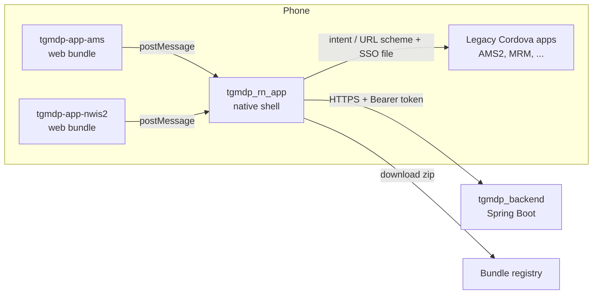

# tgmdp_rn_app (repo map)

> The **TGMDP native shell**: the one app field engineers install on their phones. It is an Expo + React Native app that owns login, the session, the module menu, push notifications and device hardware, and it hosts every business module (AMS, NWIS2, BTS, MRM...) as a web app inside a WebView. Web modules reach the backend and the hardware only by posting messages across a bridge to this shell.

Up: [[System Overview]] · Overview: [[Mobile Architecture Overview]] · Guests: [[tgmdp-app-ams]], [[tgmdp-app-ams|tgmdp-app-nwis2 Sibling Micro-App]] · Sibling shell: [[tgmdp_vendor_rn]]

## What problem this repo solves

Taiwan Mobile's field staff used to install a family of separate Cordova apps (AMS2 for base-station faults, NWIS2 for inspections, BTS, MRM and more). Each app had its own login and its own copy of the native plugins. They shared a session through an OS-level "SSO" file.

This repo replaces that family with **one host app** that:

1. Signs the user in once (password, OTP, biometrics) and keeps the session.
2. Shows a menu of modules the user may open.
3. Opens a module either as a **web bundle in a WebView** (migrated modules) or by **launching the old native app** (modules not migrated yet).
4. Serves every web module's needs (HTTP with the auth token, GPS, camera, scanner, phone dial, push) through a typed message bridge.

That is a [[Hybrid Mobile Apps|hybrid mobile app]] built on the [[WebView and Native Bridge]] idea, and it is being rolled out module by module, which is the [[Strangler Fig]] pattern.

## Tech stack at a glance

| Layer | Tool | Where |
|---|---|---|
| Framework | Expo 54, React Native 0.81, React 19.1, Hermes, New Architecture | `package.json:67-90`, `app.config.js:88,95` |
| Routing | expo-router 6 (file-based) | `app/` |
| WebView | react-native-webview 13 | `features/webview/screen/webview-screen.view.tsx` |
| State | Zustand 5 | `stores/` |
| HTTP | axios, one shared client with interceptors | `configs/axios.ts` |
| Secure storage | expo-secure-store | `services/storage/secure-storage/` |
| Push | Firebase Messaging + expo-notifications | `hooks/useAppInitialization.fcm.ts` |
| OTA bundles | react-native-zip-archive + custom loader | `core/bundled-manager/` |
| Native code | Expo modules in Kotlin/Swift | `modules/tgmdp-*`, `modules/data-service` |
| Tests | Jest (jest-expo + @swc/jest), Testing Library, **100% coverage gate** | `package.json:172-224` |
| Contract tests | Vitest against a live backend | `vitest.contract.config.ts` |

## Top-level layout

```
tgmdp_rn_app/
├── app/                 expo-router routes: index, login/, menu/, webview/[moduleId], [module]
├── features/            login, menu, webview (screen controller), memory-overlay (dev)
├── core/
│   ├── bundled-manager/ OTA zip download, SHA-256 verify, extract, cache, fallback
│   ├── communications/  boot shim + native→web dispatch scripts (injected JS)
│   └── webview/         boot state machine (useWebViewBoot.*)
├── modules/
│   ├── bridge-engine/   validate → classify → route web→native messages
│   ├── runtime/         strict 3-LRU WebView pool
│   └── tgmdp-*, data-service, do-legacy-things, device-integrity   native modules
├── services/            auth/session, bridge (API, session, media, resilience), notification, platform, storage
├── stores/              Zustand stores (auth, login, notifications, loading, dev...)
├── hooks/               root-level hooks (app init, session sync, version check, legacy bridge)
├── configs/             env.ts, feature-flags.ts, axios.*, app-config.<env>.json
├── constants/           modules.ts (module registry), error messages, theme
├── types/ data/ utils/  contracts, DTO adapters, logger, sanitizers
├── plugins/             Expo config plugins that edit android/ and ios/ at prebuild
├── scripts/             build-apk, build-ipa, benchmarks, credential and dependency scans
└── __tests__/           all Jest tests (mirrors the source tree)
```

Most folders carry their own `README.md` (written in Indonesian). The root `README.md` is the master map.

## The five ideas you need

1. **The shell owns the session; modules borrow it.** See [[Bridge API Request Flow and Auth]].
2. **Every web→native call is a JSON message**, classified into `api`, `native`, `boot`, `navigation` or `diagnostic`. See [[Bridge Engine and Message Protocol]].
3. **Each WebView boots through a handshake** (`WEB_READY` → `BOOTSTRAP` → `BOOTSTRAP_APPLIED`) so the shell can tell the guest which module it is and which route to open. Also in [[Bridge Engine and Message Protocol]].
4. **Web bundles are shipped over the air** as zip files and kept warm in a pool of WebViews. See [[WebView Pool and Bundle Loading]].
5. **Old and new apps coexist.** The shell shares its session with legacy apps and can launch them. See [[Native Modules and Legacy Coexistence]].

How it is built and run (Expo prebuild, flavors, debug vs release, Metro): [[RN Shell Build and Environments]].
How the code inside the app is organised (routes, features, stores, hooks): [[RN Shell App Structure]].
Why anyone would build it this way: [[Hybrid Shell Architecture Trade-offs]].

## Where the code meets other repos



- The module registry `constants/modules.ts:16-123` lists every module id. A module counts as migrated when its URL is configured: `FeatureFlags.AMS2 = Boolean(moduleUrls.AMS2)` (`configs/feature-flags.ts:22-40`).
- Public (no-token) backend endpoints are listed in `configs/axios.ts:33-41`, for example `/api/v1/tgmdp/auth/login` and `/api/v1/tgmdp/checkVer`. Everything else gets `Authorization: Bearer <token>`.
- A seed AMS bundle ships inside the app at `modules/zips/AMS/0.0.0.zip`, so AMS can open even before the first OTA download.

## Quality gates

`npm run husky` chains everything (`package.json:49`): ESLint with zero warnings, a hard-coded-credential scan, `tsc --noEmit`, `madge --circular` (no import cycles) and Jest with a **100% global threshold** on branches, functions, lines and statements (`package.json:216-223`). See [[Test Coverage Gates]] and [[Linting and Formatting]].

## Try it yourself

- Open `constants/modules.ts` and `configs/app-config.development.json`. Find which keys under `MODULE_URLS` turn a module into a WebView module. Then remove one key in your head: which code path opens that module instead? (Answer: `launchLegacyModule` in `features/menu/hooks/actions/menu-screen.launch-actions.ts:152`.)
- Run `npm test -- --runTestsByPath __tests__/modules/bridge-engine` and read one test to see how a message is classified.

## Related

- [[System Overview]] · [[Mobile Architecture Overview]]
- [[RN Shell App Structure]] · [[RN Shell Build and Environments]] · [[Bridge Engine and Message Protocol]] · [[Bridge API Request Flow and Auth]] · [[WebView Pool and Bundle Loading]] · [[Native Modules and Legacy Coexistence]] · [[Hybrid Shell Architecture Trade-offs]]
- [[tgmdp-app-ams]] · [[tgmdp_vendor_rn]] · [[tgmdp_backend]]
- Concepts: [[Hybrid Mobile Apps]] · [[WebView and Native Bridge]] · [[Client State Management]] · [[Routing]] · [[Authentication and Sessions]] · [[Configuration and Environments]] · [[Build Tools and Dependency Management]]
- Patterns: [[Strangler Fig]] · [[Facade]] · [[Gateway]] · [[Store Pattern]] · [[Feature-Sliced Structure]]
- Practices: [[Test Coverage Gates]] · [[Linting and Formatting]] · [[Feature Flags and Mock Toggles]] · [[Environment Separation]] · [[Secrets Management]]
