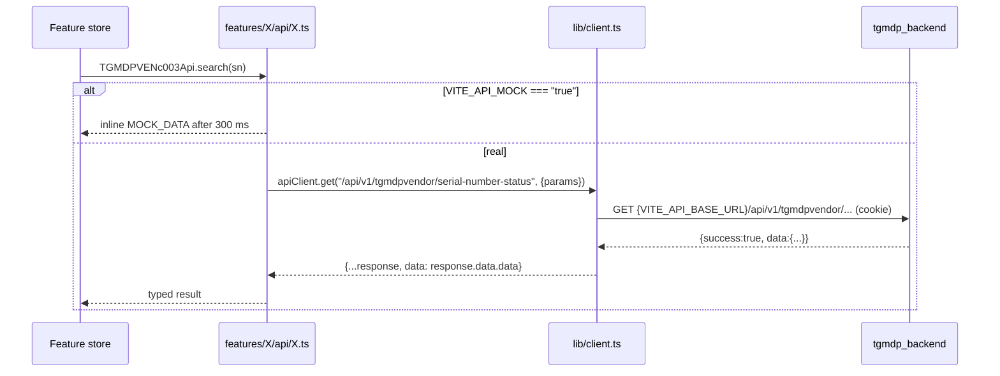

# Vendor Portal API Layer

Up: [[tgmdp_vendor_frontend]] · [[System Overview]]

All HTTP traffic goes through `src/lib/client.ts`, a single axios instance with interceptors. It started from the same template as the admin console's client (the comments are even partly in Indonesian, "supaya bisa pakai…", from the original authors), but it has evolved differently. Read [[Web Console API Layer]] alongside this note to see two answers to the same problem.

## Overview



## 1. The instance

```ts
// src/lib/client.ts:31-48
// Only GET and POST are exposed: the WAF blocks PUT/PATCH/DELETE.
export interface CustomAxiosInstance
  extends Omit<AxiosInstance, "get" | "post" | "put" | "patch" | "delete"> {
  get<T, R = T>(_url: string, _config?: AxiosRequestConfig): Promise<R>;
  post<T, R = T>(_url: string, _data?: T, _config?: AxiosRequestConfig): Promise<R>;
}

const { VITE_API_BASE_URL: baseURL } = import.meta.env;
const apiClient: CustomAxiosInstance = axios.create({
  baseURL: baseURL ? String(baseURL) : "https://api.example.com",
  timeout: 60 * 1000,
  withCredentials: true,
}) as CustomAxiosInstance;
```

Two design choices to learn from:

- **Encode an infrastructure constraint in the type system.** The internet-facing Web Application Firewall rejects `PUT`, `PATCH` and `DELETE`. Instead of a wiki page saying "don't use DELETE", the type `Omit<…, "put" | "patch" | "delete">` makes `apiClient.delete(...)` a compile error. The backend matches this with `POST …/delete`-style endpoints. This is an honest trade-off against pure [[HTTP and REST]] semantics, made because of a real deployment constraint. See [[Type Systems]] and [[Defensive Programming]].
- **A 60-second timeout** (the console uses 10 s). Vendor screens upload photos and generate PDFs and ZIPs, which are slow.

`withCredentials: true` sends the `access_token` HttpOnly cookie set at OTP verification (`tgmdp_backend/.../controller/tgmdpvendor/TgmdpvendorAuthController.java:318-323`). See [[Authentication and Sessions]] and [[Cookies and CSRF]].

## 2. No prefix builder: paths are absolute

The request interceptor is a no-op (`client.ts:51-60`). Each feature writes the full path:

```ts
// src/features/TGMDPVENc003/api/TGMDPVENc003.ts:6-7
const BASE_PATH = "/api/v1/tgmdpvendor/serial-number-status";
const PERMISSIONS_PATH = `${BASE_PATH}/permissions`;
```

This is more repetitive than the console's `apiVersion` + `basePath` config, but it is also more greppable: searching the backend for `serial-number-status` finds the controller immediately. Not every path starts with `/api/v1/tgmdpvendor`; the public vendor search uses `/api/v1/TGMDPVENz001/browse` (`TGMDPVENz001.ts:64`), which the backend lists as `permitAll` (`WebSecurityConfig.java`, the `/api/v1/TGMDPVENz001/**` matcher). There is no empty-field stripping either, so each api function decides what to send.

## 3. The response interceptor

The success branch (`client.ts:63-95`):

```ts
// Unwrap backend response format {success: true, data: {...}}
if (response.data && response.data.success && response.data.data !== undefined) {
  return { ...response, data: response.data.data };
}
return response;
```

Notice the difference from the console. The console returns the **envelope** (`response.data`), and callers then read `.data`. The vendor client returns **the AxiosResponse with `data` replaced by the payload**. So vendor call sites read:

```ts
const { data } = await apiClient.get<ApiResponseDto<SearchResponse>>(BASE_PATH, { params: { sn } });
return { currStatus: data.currStatus ?? [], nocloseLog: data.nocloseLog ?? [] };
```

The generic says `ApiResponseDto<SearchResponse>`, and that type has a `data: T` field (`src/types/ApiResponseDto.ts:3-11`), so destructuring `{ data }` yields a `SearchResponse` for the type checker. At runtime `data` really is the payload, because of the unwrap above. It works, but the type and the runtime value only line up by coincidence of field names. That is a good example of why [[Type Systems]] only protect you as far as your types describe reality. `ApiResponseDto` also carries `RTN_DATA: T` to satisfy older call sites that used the legacy field name.

Blob responses get special care (`client.ts:66-84`): if a download request comes back with `Content-Type: application/json`, it is not a file, it is an error (or a JSON success with no file). The interceptor parses the Blob text and throws `ApiError` with the real message. The console does this only when the caller opts in with `useActualMessage`; the vendor portal does it always.

## 4. Error handling

The error branch (`client.ts:96-164`) normalises **two backend error shapes**:

```ts
// src/types/ApiResponseDto.ts:14-34 (shape)
// 1. Legacy: { success:false, error:{ code, message, remainingAttempts? } }
// 2. New:    { success:false, message, meta:{ code, message }, data:{ remainingAttempts } }
```

```ts
// client.ts:119-131 (trimmed)
if (responseData && !responseData.success) {
  const errorData = responseData.error || responseData.meta;
  const errorMessage = errorData?.message || responseData.message || "發生未知錯誤";
  const errorCode = errorData?.code || "UNKNOWN_ERROR";
  const remainingAttempts = responseData.error?.remainingAttempts || responseData.data?.remainingAttempts;
  const apiError = new ApiError(errorMessage, errorCode, remainingAttempts);
```

`remainingAttempts` exists for the OTP screen ("密碼錯誤, N attempts left"). Accepting two shapes is an [[Anti-Corruption Layer]] in miniature: the rest of the app sees one `ApiError` type regardless of which backend generation answered.

**401 handling** (`client.ts:133-143`): log out and hard-redirect to `/login`, **except**

- for `/auth/` URLs (a failed OTP is a 401 the login screen must show, not a redirect), and
- inside pop-up windows (`window.opener` set), such as registration and vendor search, where the caller handles the error.

It uses `window.location.href = publicUrl("/login")`, a full page load, rather than router navigation. That guarantees every in-memory store is wiped, which the console has to do by hand with `resetAllStores()` ([[Web Console State and Forms]]).

Non-envelope errors (network, timeout, plain status codes) keep the original `AxiosError` but replace its message with a Traditional Chinese translation (`translateAxiosMessage`, lines 168-197), the same table as the console. See [[Error Handling]] and [[Internationalization]].

## 5. The mock toggle, inline

```ts
// src/features/TGMDPVENc003/api/TGMDPVENc003.ts:8, 41-45
const isMockMode = import.meta.env.VITE_API_MOCK === "true";
// …
search: async (sn: string): Promise<SearchResponse> => {
  if (isMockMode) {
    await new Promise((r) => setTimeout(r, 300));
    return MOCK_DATA;
  }
```

Each method branches at the top. Pros: the mock sits right next to the real call, so drift is easier to spot in review. Cons: mock data ships in the production bundle unless the bundler can prove the branch dead (it can, because `import.meta.env.VITE_API_MOCK` is replaced by a literal at build time and minifiers drop `if ("false" === "true")` blocks). The `register` feature goes further and loads its mocks with a dynamic `import()` gated on `isMockMode` (`src/features/register/mocks/registerMocks.ts:1-4`), so they never enter the main chunk. See [[Feature Flags and Mock Toggles]] and [[Mocking]].

The auth mocks are stateful: `auth.ts:14-25` keeps a per-user fail counter in a `Map` to simulate the 3-strikes OTP lock, and `000000` simulates an expired OTP. That lets QA rehearse lockout flows without a backend.

## Questions to check understanding

1. A teammate writes `apiClient.delete("/foo")`. What happens at compile time, and why is that desirable here?
2. Why should a 401 from `/auth/otp/verify` not redirect to the login page?
3. In the vendor client, what does `await apiClient.get(...)` resolve to? In the console client?
4. What is the risk of returning `{ ...response, data: response.data.data }` only when `data !== undefined`?

## Related

- Up: [[tgmdp_vendor_frontend]] · [[System Overview]] · Backend: [[tgmdp_backend]]
- Siblings: [[Vendor Portal Folder and Feature Structure]] · [[Vendor Portal State and Forms]] · [[Vendor Portal Routing Auth and Permissions]] · [[Vendor Portal Feature Trace - TGMDPVENc003 Serial Number Query]]
- Compare: [[Web Console API Layer]] · [[Web Frontends Compared]]
- Concepts: [[HTTP and REST]] · [[Client-Server Architecture]] · [[Authentication and Sessions]] · [[Cookies and CSRF]] · [[Error Handling]] · [[Type Systems]] · [[Serialization and DTOs]] · [[Mocking]] · [[Internationalization]]
- Patterns: [[Interceptor and Filter Chain]] · [[Singleton]] · [[Anti-Corruption Layer]] · [[Gateway]] · [[Adapter]]
- Practices: [[Feature Flags and Mock Toggles]] · [[Defensive Programming]] · [[API Versioning]]
