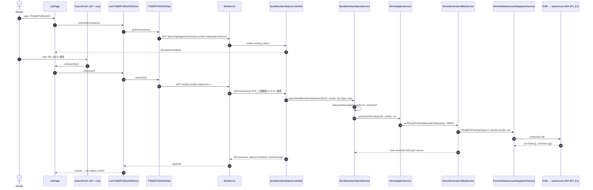

# Vendor Portal Feature Trace: TGMDPVENc003 Serial Number Query

Up: [[tgmdp_vendor_frontend]] · [[System Overview]]

**序號查詢作業** lets a vendor type an equipment serial number (序號, SN) and see two tables: where that item currently is (current status) and which material transactions involving it are still open (unclosed log). The data does not live in TGMDP's own database. It lives in the warehouse system behind the corporate ESB. So this small screen shows the whole chain: browser → portal → backend → ESB → warehouse, and back.

It is the smallest complete vendor feature (about 940 lines with tests), which makes it a good first read.

## The whole path



## Step 1: route and layout

```tsx
// src/router.tsx:426-445 (shape)
{ path: "TGMDPVENc003", children: [
    { index: true, lazy: lazyLoad(async () => ({ Component: (await import("@/features/TGMDPVENc003/pages/ListPage")).ListPage })) },
    { path: "result", lazy: … ResultPage … },
] }
```

(The real code destructures inside the async function; the shape above is condensed.) The route sits under `/` → `ProtectedRoute` → `DashboardLayout`, so the session is verified with `/auth/me` once, the sidebar and watermark render, and the page chunk downloads on first visit. There is no client-side task guard; see [[Vendor Portal Routing Auth and Permissions]].

## Step 2: the page wires things together

```tsx
// src/features/TGMDPVENc003/pages/ListPage.tsx:24-39
useEffect(() => {
  if (error) {
    navigate("/TGMDPVENc003/result", { state: { success: false, message: error, returnTo: "/TGMDPVENc003" } });
    clearError();
  }
}, [clearError, error, navigate]);

useEffect(() => { void checkPermissions(); }, [checkPermissions]);

useEffect(() => reset, [reset]);
```

- **Errors go to a result page**, not a toast. Legacy forwarded failures to a JSP result page, so the portal navigates to `LegacyResultPage` with the message in router state.
- **Permission check on mount.** The page asks the backend whether the 查詢 button may show.
- **Reset on unmount**, so a later visit starts clean.

The render (lines 41-68) passes props down to presentational components: `SearchForm` gets `onSearch`, `isLoading`, `browsePermitted`; the two tables get arrays. A long comment (lines 49-57) explains why both tables render even when empty: legacy `TGMDPVENc003Q1.jsp:44-48,85-88` always showed both fieldsets after a search, and an earlier "improvement" that hid empty tables was reverted as a parity bug (#326). Comments like this protect a decision from being undone by the next well-meaning developer.

## Step 3: the form

`components/SearchForm.tsx:12-42`: a one-field Zod schema (`sn` required, max 30), `zodResolver`, and an error callback that opens the shared modal with 序號為必填. The 查詢 button only renders when `browsePermitted` is true (lines 66-73). The hint under the form, 序號：需完整輸入並區分英文大小寫, tells users the match is exact and case-sensitive, because the warehouse system does no fuzzy search. See [[Validation]].

## Step 4: the store

`store/useTGMDPVENc003Store.ts` (full walkthrough in [[Vendor Portal State and Forms]]):

- `search` ignores calls while loading, clears old results, then stores new results or an error message.
- `checkPermissions` **fails open**: if the permission call errors, the button stays visible (`browsePermitted` defaults to `true`, the `catch` only logs). The comment says "never hide the button because the permission check itself failed". This is safe only because the backend re-checks the permission on the actual search, which is exactly what Step 6 shows. Failing open on a UX hint while failing closed on the real check is a deliberate, reasonable split.

## Step 5: the API module

```ts
// src/features/TGMDPVENc003/api/TGMDPVENc003.ts:41-54
search: async (sn: string): Promise<SearchResponse> => {
  if (isMockMode) { await new Promise((r) => setTimeout(r, 300)); return MOCK_DATA; }
  const { data } = await apiClient.get<ApiResponseDto<SearchResponse>>(BASE_PATH, { params: { sn } });
  return { currStatus: data.currStatus ?? [], nocloseLog: data.nocloseLog ?? [] };
},
```

The `?? []` defaults mean the page never has to null-check the arrays. Field names such as `NOW_PLACE`, `PARTNO`, `WORK_SATUS` (sic) are passed through in the warehouse system's own upper-case spelling (`types/index.ts`). The portal does not rename them, which keeps the mapping to the legacy JSP columns obvious at the cost of un-idiomatic TypeScript names. See [[Serialization and DTOs]] and [[Clean Code Naming]].

## Step 6: the backend

**Controller** `tgmdp_backend/src/main/java/com/taiwanmobile/boilerplate/controller/tgmdpvendor/SerialNumberStatusController.java`:

```java
// lines 42-67 (trimmed)
@PreAuthorize("hasAnyAuthority('SYS_工程驗收', 'SYS_廠商')")
public class SerialNumberStatusController {
    @GetMapping
    public ResponseEntity<ApiResponse<SerialNumberStatusResponse>> browse(
            @Valid @ModelAttribute @ParameterObject SerialNumberStatusSearchRequest searchRequest,
            HttpServletRequest request) {
        Claims claims = resolveClaims(request);              // reads the access_token cookie
        UserInfo userInfo = extractUserFromClaims(claims);   // subject + vendorId claim
        String accType = jwtService.extractAccType(claims);
        SerialNumberStatusResponse response = serialNumberStatusService.querySerialNumberStatus(
                userInfo.vendorId(), userInfo.userId(), accType, searchRequest);
        return ResponseEntity.ok(new ApiResponse<>(HttpStatus.OK, "Success", response));
    }
```

- Class-level `@PreAuthorize` requires one of two system authorities. The comment (lines 38-41) records that this was added after a review found the endpoint had none, so any JWT from the shared backend could reach it.
- The vendor id comes from the **signed JWT**, never from a request parameter. A vendor cannot query on behalf of another vendor.
- Local `@ExceptionHandler`s (lines 121-140) map `BROWSE_NOT_PERMITTED` to 403 and other domain errors to 400, using the `{success:false, error:{code,message}}` envelope the client's interceptor understands. See [[Error Handling]].

**Service** `service/tgmdpvendor/SerialNumberStatusService.java:41-76`:

1. `isBrowsePermitted(userId, accType)` re-checks the `TGMDPVENc003` / `browse` button. Legacy only enforced it by hiding the button in the JSP; the rebuild enforces it on the server too.
2. Look up the vendor's warehouse code (`venNo`). If it is blank, **refuse** with 查無此廠商資料. Legacy sent the blank value to the ESB anyway; the comment documents this as a deliberate, user-approved deviation (#331), consistent with the c001, c002 and c004 services.
3. Call the adapter. A `FAIL` with exactly 查無資料。 becomes an empty result (not an error), mirroring legacy's exact string match. Other failures become `SN_STATUS_QUERY_ERROR`.

**Integration** `service/tgmdpvendor/MrmAdapterService.java:996` → `service/mrmads/MrmAdsVendorUtilityService.java:1736`: builds a warehouse `API_E1` request (`reqType=2`, `userId=venNo`, `sn`), calls `mrmAdsWarehouseIntegrationService.whApiE1Post(...)`, enriches rows with part names (品名) from a local lookup, and in a `finally` block writes an interface log row (`FunType = "WH_E1_VEN"`, ESB id, status, query text). Logging every external call, success or failure, is what makes cross-system incidents debuggable. See [[Message Integration and ESB]], [[Logging and Observability]] and [[Adapter]].

The layering is [[MVC]] controller → [[Service Layer]] → an [[Adapter]] / [[Gateway]] to an external system, with the [[Anti-Corruption Layer]] turning the warehouse's status strings into domain exceptions.

## Things to notice

- **Defense in depth.** The button check exists three times: UI (`browsePermitted`), controller (`@PreAuthorize` on the system), service (`isBrowsePermitted` on the task button). Only the last two are security; the first is UX.
- **Parity decisions are written down** at the exact line they apply to, with ticket numbers. That is how a migration team keeps hundreds of small decisions from being re-litigated.
- **Mocks would hide the ESB.** In mock mode the screen returns one fixed row after 300 ms. The interesting failure modes (ESB down, vendor not mapped, "no data" string) only appear against a real backend.

## Questions to check understanding

1. Why does `checkPermissions` fail open while the service fails closed?
2. What would break if the controller read `vendorId` from a query parameter instead of the JWT?
3. Where would you add a request timeout for the ESB call, front end or back end, and why?
4. The warehouse returns `查無資料。` as a failure status. Why is converting it to an empty list the right call for the UI?

## Related

- Up: [[tgmdp_vendor_frontend]] · [[System Overview]] · Backend: [[tgmdp_backend]]
- Siblings: [[Vendor Portal API Layer]] · [[Vendor Portal State and Forms]] · [[Vendor Portal Routing Auth and Permissions]] · [[Vendor Portal Folder and Feature Structure]]
- Compare: [[Web Console Feature Trace - APP Login Logout Record Query]] · [[Web Frontends Compared]]
- Concepts: [[Message Integration and ESB]] · [[HTTP and REST]] · [[Authorization and RBAC]] · [[Authentication and Sessions]] · [[Validation]] · [[Error Handling]] · [[Logging and Observability]] · [[Serialization and DTOs]] · [[Mocking]]
- Patterns: [[MVC]] · [[Service Layer]] · [[Adapter]] · [[Gateway]] · [[Anti-Corruption Layer]] · [[Container-Presentational]] · [[Store Pattern]] · [[Strangler Fig]]
- Practices: [[Defensive Programming]] · [[Code Review]] · [[Clean Code Naming]]
