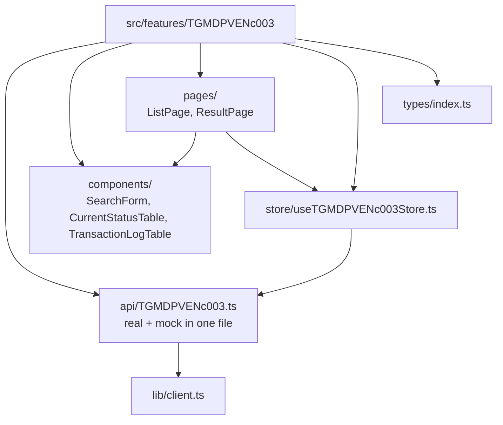

# Vendor Portal Folder and Feature Structure

Up: [[tgmdp_vendor_frontend]] · [[System Overview]]

The vendor portal uses the same [[Feature-Sliced Structure]] idea as the admin console, but in a flatter, more literal form: **each feature folder is named after its legacy task code**. `src/features/TGMDPVENc003/` is the 序號查詢作業 screen, full stop. There is no menu-group level.

## Why name folders by task code?

The portal has about twelve modules, and every conversation about them (bug tickets, parity reviews, legacy JSP names such as `TGMDPVENc003Q1.jsp`) uses the code. Naming the folder by code makes the path from ticket to file instant. The console, with a hundred-plus modules nested under business groups, chose English names instead and keeps the code in route guards. Both are valid; see [[Web Frontends Compared]] and [[Clean Code Naming]].

## The layout

```
src/
├── features/
│   ├── auth/               # login (captcha + OTP), auth store, useHasButton
│   ├── register/           # vendor self-registration pop-up
│   ├── dashboard/
│   ├── TGMDPVENa001/ … TGMDPVENc004/, TGMDPVENz001/
├── components/             # shared UI kit + Sidebar + ProtectedRoute + layouts/
├── constants/menu.ts       # static sidebar fallback
├── stores/useUIStore.ts    # global UI store
├── shared/                 # cross-feature pages (photo preview, LegacyResultPage) + constants
├── lib/client.ts           # axios
├── types/ApiResponseDto.ts
└── utils/                  # api-url, public-url, sanitize, datetime, file download helpers
```



## Inside one feature

`src/features/TGMDPVENc003/` (942 lines including tests):

| Path | Lines | Role |
|---|---|---|
| `api/TGMDPVENc003.ts` | 67 | HTTP calls, plus inline mock data when `VITE_API_MOCK=true` |
| `api/index.ts` | 1 | re-export |
| `store/useTGMDPVENc003Store.ts` | 54 | results, loading, error, `browsePermitted`, actions |
| `components/SearchForm.tsx` | 77 | react-hook-form + zod form |
| `components/CurrentStatusTable.tsx`, `TransactionLogTable.tsx` | ~45 each | presentational tables |
| `pages/ListPage.tsx` | 70 | composes form + tables, wires the store |
| `pages/ResultPage.tsx` | 8 | wraps the shared `LegacyResultPage` |
| `types/index.ts` | 33 | DTO types (`SearchResponse`, `CurrStatusItem`…) |
| `__tests__/` under each folder | | store, page and component specs |

Compared with the console:

- **`components/` is used more.** Vendor pages are split into a page (wiring) and components (form, tables) that take props. `SearchForm` receives `onSearch`, `isLoading`, `browsePermitted` and knows nothing about the store. That is the [[Container-Presentational]] split, done by convention.
- **No separate `schema/` folder.** Small schemas sit inside the component that uses them (`SearchForm.tsx:12-14`). The `register` and `TGMDPVENz001` features have a `validations/` folder for larger ones.
- **Real and mock API in one file**, guarded by `if (isMockMode)` inside each method, rather than a separate `.mock.ts` plus an `index.ts` selector. See [[Vendor Portal API Layer]].
- **Feature docs** sometimes live in the folder: `TGMDPVENb003/README.md`, `TGMDPVENb004/README.md`, `QUICK_START.md`, `API_INTEGRATION_SUMMARY.md`.

## Feature size varies a lot

Line counts (including tests) show where the business complexity is:

| Feature | Lines |
|---|---|
| `TGMDPVENb001` 工程驗收作業 | ~12,900 |
| `TGMDPVENb004` 施工同意書作業 | ~7,300 |
| `TGMDPVENb002` 無驗收單案件 | ~4,500 |
| `TGMDPVENb003` 領用物料上傳 | ~3,300 |
| `TGMDPVENc001`, `c002` | ~2,400 each |
| `TGMDPVENc003` 序號查詢作業 | ~940 |

`TGMDPVENb001` alone has 13 pages (list, detail, fin-picture, test report, checklist inspection, payment…) and 9 components. It is the heart of the portal: vendors prove work was done by uploading completion photos and reports. If you want to study a complex flow later, start there.

## Shared pieces worth knowing

- **`src/shared/pages/LegacyResultPage.tsx`.** Legacy JSP actions forwarded to a "result" page that said 作業成功 or 作業失敗 and offered a return link. The rebuilt portal reproduces that with one reusable page that reads `{ success, message, returnTo }` from router state and auto-returns after 2 seconds on success. Each feature's `ResultPage.tsx` is a one-line wrapper. A nice example of [[Template Method]]-style reuse through props.
- **`src/shared/constants.ts` `MODULE_URL_MAP`.** A registry that tells the shared photo preview page which backend endpoints to call for each module (`TGMDPVENb001`, `TGMDPVENb002`, plus `Temp` variants). Adding a module to the preview means adding one entry, not editing the page. That is the Open/Closed principle in [[SOLID]], implemented as a plain lookup table (data-driven config, not a full [[Strategy]] with interchangeable behaviour objects).
- **`src/utils/sanitize.ts`.** Replaces `" & < > --` with full-width characters, matching the legacy UI promise 若輸入符號…系統將會轉換成全形符號. Used by `TGMDPVENb005/pages/DetailPage.tsx:75`. It is legacy parity, not a complete XSS defence; React's own escaping does that job when rendering.
- **`src/utils/api-url.ts` vs `src/utils/public-url.ts`.** `apiUrl()` prefixes the backend origin for links the browser opens directly (for example the APK download link). `publicUrl()` prefixes Vite's `BASE_URL` for files in `public/`. The doc comments explain the difference because mixing them up breaks deployments under a sub-path.

## Scaffolding new features

`npm run scaffold:feature <name>` runs `scripts/scaffold-feature.js`, which creates `api/`, `components/`, `store/`, `types/`, `pages/` with starter files (an empty Zustand store, a placeholder page). A generator encodes the convention so new modules start consistent. See [[Factory]].

## Try it yourself

1. Run `npm run scaffold:feature demo-feature` in a scratch branch and compare the generated tree with `TGMDPVENc003/`. What does the real feature add?
2. Open `TGMDPVENb001/pages/` and pick the page with the most imports. Which of its parts could be moved into `components/`?
3. Find every `ResultPage.tsx` that does **not** use `LegacyResultPage`. Why might `TGMDPVENc001` have its own?

## Related

- Up: [[tgmdp_vendor_frontend]] · [[System Overview]]
- Siblings: [[Vendor Portal API Layer]] · [[Vendor Portal State and Forms]] · [[Vendor Portal Routing Auth and Permissions]] · [[Vendor Portal Feature Trace - TGMDPVENc003 Serial Number Query]]
- Compare: [[Web Console Folder and Feature Structure]] · [[Web Frontends Compared]]
- Concepts: [[Component-Based UI]] · [[Layered Architecture]] · [[Validation]] · [[Serialization and DTOs]]
- Patterns: [[Feature-Sliced Structure]] · [[Container-Presentational]] · [[Store Pattern]] · [[Strategy]] · [[Template Method]] · [[Factory]] · [[DTO Pattern]]
- Practices: [[Clean Code Naming]] · [[Separation of Concerns]] · [[SOLID]] · [[Defensive Programming]]
