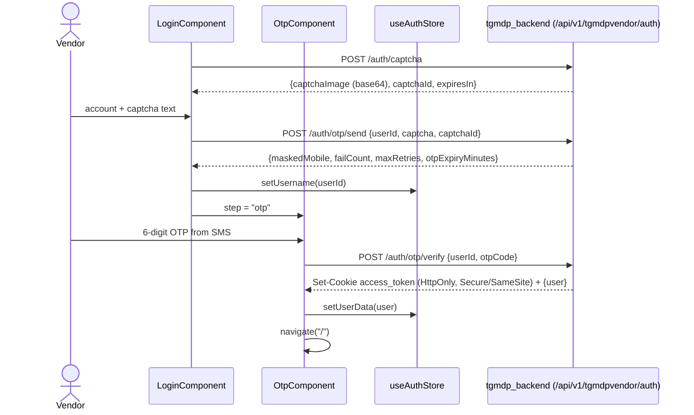

# Vendor Portal Routing, Auth and Permissions

Up: [[tgmdp_vendor_frontend]] · [[System Overview]]

External vendors cannot use corporate SSO, so the portal authenticates with **captcha + SMS one-time password**, and the backend issues an HttpOnly JWT cookie. This note covers that login, the route table, the session guard, the menu, and button-level permissions.

## Login: two steps on one page

`src/features/auth/pages/LoginPage.tsx:9-42` keeps a local `step` state (`"login"` or `"otp"`) and swaps `LoginComponent` for `OtpComponent`. No route change happens between the steps.



Key points:

- **Captcha id.** The server remembers which answer belongs to which image by `captchaId`, so the captcha is checked server-side. `normalizeCaptchaData` (`src/features/auth/api/auth.ts:41-57`) also accepts a legacy `{ IMG }` shape and adds a `data:image/jpeg;base64,` prefix if missing, another small [[Anti-Corruption Layer]].
- **OTP send is the gate.** Sending the SMS requires a correct captcha. This throttles automated SMS abuse.
- **Lockout.** After repeated wrong codes the backend returns `ACCOUNT_LOCKED`; `OtpComponent` shows the message and returns to step 1 after 3 s. `OTP_EXPIRED` clears the input (`src/features/auth/components/OtpComponent.tsx:52-61`). The client also shows `remainingAttempts` carried on `ApiError`.
- **The cookie.** The backend sets `access_token` with `httpOnly(true)` and `SameSite=None` when Secure, `Lax` otherwise (`TgmdpvendorAuthController.java:318-323`). JavaScript never sees the JWT. See [[Authentication and Sessions]] and [[Cookies and CSRF]].
- **Role level.** If the backend omits `roleLvl`, the client derives it: `roleId "0"` means admin (`auth.ts:59-64`), mirroring `ACPT_ROLE_DATA.ROLE_LVL`.

The backend leaves `/api/v1/tgmdpvendor/auth/**` and `/api/v1/tgmdpvendor/register/**` open (`WebSecurityConfig.java:113-114`); every other vendor path requires a valid token.

## The route table

`src/router.tsx` is one file with every route. Unlike the console, almost every page is **lazy-loaded**:

```tsx
// src/router.tsx:95-102
{
  path: "TGMDPVENa001",
  lazy: lazyLoad(async () => {
    const { AccountInfoPage } = await import("@/features/TGMDPVENa001/pages/AccountInfoPage");
    return { Component: AccountInfoPage };
  }),
},
```

`import()` tells Vite to put each page in its own chunk, downloaded on first visit. Vendors often work on slow site connections, so a small initial bundle matters. See [[Single Page Applications]] and [[Routing]].

The `lazyLoad` wrapper (`router.tsx:15-31`) solves a deployment problem: after a new release, a user with an old `index.html` asks for chunk files whose hashes no longer exist. The wrapper catches the failed import and reloads the page once, using a `sessionStorage` timestamp to avoid an infinite reload loop if the chunk is truly missing. This is [[Defensive Programming]] for the real world of cached HTML.

Structure:

```mermaid
flowchart TD
  R[createBrowserRouter] --> login[/login]
  R --> reg[/register  pop-up, lazy]
  R --> vs[/vendor-search  pop-up, lazy]
  R --> b001pop[/TGMDPVENb001/insert-test-report<br/>/insert-other, /selectFinPicture.action]
  R --> root["/" ProtectedRoute → DashboardLayout]
  root --> idx[index → AccountInfoPage]
  root --> a001[TGMDPVENa001, /verify-mobile]
  root --> b001[TGMDPVENb001 → list, result, :caseId/...]
  root --> c003[TGMDPVENc003 → list, result]
  root --> etc[... other TGMDPVEN modules]
```

The pop-up routes (`/register`, `/vendor-search`, `/TGMDPVENb001/insert-test-report` …) sit **outside** `ProtectedRoute` and outside the layout, because legacy opened them with `window.open` as bare windows. Note that `/TGMDPVENb001/selectFinPicture.action` even keeps the legacy WebWork `.action` URL, so old links and muscle memory still work. Those pop-up pages are not guarded on the client; they rely on the backend rejecting unauthenticated API calls.

## Session guard: `ProtectedRoute`

```tsx
// src/components/ProtectedRoute.tsx:26-51 (trimmed)
const verifySession = async () => {
  if (!userData) { setIsVerifying(false); setIsAuthenticated(false); return; }
  try {
    const freshUserData = await authApi.getUserData();   // GET /auth/me with the cookie
    setUserData(freshUserData);
    setIsAuthenticated(true);
    hasVerified.current = true;
  } catch (error) {
    logout();
    setIsAuthenticated(false);
  } finally {
    setIsVerifying(false);
  }
};
```

- It is a **wrapper component** (`<ProtectedRoute><DashboardLayout/></ProtectedRoute>`, `router.tsx:79-85`), not a layout route with `<Outlet/>` like the console's.
- It calls `/auth/me` **once per mount** (a `useRef` flag), and shows 驗證登入狀態… while waiting. The persisted `userData` is only a hint that a session might exist; the server decides. This also refreshes `buttons` and `menu` on every full page load.
- After that, expiry is detected lazily: the next API call returns 401 and the client interceptor redirects to `/login` ([[Vendor Portal API Layer]]).
- `VITE_APP_ENABLE_LOGIN !== "true"` skips everything, for local development.

## Menu

`Sidebar.tsx:48-54` builds the menu from `userData.menu` (a flat list of `{ taskId, taskName, taskUrl, parentId, orderSeq }` from the backend) via `transformMenuItems` (lines 16-37), which groups children under parents and sorts by `orderSeq`. If the backend sent no menu, it falls back to the static `listMenu` in `src/constants/menu.ts`. The server decides which tasks a vendor sees; the static list is a safety net for development.

## Permissions: per button, plus server-side checks

There is **no per-route task guard** in the portal (no equivalent of the console's `TaskRouteGuard`). A logged-in vendor can type `/TGMDPVENc003` even if the menu does not show it. Two other layers cover that:

1. **Buttons.** Components call `useHasButton()` with legacy-style keys:
   ```tsx
   // src/features/TGMDPVENc001/components/SearchForm.tsx:42, 210
   const hasButton = useHasButton();
   {hasButton("TGMDPVENc001_browse") && ( /* 查詢 button */ )}
   ```
   Some modules instead ask the backend directly, for example `GET /serial-number-status/permissions` → `{ browsePermitted }` in TGMDPVENc003.
2. **Backend.** Every vendor controller is annotated, for example `@PreAuthorize("hasAnyAuthority('SYS_工程驗收', 'SYS_廠商')")` on `SerialNumberStatusController` (`tgmdp_backend/.../controller/tgmdpvendor/SerialNumberStatusController.java:42`), and services re-check the button (`SerialNumberStatusService.isBrowsePermitted`). The data itself is scoped by the `vendorId` claim inside the JWT, so one vendor cannot read another vendor's data by changing a parameter. That last point matters most on an internet-facing portal. See [[Authorization and RBAC]].

## Questions to check understanding

1. Why does the OTP step not get its own route?
2. What problem does `lazyLoad` solve, and why does it store a timestamp instead of a boolean?
3. A vendor bookmarks `/TGMDPVENb004` but their role lost that task. Trace what they see on the next visit.
4. Why is scoping queries by the JWT's `vendorId` stronger than scoping by a `vendorId` query parameter?

## Related

- Up: [[tgmdp_vendor_frontend]] · [[System Overview]] · Backend: [[tgmdp_backend]]
- Siblings: [[Vendor Portal API Layer]] · [[Vendor Portal State and Forms]] · [[Vendor Portal Feature Trace - TGMDPVENc003 Serial Number Query]]
- Compare: [[Web Console Routing Auth and Permissions]] · [[Web Frontends Compared]]
- Concepts: [[Authentication and Sessions]] · [[Authorization and RBAC]] · [[Cookies and CSRF]] · [[Stateless vs Stateful]] · [[Routing]] · [[Single Page Applications]]
- Patterns: [[Anti-Corruption Layer]] · [[Custom Hooks]] · [[Strangler Fig]]
- Practices: [[Defensive Programming]] · [[Feature Flags and Mock Toggles]] · [[Secrets Management]]
