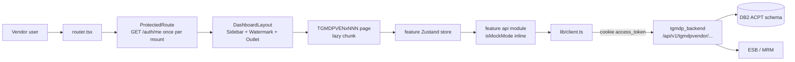

# tgmdp_vendor_frontend (repo map)

> The **TGMDP vendor portal**: the website that *external* contractors and suppliers use to upload project-acceptance documents and photos, read sign-off notices and query materials and serial numbers. It is a React 19 + Vite + Zustand + Tailwind [[Single Page Applications|single page application]]. Users log in with a captcha and an SMS one-time password, and the session is an HttpOnly cookie issued by [[tgmdp_backend]] under `/api/v1/tgmdpvendor`.

Up: [[System Overview]] · Sibling: [[tgmdp_web_frontend]] · Comparison: [[Web Frontends Compared]]

## Who uses it and why it is separate

The admin console ([[tgmdp_web_frontend]]) is for Taiwan Mobile employees on the corporate network. The vendor portal is for people **outside** the company: construction contractors (廠商), their sub-contractors (下包) and material suppliers. That difference drives most design decisions:

- **Different identity store.** Vendor accounts live in the ACPT schema (`ACLT.ACPT_USER_DATA`), not in the employee table `A_USER_DATA`. The backend has special cases for this (`tgmdp_backend/.../security/AuthTokenFilter.java:99-104`).
- **Stronger login.** No corporate SSO, so the portal uses captcha plus an SMS OTP and locks the account after repeated failures.
- **Hostile network edge.** The portal is internet-facing behind a WAF that blocks `PUT`, `PATCH` and `DELETE`. The API client type only exposes `get` and `post` for that reason (`src/lib/client.ts:32-41`).
- **Smaller scope.** About a dozen task codes (`TGMDPVENa001` … `TGMDPVENz001`) instead of the console's hundred-plus.

Like the console, it is a [[Strangler Fig]] rebuild of a legacy WebWork/JSP application (`TGMDP_VENDOR`), so comments constantly cite legacy JSP and Java files, for example `TGMDPVENc003Q1.jsp:44-48` in `src/features/TGMDPVENc003/pages/ListPage.tsx:50-57`.

## Modules

| Code | Screen | Menu group |
|---|---|---|
| `TGMDPVENa001` | 帳號資訊 account info, verify mobile | top level |
| `TGMDPVENa002` | 下載區 download area | top level |
| `TGMDPVENb001` | 工程驗收作業 project acceptance (largest, ~13k lines) | 工程驗收 |
| `TGMDPVENb002` | 無驗收單案件 cases without acceptance form | 工程驗收 |
| `TGMDPVENb003` | 領用物料上傳 material usage upload | 工程驗收 |
| `TGMDPVENb004` | 施工同意書作業 construction consent forms | 工程驗收 |
| `TGMDPVENb005` | 下包帳號管理 sub-contractor accounts | 工程驗收 |
| `TGMDPVENc001` | 簽收通知作業 sign-off notifications | 領料繳庫 |
| `TGMDPVENc002` | 領料繳庫查詢 material issue/return query | 領料繳庫 |
| `TGMDPVENc003` | 序號查詢作業 serial number query | 領料繳庫 |
| `TGMDPVENc004` | 件號庫存查詢 part-number inventory query | 領料繳庫 |
| `TGMDPVENz001` | vendor search pop-up (public, used during registration) | — |

Labels come from `src/constants/menu.ts` and page titles.

## Tech stack at a glance

| Layer | Tool | Where |
|---|---|---|
| UI | React 19 | `package.json` |
| Bundler | Vite 7 | `vite.config.ts` |
| Language | TypeScript 5.9 `strict` | `tsconfig.app.json` |
| Routing | react-router-dom v7, **lazy-loaded routes** | `src/router.tsx` |
| State | Zustand 5 | `src/features/*/store/`, `src/stores/useUIStore.ts` |
| Forms | react-hook-form (+ zod in some features) | feature `components/` |
| HTTP | axios, one instance | `src/lib/client.ts` |
| Styling | Tailwind CSS v4 only | `src/styles/index.css` |
| Format | Prettier with import sorting + Tailwind class sorting | `.prettierrc` |
| Tests | Vitest + Testing Library + jsdom | `vitest.config.ts` |

No AntD, no SCSS, no Dexie, no Playwright. The dependency list is about half the console's.

## Top-level layout

```
tgmdp_vendor_frontend/
├── src/
│   ├── main.tsx, App.tsx      # render <RouterProvider router={router}/>
│   ├── router.tsx             # the whole route table, lazy() per page
│   ├── lib/client.ts          # axios instance + interceptors
│   ├── components/            # shared UI (Button, Table, DatePicker, Sidebar, ProtectedRoute, layouts/)
│   ├── constants/menu.ts      # static fallback sidebar
│   ├── stores/useUIStore.ts   # modal, page title, sidebar, dark mode
│   ├── shared/                # photo preview page + LegacyResultPage + MODULE_URL_MAP
│   ├── features/              # auth, register, dashboard, TGMDPVENxNNN…
│   ├── types/ApiResponseDto.ts
│   └── utils/                 # api-url, public-url, sanitize, datetime, download helpers
├── scripts/scaffold-feature.js
├── docker/ (Dockerfile, nginx.conf), docker-compose.yml
└── vitest.config.ts, eslint.config.js, .prettierrc
```

About 300 files under `src/`, 81 of them tests.

## How a request flows



Details:

- [[Vendor Portal Folder and Feature Structure]]
- [[Vendor Portal API Layer]]
- [[Vendor Portal State and Forms]]
- [[Vendor Portal Routing Auth and Permissions]] (captcha + OTP login)
- [[Vendor Portal Build Lint and Testing]]
- [[Vendor Portal Feature Trace - TGMDPVENc003 Serial Number Query]]

## Branches and environments

- The active development branch is `development`. The local checkout was on `fix/TGMDPVENc001-c004-legacy-parity` at the time of writing. See [[Git Branching]].
- `.env.example` lists `VITE_APP_NAME`, `VITE_APP_ENABLE_LOGIN`, `VITE_BASE_PATH`, `VITE_API_BASE_URL`, `VITE_ALLOWED_HOSTS`, `VITE_API_MOCK`. Note the mock flag name differs from the console (`VITE_API_MOCK` here, `VITE_USE_MOCK` there). See [[Configuration and Environments]] and [[Environment Separation]].
- Production is a static `dist/` behind nginx (`docker/nginx.conf`), same as the console.

## Questions to check understanding

1. Name two reasons the vendor portal is a separate repo instead of more routes in the admin console.
2. Why does the API client type remove `put` and `delete`?
3. Which env variable switches the portal to mock data, and how is it spelled differently from the console's?

## Related

- [[System Overview]] · [[tgmdp_backend]] · [[tgmdp_web_frontend]] · [[Web Frontends Compared]]
- [[Vendor Portal Folder and Feature Structure]] · [[Vendor Portal API Layer]] · [[Vendor Portal State and Forms]] · [[Vendor Portal Routing Auth and Permissions]] · [[Vendor Portal Build Lint and Testing]] · [[Vendor Portal Feature Trace - TGMDPVENc003 Serial Number Query]]
- Concepts: [[Single Page Applications]] · [[Client-Server Architecture]] · [[Authentication and Sessions]] · [[Message Integration and ESB]] · [[Configuration and Environments]]
- Patterns: [[Strangler Fig]] · [[Feature-Sliced Structure]] · [[Store Pattern]]
- Practices: [[Environment Separation]] · [[Feature Flags and Mock Toggles]] · [[Git Branching]] · [[Secrets Management]]
