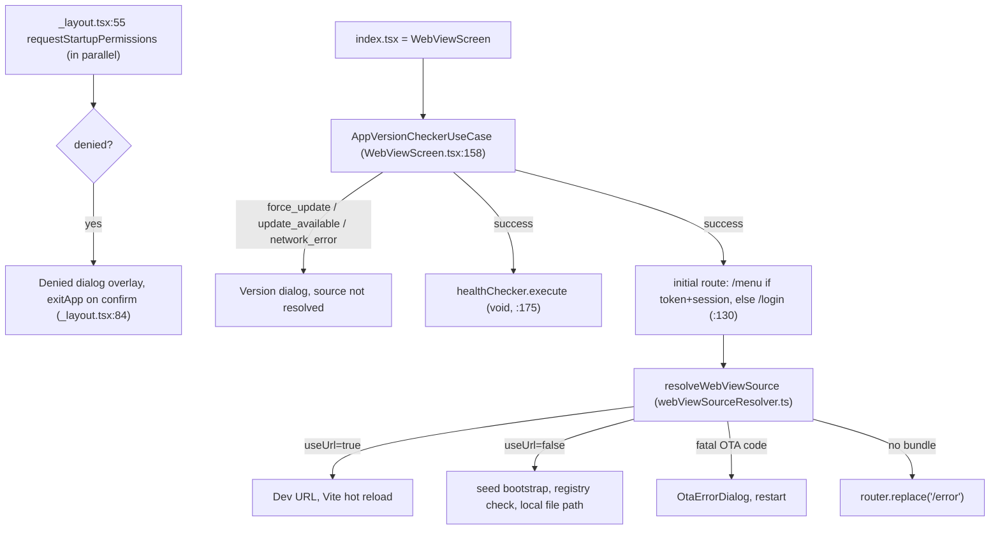

# tgmdp_vendor_rn

The **Expo (React Native) shell** for the vendor app (module ID `ACPTFirms`, set in `tgmdp_vendor_rn/configs/app-config.*.json`). It is a sibling of [[tgmdp_rn_app]]: same idea, but it hosts a *single* WebView running the whole vendor web app ([[tgmdp_vendor_frontend]]) instead of many mini-apps.

Part of [[Mobile Architecture Overview]] and [[System Overview]].

## What the shell is responsible for
The web app can't touch the OS, so the shell provides what it can't. Paths are under `tgmdp_vendor_rn/`.

| Concern | Where | Why a shell does it |
|---|---|---|
| Startup permissions | `core/startup-permissions/` | OS permission APIs are native only |
| Version gate | `core/app-version-check/application/AppVersionCheckerUseCase.ts` | Calls `GET /api/v1/acptads/version/check`, blocks old builds |
| Web bundle loading | `core/bundle-loader/`, `core/seed-bootstrap/` | Ship web updates without a store release |
| JS-to-native bridge | `core/bridge/` | Messages between WebView and native |
| API proxy | `core/api-proxy/` | `infrastructure/AxiosApiClient.ts:68-71` adds `Authorization: Bearer <token>` from secure storage, so the page never holds the token |
| Native module router | `core/native-module-router/` | camera, scanner, location, storage, device, auth, system, pdf, biometrics |
| Native modules | `modules/tgmdp-camera`, `tgmdp-scanner`, `tgmdp-exit-app` | Native code |
| Push | `core/push-notification/` and `app/_layout.tsx` | Firebase Cloud Messaging (`@react-native-firebase/messaging`) |

## Startup flow (as the code runs)
`app/index.tsx` simply re-exports `core/webview/infrastructure/WebViewScreen`, so the root screen *is* the WebView screen.

Corrections to the earlier version of this note:
- Permissions are **not** a gate in front of the WebView. `_layout.tsx` runs the request in an effect while `index` renders; a denial only overlays a dialog that exits the app.
- The version gate **is** a real gate: if status is not `success`, `WebViewScreen.tsx:158-168` returns before `resolveWebViewSource` runs. `shouldRunAppVersionCheck()` currently always returns `true`.
- The health check is fire-and-forget (`void`), so a slow endpoint cannot block boot.
- Startup picks `/menu` vs `/login` from the secure-store token and session, not always `/login`.

## Environments
`APP_ENV` selects `configs/app-config.<env>.json` (read by `app.config.js`, which exposes `useUrl` and `moduleId` as Expo `extra`; `core/webview/application/registryConfig.ts:15` defaults `useUrl` to true if absent). See [[Configuration and Environments]], [[Environment Separation]]. `useUrl` is a developer toggle, a [[Feature Flags and Mock Toggles]] cousin.

## Worth studying
- **Native activity vs session timeout.** `CameraModuleHandler.ts:114` and `ScannerModuleHandler.ts:37` call `beginNativeActivity()`, setting `isNativeActivityActive` in `store/useAppLifecycleStore.ts`. On resume, `hooks/useAppLifecycle.ts:135` sees the flag and discards the background timeout instead of logging the user out. [[Defensive Programming]] against a false positive.
- **Registry as allowlist.** `hooks/useWebViewBridge.ts:73,121-122` registers only `bridge` plus the nine names from `NativeModuleRouterService.getHandlerModuleNames()` (biometrics, camera, location, storage, device, auth, system, pdf, scanner). `WebViewBridgeMessageHandler.ts` rejects unknown message types (`UNKNOWN_MESSAGE_TYPE`), malformed payloads, and unregistered modules (`NATIVE_MODULE_NOT_IMPLEMENTED`). Inside the router, `validateNativeModuleRequest` only copies fields and `RouteNativeModuleRequestUseCase.ts:12` does a plain map lookup, so the real check is the registry in front. Each handler then `switch`es on action names (e.g. `StorageModuleHandler`: readFile/writeFile/deleteFile).
- **Store persisted to SecureStore.** `store/useAppLifecycleStore.ts` is a small Zustand [[Store Pattern]] store; `backgroundedAt` is written to `expo-secure-store` (`persistBackgroundedAt`, line 9) so the resume check survives a process kill.
- **Encrypted queue.** `core/temp-queue/infrastructure/mmkvStore.ts:51` creates an MMKV instance (`temp-photo-queue`) with an encryption key held in SecureStore; it survives WebView reloads.

An earlier claim that the lifecycle store mirrors legacy Cordova `_APP_DATA` is not supported by this repo and was removed.

## Try it yourself
1. Open `app/_layout.tsx`, then `core/webview/infrastructure/WebViewScreen.tsx` (effect near line 150). Trace the flow above.
2. Why does `api-proxy` exist? (Where would a stolen token live if the web layer held it?)

## Related
[[tgmdp_rn_app]] · [[WebView and Native Bridge]] · [[Hybrid Mobile Apps]] · [[Bridge Engine and Message Protocol]] · [[Authentication and Sessions]] · [[tgmdp_vendor_frontend]] · [[Hybrid Shell Architecture Trade-offs]]
