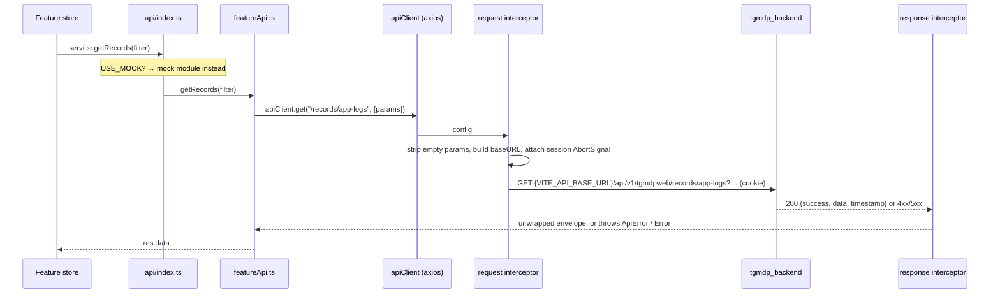

# Web Console API Layer

Up: [[tgmdp_web_frontend]] · [[System Overview]]

Every byte the admin console sends to [[tgmdp_backend]] passes through one file: `src/shared/api/client.ts`. This note walks through it top to bottom, then covers the per-feature real/mock switch.

## The big picture



## 1. One axios instance, configured once

```ts
// src/shared/api/client.ts:44-51
const { VITE_API_BASE_URL: baseURL } = import.meta.env;
const apiClient: CustomAxiosInstance = axios.create({
  baseURL: baseURL ? String(baseURL) : "https://api.example.com",
  timeout: 10000,
  withCredentials: true,
  apiVersion: 'v1',
  basePath: 'tgmdpweb',
}) as CustomAxiosInstance;
```

Why a single shared instance? Cross-cutting rules (auth cookie, timeout, error translation, logout on 401) are written once. Feature code only says *what* to fetch. This is the [[Singleton]] pattern via an ES module: the module is evaluated once, so everyone imports the same object.

- `withCredentials: true` makes the browser send the `access_token` cookie that the backend set at login. The token is an HttpOnly cookie, so JavaScript never reads it (`src/features/auth/api/authApi.ts:7-10`). That protects it from XSS theft. See [[Authentication and Sessions]] and [[Cookies and CSRF]].
- `timeout: 10000` is the default. Exports override it per call (for example `timeout: 50000` in `appLoginLogoutRecordQueryApi.ts:25`).

### Custom config keys via module augmentation

```ts
// src/shared/api/client.ts:24-32
declare module "axios" {
  export interface AxiosRequestConfig {
    showErrorMessage?: boolean;
    useActualMessage?: boolean;
    apiVersion?: string;
    basePath?: string;
    keepEmptyFields?: boolean;
  }
}
```

TypeScript "declaration merging" adds fields to axios's own config type, so a call site can write `{ basePath: "" }` and still be type-checked. See [[Type Systems]].

## 2. Building the URL prefix

The backend groups endpoints by client: `/api/v1/tgmdpweb/...` for this console, `/api/v1/tgmdpvendor/...` for the vendor portal, and other prefixes for mobile apps. The console never hard-codes `/api/v1/tgmdpweb`. The request interceptor assembles it:

```ts
// src/shared/api/client.ts:215-230
const buildBaseURL = (baseURL: string, apiVersion?: string, basePath?: string) => {
  const clean = (v?: string) => v?.replace(/^\/|\/$/g, "");
  return [baseURL.replace(/\/$/, ""), "api", clean(apiVersion), clean(basePath)]
    .filter(Boolean)
    .join("/");
};
```

So `apiClient.get("/records/app-logs")` becomes `{VITE_API_BASE_URL}/api/v1/tgmdpweb/records/app-logs`. A call that lives outside the prefix overrides `basePath`. The health check does this: `apiClient.get("/healthCheck", { basePath: "" })` → `/api/v1/healthCheck` (`src/features/auth/api/authApi.ts:68-72`).

This is a small form of [[API Versioning]]: if a `v2` ever appears, one config value changes.

## 3. The request interceptor

`src/shared/api/client.ts:72-99` does three things before a request leaves:

1. **Strips empty fields** from `params` and (non-FormData, non-array) `data` using `removeEmptyFields` (`src/shared/utils/validator/transform.ts`). A blank text box therefore sends nothing instead of `userId=`. Legacy forms behaved the same way, and the backend treats "absent" as "no filter". A caller can opt out with `keepEmptyFields: true`.
2. **Builds the base URL** as shown above.
3. **Attaches a session-wide AbortSignal**, merged with the caller's own signal via `AbortSignal.any` (lines 63-70). On a 401 the client calls `abortPendingRequests()` (lines 57-60), which cancels every in-flight request at once. Without this, ten parallel calls returning 401 would each try to log the user out.

This is the [[Interceptor and Filter Chain]] pattern, the same idea as a servlet filter on the backend.

## 4. The response interceptor and error handling

The backend wraps every JSON reply in an envelope (`src/shared/types/ApiResponseDto.ts`):

```ts
type ApiResponseDto<T> =
  | { success: true;  data: T; message?: string; timestamp: string }
  | { success: false; message: string; error: { code: string; message: string; details?: string[] }; timestamp: string };
```

The success path (`client.ts:104-121`):

- A `responseType: 'blob'` response (file download) is returned **as the full AxiosResponse**, because the caller needs the headers to read the file name.
- `success === false` with HTTP 200 is turned into a thrown `ApiError`. Some legacy-style endpoints report failure inside a 200, so the client treats both channels the same.
- Otherwise it returns `response.data`, the **envelope**. That is why every api function ends with `return res.data;`: it peels the second layer.

The error path (`client.ts:122-182`) works through the cases in order:

| Case | What happens |
|---|---|
| Request was cancelled | Re-thrown untouched, so callers can test `axios.isCancel` |
| HTTP 401 while logged in | Abort all requests, `useAuthStore.getState().purgeLogin()` |
| `useActualMessage` + Blob body | Parse the Blob as JSON to recover the real backend message (download errors) |
| Envelope with `success: false` | `throw new ApiError(message, code, timestamp)` |
| Anything else (network, timeout) | `new Error(translateAxiosMessage(...))` with a Traditional Chinese message |

`ApiError` (`client.ts:7-21`) carries `code`, `timestamp`, `details` and `actualMessage`, so a page can branch on a machine-readable code instead of parsing text. `translateAxiosMessage` (`client.ts:186-212`) maps "Network Error" to 網路錯誤，請檢查您的連線, and so on, because users of this console read Chinese. See [[Error Handling]] and [[Internationalization]].

Note that `showErrorMessage` exists in the config type but the branch that would show a toast is an empty placeholder (`client.ts:161-163`). Error display is done by each store or page today, not centrally.

## 5. The mock toggle

Every feature has an `api/index.ts` that picks an implementation once, at import time:

```ts
// src/features/record-query/app-login-logout-record-query/api/index.ts:1-8
import { appLoginLogoutRecordQueryApi } from "./appLoginLogoutRecordQueryApi";
import { appLoginLogoutRecordQueryApiMock } from "./appLoginLogoutRecordQueryApi.mock";

const USE_MOCK = import.meta.env.VITE_USE_MOCK === "true";

export const appLoginLogoutRecordQueryService = USE_MOCK
  ? appLoginLogoutRecordQueryApiMock
  : appLoginLogoutRecordQueryApi;
```

Both objects have the same method names, so the store does not know or care which one it got. This is the [[Strategy]] pattern chosen by a [[Feature Flags and Mock Toggles|feature flag]], and it is the reason front-end work could start before the backend endpoints existed.

Shared helpers in `src/shared/utils/mock.ts` make mocks realistic:

- `delay()` waits `VITE_MOCK_DELAY_MS` (default 300 ms) so loading spinners are visible.
- `mockSuccess(data)` wraps data in the same envelope the backend uses.
- `mockExportExcel()` returns a fake `AxiosResponse<Blob>` with a `content-disposition` header, so download code is exercised too.

The trade-off: a mock can drift from the real contract and nothing will notice. [[Web Console Feature Trace - APP Login Logout Record Query]] shows a concrete case (`size` vs `pageSize`). See [[Mocking]].

## 6. Downloads

Exports call `apiClient.get(url, { responseType: "blob" })` and hand the full response to `downloadFromResponse` (`src/shared/utils/file-util.ts`), which reads the RFC 5987 `filename*=UTF-8''…` header the backend sets (`TgmdpwebAppLoginLogoutQueryController.java:70-79`) and saves the Blob.

## Questions to check understanding

1. Why does the success interceptor return `response.data` for JSON but the whole `response` for blobs?
2. What would go wrong if `abortPendingRequests` created no new `AbortController` after aborting?
3. A teammate wants to call `/api/v2/tgmdpweb/foo`. Which config key do they set, and where?
4. Why is mock selection done in `api/index.ts` and not inside the store?

## Related

- Up: [[tgmdp_web_frontend]] · [[System Overview]] · Backend side: [[tgmdp_backend]]
- Siblings: [[Web Console Folder and Feature Structure]] · [[Web Console State and Forms]] · [[Web Console Routing Auth and Permissions]] · [[Web Console Feature Trace - APP Login Logout Record Query]]
- Compare: [[Vendor Portal API Layer]] · [[Web Frontends Compared]]
- Concepts: [[HTTP and REST]] · [[Client-Server Architecture]] · [[Authentication and Sessions]] · [[Cookies and CSRF]] · [[Error Handling]] · [[Serialization and DTOs]] · [[Mocking]] · [[Type Systems]] · [[Internationalization]]
- Patterns: [[Interceptor and Filter Chain]] · [[Singleton]] · [[Strategy]] · [[Gateway]] · [[Adapter]] · [[DTO Pattern]]
- Practices: [[Feature Flags and Mock Toggles]] · [[API Versioning]] · [[Defensive Programming]]
