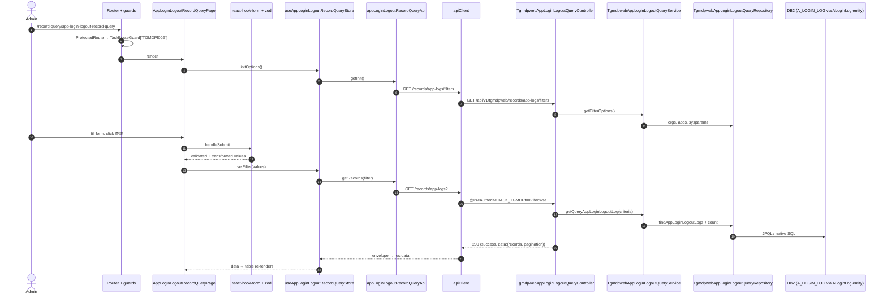

# Web Console Feature Trace: APP Login/Logout Record Query (TGMDPf002)

Up: [[tgmdp_web_frontend]] · [[System Overview]]

This note follows one real screen from the URL bar to the database and back. The screen is **APP登入/登出紀錄查詢** (APP login/logout record query), task `TGMDPf002`, legacy screen `TGMDPf002Q1`. An administrator filters mobile-app login logs by company, department, account, app, status and date range, pages through the results and exports them to Excel.

It is a good teaching example because it is small, read-only and touches every layer.

## The whole path



## Step 1: the route and its guard

```tsx
// src/features/record-query/routes.tsx:10-21
const recordQueryRoutes: RouteObject[] = [
  {
    path: "record-query",
    children: [
      ...withTaskGuard(["TGMDPf001"], webChangeRecordQueryRoutes),
      ...withTaskGuard(["TGMDPf002"], appLoginLogoutRecordQueryRoutes),
      // …
    ],
  },
];
```

The comment on line 9 notes that TGMDPf tasks have no system (`A_TASK_DATA.SYS`), so only the task-level button check applies. The feature's own `routes.tsx` maps the empty child path to `AppLoginLogoutRecordQueryPage`. Details of the guards: [[Web Console Routing Auth and Permissions]].

## Step 2: the page loads filter options

```tsx
// pages/AppLoginLogoutRecordQueryPage.tsx:73-76
useEffect(() => {
  initOptions();
  // eslint-disable-next-line react-hooks/exhaustive-deps
}, []);
```

`initOptions` in the store calls `getInit()`, which calls `GET /records/app-logs/filters` (`api/appLoginLogoutRecordQueryApi.ts:29-34`). The backend fills the dropdowns from organisation, app and system-parameter tables (`TgmdpwebAppLoginLogoutQueryService.java:35-75`). While loading, each select is wrapped in `<LoadingWrapper isLoading={loadingOptions}>`.

The company → department pair uses `useDependentSelect` (`page:54-63`) so the department list narrows when a company is picked.

## Step 3: the form validates and reshapes input

The page wires react-hook-form to the Zod schema (`page:41-52`). On submit:

- **Valid:** `onSubmit` calls `setFilter({ ...values, page: 1 })` (`page:78-80`).
- **Invalid:** `onError` (`page:103-128`) shows a legacy-style modal, for example 結束日期不可早於或等於開始日期！ for a bad date range.

What the schema does (`schema/appLoginLogoutRecordQueryScheme.ts`):

| Field | Rule |
|---|---|
| `userId` | max 20 chars (公司帳號長度不可超過20字元) |
| `userName` | max 30 chars (the backend allows 20, see "Contract drift" below) |
| `loginStatus`, `app`, `tlogSou` | multi-select → comma-separated string |
| `startDate`/`endDate` | normalised to `YYYY/MM/DD`; end must be after start (combined with HHmm times) |
| `page` | int ≥ 1, default 1 |
| `size` | int 1-100, default 20 |

## Step 4: the store calls the API

```ts
// store/useAppLoginLogoutRecordQueryStore.ts:60-72
fetchData: async () => {
  set({ loading: true, error: undefined });
  try {
    const res = await appLoginLogoutRecordQueryService.getRecords(get().filter) as AppLoginLogoutRecordQueryList;
    set({ data: res });
  } catch (error: unknown) {
    set({ error: (error as Error).message || "Fetch Data Failed" });
  } finally {
    set({ loading: false });
  }
},
```

`appLoginLogoutRecordQueryService` is the real API or the mock depending on `VITE_USE_MOCK` (`api/index.ts`).

## Step 5: the API module and the client

```ts
// api/appLoginLogoutRecordQueryApi.ts:9-18
async getRecords(params: GetAppLoginLogoutRecordQueryRequestDto) {
  const res = await apiClient.get<GetAppLoginLogoutRecordQueryRequestDto, GetAppLoginLogoutRecordQueryResponseDto>(
    "/records/app-logs", { params });
  return res.data;
},
```

The request interceptor strips empty fields, builds `/api/v1/tgmdpweb/records/app-logs`, and the browser attaches the `access_token` cookie. The response interceptor unwraps the envelope, so `res.data` is `{ records, pagination }`. See [[Web Console API Layer]].

## Step 6: the backend endpoint

```java
// tgmdp_backend/src/main/java/com/taiwanmobile/boilerplate/controller/tgmdpweb/TgmdpwebAppLoginLogoutQueryController.java:41-52
@GetMapping
@PreAuthorize("hasAuthority('" + TgmdpwebRecordQueryAuthorities.ROLE_SUPER_USER + "') or hasAuthority('"
        + TgmdpwebRecordQueryAuthorities.APP_LOGIN_LOG_BROWSE + "')")
public ResponseEntity<ApiResponse<TgmdpwebAppLoginLogoutQueryResponseDto>> getQueryAppLoginLogoutLog(
        @ParameterObject @Valid TgmdpwebAppLoginLogoutQueryCriteria criteria) {
    ApiResponse<TgmdpwebAppLoginLogoutQueryResponseDto> response = service.getQueryAppLoginLogoutLog(criteria);
    return ResponseEntity.status(response.getCode()).body(response);
}
```

- `@PreAuthorize` requires `ROLE_1` (super user) or `TASK_TGMDPf002:browse` (`TgmdpwebRecordQueryAuthorities.java:26,37`). The browser-side guard checked the same task, but this is the check that counts.
- `@ParameterObject @Valid` binds query parameters into a criteria object and validates them with Bean Validation regexes (date `YYYY/MM/DD`, time `HHmm`, CSV codes ≤ 20 chars). The same rules exist in Zod on the client: client validation for fast feedback, server validation for safety. See [[Validation]].
- The service validates the date range, computes `offset = (page - 1) * pageSize`, runs a find query and a count query on the repository, and wraps rows plus pagination in `ApiResponse` (`TgmdpwebAppLoginLogoutQueryService.java:77-127`). This is classic [[Layered Architecture]]: [[MVC]] controller → [[Service Layer]] → [[Repository Pattern]] → [[DB2]].

Export follows the same path through `GET /records/app-logs/export` with `responseType: "blob"`. The controller sets `Content-Disposition: attachment; filename*=UTF-8''匯出_APP登入_登出紀錄.xls` (`controller:70-79`), which the client's `downloadFromResponse` reads to name the file.

## Step 7: rendering the result

The page renders `data.records` in the shared `Table` components and a `Pagination` bound to `data.pagination` (`page:350-355`). Clicking a page number calls `setPage`, which updates `filter.page` and refetches. The 匯出 button calls `exportExcel` (`page:431`).

## Contract drift you can find yourself

Tracing end to end is how you find bugs that unit tests miss. Three examples in this feature:

1. **Page size name.** The client sends `size` (store default 20, schema field `size`), but the backend criteria field is `pageSize` with default 10 (`TgmdpwebAppLoginLogoutQueryCriteria.java:103-108`). Spring binds query parameters by name, so as far as the code shows, `size=20` is ignored and the server returns 10 rows per page. The UI still works because it renders whatever `pagination` the server returns. The store test and the mock both use `size`, so no test can see the mismatch. Confirm against a running backend before relying on this.
2. **Name length.** The Zod schema allows `userName` up to 30 characters (`appLoginLogoutRecordQueryScheme.ts:33`), but the backend criteria has `@Size(max = 20)` on `userName` (`TgmdpwebAppLoginLogoutQueryCriteria.java:44`). A 25-character name passes the client and fails server validation. The backend comment says its limits mirror the legacy `TGMDPf002Form` sizes, so the backend is probably the correct side.
3. **Export button permission.** The 匯出 button is a plain `Button`, not a `PermissionButton`, so a user without `TASK_TGMDPf002:export` still sees it. The backend's `@PreAuthorize` on `/export` (`controller:55-56`) refuses the call, so this is a UX gap, not a security hole. Whether legacy showed the button is a parity question.

All three show why [[Mocking]] is not a substitute for contract tests, and why the backend must never trust the client.

## Questions to check understanding

1. Which three places would you edit to add a new filter field "OS version"?
2. If the backend returned HTTP 200 with `{success:false, error:{code:"X", message:"Y"}}`, what would the store put in `error`?
3. Why is the date-range check implemented twice (Zod and Bean Validation)?
4. Propose a test that would have caught the `size` / `pageSize` mismatch.

## Related

- Up: [[tgmdp_web_frontend]] · [[System Overview]] · Backend: [[tgmdp_backend]]
- Siblings: [[Web Console API Layer]] · [[Web Console State and Forms]] · [[Web Console Routing Auth and Permissions]] · [[Web Console Build Lint and Testing]]
- Compare: [[Vendor Portal Feature Trace - TGMDPVENc003 Serial Number Query]] · [[Web Frontends Compared]]
- Concepts: [[HTTP and REST]] · [[Client-Server Architecture]] · [[Validation]] · [[Serialization and DTOs]] · [[Authorization and RBAC]] · [[SQL and Relational Databases]] · [[DB2]] · [[ORM and JPA]] · [[Mocking]] · [[Error Handling]]
- Patterns: [[MVC]] · [[Service Layer]] · [[Repository Pattern]] · [[DTO Pattern]] · [[Store Pattern]] · [[Gateway]]
- Practices: [[Defensive Programming]] · [[Unit Testing]] · [[Code Review]]
