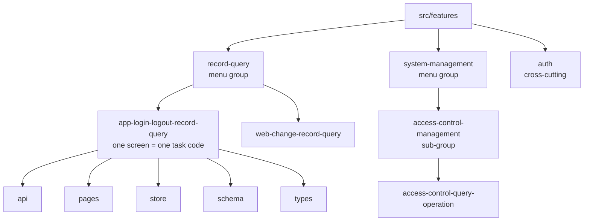

# Web Console Folder and Feature Structure

Up: [[tgmdp_web_frontend]] · [[System Overview]]

The admin console is organised **by feature, not by file type**. Instead of one big `components/` folder and one big `services/` folder, each screen gets its own folder that holds everything it needs. This is the [[Feature-Sliced Structure]] pattern, and it is the single most important thing to understand before you open any file.

## Why feature folders?

The legacy console has well over a hundred task codes (`TGMDPa001`, `TGMDPf002`, `TGMDPs008`…). If you sorted the new code by type, a single change such as "add a filter to the APP login log screen" would touch `pages/`, `stores/`, `api/`, `schemas/` and `types/` folders, each holding a hundred unrelated files. With feature folders, that change stays inside one directory. Three benefits follow:

- **Locality.** Everything a screen needs sits within a few folders of each other. This is [[Separation of Concerns]] applied at directory level.
- **Safe deletion and parity work.** A parity fix for `TGMDPf002` can be reviewed by looking at one folder diff.
- **Parallel teams.** Many developers can work on different modules with few merge conflicts.

The README states the same rationale in `tgmdp_web_frontend/README.md` ("Why Feature-Based Architecture?").

## The three levels



1. **Menu group** (`src/features/record-query/`, `src/features/report-management/`, `src/features/system-management/`…). Mirrors a top-level item in the legacy sidebar. It owns a `routes.tsx` that stitches its children together.
2. **Sub-group** (only under `system-management/`, for example `base-station-obstacle-management/`, `project-acceptance-management/`). Each one is a business system (基站障礙, 工程驗收…).
3. **Feature** (`app-login-logout-record-query/`). One legacy task code, one screen or a small family of screens.

The mapping from folder to task code is not in the folder name. You find it in two places:

- the route guard: `src/features/record-query/routes.tsx:15` → `withTaskGuard(["TGMDPf002"], appLoginLogoutRecordQueryRoutes)`
- the static menu table: `src/features/auth/data/menu.ts` (each entry has `code: "TGMDPb001"` and `url: "user-management/account-management"`).

## Inside one feature

Real example: `src/features/record-query/app-login-logout-record-query/`

```
app-login-logout-record-query/
├── routes.tsx                 # RouteObject[] for this screen
├── api/
│   ├── appLoginLogoutRecordQueryApi.ts       # real HTTP calls
│   ├── appLoginLogoutRecordQueryApi.mock.ts  # same shape, fake data
│   └── index.ts                              # picks one of the two
├── pages/
│   ├── AppLoginLogoutRecordQueryPage.tsx
│   └── __tests__/AppLoginLogoutRecordQueryPage.test.tsx
├── schema/
│   ├── appLoginLogoutRecordQueryScheme.ts    # zod schema = form + request contract
│   └── __tests__/…
├── store/
│   ├── useAppLoginLogoutRecordQueryStore.ts  # zustand: filter, data, loading, actions
│   └── __tests__/…
└── types/
    ├── AppLoginLogoutRecordQueryDto.ts       # request/response DTO types
    └── appLoginLogoutRecordQuery.type.ts     # domain/view types
```

Some features also have `components/` (pieces of a page), `hooks/` ([[Custom Hooks]] that wrap store logic), and `utils/`. Tests sit next to the code in `__tests__/` (a few older folders use `__test__/`).

### What each folder is responsible for

| Folder | Responsibility | Pattern |
|---|---|---|
| `api/` | Turn a function call into an HTTP request and return typed data. No React. | [[Gateway]], [[Adapter]] |
| `api/index.ts` | Choose real or mock implementation at module load | [[Strategy]], [[Feature Flags and Mock Toggles]] |
| `store/` | Hold the screen's state and the async actions that change it | [[Store Pattern]] |
| `schema/` | Zod schema: validate the form, transform values into the request shape | [[Validation]] |
| `types/` | DTOs mirroring the backend JSON | [[DTO Pattern]], [[Serialization and DTOs]] |
| `pages/` | Compose UI, wire the form to the store | [[Component-Based UI]] |
| `routes.tsx` | Declare the URL(s) for this feature | [[Routing]] |

The dependency direction is one way: `pages → store → api → shared/api/client`. A page never calls axios directly, and an api module never imports React. That direction is what lets the store test mock `../../api` and the page test run in mock mode. This is [[Layered Architecture]] on the client.

## `shared/`: things more than one feature needs

```
src/shared/
├── api/        client.ts (the axios instance) + lookup APIs used by many screens
├── components/ ui/ (Button, Table, FormFields, DatePicker, Pagination, PermissionButton…),
│               MessageModal, Loading, legend/, modal/
├── hooks/      useTask, useQuery, useDependentSelect, useDebounce, useArrayPagination, useToast
├── layouts/    AppLayout + sidebar/
├── pages/      AccessDenied, Error, Result, PhotoViewer…
├── schema/     schemas reused by many "login count" / "transmission stats" screens
├── store/      resettableStore.ts
├── types/      ApiResponseDto, PaginationDto…
└── utils/      datetime, file-util, mock, validator/, junction-cookie, watermark
```

A rule of thumb the code follows: move something into `shared/` only when a second feature needs it. For example, the many "login count statistics" screens across systems share `src/shared/schema/loginCountStatsSchema.ts` and `src/shared/components/LoginCountQueryForm.tsx`, because legacy had a near-identical screen per system.

## `app/`: the shell

- `src/app/App.tsx` renders `<AppRouter />`.
- `src/app/router/routes.tsx` is the root route table. It imports each menu group's `routes.tsx` and spreads them under the authenticated layout (lines 70-77).
- `src/app/store/useUIStore.ts` holds UI preferences (dark mode, sidebar open), persisted to `localStorage` under `app-ui`.

## Feature folder vs `sample/`

`src/features/sample/` is leftover boilerplate (the repo's `package.json` name is still `vite-zustand-boilerplate`). It is mounted at `/sample` in `src/app/router/routes.tsx:65-69`. Treat it as a template, not a business feature.

## Try it yourself

1. Pick `src/features/report-management/app-usage-statistics/`. List which of the seven sub-folders it has, and find its task code in `src/features/report-management/routes.tsx`.
2. Find a feature that has a `hooks/` folder (hint: `common-unit-settings`). What does the hook do that the store does not?
3. Search for a component under `shared/components/` that is imported by only one feature. Should it move back into that feature?

## Related

- Up: [[tgmdp_web_frontend]] · [[System Overview]]
- Next: [[Web Console API Layer]] · [[Web Console State and Forms]] · [[Web Console Routing Auth and Permissions]]
- Compare: [[Vendor Portal Folder and Feature Structure]] · [[Web Frontends Compared]]
- Concepts: [[Layered Architecture]] · [[Component-Based UI]] · [[Validation]] · [[Serialization and DTOs]] · [[Routing]]
- Patterns: [[Feature-Sliced Structure]] · [[Store Pattern]] · [[Gateway]] · [[Adapter]] · [[Strategy]] · [[DTO Pattern]] · [[Custom Hooks]]
- Practices: [[Separation of Concerns]] · [[Clean Code Naming]] · [[Feature Flags and Mock Toggles]]
