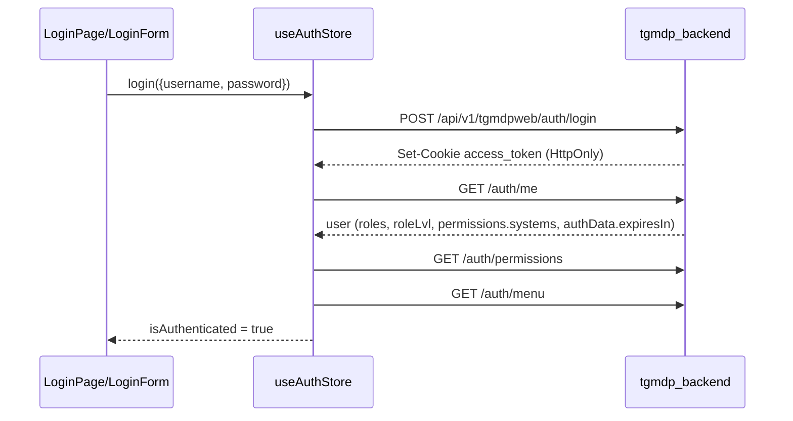

# Web Console Routing, Auth and Permissions

Up: [[tgmdp_web_frontend]] · [[System Overview]]

Access control in the console has four layers. Each one answers a different question, and only the last one is a real security boundary.

| Layer | Question | Code |
|---|---|---|
| `ProtectedRoute` | Is anyone logged in? | `src/app/router/ProtectedRoute.tsx` |
| `TaskRouteGuard` | May this user open this screen (task)? | `src/features/auth/components/guards/TaskRouteGuard.tsx` |
| Sidebar menu | Which screens should this user *see*? | `src/features/auth/utils/filter-menu-by-permissions.ts` |
| `PermissionButton` / `hasPermission` | Which buttons on the screen should show? | `src/shared/components/ui/PermissionButton.tsx` |
| Backend `@PreAuthorize` | Is this HTTP call allowed? (**the real check**) | `tgmdp_backend/.../TgmdpwebAppLoginLogoutQueryController.java:33` |

Client-side checks exist for **user experience**: hide what you cannot use, and fail early. Anyone can edit JavaScript in their browser, so the backend repeats every rule. See [[Authorization and RBAC]].

## The route tree

`src/app/router/routes.tsx` uses React Router v7's data router (`createBrowserRouter`):

```mermaid
flowchart TD
  root[createBrowserRouter<br/>basename = VITE_BASE_PATH] --> login[/login]
  root --> err[/error, /download-error, /access-denied]
  root --> PR[ProtectedRoute]
  PR --> AL[AppLayout<br/>sidebar + watermark + Outlet]
  AL --> home[/ HomePage]
  AL --> groups[...userManagementRoutes<br/>...recordQueryRoutes<br/>...variousSystemManagementRoutes …]
  groups --> TG[TaskRouteGuard taskIds=TGMDPf002]
  TG --> page[/record-query/app-login-logout-record-query]
  PR --> standalone[Standalone routes<br/>photo-viewer, inspect-result,<br/>pop-up pages without layout]
```

Two route families exist under `ProtectedRoute` (lines 51-116):

- **Layout routes** render inside `AppLayout` (sidebar, watermark).
- **Standalone routes** (`...userManagementStandaloneRoutes` etc., lines 109-111) render without the layout. Legacy opened many detail screens in pop-up windows via `window.open`, so the new app needs bare pages for those too.

`basename: import.meta.env.VITE_BASE_PATH` (line 117) lets the same build run under a sub-path such as `/TGMDP/` behind the corporate proxy. See [[Routing]].

## Layer 1: `ProtectedRoute`

```tsx
// src/app/router/ProtectedRoute.tsx:5-21
export const ProtectedRoute = () => {
  const { isAuthenticated, hydrate } = useAuthStore();
  const location = useLocation();
  useEffect(() => { const hydrateCall = async () => { await hydrate(); }; hydrateCall(); }, [location.pathname]);
  if (String(import.meta.env.VITE_APP_ENABLE_LOGIN).toLowerCase() !== "true") return <Outlet />;
  return isAuthenticated ? <Outlet /> : <Navigate to="/login" replace />;
};
```

It is a *layout route*: it renders `<Outlet />` (its children) or a redirect. On every path change it calls `hydrate()`, which revalidates the session with `/auth/me` only when the cached token lifetime has run out (see [[Web Console State and Forms]]).

## Login flow



`postLoginInit` loads permissions **before** the menu on purpose (`useAuthStore.ts:73-88`): the comment explains some menu items depend on permissions. The `/auth/**` paths are `permitAll` in the backend (`WebSecurityConfig.java:112`), every other `tgmdpweb` path requires a valid token. The backend reads the token from the `access_token` cookie (`AuthTokenFilter.java:221-224`). See [[Authentication and Sessions]] and [[Stateless vs Stateful]]: the backend is stateless (`SessionCreationPolicy.STATELESS`), the session lives in the signed JWT cookie.

Logout calls `/auth/logout`, purges local state, then tries `window.close()` (`useAuthStore.ts:90-97`). That last call only works when the console was opened by SSO in a pop-up, a legacy behaviour kept on purpose.

## Layer 2: `TaskRouteGuard`, a port of the legacy front controller

The legacy app had a servlet filter, `FrontControllerFilter`, in front of every action. It checked two things: the role holds at least one button of the task, and the user holds the task's *system* (基站巡檢, 工程驗收…) or is a level-1 user. `TaskRouteGuard` re-implements exactly that:

```tsx
// src/features/auth/components/guards/TaskRouteGuard.tsx:21-35
const isLoaded = useAuthStore((state) => isMock || (state.permissions !== null && state.taskSys !== null));
const hasAccess = useAuthStore((state) =>
  isMock ||
  taskIds.some((taskId) =>
    Boolean(state.permissions?.[taskId]?.buttons.length) &&
    (state.user?.roleLvl === LEVEL_ONE ||
      hasSysAuth(state.taskSys?.[taskId] ?? "", state.user?.permissions?.systems)),
  ),
);
return useNoPowerGuard(hasAccess, isLoaded);
```

- `hasSysAuth` (`src/features/auth/utils/sys-auth.ts:11-30`) is a direct port of `ButtonBean.checkSysAuth`, including its quirks: some systems are satisfied by any of several others (高空作業 passes if you hold 基站巡檢, 基站障礙 or 基站優化), and the default branch matches by **substring**, because legacy used `indexOf`.
- `isLoaded` prevents a false "no access" during the split second before permissions arrive.
- `useNoPowerGuard` (`useNoPowerGuard.tsx:13-62`) copies legacy's punishment for a refused request: **log out and go to the login page**, not a polite 403 page. A `useRef` flag stops the effect from logging out twice under React StrictMode.

Feature routes opt in with a helper that wraps them in a pathless parent route:

```tsx
// src/features/auth/components/guards/withRouteGuards.tsx:6-11
export const withTaskGuard = (taskIds: string[], routes: RouteObject[]): RouteObject[] => [
  { element: <TaskRouteGuard taskIds={taskIds} />, children: routes },
];
```

Used like `...withTaskGuard(["TGMDPf002"], appLoginLogoutRecordQueryRoutes)` (`src/features/record-query/routes.tsx:15`). This is the [[Decorator]]-style composition React Router encourages: guards are routes.

Rollout note: about 43 `routes.tsx` files use `withTaskGuard`, but not all groups do yet. For example `src/features/system-management/bts-management/routes.tsx` spreads its children without a guard. Those screens are still protected by `ProtectedRoute` and by the backend, just not by the client-side task check.

## Layer 3: building the sidebar

The backend returns a menu tree from `/auth/menu` (shape in `src/features/auth/types/menu.type.ts`). `mapMenuTreeToSidebar` (`filter-menu-by-permissions.ts:184-223`) turns it into sidebar items:

1. Optionally inject **hard-coded menu items** (`src/features/auth/data/hardcodedMenu.ts`) for brand-new screens that have no row in the legacy `A_TASK_DATA` table yet, visible only to roles in `VITE_ALLOWED_ROLES_FOR_HARDCODED_MENUS` (default role `"1"`). Turned off with `VITE_DISABLE_HARDCODE_MENU=true`.
2. Drop nodes with `hasAccess: false`, and, if `VITE_ALLOWED_MENU_TASK_IDS` is set, any task not on that allow-list. That env var is a rollout [[Feature Flags and Mock Toggles|feature flag]]: production can show only the modules that are ready while the rest are still served by the legacy app ([[Strangler Fig]]).
3. Translate each task code to a React route via the static `listMenu` table (`src/features/auth/data/menu.ts`), so `TGMDPb001` becomes `user-management/account-management`.

`mapTaskSys` (lines 229-239) walks the raw tree and records each task's system. It deliberately ignores the filters above, because the route guard must know the system of every task, visible or not.

`useTask()` (`src/shared/hooks/useTask.ts`) walks the sidebar tree with the current URL to find the current task code and name, which pages use for titles and permission checks.

## Layer 4: button permissions

`/auth/permissions` returns a list of `{ taskId, buttons[] }`. `mapTaskPermissions` merges it into one map keyed by task id, and `hasPermission(taskId, action)` reads it (`useAuthStore.ts:128-135`). Pages use either the hook directly:

```tsx
// src/features/mobile-device-management/message-push/pages/MessagePushPage.tsx:41
const canCreate = hasPermission("TGMDPa005", "goInsert");
```

or the `PermissionButton` / `PermissionLink` components (`src/shared/components/ui/PermissionButton.tsx:37-64`), which hide or disable themselves. About 120 feature files use `PermissionButton`.

The backend mirrors each button as a Spring authority string, for example `TASK_TGMDPf002:export` (`tgmdp_backend/.../constants/TgmdpwebRecordQueryAuthorities.java:38`). Same vocabulary on both sides is what makes parity reviewable.

## Questions to check understanding

1. A user with `TGMDPf002` buttons but without the matching system opens the URL directly. Walk through what each layer does.
2. Why does `mapTaskSys` ignore `VITE_ALLOWED_MENU_TASK_IDS`, while `mapMenuTreeToSidebar` honours it?
3. The legacy `noPower` behaviour logs the user out. What are the UX and security arguments for and against copying it?
4. Which layer would you change to let QA see a new hard-coded screen in staging only?

## Related

- Up: [[tgmdp_web_frontend]] · [[System Overview]] · Backend: [[tgmdp_backend]]
- Siblings: [[Web Console API Layer]] · [[Web Console State and Forms]] · [[Web Console Feature Trace - APP Login Logout Record Query]]
- Compare: [[Vendor Portal Routing Auth and Permissions]] · [[Web Frontends Compared]]
- Concepts: [[Routing]] · [[Single Page Applications]] · [[Authentication and Sessions]] · [[Authorization and RBAC]] · [[Cookies and CSRF]] · [[Stateless vs Stateful]] · [[Configuration and Environments]]
- Patterns: [[Front Controller]] · [[Interceptor and Filter Chain]] · [[Strangler Fig]] · [[Decorator]] · [[Store Pattern]]
- Practices: [[Feature Flags and Mock Toggles]] · [[Defensive Programming]] · [[Environment Separation]]
