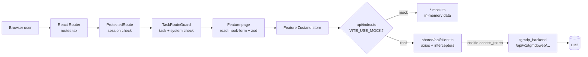

# tgmdp_web_frontend (repo map)

> The **TGMDPweb admin console**: the internal back-office website that Taiwan Mobile staff use to configure, monitor and report on every field-operations system in the TGMDP platform. It is a [[Single Page Applications|single page application]] built with React 19, Vite, Zustand and Tailwind, and it talks to one backend, [[tgmdp_backend]], under the `/api/v1/tgmdpweb` prefix.

Up: [[System Overview]] · Sibling: [[tgmdp_vendor_frontend]] · Comparison: [[Web Frontends Compared]]

## What problem this repo solves

The legacy TGMDP console was a Java EE / WebWork (Struts-style) application that rendered JSP pages on the server. Every screen had a task code such as `TGMDPf002` and a set of "buttons" (actions) a role could hold. This repo rebuilds those screens one by one as a React SPA, while the data and business rules move into a Spring Boot REST backend. This is a textbook [[Strangler Fig]] migration: the old app keeps running while modules are rebuilt and switched over.

That history explains a lot of the code you will read:

- Comments cite legacy files (`FrontControllerFilter.java:82`, `ButtonBean.java:177`) because **legacy parity** is a hard requirement. The new console must allow and refuse exactly what the old one did.
- Permission names (`browse`, `select`, `export`, `goInsert`, `ApproveMR`…) are copied from legacy button IDs, so they are not tidy English verbs.
- Page subtitles show legacy screen IDs, for example `TGMDPf002Q1` in `src/features/record-query/app-login-logout-record-query/pages/AppLoginLogoutRecordQueryPage.tsx:134`.

## Tech stack at a glance

| Layer | Tool | Where |
|---|---|---|
| UI library | React 19 | `package.json` |
| Bundler / dev server | Vite 7 | `vite.config.ts` |
| Language | TypeScript 5.9, `strict` | `tsconfig.app.json` |
| Routing | react-router-dom v7 (`createBrowserRouter`) | `src/app/router/routes.tsx` |
| Client state | Zustand 5 (+ `persist`) | `src/features/**/store/*.ts` |
| Forms | react-hook-form + `@hookform/resolvers/zod` | feature `pages/` |
| Validation | Zod 4 with zh-TW locale | `src/plugins/zodConfig.ts` |
| HTTP | axios, one shared instance | `src/shared/api/client.ts` |
| Styling | Tailwind CSS v4 + SCSS theme files | `src/shared/styles/` |
| UI kit | **mostly hand-written components**; AntD is used almost only for `Watermark` | `src/shared/components/ui/` |
| Unit tests | Vitest 4 + Testing Library + jsdom | `vitest.config.ts` |
| E2E tests | Playwright | `playwright.config.ts` |
| Local cache | Dexie (IndexedDB) for ticket photos | `ticketPhotoDB` in obstacle module |

A note on AntD: the repo is often described as "the AntD console", but a grep shows `antd` imported in about 30 files and almost all of those import only `Watermark` (one imports `Tooltip`). Tables, selects, date pickers and modals are custom components in `src/shared/components/ui/`, styled to look like the legacy JSP pages. Do not assume AntD form components exist here.

## Top-level layout

```
tgmdp_web_frontend/
├── src/
│   ├── main.tsx            # entry: zod locale, theme, junction-cookie guard, render <App/>
│   ├── app/                # App.tsx, router/, store/useUIStore.ts
│   ├── features/           # one folder per legacy menu group → sub-feature folders
│   ├── shared/             # api client, ui kit, hooks, layouts, utils, shared pages
│   ├── plugins/zodConfig.ts
│   └── test/               # test-utils.tsx (render with MemoryRouter)
├── vitest.config.ts / vitest.setup.ts
├── playwright.config.ts
├── eslint.config.js
├── docker/ (Dockerfile + nginx.conf), docker-compose.yml
├── openspec/               # spec-driven change proposals for AI-assisted work
└── .autoqa/                # CI include for an AutoQA test-case analysis job
```

About 2,600 files live under `src/`, and roughly 660 of them are test files.

## How a request flows through the console



Each box has its own note:

- Folder layout and the feature-module convention: [[Web Console Folder and Feature Structure]]
- axios client, prefix building, the mock toggle and errors: [[Web Console API Layer]]
- Zustand stores, forms and Zod schemas: [[Web Console State and Forms]]
- Routes, guards, menus and button permissions: [[Web Console Routing Auth and Permissions]]
- Vite, TypeScript, ESLint, Vitest, Playwright: [[Web Console Build Lint and Testing]]
- One screen traced from page to SQL: [[Web Console Feature Trace - APP Login Logout Record Query]]

## Branches and environments

- The active development branch is `development` (the workspace parity tooling targets it). At the time of writing the local checkout was on a `fix/TGMDPs012-…` branch, which is normal for parity-fix work. See [[Git Branching]].
- Behaviour is switched by `VITE_*` variables in `.env` (see `.env.example`): `VITE_API_BASE_URL`, `VITE_BASE_PATH`, `VITE_USE_MOCK`, `VITE_APP_ENABLE_LOGIN`, `VITE_ALLOWED_MENU_TASK_IDS`, `VITE_DISABLE_HARDCODE_MENU`, `VITE_WATERMARK_CONTENT` and others. Real values are environment-specific and must never be committed. See [[Configuration and Environments]], [[Environment Separation]] and [[Secrets Management]].
- Production is a static build served by nginx with an SPA fallback (`docker/nginx.conf`: `try_files $uri /index.html`). That fallback is what makes client-side [[Routing]] work on a hard refresh.

## Things that surprise newcomers

1. **The login switch.** If `VITE_APP_ENABLE_LOGIN` is not `"true"`, `ProtectedRoute` and every `TaskRouteGuard` let you straight in (`src/app/router/ProtectedRoute.tsx:16-18`). This is for local development with mocks. It is a [[Feature Flags and Mock Toggles|feature flag]], not a security boundary, because the backend still checks every call.
2. **Mock mode unlocks all buttons.** `hasPermission` returns `true` whenever `VITE_USE_MOCK === "true"` (`src/features/auth/store/useAuthStore.ts:128-132`).
3. **iDM / WebSEAL junction cookie.** In production the console sits behind an IBM WebSEAL reverse proxy that shares a host with the legacy app. `installJunctionCookieGuard()` (`src/shared/utils/junction-cookie.ts:16`) keeps rewriting the `IV_JCT` cookie so the legacy app open in another tab cannot steal the routing. This is a real-world [[Strangler Fig]] side effect.
4. **Feature folders are named in English**, not by task code. The task code lives in the route guard (`withTaskGuard(["TGMDPf002"], …)`) and in the menu data.

## Questions to check understanding

1. Why does the console need both `ProtectedRoute` and `TaskRouteGuard`? What does each one check?
2. If you set `VITE_USE_MOCK=true` and `VITE_APP_ENABLE_LOGIN=false`, which backend calls still happen?
3. Why does the nginx config need `try_files $uri /index.html`?

## Related

- [[System Overview]] · [[tgmdp_backend]] · [[tgmdp_vendor_frontend]] · [[Web Frontends Compared]]
- [[Web Console Folder and Feature Structure]] · [[Web Console API Layer]] · [[Web Console State and Forms]] · [[Web Console Routing Auth and Permissions]] · [[Web Console Build Lint and Testing]] · [[Web Console Feature Trace - APP Login Logout Record Query]]
- Concepts: [[Single Page Applications]] · [[Client-Server Architecture]] · [[Component-Based UI]] · [[Client State Management]] · [[Routing]] · [[Configuration and Environments]]
- Patterns: [[Strangler Fig]] · [[Feature-Sliced Structure]] · [[Store Pattern]]
- Practices: [[Environment Separation]] · [[Secrets Management]] · [[Feature Flags and Mock Toggles]] · [[Git Branching]]
