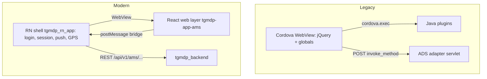

# Cordova+jQuery vs RN Shell + React Web Layer

> Ticket search in AMS2 (legacy) vs `tgmdp-app-ams` (modern). Up: [[Legacy to Modern MOC]] · [[System Overview]]

## The two architectures

| Concern | Legacy (`ams2-app-legacy/AMS2/.../www`) | Modern (`tgmdp-app-ams/src`) |
|---|---|---|
| Shell | Cordova Android only | Expo React Native, iOS + Android (`TGMDP_RN_AND_NWIS2.md`) |
| UI | HTML fragments loaded into `#contentPage` | React components, `react-router` `<Routes>` (`App.tsx:181`) |
| State | Globals `_WHERE_PARAM1`, `_USER_BEAN`, `pagesHistory` (`js/GlobeValue.js`, `js/AMS2.js:2`) | Zustand stores + URL search params (`hooks/ticketShare/useTicketList.ts`) |
| Back button | Pop `pagesHistory`, reload fragment (`AMS2.js:585`) | Router history |
| HTTP | `AdapterObject.invokeProcedure`, jQuery `$.ajax`, 3 creds in the body | `bridgeClient.get(...)` over `postMessage` (`services/api/bridge.ts`), shell adds auth |
| Endpoint | `AMS_GetTicketList_getTicketList` | `GET /api/v1/ams/ticket/list` (`TicketController.java:24`) |
| Timeout | 60 s default (`AdapterUtility.js:35`) | `LEGACY_ADAPTER_TIMEOUT_MS = 60000` kept on purpose (`services/api/ams.ts:11`) |
| Native calls | `cordova.exec('GetLocation', ...)` | Bridge messages to the shell |
| Login | None; AIDL to the TGMDP launcher | Shell owns login and session |
| Updates | cordova-hot-code-push from the legacy TGMDP server | Shell downloads web bundles |
| Tests | None | Vitest + Testing Library, coverage gate |

## Why it changed

- **Two platforms, one shell.** Cordova + AIDL was Android-only and tied to a launcher app. The RN shell gives iOS/Android, biometrics and Firebase push from maintained libraries ([[Hybrid Mobile Apps]], [[WebView and Native Bridge]]).
- **Maintainability.** jQuery 1.9 and `innerHTML` strings with unescaped server data (`TicketList.js:190-201`) became typed components and typed API clients ([[Component-Based UI]], [[Type Systems]]).
- **Predictable state.** Globals could be written by any page; stores have owners and tests ([[Client State Management]]).
- **A real API contract.** RPC-over-200 with string errors became REST with status codes and DTOs ([[HTTP and REST]]).
- **Deploy flexibility.** The web layer ships independently of the shell.

## What was lost or got harder

- **Fewer moving parts.** The legacy app was one APK and one folder. Now there is shell + web layer + bridge protocol; two repos must agree on message formats.
- **Offline simplicity and speed.** `www` shipped inside the APK; the web layer loads through a WebView host with handshake (`WEB_READY`/`BOOTSTRAP`).
- **Free native access.** `cordova.exec` reached any Java plugin directly; now each capability needs a bridge message and shell handler.
- **Hidden behaviour.** The N/M zone rule, `查無資料` messages, timeouts and 1-based paging lived in JS and adapters and must be rediscovered (see [[Strangler Fig Migration and Legacy Parity]]).

## Questions

1. In the legacy code, which global carries the ticket search to `TicketList.js`? What replaces it in the React hook?
2. Why keep a 60 s timeout constant that cites `AdapterUtility.js:35`?

## Related

- Up: [[Legacy to Modern MOC]] · [[System Overview]]
- [[Legacy Cordova App Anatomy]] · [[ams2-app-legacy]] · [[niws2-app-legacy]] · [[Legacy ADS Adapter Backends]]
- [[Hybrid Mobile Apps]] · [[WebView and Native Bridge]] · [[Client State Management]] · [[Single Page Applications]] · [[Adapter]] · [[Gateway]]
