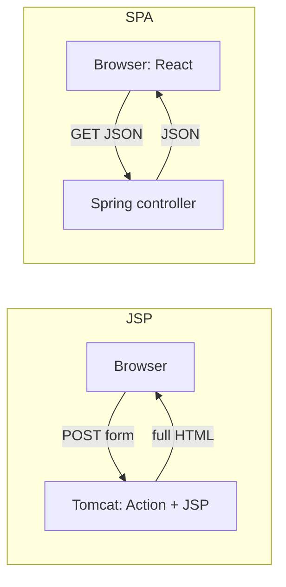

# Server-rendered JSP vs React SPA

> Same screen, TGMDPa002 device query: JSP page vs React page. Up: [[Legacy to Modern MOC]] · [[System Overview]]

## Side by side

| Concern | Legacy JSP (`legacy/TGMDP/TGMDP/TGMDPa002/TGMDPa002Q1.jsp`) | React (`tgmdp_web_frontend/src/features/mobile-device-management/device-inquiry-operation/`) |
|---|---|---|
| Who renders HTML | Tomcat, per request, inside `Template01.jsp` | Browser, from JSON |
| Data hand-off | `request.setAttribute("view_data", rows)`, read with scriptlets (`Q1.jsp:15, 327`) | `api/deviceInquiryOperationApi.ts` calls `GET /mobile-devices` |
| Form | One `<form id="form1">`, `submitForm('browse')` posts the whole page (`js/submitForm.js:24-32`) | `react-hook-form` + zod schema (`schema/deviceInquiryQuerySchema.ts`) |
| Validation | Hand-written jQuery in `goBrowse()` (`Q1.jsp:41-121`), server rechecks via `form.checkForm()` | Declarative zod rules, same messages kept for parity |
| State | Server session + hidden fields (`whereParam`, `numParam`) | Zustand store (`store/useDeviceInquiryOperationStore.ts`) |
| Routing | `.action` URL + XWork XML | `routes.tsx` with `withTaskGuard(["TGMDPa002"], ...)` |
| Escaping | Manual `StringUtility.escapeHtml` on each cell | JSX escapes by default |
| Page size | 489-line JSP | 856-line page component plus store, schema, api, types, tests |

## Why it moved

- **Interaction.** A full reload on every search loses scroll, focus and form state. An SPA updates only the table ([[Single Page Applications]]).
- **Reuse.** The JSON API serves the console, tests and other clients; the JSP result served one browser.
- **Safety by default.** Forget one `escapeHtml` in a JSP and you have XSS. React makes the safe path the default.
- **Testability.** Page logic, schema and store each have Vitest tests (`__tests__/`). The JSP had none ([[Testing Pyramid]]).
- **Team scale.** Typed components ([[Component-Based UI]], [[Type Systems]]) beat scriptlets mixed with HTML.

## What was lost

- **Simplicity.** JSP needed no build step, no bundler, no client state library. The SPA needs all three.
- **Server-side authority.** Legacy checked permission in one place per request. The SPA hides buttons (`PermissionButton`), so the backend must enforce too (it does, via `@PreAuthorize`).
- **First-load cost and SEO** (irrelevant here: internal console).
- **Free session state.** Paging and filters used to ride in hidden fields; now the client must hold and replay them.
- **Parity risk.** JSP quirks (NULL printed as empty, date format `yyyy/MM/dd HH:mm:ss` from `DBDAO.makeTO`) must be reproduced on purpose.

## Questions

1. Where did the dropdown data of `begin` (`COMPANY_DATA`, `Node2Al`) go in the React version? (see `/mobile-devices/init`)
2. Which layer now owns the date-range validation, and is it also enforced on the server?

## Related

- Up: [[Legacy to Modern MOC]] · [[System Overview]]
- [[WebWork Request Flow]] · [[WebWork Actions vs Spring Controllers]] · [[Legacy TGMDP Monolith]]
- [[Server-Side Rendering]] · [[Single Page Applications]] · [[Component-Based UI]] · [[Client State Management]] · [[Validation]] · [[Routing]] · [[Store Pattern]]
