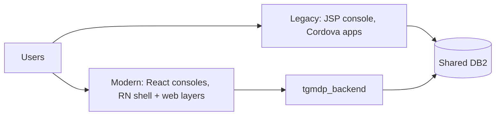

# Strangler Fig Migration and Legacy Parity

> How the team replaces a running system module by module, and proves each rebuild matches. Up: [[Legacy to Modern MOC]] · [[System Overview]]

## The pattern

The [[Strangler Fig]] migration replaces a legacy system gradually: new code grows around the old, takes over one slice at a time, and the old code is retired when nothing is left. The alternative, a big-bang rewrite, fails because nobody can stop feature work for two years and the rewrite never matches the old system's hidden rules.

Here the slices are **modules** keyed by task code (`TGMDPa002`, `c001`). The seam is the **shared DB2 database**: `project-description.md` §9.3 says the same instance is used by the legacy app, new modules and the web portal. Old and new run side by side; users move module by module.

## The rule: legacy is the spec

`FACTORY.md` ground-truth rule: "the legacy app is the spec. Agents transpile business logic; they never invent it. Every extracted rule cites a legacy `file:line`." Station 1 (archaeology) turns legacy code into a spec; later stations build, test and audit.

## The parity-review process

Skills in `.claude/skills/parity-review` produce a static old-vs-new report per module (Traditional Chinese, plus an `.en.md` twin):

- `acpt_parity_review/` (project-acceptance console, e.g. `TGMDPs009`), `vendor_parity_review/` (vendor portal, `TGMDPVEN*`), and an AMS family for `ams2-app-legacy`.
- Each report lists every logical or visual difference with legacy `file:line` vs new `file:line`, severity, trigger scenario and suggested fix, then SIT test cases. Reports are refreshed with `/parity-recheck` against the latest dev branch while legacy stays pinned to one commit.
- Differences the business must accept go to `*_accepted-deviations.md`. Example, `TGMDPs009`: legacy had no server-side permission check (JSP-only gate); the rebuild checks on the server. Types used: deliberate hardening, design decision, legacy bug.
- `/parity-scan` writes gaps as TODO issues; `/parity-verify` re-diffs the fix and greps for blast radius so no other module shifts.

## What parity has to cover (from the notes in this vault)

- Output formatting: NULL as `""`, `yyyy/MM/dd HH:mm:ss` ([[Legacy Data Access with DBDAO]]).
- Paging base: 1-based legacy vs 0-based `Pageable`; `LegacyQueryParamFilter` bridges old parameter names.
- Permission strings: `TGMDPa002_browse` became `TASK_TGMDPa002:browse` ([[FrontControllerFilter and ButtonBean Permissions]]). `SysAuthRules.java` is a line-by-line port of `ButtonBean.checkSysAuth`.
- DB-side logic: stored procedures and DB2 functions both systems call.
- Legacy bugs: copy them, fix them, or ask the business (accepted-deviations sheet).

## Gains and costs

- **Gain:** continuous delivery of value, small rollback units, real users validate each slice.
- **Gain:** parity reports become the missing documentation and test plan the legacy never had.
- **Cost:** two systems to run and keep consistent; shared tables mean new writes must look like old writes (the DoD cards ask "which system owns this table?" and how to tell legacy usage from new).
- **Cost:** a module can pass static review and still differ at runtime; hence SIT cases and live-DB verification.

## Questions

1. Why is a shared database both the strangler's seam and its biggest risk?
2. Pick a row in any `*_accepted-deviations.md`. Is it hardening, a design decision or a legacy bug?

## Related

- Up: [[Legacy to Modern MOC]] · [[System Overview]]
- [[Legacy Systems]] · [[Legacy TGMDP Monolith]] · [[ams2-app-legacy]] · [[niws2-app-legacy]]
- [[Strangler Fig]] · [[Anti-Corruption Layer]] · [[Code Review]] · [[Feature Flags and Mock Toggles]] · [[Test Coverage Gates]] · [[Monorepo vs Polyrepo]]
