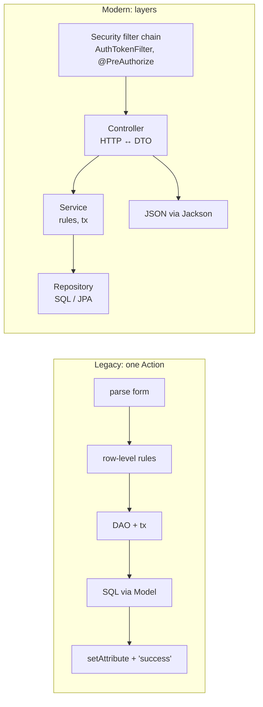

# WebWork Actions vs Spring Controllers

> The same screen, `TGMDPa002` 裝置查詢作業 (device query), served by a 2009 WebWork Action and by a modern Spring Boot REST controller. Up: [[Legacy to Modern MOC]] · [[System Overview]]

Both are controllers in the [[MVC]] sense. Both sit behind a [[Front Controller]]
(`ServletDispatcher` vs Spring's `DispatcherServlet`), both are wrapped in a filter/interceptor
chain, and both map a URL to a Java method. The differences are in **what the method returns**,
**how it gets its inputs and collaborators**, and **who owns transactions, errors and security**.
Each of those differences is a lesson in why frameworks evolved.

## Side by side

| Concern | Legacy `TGMDPa002` (WebWork 2.2) | Modern `TgmdpwebMobileDeviceManagementController` (Spring Boot) |
|---|---|---|
| Routing | XML: `<package namespace="/TGMDPa002"><action name="browse" method="browse">` in `legacy/TGMDP/src/WW_XML/TGMDPa.xml:19-27` | Annotations: `@RequestMapping("/api/v1/tgmdpweb/mobile-devices")` + `@GetMapping("")` |
| URL shape | `/TGMDP/TGMDPa002/browse.action` (verb in the URL, always POST from a form) | `GET /api/v1/tgmdpweb/mobile-devices?nodeId1=...&page=0&size=10` (resource + HTTP verb) |
| Output | A result **name** (`"success"`) that XML maps to a JSP; data goes into `request.setAttribute` | `ResponseEntity<ApiResponse<Dto>>` serialized to JSON |
| Input binding | `ModelDriven` + `params` interceptor fill a mutable `TGMDPa002Form` | `@ParameterObject DeviceManagementSearchCriteria` bound by Spring MVC |
| Current user | `(UserID) session.getAttribute("UserBean")` | `@AuthenticationPrincipal CustomUserDetails currentUser` |
| Collaborators | `new DeviceModel()`, `new DBDAO()` inside the method | Service injected through the constructor ([[Dependency Injection]]) |
| Lifecycle | New Action instance per request | One singleton controller, must be stateless |
| Permission | `FrontControllerFilter` parses the URL and checks `ButtonBean` | `@PreAuthorize("hasAuthority('TASK_TGMDPa002:browse')")` on the method |
| Transactions | `dao.open()` / `commit()` / `rollback()` / `close()` written in every method | Declarative, in the service/repository layer |
| Errors | `catch` → `ExceptionResolver.handle` → `"error"` → `common/Result.jsp` | Exceptions bubble to `@RestControllerAdvice` (`config/GlobalExceptionHandler.java:38`) |
| Size | One class with 10 entry points, 1,158 lines | Controller 90 lines; logic in service and repository classes |

## The legacy method

```java
// legacy/TGMDP/src/com/prj/actions/tgmdpa/TGMDPa002.java:130-196 (trimmed)
public String browse(){
    String forward = "success";
    HttpServletRequest request = ServletActionContext.getRequest();
    UserID userID = (UserID) request.getSession().getAttribute("UserBean");
    DBDAO dao = (DBDAO) daoFactory.creatDAO("DBDAO");
    try{
        form.checkForm();
        dao.open();
        DeviceModel devicemodel = new DeviceModel();
        devicemodel.setDao(dao);
        Map<String, String> hm = new LinkedHashMap();
        hm.put("NODE_ID1", form.getNODE_ID1());
        if(userID.getUserLVL().equals("2")) hm.put("NODE_ID2", "1_" + userID.getNODE_ID2());
        ...
        PageBreak pb = new PageBreak();
        pb.setDao(dao); pb.setRequest(request);
        pb.setModel(devicemodel, "browseMAC");
        pb.doPageBreak(hm);
        if(pb.isDoSearch()) request.setAttribute("view_data", devicemodel.getResultData());
    } catch(Exception e){
        forward = "error"; dao.rollback();
        ExceptionResolver.handle(this.getClass(), e, request, dao);
    } finally { dao.close(); }
    return forward;
}
```

One method does request parsing, row-level security, data access wiring, transaction handling,
error handling and view hand-off. That is five responsibilities. See [[SOLID]], the S.

## The modern method

```java
// tgmdp_backend/src/main/java/com/taiwanmobile/boilerplate/controller/tgmdpweb/TgmdpwebMobileDeviceManagementController.java:28-57
@RestController
@RequestMapping("/api/v1/tgmdpweb/mobile-devices")
class TgmdpwebMobileDeviceManagementController {
    private final TgmdpwebMobileDeviceManagementService tgmdpwebMobileDeviceManagementService;

    TgmdpwebMobileDeviceManagementController(TgmdpwebMobileDeviceManagementService s) {
        this.tgmdpwebMobileDeviceManagementService = s;
    }

    @GetMapping("")
    @PreAuthorize("hasAuthority('TASK_TGMDPa002:browse')")
    @SecurityRequirement(name = "cookieAuth")
    public ResponseEntity<ApiResponse<MobileDeviceManagementSearchResponseDto>>
    search(@AuthenticationPrincipal CustomUserDetails currentUser,
           @ParameterObject DeviceManagementSearchCriteria criteria) {
        Pageable pageable = PageRequest.of(criteria.getPage(), criteria.getSize());
        var res = tgmdpwebMobileDeviceManagementService.search(criteria, pageable, currentUser.getUserId());
        return ResponseEntity.ok(new ApiResponse<>(HttpStatus.OK, "Device search completed successfully", res));
    }
```

The controller only translates HTTP into a service call and back. Everything else has moved:



That is [[Layered Architecture]] with a [[Service Layer]] and [[Repository Pattern]], wired by
[[Dependency Injection]] (Spring's [[Inversion of Control]] container creates the controller and
hands it the service).

## Why the change was worth it

1. **One API, many clients.** A JSP result can only be shown in a browser. A JSON endpoint can be
   used by the React console, a test, a script or another service. The legacy system needed a
   separate set of mobile backends ([[Legacy ADS Adapter Backends]]) for exactly this reason.
2. **Testability.** The legacy method can only run inside Tomcat with a live DB2 and a session. The
   modern controller can be unit-tested with a mocked service, and the service with a mocked
   repository ([[Unit Testing]], [[Mocking]]). The backend enforces coverage gates; the legacy
   code has no tests.
3. **Security you can read at the method.** `@PreAuthorize` sits on the method it protects. In
   legacy, security depends on a filter parsing the URL correctly, and (as parity reviews found)
   some actions had **no server-side check** at all, only a hidden button.
4. **No hand-written transaction plumbing.** Forgetting `dao.commit()` in legacy silently loses
   writes. Declarative transactions remove that class of bug ([[Database Transactions]]).
5. **Stateless servers.** No HTTP session means any instance can serve any request
   ([[Stateless vs Stateful]]).

## What was lost or got harder

- **Locality.** In legacy you can read one file and see the whole feature, top to bottom. In the
  modern code a feature is spread over a controller, a service, a DTO, a criteria class, a
  repository interface, a custom repository implementation and a row mapper. Good structure has a
  navigation cost.
- **Server-side chaining.** `type="chain"` let `browse` reuse `begin` to fill drop-downs within
  one request. In the modern version the browser makes two calls (`/init` and the search) and the
  client coordinates them.
- **Implicit behaviour has to be rediscovered.** `makeTO` turned NULL into `""` and formatted
  timestamps. JSPs printed values in a fixed way. None of that was written down, so the rebuild
  re-derives it module by module ([[Strangler Fig Migration and Legacy Parity]]).
- **Paging semantics.** Legacy `PageBreak` is 1-based (`PAGE_NUMBER=1`). Spring `Pageable` is
  0-based. The backend's `LegacyQueryParamFilter` exists partly to convert this for the mobile app
  (`tgmdp_backend/src/main/java/com/taiwanmobile/boilerplate/filter/LegacyQueryParamFilter.java:52-53`).

## What was deliberately kept

- **The task code.** The URL changed, but the permission key did not: `TASK_TGMDPa002:browse`
  is `ButtonBean`'s `TGMDPa002_browse` in a new format. The same `begin`, `browse`, `export` button
  names became the authority suffixes. See [[Session ButtonBean vs JWT Authorities]].
- **The export file name.** `匯出_裝置查詢作業` appears in both
  (`TGMDPa002.java:206` and the controller's `exportExcel`).
- **Hand-written SQL for search screens.** The modern repository uses `NamedParameterJdbcTemplate`
  with a dynamic WHERE builder, very much like `DeviceModel` (see
  [[DBDAO vs Spring Data Repositories]]).

## Try it yourself

1. Find the modern endpoint that replaces `TGMDPa002`'s `begin` action. What does it return that
   `begin` used to put in request attributes (`COMPANY_DATA`, `Node2Al`, `SYS_LIST`)?
2. Legacy `browse` forces `NODE_ID2` for level-2 users. Find where the modern service applies
   that rule. If you cannot find it, that is a parity question to raise.
3. Write the unit test you could not write for the legacy method: mock the service and assert
   the controller returns 200 with the service's result.

## Related

- Up: [[Legacy to Modern MOC]] · [[System Overview]]
- Legacy side: [[WebWork Request Flow]] · [[Legacy TGMDP Monolith]] · [[FrontControllerFilter and ButtonBean Permissions]]
- Sibling comparisons: [[Server-rendered JSP vs React SPA]] · [[DBDAO vs Spring Data Repositories]] · [[Session ButtonBean vs JWT Authorities]]
- Concepts: [[MVC]] · [[Front Controller]] · [[Layered Architecture]] · [[Service Layer]] · [[Repository Pattern]] · [[Dependency Injection]] · [[Inversion of Control]] · [[HTTP and REST]] · [[Serialization and DTOs]] · [[DTO Pattern]] · [[Error Handling]] · [[Database Transactions]] · [[Stateless vs Stateful]] · [[Interceptor and Filter Chain]] · [[SOLID]] · [[Separation of Concerns]] · [[Unit Testing]] · [[Mocking]] · [[API Versioning]]
